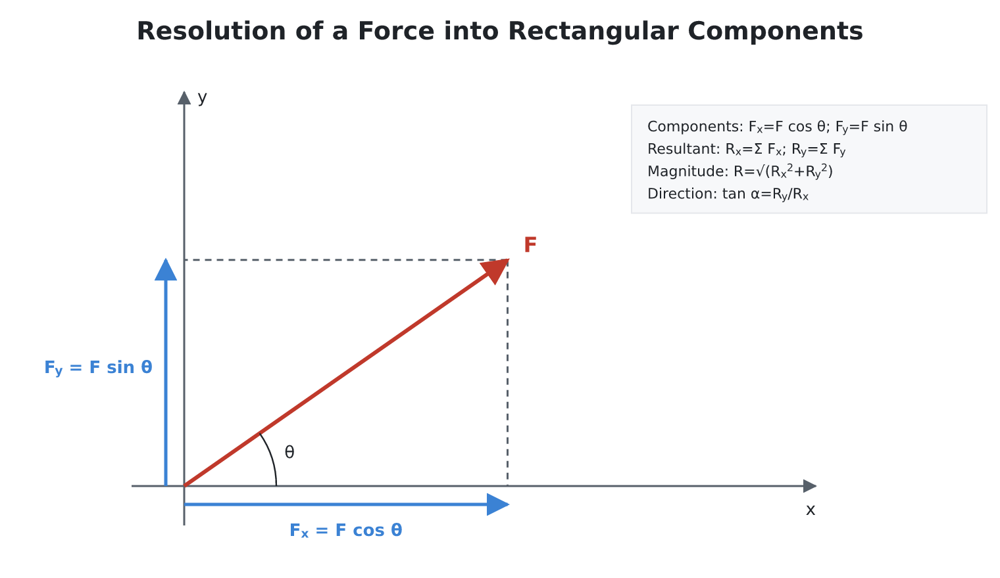
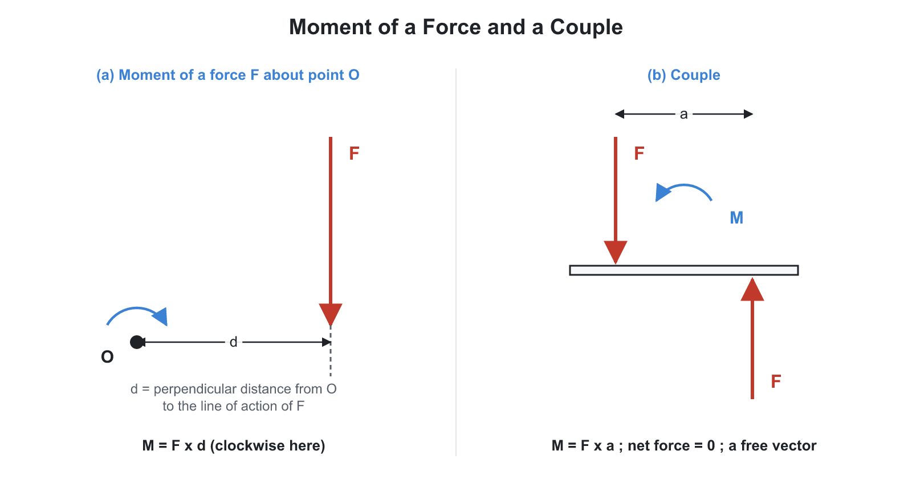
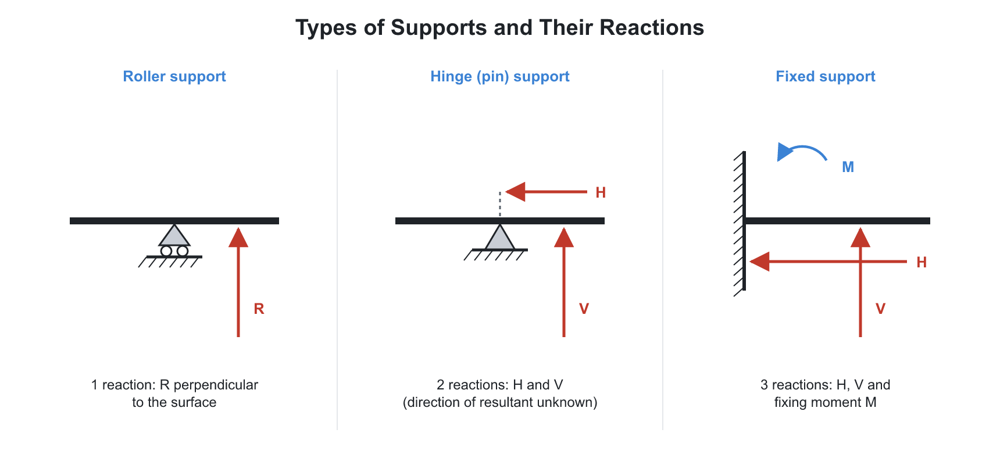
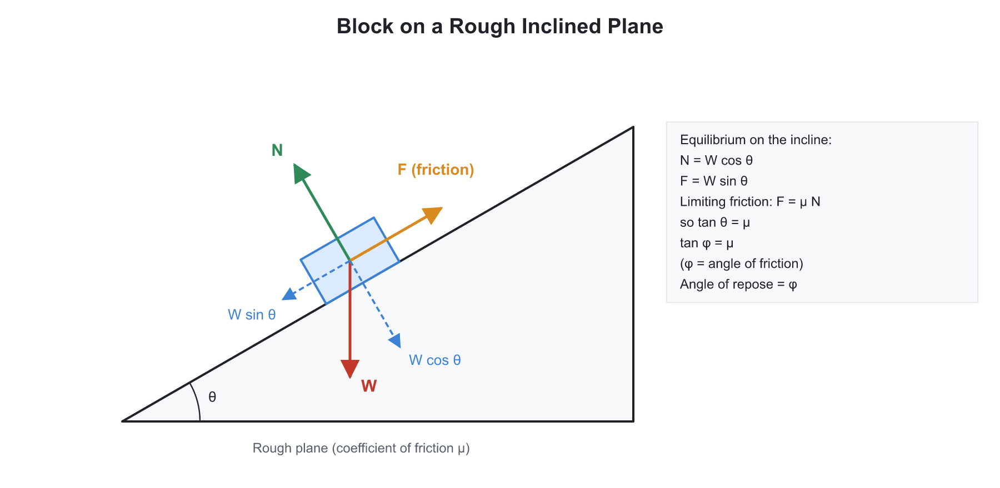
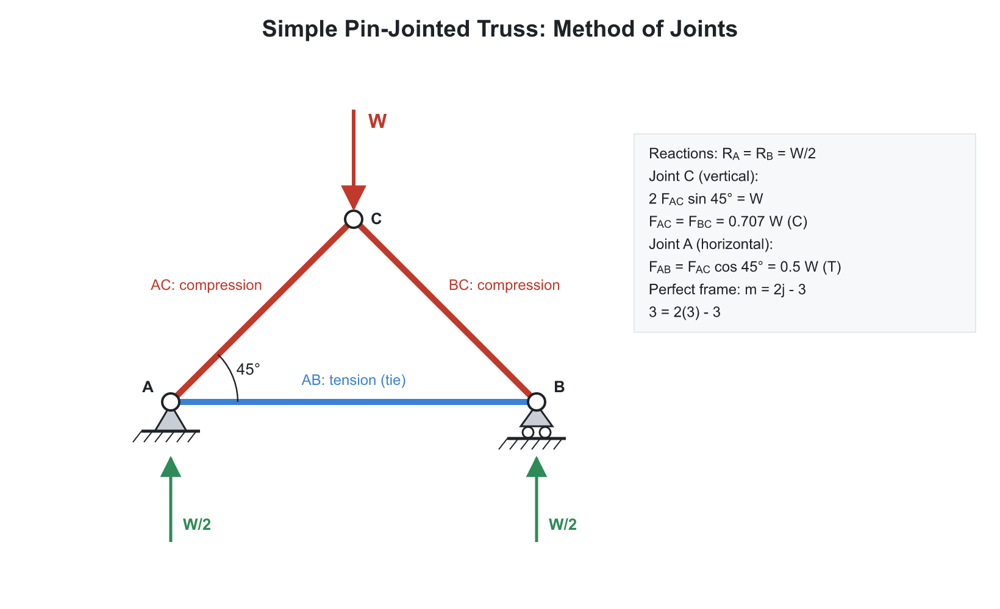

# ⚖️ 01. Statics, Friction and Trusses

**Exam relevance:** APPSC AEE: C | SSC JE: C | RRB JE: C | Category: ALL | Yield: HY

---

## 📘 Part A: Detailed Theory (read this first)

This part rebuilds the subject from zero. Part B (from section 1 onwards) is the compact reference with formulas, numericals and PYQs. If a Part B line looks cryptic, find the idea here.

### 🔹 A1. What mechanics is and why it comes first

**Mechanics** is the science of forces and the motion (or rest) they cause. Every other mechanical subject, such as strength of materials, machine design and fluid mechanics, is built on it.

- **Statics:** bodies at rest, or moving with constant velocity. The sum of forces and moments is zero.
- **Dynamics:** bodies with acceleration. Split into **kinematics** (motion without asking why) and **kinetics** (motion with its causes: force, mass).
- **Rigid body idealisation:** we assume the body never deforms, so the distance between any two points stays fixed. This is false in reality, but deformations are tiny compared with the body size, so statics works. When deformation matters (stress, deflection), we switch to strength of materials.
- **Particle idealisation:** the body is so small, or the question so simple, that all forces act through one point. No rotation question arises.

**Units.** Base SI units: metre, kilogram, second. Force unit newton: $1\ \text{N} = 1\ \text{kg}\cdot\text{m/s}^2$. Weight is a force: $W = mg$, with $g = 9.81\ \text{m/s}^2$. Mass does not change with location; weight does.

### 🔹 A2. Force and vectors

A **force** is a push or pull. It is a **vector**: it has magnitude, direction and a point (line) of application. A scalar (mass, time, energy) has only magnitude.

- **Principle of transmissibility:** for a rigid body, a force can slide along its line of action without changing the external effect. Pushing a box from behind or pulling from the front along the same line has the same effect on the box's motion. It does not hold for internal effects (a bar pushed is compressed, a bar pulled is stretched).
- **Resolution:** any force $F$ at angle $\theta$ from the $x$-axis splits into $F_x = F\cos\theta$ and $F_y = F\sin\theta$. This is the most used step in all of mechanics.
- **Resultant of concurrent forces:** add components. $R_x = \sum F_x$, $R_y = \sum F_y$,

$$R = \sqrt{R_x^2 + R_y^2}, \qquad \tan\alpha = \frac{R_y}{R_x}$$

- **Parallelogram law:** the resultant of two forces $P$ and $Q$ with included angle $\theta$ is

$$R = \sqrt{P^2 + Q^2 + 2PQ\cos\theta}$$

This comes directly from adding components. Note that $\theta$ is the angle between the two forces when both point away from the same point. When $\theta = 0$, $R = P + Q$ (maximum). When $\theta = 180^\circ$, $R = |P - Q|$ (minimum).

- **Triangle law and polygon law:** draw the forces head to tail; the closing side is the resultant. If the polygon closes, the resultant is zero and the forces are in equilibrium.

### 🔹 A3. Moment and couple

- **Moment of a force** about a point $O$ measures its turning effect: $M_O = F \times d$, where $d$ is the perpendicular distance from $O$ to the line of action. Unit N-m. Counter-clockwise is usually positive.
- **Varignon's theorem:** the moment of a force about a point equals the sum of the moments of its components about that point. This is why we can take moments of $F_x$ and $F_y$ separately and avoid finding $d$.
- **Couple:** two equal, opposite, parallel forces with different lines of action. Net force is zero, but there is a pure turning effect $M = F \times d$ ($d$ = distance between the forces). A couple's moment is the same about every point, so it is a **free vector**. A couple can be moved anywhere in its plane, and rotated, without changing its effect.
- **Force-couple system:** a force $F$ acting at $A$ can be moved to another point $B$ if we add a couple $M = F \times d$ ($d$ = perpendicular distance between the two lines). This is the key to reducing any force system to one resultant force plus one couple.

**Reduction of a coplanar force system.** Pick a point, sum all forces to get $R$, sum all moments about that point to get $M_O$. Then:

- $R = 0$, $M_O = 0$: **equilibrium**.
- $R = 0$, $M_O \neq 0$: a **pure couple**.
- $R \neq 0$: single resultant force; its line of action is shifted by $d = M_O/R$ from the point.

**Parallel forces.** For like parallel forces, the resultant equals their sum and acts between them, closer to the larger force. For unlike parallel forces, the resultant equals the difference, acts outside and on the side of the larger force.

### 🔹 A4. Equilibrium: the central idea

A body is in equilibrium when it has no tendency to translate or rotate.

- **Coplanar general system:** $\sum F_x = 0$, $\sum F_y = 0$, $\sum M = 0$. That gives three equations, so three unknowns can be solved.
- **Concurrent system:** all lines pass through one point, so moments are automatically zero; only $\sum F_x = 0$ and $\sum F_y = 0$. Two unknowns.
- **Three forces in equilibrium** must be concurrent or parallel. **Lami's theorem:** for three concurrent coplanar forces in equilibrium,

$$\frac{F_1}{\sin\alpha} = \frac{F_2}{\sin\beta} = \frac{F_3}{\sin\gamma}$$

where each angle $\alpha$, $\beta$, $\gamma$ lies **opposite** to its force (the angle between the other two forces).

**Recipe for every statics problem.**

1. Choose the body or joint (the system).
2. Draw the **free body diagram (FBD)**: remove all supports and replace them with their reaction forces. Show every external force (weights, loads, reactions).
3. Choose axes and write the equilibrium equations.
4. Solve. If an answer is negative, the force acts opposite to the assumed direction.

### 🔹 A5. Supports and reactions

A support stops motion in some directions, so it supplies a reaction in those directions.

| Support | Stops | Reaction |
|---|---|---|
| Roller or rocker | Motion normal to the surface | 1 force, perpendicular to the surface |
| Smooth surface or cable | Motion along the cable or normal | 1 force (cable pulls only) |
| Hinge or pin | Translation in any direction | 2 force components (or one force of unknown direction) |
| Fixed (built-in) | Translation and rotation | 2 force components plus 1 moment |

**Determinacy.** If the unknown reactions equal the available equations (3 for a plane body), the structure is **statically determinate**. More unknowns than equations means **indeterminate**; deformation (compatibility) equations are then needed (strength of materials).

**Types of loads.** Point load (concentrated), UDL (uniformly distributed, replace by $w \times L$ at the centre), UVL (uniformly varying, replace by the area of the triangle at one-third from the larger end), couple load.

### 🔹 A6. Friction, step by step

**Friction** is the resistance a surface offers to relative sliding of another. It acts parallel to the contact surface, opposite to the (tendency of) motion. It arises from microscopic surface roughness and adhesion.

- **Static friction** acts when there is no motion. It adjusts itself to match the applied force, up to a limit.
- **Limiting friction:** the maximum static friction, just when motion is about to start (impending motion).
- **Kinetic (dynamic) friction:** friction during sliding; slightly less than limiting friction.

**Laws of dry friction (Coulomb):**

1. Friction force is proportional to the normal reaction $N$: $F_{max} = \mu N$.
2. It is independent of the area of contact (for practical purposes).
3. It is independent of sliding speed at low speeds.
4. $\mu_{static} > \mu_{kinetic}$.

**Angle of friction $\phi$:** the angle between the normal reaction and the resultant of $N$ and $F$, at limiting condition.

$$\tan\phi = \frac{F}{N} = \mu$$

**Angle of repose $\alpha$:** the maximum slope angle of an inclined plane at which a block just stays at rest without any external force. At that point $\alpha = \phi$. The **cone of friction** is the cone of semi-angle $\phi$ about the normal: the resultant reaction must lie inside it for the body to stay at rest.

**Block on an inclined plane** (angle $\alpha$, weight $W$). Resolve along and perpendicular to the plane: normal $N = W\cos\alpha$, down-slope pull $W\sin\alpha$. Friction available $\mu W\cos\alpha$. The block slides when $W\sin\alpha > \mu W\cos\alpha$, that is $\tan\alpha > \mu$.

- Force $P$ parallel to the plane to push up: $P = W(\sin\alpha + \mu\cos\alpha)$.
- Force to just prevent sliding down: $P = W(\sin\alpha - \mu\cos\alpha)$.
- With an applied force at an angle, always recompute $N$, because $N$ changes: $N = W\cos\alpha \pm P\sin\theta$.
- Minimum force to drag a block on a horizontal surface: apply $P$ at angle $\phi$ above the horizontal; $P_{min} = W\sin\phi$. (This is why pulling is easier than pushing.)

**Ladder problems.** The ladder leans on a wall and rests on the floor. Floor friction stops the foot sliding out. Method: balance forces horizontally and vertically, then take moments about the foot.

Worked case: uniform ladder of weight $W$, length $L$, angle $\theta$ with the floor, smooth wall, floor friction $\mu$. Vertical: $N = W$. Horizontal: wall reaction $R_w = \mu N = \mu W$. Moments about the foot:

$$R_w\,L\sin\theta = W\,\frac{L}{2}\cos\theta \;\Rightarrow\; \tan\theta = \frac{1}{2\mu}$$

This is the smallest angle (with the floor) at which the ladder stays at rest. Rough wall: add wall friction $\mu_w R_w$ in the vertical balance and repeat the same three steps.

**Wedge.** Used to lift loads with a small force. Friction acts on both faces, and the wedge is self-locking if its angle is less than twice the friction angle ($\alpha < 2\phi$).

**Screw friction (preview).** A square thread unrolls to an inclined plane of angle equal to the lead angle. Raising a load is like pushing a block up an incline: $P = W\tan(\alpha + \phi)$. Efficiency $\eta = \dfrac{\tan\alpha}{\tan(\alpha + \phi)}$. A screw is **self-locking** when $\alpha < \phi$, and then efficiency is below 50 percent. Details are in the Machine Design and TOM chapters.

### 🔹 A7. Trusses

A **truss** is a rigid framework of straight members joined at their ends by pins (assumed frictionless). Used in bridges, roofs, towers.

**Assumptions:**

1. Members are joined by frictionless pins.
2. Loads act only at the joints.
3. Member weights are negligible (or placed at joints).

Under these assumptions each member is a **two-force member**: it carries only axial force, either **tension** (pulling away from the joint) or **compression** (pushing into the joint).

**Perfect truss:** just enough members to be rigid with no redundancy. The condition for a plane truss with $m$ members and $j$ joints:

$$m = 2j - 3$$

Why: each joint gives 2 equations ($\sum F_x = 0$, $\sum F_y = 0$), so $2j$ equations in total. Three unknowns are support reactions, so members $= 2j - 3$. Fewer members: **deficient** (a mechanism, unstable). More: **redundant** (indeterminate).

**Method of joints.** Consider one joint at a time; start from a joint with at most two unknown members (often after finding support reactions). Apply $\sum F_x = 0$ and $\sum F_y = 0$. Good when all member forces are needed.

**Method of sections.** Cut the truss through at most three members (non-concurrent), draw the FBD of one part, and use $\sum M = 0$ about the point where two cut members meet. Good when only a few member forces are needed.

**Zero-force members:**

1. At a joint of two non-collinear members with no external load, both are zero-force.
2. At a joint of three members, two collinear, with no external load, the third (non-collinear) member is zero-force.

Zero-force members are not useless; they give stability and carry load if the loading changes.

**Quick sign rule.** A member force pointing away from the joint on the FBD is tension; pointing toward the joint is compression.

### 🔹 A8. Principle of virtual work (concept)

If a system in equilibrium is given a small imaginary (virtual) displacement consistent with its constraints, the total virtual work of the active forces is zero. It is a shortcut for problems with ladders, linkages and jacks: ignore reactions at smooth supports and find the unknown force directly from geometry.

### 🔹 A9. What examiners test from this chapter

- Resultant and equilibrium of coplanar forces, Lami's theorem (SSC JE and RRB JE love one-step formulas).
- Friction on inclined planes, angle of repose, ladder and wedge (very common).
- Truss condition $m = 2j - 3$, zero-force members, method of sections (APPSC AEE).
- Support reactions and types of supports (all exams).

---

## ⚡ Part B: Quick-reference notes, formulas, numericals and PYQs

## 🧭 1. Foundations

- **Mechanics** deals with the effect of forces on bodies. Branches: statics (bodies at rest) and dynamics (kinematics plus kinetics).
- **Rigid body** assumption: the distance between any two points never changes.
- **Particle:** mass concentrated at a point. **Force:** a vector with magnitude, direction and point of application (line of action).
- **Principle of transmissibility:** a force can slide along its line of action without changing its external effect on a rigid body.
- **Newton's laws:** (1) inertia, (2) $F = ma$, (3) action and reaction.
- **Parallelogram law:** for two forces $P$ and $Q$ at angle $\theta$:

$$R = \sqrt{P^2 + Q^2 + 2PQ\cos\theta}, \qquad \tan\alpha = \frac{Q\sin\theta}{P + Q\cos\theta}$$

- **Triangle and polygon laws:** the closing side of the vector polygon gives the resultant.
- **Lami's theorem:** for three concurrent forces in equilibrium (each angle is opposite its force):

$$\frac{P}{\sin\alpha} = \frac{Q}{\sin\beta} = \frac{R}{\sin\gamma}$$

## 🧭 2. Force systems

| System | Equilibrium conditions |
|---|---|
| Concurrent coplanar | $\Sigma F_x = 0,\ \Sigma F_y = 0$ |
| Non-concurrent coplanar | $\Sigma F_x = 0,\ \Sigma F_y = 0,\ \Sigma M = 0$ |
| Parallel coplanar | $\Sigma F = 0,\ \Sigma M = 0$ |
| Space (3D) | Six equations: $\Sigma F = 0$ (3) and $\Sigma M = 0$ (3) |

- **Moment:** $M = F \times d$ ($d$ is the perpendicular distance). **Couple:** two equal, opposite, non-collinear forces; moment $= F \times d$, the same about any point; a couple cannot be balanced by a single force.
- **Varignon's theorem:** the moment of a resultant about a point equals the algebraic sum of the moments of its components.
- A force can be shifted parallel to itself only if a couple of moment $F \times d$ is added.

## 🧭 3. Free body diagram and supports

| Support | Reactions (2D) |
|---|---|
| Roller / smooth surface | 1 (normal to the surface) |
| Hinge / pin | 2 (horizontal and vertical) |
| Fixed / built-in | 3 (horizontal, vertical, moment) |
| Link / cable | 1 along its axis |

- **Statically determinate:** unknowns $\le$ equilibrium equations. Determinate beams: simply supported, cantilever, overhanging. Indeterminate: propped cantilever, fixed, continuous.

## 🧭 4. Friction

- **Laws of dry (Coulomb) friction:** friction opposes motion; it is independent of contact area; it is proportional to the normal reaction; kinetic friction is less than limiting friction and independent of speed.
- Limiting friction $F = \mu N$. **Angle of friction** $\phi = \tan^{-1}\mu$, so $\mu = \tan\phi$. **Angle of repose** equals the angle of friction. **Cone of friction** has semi-angle $\phi$.

### 🔹 Inclined plane (weight $W$, inclination $\alpha$)

| Case | Force $P$ parallel to the plane |
|---|---|
| Up the plane, impending | $P = W\sin\alpha + \mu W\cos\alpha$ |
| Down the plane, impending | $P = W\sin\alpha - \mu W\cos\alpha$ |
| Force at angle $\theta$ to the plane (up) | $P = \dfrac{W\sin(\alpha+\phi)}{\cos(\theta-\phi)}$ |
| Minimum force (up) | $P_{min} = W\sin(\alpha+\phi)$ at $\theta = \phi$ |

- The body slides down by itself if $\alpha > \phi$. Self-locking: $\alpha \le \phi$.
- **Efficiency of an inclined plane / square-thread screw jack:**

$$\eta = \frac{\tan\alpha}{\tan(\alpha+\phi)}, \qquad \eta_{max} = \frac{1-\sin\phi}{1+\sin\phi} \ \text{ at } \ \alpha = 45^\circ - \frac{\phi}{2}$$

- A self-locking screw has $\phi \ge \alpha$, hence $\eta \le 50\%$.
- **Ladder** (uniform, weight $W$, smooth wall, floor friction $\mu_f$): the wall reaction equals the floor friction $\mu_f W$. Moments about the foot give, at limiting equilibrium:

$$\tan\theta = \frac{1}{2\mu_f}$$

  The ladder is safe if $\theta \ge \tan^{-1}\!\left(\dfrac{1}{2\mu_f}\right)$.
- **Wedge:** friction on two faces; self-locking if the wedge angle $\alpha \le 2\phi$.
- **Belt friction:**

$$\text{Flat belt: } \frac{T_1}{T_2} = e^{\mu\theta}, \qquad \text{V-belt: } \frac{T_1}{T_2} = e^{\mu\theta/\sin\beta}$$

  where $2\beta$ is the groove angle and $\theta$ is the angle of lap in radians.
- **Rolling resistance:** $F = \dfrac{\text{coefficient of rolling resistance} \times N}{r}$.

## 🧭 5. Trusses

- **Perfect truss:** $m = 2j - 3$ ($m$ members, $j$ joints). $m < 2j-3$ is deficient; $m > 2j-3$ is redundant.
- Assumptions: pin-jointed, loads only at joints, two-force members (axial loads only), self weight neglected.
- **Method of joints:** each joint is a concurrent system, 2 equations per joint. **Method of sections (Ritter):** cut at most 3 members and take moments.
- **Zero-force members:** (a) two non-collinear members at an unloaded joint; (b) three members at an unloaded joint where two are collinear, so the third is zero.
- Types: Pratt (diagonals in tension), Howe (diagonals in compression), Warren, Fink, K-truss.
- **Cables:** UDL gives a parabola; self weight gives a catenary.

## 🧭 6. Worked numericals

1. **Block on incline.** $W = 1000$ N, $\alpha = 30^\circ$, $\mu = 0.3$. Force up the plane:

$$P = 1000\,(0.5 + 0.3 \times 0.866) = 759.8\ \text{N}$$

2. **Truss check.** 7 members and 5 joints: $2j - 3 = 7$, so the truss is perfect.
3. **Belt.** $\theta = \pi$ rad and $\mu = 0.3$:

$$\frac{T_1}{T_2} = e^{0.3\pi} = e^{0.942} = 2.57$$

## 🧭 7. Common mistakes

- Swapping $\sin$ and $\cos$ on the inclined plane (resolve parallel and perpendicular components carefully).
- Treating the angle of repose and the angle of friction as different for a plain block (they are equal).
- Using the flat-belt ratio for a V-belt (divide the exponent by $\sin\beta$).

## 🧭 8. Interconnections

- Friction: brakes, clutches, belts (Theory of Machines), screw jack (Machine Design).
- Trusses and beams: Strength of Materials (SFD/BMD) and structures.
- Equilibrium: basis of the free body diagram in all of dynamics and vibrations.

## 🧭 9. PYQs

| # | Question | Answer | Exam / Year | Verify |
|---|---|---|---|---|
| 1 | The angle of repose equals | Angle of friction (limiting) | SSC JE 2017 | [ ] |
| 2 | A truss with $j$ joints needs how many members to be perfect | $2j - 3$ | RRB JE 2014/2015 (recurring) | [ ] |
| 3 | Lami's theorem applies to | Three concurrent coplanar forces in equilibrium | SSC JE 2018 | [ ] |
| 4 | A screw jack is self-locking when | Efficiency $\le 50\%$ ($\phi \ge \alpha$) | SSC JE 2018 | [ ] |
| 5 | Maximum efficiency of a screw jack | $\dfrac{1-\sin\phi}{1+\sin\phi}$ | RRB JE 2019 | [ ] |
| 6 | Resultant of two equal forces $P$ at $120^\circ$ | $P$ | SSC JE 2016 | [ ] |
| 7 | Coefficient of friction $\mu$ equals | $\tan\phi$ | APPSC AEE 2012 | [ ] |
| 8 | Belt tension ratio | $e^{\mu\theta}$ | RRB JE 2019 | [ ] |
| 9 | Does dry friction depend on contact area? | No | RRB JE 2015 | [ ] |
| 10 | Moment of a couple depends on | Force times perpendicular distance, independent of the moment centre | SSC JE 2020 | [ ] |

## 🧭 10. Revision checklist

- [ ] State Lami, Varignon, transmissibility
- [ ] Derive $P$ for the inclined plane
- [ ] Screw jack efficiency and self-locking
- [ ] Truss perfect condition and zero-force members
- [ ] Belt ratio, flat versus V
