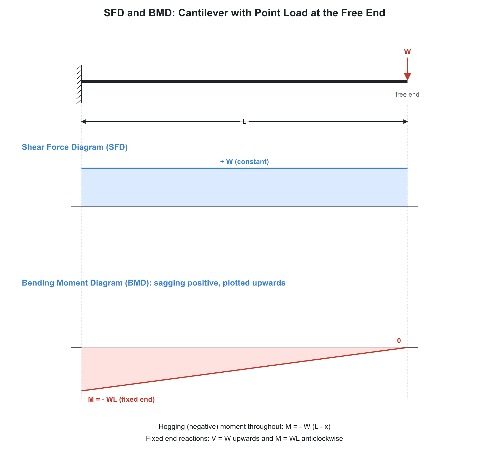
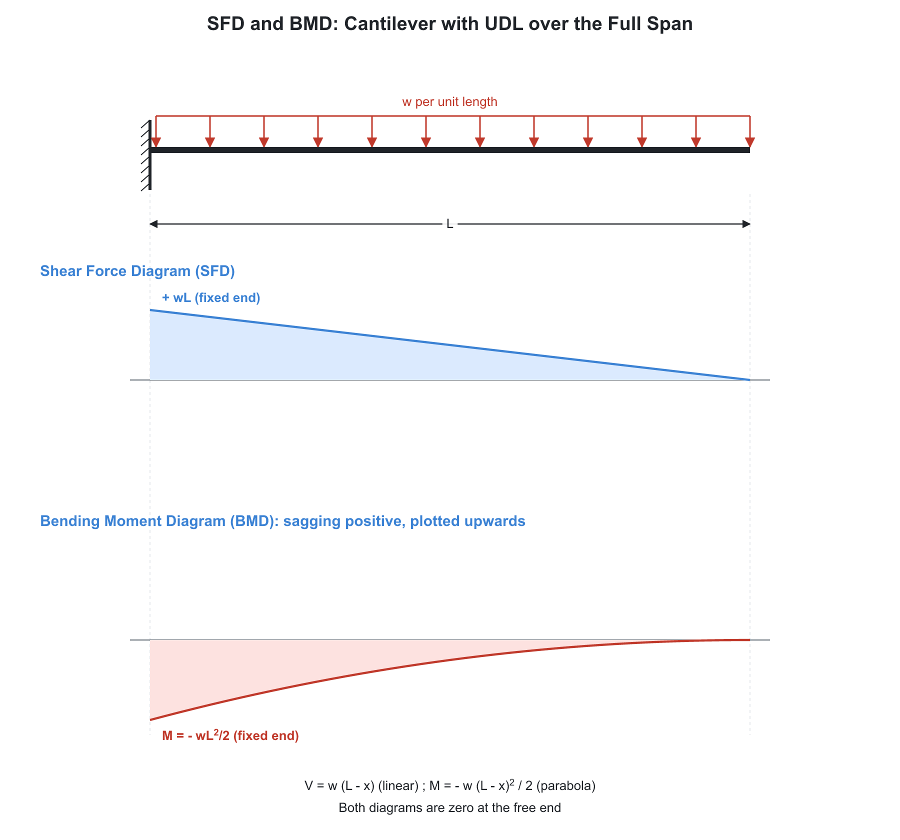
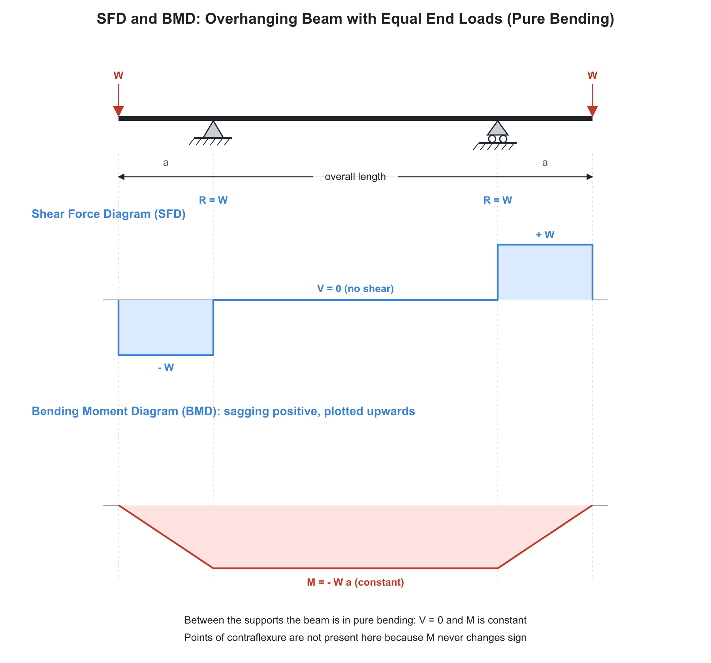
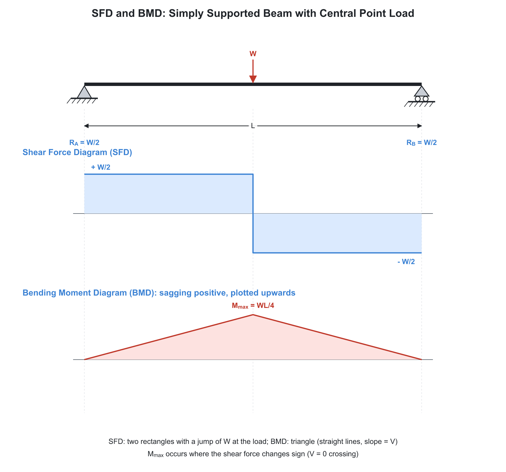
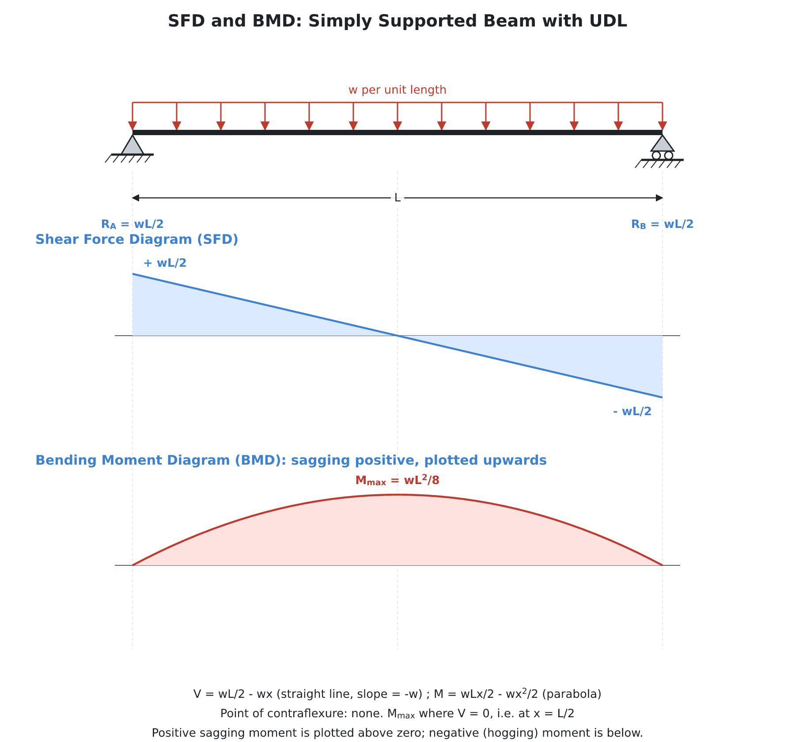

# 📐 02. Shear Force and Bending Moment Diagrams

**Exam relevance:** APPSC AEE: C | SSC JE: C | RRB JE: C | Category: ALL | Yield: VHY

---

## 📘 Part A: Detailed Theory (read this first)

This part teaches how to find shear force and bending moment in beams and draw their diagrams without memorising. Part B (from section 1 onwards) is the compact reference.

### 🔹 A1. What a beam is and how it is loaded

A **beam** is a member whose length is much larger than its cross-section, loaded **transverse** (perpendicular) to its axis. Beams are classified by support:

| Beam | Supports | Determinate? |
|---|---|---|
| Simply supported | Hinge at one end, roller at the other | Yes |
| Cantilever | Fixed at one end, free at the other | Yes |
| Overhanging | Simply supported with one or both ends projecting beyond a support | Yes |
| Fixed (built-in) | Fixed at both ends | No (indeterminate) |
| Propped cantilever | Fixed at one end, simple support at the other | No |
| Continuous | More than two supports | No |

**Loads:** concentrated (point) load, uniformly distributed load (UDL, $w$ per unit length), uniformly varying load (UVL, triangular), and applied couple (moment).

### 🔹 A2. Shear force and bending moment: the meaning

Imagine cutting the beam at a section $x$. The part you keep is no longer in equilibrium unless the cut face supplies **internal forces** that replace the removed part:

- A vertical internal force: the **shear force (SF)** $V$ at that section. It equals the algebraic sum of all vertical forces on **one side** of the section.
- An internal moment: the **bending moment (BM)** $M$. It equals the algebraic sum of the moments of all forces on one side about the section.

**Sign convention (sagging positive).**

- SF is positive if the left part tends to move **up** relative to the right (the common rule: sum of upward forces to the left of the section is positive).
- BM is positive when it causes **sagging** (concave upward, fibres at the bottom in tension). Negative BM is **hogging** (concave downward, top fibres in tension).

A cantilever with a downward load always hogs. A simply supported beam with downward loads always sags.

### 🔹 A3. The step-by-step method

1. Draw the FBD of the whole beam, replace supports with reactions.
2. Find reactions from $\sum F_y = 0$, $\sum M = 0$.
3. Divide the beam into segments at every point load, couple, start or end of a distributed load, and support.
4. In each segment, write $V(x)$ and $M(x)$ using forces on the left (or right, whichever has fewer terms).
5. Calculate values at the segment boundaries and plot. Check that SF returns to zero at the free end, and BM is zero at a free end and at a simple support.

### 🔹 A4. Relations between load, SF and BM (the shortcut)

Take a small element of length $dx$ with distributed load $w$ (downward positive). Vertical equilibrium and moment equilibrium give

$$\frac{dV}{dx} = -w, \qquad \frac{dM}{dx} = V$$

Consequences:

- Where there is **no load** ($w = 0$), SF is constant and BM varies linearly.
- Under a **UDL**, SF is linear and BM is a parabola.
- Under a **UVL**, SF is a parabola and BM is cubic.
- BM is **maximum or minimum where SF is zero** (or changes sign).
- The area of the SF diagram between two sections equals the change in BM.
- A **point load** causes a jump in SF equal to the load and a kink (slope change) in BM.
- An **applied couple** causes a jump in BM equal to the couple and no change in SF.
- At a **point of contraflexure**, the BM passes through zero and changes sign. The beam curvature reverses there.

### 🔹 A5. The standard cases, derived

**Simply supported beam, central point load $W$, span $L$.** Reactions $W/2$ each. For $x < L/2$: $V = W/2$, $M = Wx/2$. Maximum BM at the centre $= \dfrac{WL}{4}$.

**Simply supported beam, UDL $w$ over the full span.** Reactions $wL/2$. $V = \dfrac{wL}{2} - wx$, zero at $x = L/2$. $M = \dfrac{wLx}{2} - \dfrac{wx^2}{2}$; maximum at the centre $= \dfrac{wL^2}{8}$.

**Cantilever, point load $W$ at the free end.** $V = W$ constant. $M = -Wx$ (measured from the free end), maximum at the fixed end $= -WL$.

**Cantilever, UDL $w$.** $V = wx$, $M = -\dfrac{wx^2}{2}$, maximum $-\dfrac{wL^2}{2}$ at the fixed end.

**Cantilever, UVL (zero at free end, $w_0$ at fixed end).** Load total $\dfrac{w_0L}{2}$ acting at $L/3$ from the fixed end, so maximum $M = -\dfrac{w_0L^2}{6}$.

**Simply supported beam, UVL (zero at one end, $w_0$ at the other).** Total load $\dfrac{w_0L}{2}$. Reactions $\dfrac{w_0L}{6}$ (at the zero end) and $\dfrac{w_0L}{3}$. Maximum BM $= \dfrac{w_0L^2}{9\sqrt{3}}$ at $x = L/\sqrt{3}$ from the zero end.

**Overhanging beam.** Treat as two parts; the BM over the supports is usually the maximum hogging moment. Because the BM is positive in the span and negative over the overhang, there is a point of contraflexure in between.

**Beam with a couple $M_0$.** The reactions form a couple that balances $M_0$. The SF diagram is a constant horizontal line; the BM diagram jumps by $M_0$ at the point of application.

### 🔹 A6. Shape of the diagrams: a visual check

| Load | SF shape | BM shape |
|---|---|---|
| None | Horizontal line | Sloping straight line |
| Point load | Step | Change of slope (kink) |
| UDL | Sloping straight line | Parabola |
| UVL | Parabola | Cubic |
| Couple | No change | Step |

If your drawn diagrams do not follow these shapes, you have an error.

### 🔹 A7. Why we care

The maximum BM governs the section size (bending stress $= M y / I$). The maximum SF governs shear and connections. The diagrams show where to place the stiffest section. In the next chapter, BM becomes stress and curvature.

### 🔹 A8. Exam relevance

- Standard case maxima: $\dfrac{WL}{4}$, $\dfrac{wL^2}{8}$, $WL$, $\dfrac{wL^2}{2}$ (all three exams).
- Relation between load, SF, BM; point of contraflexure; shape of diagram (SSC JE, RRB JE, APPSC AEE).
- Overhanging beam with UDL and point loads (APPSC AEE, SSC JE).

---

## ⚡ Part B: Quick-reference notes, formulas, numericals and PYQs

## 🧭 1. Foundations

- **Shear force (SF)** at a section is the algebraic sum of the vertical forces on one side. **Bending moment (BM)** is the algebraic sum of the moments of the forces on one side.
- **Sign convention:** SF is positive if it tends to rotate the section clockwise (left side up, right side down). BM is sagging (positive) when the beam bends concave upward; hogging is negative.
- **Beam types:** simply supported, cantilever, overhanging, fixed, propped cantilever, continuous.
- **Loads:** point load, UDL ($w$ per unit length), UVL (triangular), couple (moment).

## 🧭 2. Fundamental relations

$$\frac{dV}{dx} = -w, \qquad \frac{dM}{dx} = V, \qquad \frac{d^2M}{dx^2} = -w$$

- BM is maximum (or minimum) where SF is zero or changes sign.
- **Point of contraflexure:** BM $= 0$ and changes sign.
- Shapes: UDL gives linear SF and parabolic BM. Point load gives constant SF and linear BM. UVL gives parabolic SF and cubic BM. The BM curve is one degree higher than the SF curve.
- A point load causes a sudden jump in SF. A couple causes a sudden jump in BM (SF unchanged).

## 🧭 3. Standard cases (memorise)

| Beam and load | Maximum SF | Maximum BM |
|---|---|---|
| Cantilever, point load $W$ at the free end | $W$ | $WL$ (fixed end) |
| Cantilever, UDL $w$ over $L$ | $wL$ | $\dfrac{wL^2}{2}$ (fixed end) |
| Cantilever, UVL (zero at free end, $w$ at fixed end) | $\dfrac{wL}{2}$ | $\dfrac{wL^2}{6}$ |
| SS beam, central point load $W$ | $\dfrac{W}{2}$ | $\dfrac{WL}{4}$ (centre) |
| SS beam, UDL $w$ over $L$ | $\dfrac{wL}{2}$ | $\dfrac{wL^2}{8}$ (centre) |
| SS beam, UVL (zero at one end, $w$ at the other) | $\dfrac{wL}{3}$ (heavy end) | $\dfrac{wL^2}{9\sqrt{3}} \approx 0.0642\,wL^2$ at $x = \dfrac{L}{\sqrt{3}}$ from the light end |
| SS beam, symmetric triangular load, peak $w$ at centre | $\dfrac{wL}{4}$ | $\dfrac{wL^2}{12}$ |
| SS beam, couple $M$ at the centre | $\dfrac{M}{L}$ | $\dfrac{M}{2}$ |
| Fixed beam, central point load | $\dfrac{W}{2}$ | $\dfrac{WL}{8}$ (supports and centre) |
| Fixed beam, UDL | $\dfrac{wL}{2}$ | $\dfrac{wL^2}{12}$ (support), $\dfrac{wL^2}{24}$ (centre) |
| Propped cantilever, UDL | $\dfrac{5wL}{8}$ | $\dfrac{wL^2}{8}$ (fixed end) |

- For a simply supported beam with UDL, BM at distance $x$ from one end:

$$M(x) = \frac{w\,x\,(L - x)}{2}$$

- For an overhanging beam, contraflexure points can exist between the supports when the overhang loads cause hogging at the supports.

## 🧭 4. Method of drawing

1. Find the reactions ($\Sigma F = 0$, $\Sigma M = 0$).
2. Divide into segments at loads, supports and discontinuities.
3. Write $V(x)$ and $M(x)$ for each segment, or use the area method: change in $V$ $=$ $-$ area under the load diagram; change in $M$ $=$ area under the SF diagram.
4. Locate zero-shear points to find $M_{max}$.
5. Check: BM at free ends is zero (except where a couple is applied); SF and BM at a cantilever's free end equal the applied end loads.

## 🧭 5. Worked numericals

1. **SS beam,** $L = 6$ m, UDL $10$ kN/m: reactions $30$ kN each;

$$M_{max} = \frac{10 \times 6^2}{8} = 45\ \text{kN}\cdot\text{m}$$

2. **SS beam,** $L = 8$ m, $40$ kN at $3$ m from A: $R_A = \dfrac{40 \times 5}{8} = 25$ kN, $R_B = 15$ kN; $M_{max} = 25 \times 3 = 75$ kN-m under the load.
3. **Cantilever,** $2$ m, $5$ kN at the end plus UDL $2$ kN/m over the full length:

$$M_{fixed} = 5\times2 + \frac{2\times 2^2}{2} = 14\ \text{kN}\cdot\text{m}$$

## 🧭 6. Common mistakes

- Wrong resultant location: centre for a UDL, $\dfrac{L}{3}$ from the larger end for a UVL.
- Thinking a point couple changes the SF (it does not).
- Assuming the BM maximum is always at the centre.

## 🧭 7. Interconnections

- BM and SF feed the flexure formula and shear stress distribution (chapter 03).
- Deflection is obtained by integrating the BM equation (chapter 03).
- Shaft design in Machine Design uses BM and torque diagrams.

## 🧭 8. PYQs

| # | Question | Answer | Exam / Year | Verify |
|---|---|---|---|---|
| 1 | Maximum BM of a simply supported beam with central load $W$ | $\dfrac{WL}{4}$ | SSC JE 2017 | [ ] |
| 2 | Maximum BM of a simply supported beam with UDL | $\dfrac{wL^2}{8}$ | RRB JE 2015 | [ ] |
| 3 | Maximum BM of a cantilever with UDL | $\dfrac{wL^2}{2}$ | SSC JE 2018 | [ ] |
| 4 | Point of contraflexure is where | BM changes sign | RRB JE 2014 | [ ] |
| 5 | Relation between SF and BM | $\dfrac{dM}{dx} = V$ | SSC JE 2016 | [ ] |
| 6 | SF diagram for UDL on a simply supported beam | An inclined straight line | RRB JE 2019 | [ ] |
| 7 | BM diagram of a cantilever with a point load at the free end | Triangle (linear) | RRB JE 2015 | [ ] |
| 8 | BM is maximum where | SF is zero | SSC JE 2019 | [ ] |
| 9 | Maximum BM at the supports of a fixed beam with UDL | $\dfrac{wL^2}{12}$ | APPSC AEE 2012 | [ ] |
| 10 | Slope of the SF diagram under a UDL | Constant, equal to $-w$ | SSC JE 2020 | [ ] |

## 🧭 9. Revision checklist

- [ ] Memorise the standard-case table
- [ ] State the load-SF-BM relations
- [ ] Identify contraflexure points
- [ ] Practise the area method on five beams
