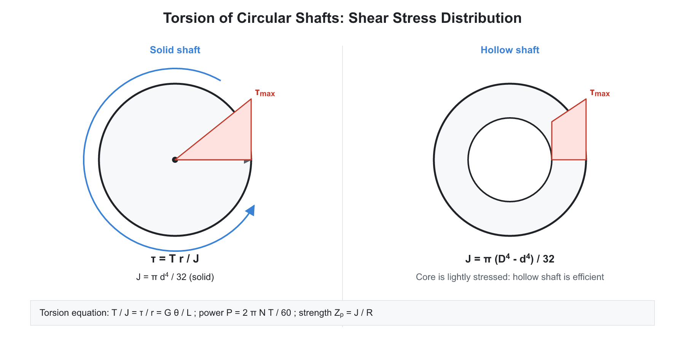

# 04. Torsion, Springs and Strain Energy

**Exam relevance:** APPSC AEE: C | SSC JE: C | RRB JE: C | Category: ALL | Yield: VHY

---

## Part A: Detailed Theory (read this first)

This part explains twisting of shafts, spring behaviour and energy methods from first principles. Part B (from section 1 onwards) is the compact reference.

### A1. What torsion is
```text
Fixed end                       Applied torque T
  |                                   (twist)
  +======================================+
  |            circular shaft           |
```


**Torsion** is twisting of a member by a torque (twisting moment) about its axis. Shafts transmit power through torque: $P = T\omega$. A shaft may fail by shear (maximum shear stress too large) or by being too flexible (twist angle too large for accuracy or vibration).

**Assumptions of the torsion formula (circular shafts):**

1. The shaft is straight, of uniform circular section, homogeneous and isotropic.
2. Material obeys Hooke's law in shear (the stress is within the proportional limit).
3. **Plane transverse sections remain plane** and circular, and radii remain straight, so a section simply rotates as a rigid disc. This holds only for circular sections. Non-circular sections warp.
4. The twist is uniform along the length; the torque acts at the ends.

### A2. Derivation of the torsion equation


Consider a shaft of length $L$ and radius $R$ twisted by angle $\theta$ at one end. A longitudinal line on the surface rotates to a helix and moves by an angle $\gamma$ (shear strain) where $\gamma L = R\theta$. At any radius $r$, $\gamma_r = \dfrac{r\theta}{L}$. Shear strain is proportional to the distance from the axis. By Hooke's law in shear:

$$\tau_r = G\gamma_r = \frac{G\theta r}{L}$$

The torque of the shear stress on a ring of radius $r$ and thickness $dr$ is $\tau_r \cdot 2\pi r\,dr \cdot r$. Summing,

$$T = \int \tau_r\,r\,dA = \frac{G\theta}{L}\int r^2\,dA = \frac{G\theta}{L}J$$

Combining:

$$\boxed{\frac{T}{J} = \frac{\tau}{r} = \frac{G\theta}{L}}$$

- $J$ is the polar MOI: $\dfrac{\pi d^4}{32}$ for a solid shaft, $\dfrac{\pi (D^4 - d^4)}{32}$ for a hollow shaft.
- Maximum shear stress at the outer surface: $\tau_{max} = \dfrac{T R}{J}$. For solid shaft $\tau = \dfrac{16T}{\pi d^3}$.
- **Torsional rigidity** $GJ$; **torsional stiffness** $\dfrac{T}{\theta} = \dfrac{GJ}{L}$ (like a spring).
- **Polar modulus** $Z_p = \dfrac{J}{R}$, so $T = \tau Z_p$.

**Hollow vs solid.** For the same weight, a hollow shaft is stronger because more material is at the large radius where shear stress is largest. The core material of a solid shaft carries little stress and is wasted. The hollow shaft is also used when the weight matters (aircraft, automobiles).

**Power transmission:** $P = T\omega = \dfrac{2\pi N T}{60}$ ($N$ in rpm). A shaft at higher speed carries more power at the same torque, so high-speed shafts are thinner than low-speed shafts for the same power.

**Combinations.**

- **Shafts in series:** same torque, angles add.
- **Shafts in parallel (compound):** same twist angle, torque is shared in proportion to $GJ/L$.
- **Equivalent shaft:** replace a stepped shaft by one of uniform diameter giving the same stiffness.
- **Taper shaft:** twist angle $\theta = \dfrac{32 T L}{3\pi G}\dfrac{d_1^2 + d_1d_2 + d_2^2}{d_1^3 d_2^3}$ (use for tapered circular shafts).

**Combined bending and torsion.** A shaft carrying both gets the maximum principal stress and the maximum shear stress from Mohr's circle. The equivalent torque is

$$T_e = \sqrt{M^2 + T^2}, \qquad M_e = \tfrac{1}{2}\left(M + \sqrt{M^2 + T^2}\right)$$

$T_e$ is used with the maximum shear stress theory; $M_e$ with the maximum principal stress theory.

### A3. Springs

A spring stores energy through elastic deformation and returns it when released. Used for shock absorption, force control and energy storage.

**Helical spring under axial load $W$** (mean coil diameter $D$, wire diameter $d$, $n$ active coils).

- The load acts along the axis, so every section of the wire is twisted by a torque $T = W \dfrac{D}{2}$ (and also carries direct shear $W$). Wire shear stress, ignoring direct shear: $\tau = \dfrac{16 W D/2}{\pi d^3} = \dfrac{8WD}{\pi d^3}$.
- Wire length $= \pi D n$. Twist of the wire gives axial deflection:

$$\delta = \frac{8 W D^3 n}{G d^4}, \qquad k = \frac{W}{\delta} = \frac{G d^4}{8 D^3 n}$$

- The **spring index** $C = D/d$ (usually 4 to 12). **Wahl's factor** corrects for direct shear and wire curvature: $K_w = \dfrac{4C - 1}{4C - 4} + \dfrac{0.615}{C}$, and $\tau = K_w \dfrac{8WD}{\pi d^3}$.
- **Springs in series:** $\dfrac{1}{k} = \dfrac{1}{k_1} + \dfrac{1}{k_2}$ (softer). **In parallel:** $k = k_1 + k_2$ (stiffer).
- **Concentric springs** (one inside another, same deflection, same length): load shared in proportion to stiffness.
- **Energy stored** $U = \tfrac{1}{2}W\delta$.

**Leaf (carriage) spring.** A multi-leaf beam of uniform strength. Treat as a simply supported beam with a central load; $\sigma = \dfrac{3WL}{2nbt^2}$ and $\delta = \dfrac{3WL^3}{8Enbt^3}$ (with $n$ leaves of width $b$ and thickness $t$).

**Close-coiled vs open-coiled.** In a close-coiled spring the helix angle is small and the wire is subject mainly to torsion. In an open-coiled spring the helix angle is large, so the wire also carries bending and axial effects.

### A4. Strain energy: the energy view

When a body is deformed, work done by the load is stored as **strain energy** $U$ (recoverable in the elastic range). Energy methods are often easier than force methods for deflection, impact and indeterminate problems.

| Loading | Strain energy |
|---|---|
| Axial | $\dfrac{P^2 L}{2AE}$ |
| Bending | $\int \dfrac{M^2}{2EI}\,dx$ |
| Torsion | $\dfrac{T^2 L}{2GJ}$ |
| Shear (transverse) | $\dfrac{\tau^2}{2G}\times$ volume (with a form factor for beams) |

Strain energy per unit volume for uniaxial stress is $\dfrac{\sigma^2}{2E}$. It splits into **volumetric** energy (change in size) and **distortion** energy (change in shape).

**Castigliano's theorem.** The partial derivative of the total strain energy with respect to a load equals the deflection (or rotation) at that load, in the direction of the load:

$$\delta_i = \frac{\partial U}{\partial P_i}$$

For a point where no load exists, add a **dummy load** $P_0$, differentiate, then set $P_0 = 0$. For beams, differentiate under the integral: $\delta = \int \dfrac{M}{EI}\dfrac{\partial M}{\partial P}\,dx$.

**Maxwell's reciprocal theorem.** The deflection at A due to a unit load at B equals the deflection at B due to a unit load at A. Basis of influence lines and flexibility methods.

### A5. Why the three topics belong together

Torsion, springs and energy methods all use shear stress and strain energy. A helical spring is a long twisted wire. Castigliano is the quickest route to spring deflection. Together they give the machine designer a way to find twist, stiffness and energy storage for shafts and springs.

### A6. Exam relevance

- Torsion equation, hollow versus solid shaft, power transmission (all exams).
- Spring deflection and stiffness, series and parallel (all exams).
- Strain energy expressions, Castigliano, Maxwell (APPSC AEE, SSC JE).

---

## Part B: Quick-reference notes, formulas, numericals and PYQs


## 🧭 1. Torsion of circular shafts

- **Assumptions:** homogeneous, isotropic, linear elastic material; circular section stays circular; plane sections stay plane; radii stay straight; uniform twist along the length; stresses within the elastic limit.

### Torsion equation

$$\frac{T}{J} = \frac{\tau}{r} = \frac{G\theta}{L}$$

$$\tau_{max} = \frac{Tr}{J} = \frac{16T}{\pi d^3} \ \text{(solid)}, \qquad \theta = \frac{TL}{GJ} \ \text{(radians)}$$

$$J_{solid} = \frac{\pi d^4}{32}, \qquad J_{hollow} = \frac{\pi (D^4 - d^4)}{32}$$

- **Torsional rigidity** $= GJ$. **Polar modulus** $Z_p = \dfrac{J}{r}$.
- Shear stress varies linearly from zero at the centre to the maximum at the outer surface.
- **Power transmitted** ($N$ in rpm, $T$ in N-m, $P$ in W):

$$P = \frac{2\pi N T}{60}$$

- **Hollow vs solid shaft** (same material, torque and outer diameter): the hollow shaft is lighter. For the same weight, a hollow shaft is stronger and stiffer. Strength ratio of a hollow shaft $= (1 - k^4)$, with $k = \dfrac{d}{D}$.
- **Shafts in series:** same torque; twists add. **Shafts in parallel:** same twist; torques add.
- **Composite shaft:** equal twist in both materials; $T = T_1 + T_2$.
- **Strain energy in torsion:**

$$U = \frac{T^2 L}{2GJ} \qquad \text{(for a solid shaft, } u = \frac{\tau^2}{4G} \text{ per unit volume)}$$

- **Combined bending and torsion:**

$$T_e = \sqrt{M^2 + T^2}, \qquad M_e = \frac{1}{2}\left(M + \sqrt{M^2 + T^2}\right)$$

  $T_e$ is used with the maximum shear stress theory and $M_e$ with the maximum principal stress theory.
- **Thin-walled tube (Bredt-Batho):** $\tau = \dfrac{T}{2A_m t}$.
- Non-circular sections warp; the torsion equation above does not apply.

## 🧭 2. Springs

### Closed-coiled helical springs (mean diameter $D$, wire diameter $d$, $n$ active coils)

$$\tau = K_w\frac{8WD}{\pi d^3}, \qquad K_w = \frac{4C-1}{4C-4} + \frac{0.615}{C}, \qquad C = \frac{D}{d}$$

$$\delta = \frac{8WD^3 n}{Gd^4}, \qquad k = \frac{Gd^4}{8D^3 n}, \qquad U = \tfrac{1}{2}W\delta$$

- Without the Wahl factor (simple formula): $\tau = \dfrac{8WD}{\pi d^3} = \dfrac{16WR}{\pi d^3}$.
- **Series:** $\dfrac{1}{k} = \dfrac{1}{k_1} + \dfrac{1}{k_2}$ (deflections add). **Parallel:** $k = k_1 + k_2$.
- **Open-coiled helical spring:** carries both axial and twisting effects because the helix angle is large.
- **Concentric springs:** same deflection; load divides in proportion to stiffness.
- **Leaf spring (semi-elliptical, $n$ leaves, width $b$, thickness $t$):**

$$\sigma = \frac{3WL}{2nbt^2}, \qquad \delta = \frac{3WL^3}{8Enbt^3}$$

  A quarter-elliptic leaf spring behaves as a cantilever.
- **Surge:** resonance when the load frequency equals the natural frequency of the coil.
- Spring materials: spring steel (carbon, chrome-vanadium), phosphor bronze, beryllium copper.

## 🧭 3. Strain energy methods

- **Strain energy density:** $u = \dfrac{\sigma^2}{2E}$ (axial), $u = \dfrac{\tau^2}{2G}$ (shear).
- **Proof resilience:** energy stored at the elastic limit. **Modulus of resilience:** proof resilience per unit volume.
- **Castigliano's first theorem:** deflection at the load point, in the direction of the load, is $\delta = \dfrac{\partial U}{\partial P}$.
- **Maxwell's reciprocal theorem:** deflection at B due to a unit load at A equals deflection at A due to a unit load at B.
- **Impact loading:** equate the loss of potential energy to the strain energy gained.

## 🧭 4. Worked numericals

1. **Solid shaft.** $d = 50$ mm, $T = 1$ kN-m:

$$\tau = \frac{16 \times 10^{6}}{\pi \times 50^3} = 40.7\ \text{MPa}$$

2. **Power.** $100$ kW at $300$ rpm:

$$T = \frac{100\times10^{3}\times 60}{2\pi \times 300} = 3183\ \text{N}\cdot\text{m}$$

3. **Spring.** $W = 500$ N, $D = 60$ mm, $d = 10$ mm, $n = 10$, $G = 80$ GPa:

$$\delta = \frac{8 \times 500 \times 60^3 \times 10}{80000 \times 10^4} = 10.8\ \text{mm}$$

## 🧭 5. Common mistakes

- Using $D$ instead of $d$ (or $r$) in $J$; mixing the mean coil radius with the wire radius in springs.
- Forgetting the factor $60$ in the power formula.
- Mixing up the series and parallel stiffness rules for springs.

## 🧭 6. Interconnections

- Torsion combines with bending in shaft design (Machine Design); springs appear in vibrations (TOM) and the Hartnell governor.

## 🧭 7. PYQs

| # | Question | Answer | Exam / Year | Verify |
|---|---|---|---|---|
| 1 | Torsion equation | $\dfrac{T}{J} = \dfrac{\tau}{r} = \dfrac{G\theta}{L}$ | SSC JE 2017 | [ ] |
| 2 | Polar moment of inertia of a solid shaft | $\dfrac{\pi d^4}{32}$ | RRB JE 2015 | [ ] |
| 3 | Shear stress in a solid shaft | $\dfrac{16T}{\pi d^3}$ | SSC JE 2018 | [ ] |
| 4 | Torsional stiffness | $\dfrac{GJ}{L}$ | RRB JE 2019 | [ ] |
| 5 | Deflection of a helical spring | $\dfrac{8WD^3 n}{Gd^4}$ | SSC JE 2016 | [ ] |
| 6 | Springs in series: equivalent stiffness | $\dfrac{1}{k} = \dfrac{1}{k_1} + \dfrac{1}{k_2}$ | RRB JE 2014 | [ ] |
| 7 | Springs in parallel | $k = k_1 + k_2$ | SSC JE 2019 | [ ] |
| 8 | Power transmitted by a shaft | $\dfrac{2\pi NT}{60}$ | RRB JE 2015 | [ ] |
| 9 | Equivalent torque | $\sqrt{M^2 + T^2}$ | APPSC AEE 2012 | [ ] |
| 10 | The Wahl factor accounts for | Direct shear plus curvature effect | SSC JE 2020 | [ ] |

## 🧭 8. Revision checklist

- [ ] Torsion equation, $J$, $Z_p$
- [ ] Series and parallel shafts and springs
- [ ] Wahl factor and spring deflection
- [ ] Equivalent torque and equivalent moment
