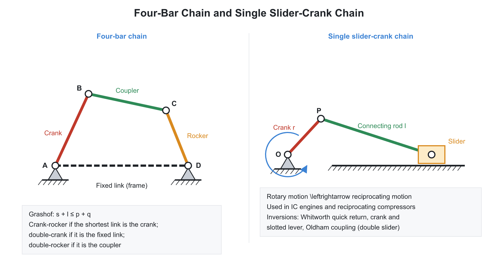
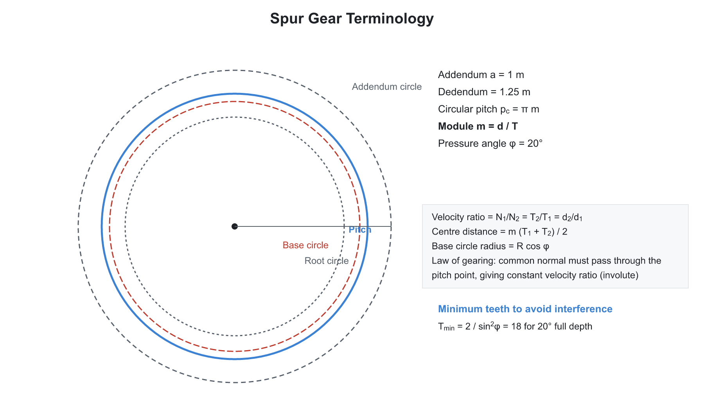
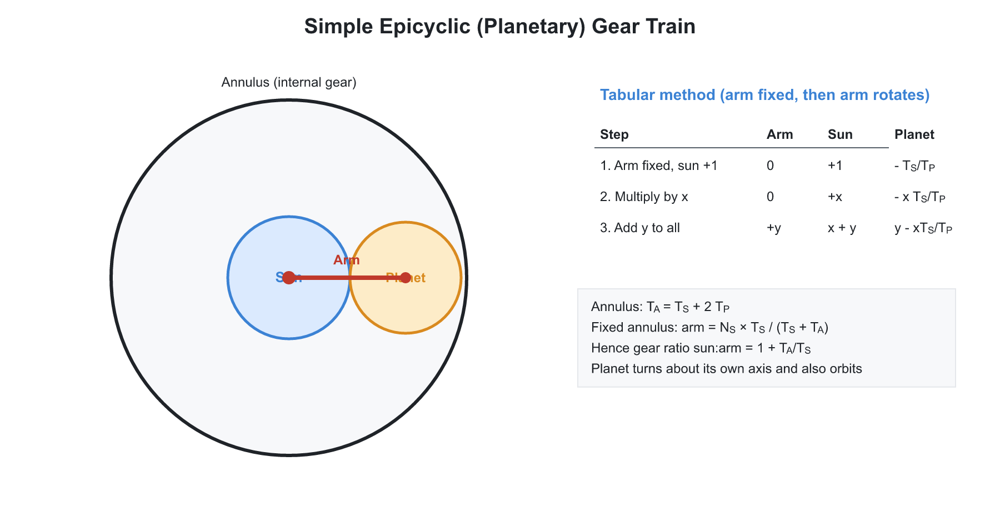
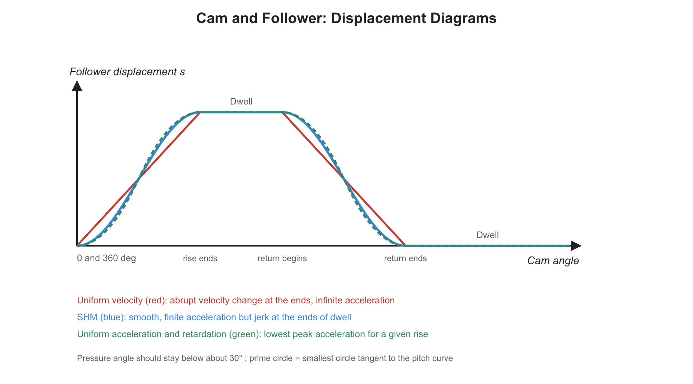

# ⚙️ 01. Mechanisms, Kinematics, Gears and Cams

**Exam relevance:** APPSC AEE: C | SSC JE: C | RRB JE: C | Category: ALL | Yield: VHY

---

## 📘 Part A: Detailed Theory (read this first)

This part explains how machines are built from links, how motion is transmitted, and how gears and cams work. Part B (from section 1 onwards) is the compact reference.

### 🔹 A1. What Theory of Machines studies

A **machine** is a combination of resistant bodies that transmits motion and force and does useful work. A **mechanism** is a similar arrangement used only to transmit or transform motion (no useful work requirement). **Kinematics** studies motion without forces; **dynamics** (kinetics) adds forces.

**Basic vocabulary:**

- **Link (element):** a rigid body (or resistant body) that has relative motion with other parts.
- **Kinematic pair:** two links in contact that permit relative motion. **Lower pair:** surface contact (revolute or turning pair, prismatic or sliding pair, screw, spherical). **Higher pair:** point or line contact (cam and follower, gear teeth, ball bearing).
- **Closed pair:** the elements are held together by form or force. **Unclosed pair:** held by gravity or a spring (cam and follower).
- **Kinematic chain:** a set of links joined by pairs so that relative motion is constrained. **Mechanism:** a chain with one link fixed. **Inversion:** fixing a different link of the same chain.
- **Binary, ternary, quaternary link:** link with two, three, four joints.
- **Constrained motion:** completely constrained (only one possible relative motion, e.g. a shaft in a bearing), incompletely constrained (the pair can move in more than one way, e.g. a shaft in a circular hole), successfully constrained (kept by external force, e.g. a cam and follower).

### 🔹 A2. Degrees of freedom (mobility)

The **degrees of freedom (DOF)** of a mechanism is the number of independent inputs needed to fix the position of every link. A free body in a plane has 3 DOF (two translations and one rotation). Each joint removes some of them.

**Gruebler's equation (planar):**

$$F = 3(n - 1) - 2j - h$$

where $n$ = number of links (including the fixed link), $j$ = number of lower pairs (1-DOF joints), $h$ = number of higher pairs (2-DOF joints).

Reasoning: $n - 1$ moving links have $3(n-1)$ DOF; each lower pair removes 2, each higher pair removes 1.

- $F = 1$: constrained mechanism (one input drives it, like a four-bar).
- $F = 0$: a structure (no motion). $F < 0$: statically indeterminate structure.
- $F = 2$: needs two inputs (like a five-bar linkage).
- **Kutzbach criterion** is the same equation. **Redundant DOF** occurs when a link can move without affecting the output (a roller in a cam follower adds one idle DOF).
- For a kinematic chain with only turning pairs, with $l$ links, $p$ pairs and $j$ joints: $l = 2p - 4$ and $j = \dfrac{3l}{2} - 2$. A four-bar chain has $l = 4$, $p = 4$, $j = 4$.

### 🔹 A3. Four-bar chain and its inversions

The most important mechanism. Four links joined by four turning pairs. Let $s$ = shortest link, $l$ = longest, $p, q$ = the other two.

**Grashof's law:** at least one link can make a full rotation relative to the others only if

$$s + l \le p + q$$

- If the inequality holds (**Grashof chain**): depending on which link is fixed we get a **crank-rocker** (shortest link adjacent to the fixed link), **double-crank / drag link** (shortest link fixed), or **double-rocker** (shortest link opposite the fixed link, the coupler is the shortest).
- If $s + l > p + q$: **non-Grashof**; all inversions are double-rockers and no link can rotate fully.
- If $s + l = p + q$: **change-point** mechanism (parallelogram or deltoid) with the links collinear at some positions.

**Inversions of the four-bar chain (all with 4 turning pairs):** crank-rocker (beam engine), drag-link (coupled wheels of a locomotive), double-rocker (Watt's straight-line mechanism, Ackermann steering uses a trapezoid).

**Single slider-crank chain** (3 turning + 1 sliding pair) - reciprocating engine, compressor. Inversions:

1. **First inversion** - fix the cylinder or frame (link 1): the ordinary reciprocating engine or compressor.
2. **Second inversion** - fix the crank (link 2): the **Whitworth quick-return mechanism** (the slotted lever rotates fully) and the **rotary engine** (Gnome engine, in which the cylinders rotate).
3. **Third inversion** - fix the connecting rod (link 3): the **crank and slotted-lever quick-return mechanism** (shaper) and the **oscillating cylinder engine**.
4. **Fourth inversion** - fix the slider (link 4): the **pendulum pump** (Bull engine) and the hand pump.

**Double slider-crank chain** (2 turning + 2 sliding pairs). Inversions: **elliptical trammel** (two sliding blocks trace an ellipse), **Scotch yoke** (converts rotary into SHM), **Oldham's coupling** (joins two parallel, slightly offset shafts).

**Straight-line mechanisms:** Watt, Peaucellier (exact), Hart, Scott-Russel. **Steering gears:** Davis (sliding pairs, exact) and Ackermann (turning pairs, approximate).

**Quick-return mechanisms:** the working stroke is slower than the return stroke so that the cutting time ratio is greater than 1. Quick return ratio $= \dfrac{\text{time of cutting stroke}}{\text{time of return stroke}} = \dfrac{\alpha}{\beta}$ where $\alpha + \beta = 360^\circ$.

**Mechanical advantage and transmission angle.** The angle between the coupler and the follower link should be kept near $90^\circ$; below about $40^\circ$ the mechanism jams. **Toggle position:** the mechanical advantage becomes infinite at the dead-centre position (stone crushers).

### 🔹 A4. Velocity and acceleration analysis

Why analyse: the velocities and accelerations of points on links determine forces (through $F = ma$) and speeds of cutting tools.

**Methods:**

1. **Relative velocity method:** for two points A and B on the same link, $v_B = v_A + v_{BA}$, where $v_{BA} = \omega \cdot AB$ is perpendicular to AB. Draw a velocity polygon (vector diagram) to scale. A point on the polygon is marked with lower-case letters of the corresponding point on the link.
2. **Instantaneous centre (IC) method:** at any instant the motion of a plane rigid body is a pure rotation about a point. For $n$ links, the number of ICs is $\dfrac{n(n-1)}{2}$.
3. **Kennedy's theorem (three-centres-in-line):** any three bodies in relative plane motion have their three ICs on one straight line.

**Types of ICs:** fixed (the centre is fixed in the frame), permanent, and neither. Rolling contact: the IC is at the point of contact. Sliding contact: the IC lies on the common normal.

**Acceleration analysis.** A point on a link rotating with $\omega$ and $\alpha$ has two components relative to another point on the same link: **centripetal** $a^c = \omega^2 r$ (toward the centre) and **tangential** $a^t = \alpha r$ (perpendicular to the link). Coriolis component arises when a point slides on a rotating link: $a^{cor} = 2\omega v$ (magnitude), where $\omega$ is the angular speed of the link and $v$ the sliding velocity. Used in a crank-slotted-lever.

**Klein's construction** gives the velocity and acceleration of a reciprocating engine quickly. The **piston acceleration** $= \omega^2 r\left(\cos\theta + \dfrac{\cos 2\theta}{n}\right)$ where $n = l/r$.

### 🔹 A5. Gears

**Why gears?** Belts and friction wheels slip. Gears transmit motion with a **constant velocity ratio** by positive engagement of teeth.

**Classification:** by shaft position - parallel (spur, helical, herringbone), intersecting (bevel), non-parallel non-intersecting (worm, spiral/crossed helical, hypoid). **Rack and pinion** converts rotation into translation.

**Spur-gear terminology:**

| Term | Meaning |
|---|---|
| Pitch circle | Imaginary circle that rolls without slipping with its mate |
| Module $m$ | $\dfrac{d}{T}$ (mm per tooth): size of the tooth. Standard values (1, 1.25, 1.5, 2, 2.5, 3, 4, 5 ...) |
| Circular pitch $p_c$ | $\pi m = \dfrac{\pi d}{T}$; arc distance between corresponding points of adjacent teeth |
| Diametral pitch $P_d$ | $\dfrac{T}{d} = \dfrac{1}{m}$ |
| Addendum | Radial height above the pitch circle ($= 1\,m$) |
| Dedendum | Radial depth below the pitch circle ($= 1.25\,m$) |
| Clearance | Difference between dedendum and addendum |
| Backlash | Gap between mating teeth along the pitch circle |
| Pressure angle $\phi$ | Angle between the common normal at the contact point and the common tangent to the pitch circles: $14.5^\circ$ or $20^\circ$ |
| Base circle | Circle from which the involute is generated: $r_b = r\cos\phi$ |
| Line of action | Common tangent to the two base circles; the contact point moves along it |

**Law of gearing:** for constant angular velocity ratio, the common normal at the point of contact must always pass through a fixed point (the **pitch point**) on the line of centres. Profiles that satisfy this are **conjugate**.

**Involute profile** - the most common. Traced by the end of a taut string unwound from the base circle. Advantages: the velocity ratio stays constant even if the centre distance is slightly wrong; simple to manufacture (the rack has straight sides); the pressure angle remains constant. **Cycloidal** profiles have no interference but are harder to make and need an exact centre distance.

**Velocity ratio:** $\dfrac{N_1}{N_2} = \dfrac{T_2}{T_1} = \dfrac{d_2}{d_1}$. Centre distance $= \dfrac{m(T_1 + T_2)}{2}$.

**Path of contact, arc of contact, contact ratio.**

- Path of contact: the portion of the line of action traced by the contact point (approach plus recess).
- Contact ratio $= \dfrac{\text{arc of contact}}{\text{circular pitch}}$ = average number of tooth pairs in contact. It must be greater than 1; typically 1.2 to 1.6 (higher means smoother and quieter running).

**Interference and undercutting.** If the tip of a tooth of one gear contacts the non-involute part (below the base circle) of its mate, the tooth flank is cut away: **undercutting** weakens the tooth. Minimum number of teeth on a pinion to avoid interference:

$$T_{min} = \frac{2\,A_w}{\sin^2\phi}$$

where $A_w$ is the addendum factor (1 for full-depth). For $\phi = 20^\circ$ the value is $17.1$, so $18$ teeth are used in practice (often quoted as $17$ or $18$); for $14.5^\circ$ it is $32$ teeth. Remedies: increase the pressure angle, use stub teeth, or use **profile shifting** (corrected gears).

**Helical gears:** inclined teeth give gradual engagement, higher contact ratio, quieter, but produce axial thrust (cancelled in herringbone). **Bevel gears:** transmit between intersecting shafts. **Worm gears:** large reduction in one stage (worm usually has 1 to 4 starts); the gear can be self-locking if the lead angle is below the friction angle; low efficiency.

**Gear trains.**

- **Simple train:** one gear per shaft. The idler changes direction but not the ratio.
- **Compound train:** two gears on one shaft; ratio is the product of the individual ratios.
- **Reverted train:** input and output shafts coaxial.
- **Epicyclic (planetary) train:** the axis of one gear moves with an arm. Compact, large reduction, also used in differentials. Analyse with the **tabular method**:
  1. Lock the arm and give the whole train $+1$ turn: write each gear's turns (a mating external gear turns the opposite way, ratio $-T_1/T_2$).
  2. Give the arm $x$ turns and add $x$ to every gear (the whole train moves as one body).
  3. Put the known condition (for example, the fixed gear has zero net turns) and solve for $x$.

### 🔹 A6. Cams and followers

A **cam** is a rotating or reciprocating element that gives a prescribed motion to another element, the **follower**, through direct contact (higher pair).

**Types of followers:** knife-edge (wears fast), roller (low wear, most common; cam profile differs from the pitch curve), flat-faced (mushroom; large side thrust avoided), spherical-faced. By motion: translating or oscillating. By line of motion: radial or offset.

**Types of cams:** disc (plate) cam, cylindrical (barrel) cam, translating (wedge) cam, face cam.

**Terminology.** Base circle (smallest circle from the cam centre), trace point (knife-edge or roller centre), **pitch curve** (path of the trace point), **pitch circle**, **pressure angle** (angle between the follower's direction of motion and the normal to the pitch curve; keep below $30^\circ$ for translating followers, $45^\circ$ for oscillating), **lift or stroke** $h$, **angle of ascent, dwell, descent**.

**Follower motion laws and why they matter.** Let $h$ = lift, $\varphi$ = cam angle for rise, $\omega$ = cam speed.

| Motion | Velocity | Acceleration | Remarks |
|---|---|---|---|
| Uniform velocity | Constant | Infinite at start and end | Poor: infinite inertia force (shock) |
| SHM | Sinusoidal | Finite but jumps at ends | Moderate; smooth in the middle |
| Uniform acceleration (parabolic) | Linear | Constant, with a sign change | Lowest peak acceleration; jerk infinite |
| Cycloidal | Smooth | Smooth, zero at ends | Best; low jerk, high speed |

Inertia force $= $ mass $\times$ acceleration; large acceleration leads to vibration, noise, wear and follower jump. **Follower jump** is the loss of contact at high speed when the spring force is not enough.

### 🔹 A7. Exam relevance

- DOF equation, Grashof's law, number of ICs, inversions (all three exams).
- Gear terminology, module, interference, minimum teeth, contact ratio (all exams).
- Gear trains, epicyclic trains (APPSC AEE, SSC JE).
- Cam follower motions, pressure angle (SSC JE, APPSC AEE).

---

## ⚡ Part B: Quick-reference notes, formulas, numericals and PYQs

## 🧭 1. Basic terminology

- **Kinematic link:** a rigid body having relative motion with respect to others. **Kinematic pair:** two links in contact permitting relative motion. **Kinematic chain:** an assembly of pairs. **Mechanism:** a chain with one link fixed. **Machine:** a mechanism that transmits force or does work.
- **Lower pair:** surface contact (revolute, prismatic, screw, cylindrical, spherical, planar). **Higher pair:** point or line contact (cam and follower, gear teeth).
- **Closed pair:** held together by geometry or force. **Unclosed pair:** needs an external force (spring or gravity).
- Link types: binary, ternary, quaternary.

## 🧭 2. Degrees of freedom

$$F = 3(n-1) - 2j - h \qquad \text{(Grubler, planar)}$$

Here $n$ is the number of links, $j$ the number of lower pairs and $h$ the number of higher pairs.

- $F = 1$: constrained mechanism. $F = 0$: structure. $F < 0$: statically indeterminate structure. $F > 1$: needs more than one input.
- Four-bar chain: $n = 4$, $j = 4$, so $F = 1$.
- Condition for a kinematic chain with turning pairs only: $l = 2p - 4$ and $j = \dfrac{3n}{2} - 2$.

## 🧭 3. Four-bar mechanism and inversions

**Grashof's law:** with $s$ the shortest link, $l$ the longest, and $p, q$ the other two,

$$s + l \le p + q$$

If this holds, at least one link can rotate fully.

| Fixed link | Result |
|---|---|
| A link adjacent to the shortest link | Crank-rocker |
| The shortest link | Double crank (drag link) |
| The link opposite to the shortest | Double rocker |

- If $s + l > p + q$, every inversion is a double rocker (non-Grashof).

### 🔹 Slider-crank chain and its inversions

| Inversion | Fixed link | Applications |
|---|---|---|
| 1st | Frame (cylinder) | Reciprocating engine, compressor |
| 2nd | Crank | Whitworth quick return, rotary engine (Gnome) |
| 3rd | Connecting rod | Oscillating cylinder engine, crank and slotted lever quick return |
| 4th | Slider | Hand pump, pendulum pump, Bull engine |

Double slider crank chain: elliptical trammel, Scotch yoke, Oldham's coupling.

- **Quick return ratio** (time of cutting stroke to time of return stroke):

$$\text{QRR} = \frac{180^\circ + \alpha}{180^\circ - \alpha}$$

  where $\alpha$ is the angle subtended by the extreme positions of the slotted lever.
- **Straight-line mechanisms:** Watt, Peaucellier (exact), Hart, Scott-Russell, Robert.
- **Steering gears:** Davis (sliding pairs, exact) and Ackermann (turning pairs, approximate). Condition for correct steering:

$$\cot\phi - \cot\theta = \frac{b}{l}$$

- **Hooke's joint:** the speed ratio of driven to driving shaft (shaft angle $\alpha$, driving shaft rotation $\theta$) is

$$\frac{\omega_2}{\omega_1} = \frac{\cos\alpha}{1 - \cos^2\theta\,\sin^2\alpha}$$

  Its maximum and minimum values are $\dfrac{1}{\cos\alpha}$ and $\cos\alpha$. A double Hooke's joint gives a constant velocity ratio.
- Other devices: pantograph, Geneva mechanism (intermittent motion), ratchet and pawl.

## 🧭 4. Velocity and acceleration analysis

- **Instantaneous centre method:** the number of ICs is $N = \dfrac{n(n-1)}{2}$. **Kennedy's theorem:** three bodies in relative motion have three ICs that lie on a straight line.
- **Coriolis acceleration:** $a_c = 2\omega v$, present when a slider moves on a rotating link. Its direction is the sliding velocity rotated through $90^\circ$ in the sense of $\omega$.
- **Slider-crank kinematics** (crank radius $r$, connecting rod length $l$, $n = \dfrac{l}{r}$):

$$v_s = \omega r\left(\sin\theta + \frac{\sin 2\theta}{2n}\right), \qquad a_s = \omega^2 r\left(\cos\theta + \frac{\cos 2\theta}{n}\right)$$

## 🧭 5. Gears

- **Law of gearing:** the common normal at the point of contact passes through the pitch point, giving a constant velocity ratio.
- **Terms:**

| Term | Expression |
|---|---|
| Module | $m = \dfrac{d}{T}$ |
| Circular pitch | $p_c = \pi m$ |
| Diametral pitch | $P = \dfrac{T}{d}$ |
| Addendum | $1\,m$ |
| Dedendum | $1.25\,m$ |
| Clearance | $0.25\,m$ |
| Base circle diameter | $d_b = d\cos\phi$ |
| Pressure angle $\phi$ | $14.5^\circ$ or $20^\circ$ |

- **Velocity ratio:**

$$\frac{N_1}{N_2} = \frac{T_2}{T_1} = \frac{d_2}{d_1}$$

- **Involute profile:** keeps a constant velocity ratio even with a small change in centre distance. The cycloidal profile has no interference but needs an exact centre distance.
- **Interference** occurs when contact begins before the tangent point. Minimum teeth on a pinion meshing with a rack or large gear:

$$T_{min} = \frac{2}{\sin^2\phi}$$

  This gives $32$ for $14.5^\circ$ and $18$ for $20^\circ$ full-depth teeth. Remedies: undercutting, larger pressure angle, stub teeth, profile shifting.
- **Contact ratio** $= \dfrac{\text{arc of contact}}{\text{circular pitch}}$ (must exceed $1$; typically $1.2$ to $1.6$). Path of contact $=$ path of approach $+$ path of recess.

| Gear type | Axes | Notes |
|---|---|---|
| Spur | Parallel | Simple, noisy, no axial thrust |
| Helical | Parallel (or crossed) | Smooth, produces axial thrust |
| Herringbone | Parallel | No axial thrust |
| Bevel | Intersecting | Straight, spiral; hypoid is non-intersecting |
| Worm | Perpendicular, non-intersecting | High reduction, self-locking, low efficiency |
| Rack and pinion | Converts rotation to linear motion | |

- **Gear trains:** simple (an idler only changes direction), compound, reverted (input and output are coaxial), epicyclic (planetary). Train value $= \dfrac{\text{product of driven teeth}}{\text{product of driver teeth}}$.
- **Epicyclic trains:** use the tabular method (fix the arm, give $+1$ rotation to the gear, then add the arm's actual rotation). Geometry of a sun-planet-ring set:

$$T_{ring} = T_{sun} + 2\,T_{planet}$$

  With the ring fixed and the sun driving, the arm speed is $N_{arm} = N_{sun}\,\dfrac{T_{sun}}{T_{sun} + T_{ring}}$.
- **Differential gear:** allows unequal wheel speeds on turns; the average of the two rear wheel speeds equals the propeller shaft speed.

## 🧭 6. Cams

- **Followers:** knife-edge, roller, flat-faced, spherical-faced; reciprocating or oscillating. **Cams:** plate (disc), cylindrical, wedge, globoidal.
- **Terms:** base circle, prime circle, pitch curve, trace point, pressure angle, lift (stroke), dwell.
- **Follower motions:** uniform velocity (infinite acceleration at the ends), SHM (finite jerk), uniform acceleration and retardation (parabolic; least acceleration for a given rise), cycloidal (no jerk; best for high speed).

For lift $h$, cam angular speed $\omega$ and angle of rise $\varphi$:

| Motion | $v_{max}$ | $a_{max}$ |
|---|---|---|
| Uniform velocity | $\dfrac{h\omega}{\varphi}$ | infinite at the ends |
| SHM | $\dfrac{\pi h\omega}{2\varphi}$ | $\dfrac{\pi^2 h\omega^2}{2\varphi^2}$ |
| Uniform acceleration (parabolic) | $\dfrac{2h\omega}{\varphi}$ | $\dfrac{4h\omega^2}{\varphi^2}$ |
| Cycloidal | $\dfrac{2h\omega}{\varphi}$ | $\dfrac{2\pi h\omega^2}{\varphi^2}$ |

- Keep the pressure angle below $30^\circ$ (translating follower) or $45^\circ$ (oscillating follower). A larger base circle reduces the pressure angle. Undercutting occurs when the radius of curvature of the pitch curve is smaller than the roller radius.

## 🧭 7. Worked numericals

1. **DOF.** 6 links with 7 binary joints: $F = 3(6-1) - 2(7) = 1$.
2. **Gears.** $T_1 = 20$, $T_2 = 60$, $m = 4$ mm: centre distance $= \dfrac{4(20+60)}{2} = 160$ mm; ratio $= 3$.
3. **Cam.** $h = 30$ mm, $\varphi = 60^\circ = 1.047$ rad, $N = 300$ rpm ($\omega = 31.4$ rad/s). For SHM:

$$v_{max} = \frac{\pi \times 30 \times 31.4}{2 \times 1.047} = 1413\ \text{mm/s}$$

## 🧭 8. Common mistakes

- Miscounting a joint where three links meet (it counts as two pairs in Grubler's equation).
- Using diameter instead of module when sizing gears.
- Confusing slider-crank inversions: Whitworth fixes the crank; crank-and-slotted-lever fixes the connecting rod.

## 🧭 9. Interconnections

- Slider-crank dynamics leads to IC engine balancing; gears lead to Machine Design (Lewis equation); cam follower motion links to vibration and jerk.

## 🧭 10. PYQs

| # | Question | Answer | Exam / Year | Verify |
|---|---|---|---|---|
| 1 | Degrees of freedom of a planar mechanism (Grubler) | $3(n-1) - 2j - h$ | SSC JE 2017 | [ ] |
| 2 | Grashof's law | $s + l \le p + q$ | RRB JE 2015 | [ ] |
| 3 | Whitworth quick return is an inversion of | Single slider crank chain | SSC JE 2018 | [ ] |
| 4 | Elliptical trammel is an inversion of | Double slider crank chain | RRB JE 2014 | [ ] |
| 5 | Oldham's coupling is an inversion of | Double slider crank chain | SSC JE 2016 | [ ] |
| 6 | Module of a gear | Pitch diameter divided by number of teeth | RRB JE 2019 | [ ] |
| 7 | Minimum teeth to avoid interference ($20^\circ$ full depth) | 18 | SSC JE 2019 | [ ] |
| 8 | Law of gearing ensures | Constant velocity ratio | RRB JE 2015 | [ ] |
| 9 | Follower motion with least jerk at high speed | Cycloidal | APPSC AEE 2012 | [ ] |
| 10 | Davis steering gear is | Exact | SSC JE 2020 | [ ] |
| 11 | Number of instantaneous centres for $n$ links | $\dfrac{n(n-1)}{2}$ | SSC JE 2018 | [ ] |
| 12 | Coriolis component of acceleration | $2\omega v$ | RRB JE 2019 | [ ] |
| 13 | Gear pair with the highest reduction ratio | Worm and wheel | RRB JE 2015 | [ ] |

## 🧭 11. Revision checklist

- [ ] Grubler's equation, Grashof's law, three four-bar inversions
- [ ] Four slider-crank inversions and their applications
- [ ] Gear terminology and interference
- [ ] Epicyclic tabular method
- [ ] Cam follower motion comparison
