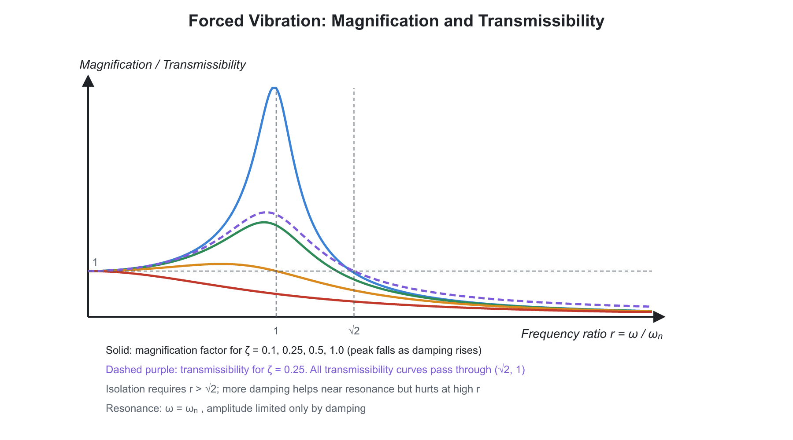

# 02. Balancing and Mechanical Vibrations

**Exam relevance:** APPSC AEE: P | SSC JE: C | RRB JE: S | Category: AEE+/ALL | Yield: HY

---

## Part A: Detailed Theory (read this first)

This part explains why rotating and reciprocating machines shake, how to balance them, and how vibrations are modelled and controlled. Part B (from section 1 onwards) is the compact reference.

### A1. Why balancing matters
```text
     o  rotating mass m
    /
   / r
  O----------> rotation
  shaft axis
```


Any mass that rotates about an axis not through its centre of mass exerts a **centrifugal force** on the bearings: $F = m\omega^2 r$. This force rotates with the shaft, so the bearing reaction changes direction every revolution. The result is vibration, noise, bearing wear and fatigue failure. The force grows with the **square of speed**, so a rotor that runs smoothly at low speed may shake violently at high speed.

**Balancing** means adding or removing mass so that the net force (and couple) on the bearings becomes zero.

- **Static balance:** the centre of mass lies on the axis; the rotor stays at rest in any angular position when placed on knife edges. Condition: $\sum m r = 0$ (vector sum). Enough for a thin disc (narrow wheel).
- **Dynamic balance:** the centrifugal forces form a zero resultant **and** their moments (couples) about any plane also sum to zero. Needed for a long rotor (crankshaft, turbine rotor), because masses in different planes create a couple even if forces cancel. Dynamic balance includes static balance; a statically balanced long rotor may still be dynamically unbalanced.

### A2. Balancing rotating masses

**Case 1: one mass in a plane.** Add an equal $mr$ opposite to it (in the same plane): $m_b r_b = m r$.

**Case 2: several masses in the same plane.** Draw the vector polygon of $mr$ for each mass (direction of the radius, magnitude $mr$). The closing vector, reversed, gives the balancing $m_b r_b$ and its angle. If the polygon already closes, the rotor is balanced.

**Case 3: masses in different planes (the general case).**

1. Choose a **reference plane (RP)**. Moving a force $F$ from its plane to the RP requires adding a couple $F \times l$ (where $l$ is the distance from the RP, positive on one side and negative on the other).
2. Draw the **couple polygon** with vectors $m r l$ (turned $90^\circ$ in direction, but usually plotted unrotated with consistent sense). The closing side gives the balancing mass in the plane where it is placed.
3. Draw the **force polygon** with all masses including the new balancing mass; its closing side gives the second balancing mass.

Two balancing masses in two planes always suffice for a rotor with any number of masses.

**Practical check list.**

- Tabulate: mass $m$, radius $r$, $mr$, plane position $l$ from RP, angle $\theta$, couple $mrl$.
- Choose the RP at a plane where an unknown mass lies to remove one unknown from the couple polygon.

### A3. Balancing reciprocating masses

In a piston-crank engine, the piston, whose mass $m$ moves along the line of stroke, has acceleration $\ddot{x} = \omega^2 r\left(\cos\theta + \dfrac{\cos 2\theta}{n}\right)$. Inertia force:

- **Primary force** $m\omega^2 r\cos\theta$ (varies once per revolution).
- **Secondary force** $m\omega^2 r\dfrac{\cos 2\theta}{n}$ (varies twice per revolution, smaller by factor $1/n$, because $n = l/r$ is usually 3 to 5).

Unlike the rotating case, this force is always along the line of stroke and changes in magnitude, so it **cannot be balanced by adding a rotating mass** alone. Adding a rotating balance mass equivalent to a fraction $c$ of $m$ cancels part of the primary force along the stroke, but creates an equal force **perpendicular** to the stroke (the force from the balancing mass rotates). The designer picks $c$ (usually $\tfrac{1}{2}$ for single-cylinder, up to $\tfrac{2}{3}$ in locomotives) so as to trade the stroke-direction shake against perpendicular shake.

**Locomotives.** With the partial balancing mass on the wheel:

- **Variation of tractive force:** the unbalanced force along the line of stroke $(1 - c)m\omega^2 r\cos\theta$ makes the pulling force on the train fluctuate.
- **Swaying couple:** the unbalanced forces of two cylinders on the two sides of a locomotive form a couple about the vertical axis, so the front sways side to side.
- **Hammer blow:** the vertical component of the balancing mass force, $c\,m\omega^2 r \sin\theta$ for a wheel. When it points downward it adds to the dead load on the rail; at high speed the wheel may even lift. The maximum hammer blow is $c\,m\omega^2 r$ per wheel. It is a rail-damage problem.

**Multi-cylinder engines.** Many cylinders give a chance to cancel forces by choosing the crank angles. Conditions for complete balance:

- Primary forces: $\sum m r \cos\theta = 0$ and $\sum m r \sin\theta = 0$ (the primary force polygon closes).
- Primary couples: $\sum m r l \cos\theta = 0$ and $\sum m r l \sin\theta = 0$.
- Secondary forces: same with $2\theta$ and a factor $1/n$.

A **single cylinder** cannot be fully balanced. A **4-cylinder in-line** engine with cranks $0^\circ$, $180^\circ$, $180^\circ$, $0^\circ$ is balanced in primary forces and couples but has an unbalanced secondary force. A **6-cylinder in-line** engine (cranks at $120^\circ$ pairs) is balanced in both. A **V-engine** or a **radial engine** can be analysed with the **direct and reverse crank method**: replace the reciprocating mass with two equal rotating masses (half each), one rotating forward at $\omega$, the other backward.

### A4. Basics of vibration

**Vibration** is repetitive motion about an equilibrium position. It occurs when a system has both mass (inertia) and elasticity (restoring force). Energy swaps between kinetic and potential.

**Classification:**

- **Free vibration:** after an initial disturbance, no external force. Frequency is the **natural frequency**.
- **Forced vibration:** a periodic external force acts. The system oscillates at the **forcing frequency**.
- **Damped / undamped:** energy dissipation (friction, viscous, structural).
- **Linear / nonlinear;** **Deterministic / random.**
- By motion type: **longitudinal** (axial), **transverse** (bending), **torsional** (twisting).

**Terms.** Amplitude, period $T$, frequency $f = 1/T$, circular frequency $\omega = 2\pi f$, phase angle, degrees of freedom (the number of independent coordinates needed to describe the motion).

**Simple harmonic motion.** A body is in SHM when its acceleration is proportional to displacement and opposite in direction: $\ddot{x} = -\omega^2 x$. Solution $x = X\sin(\omega t + \varphi)$. Maximum velocity $X\omega$, maximum acceleration $X\omega^2$.

### A5. Undamped free vibration: the foundation

A mass $m$ on a spring of stiffness $k$. Newton's law: $m\ddot{x} = -kx$, so

$$\ddot{x} + \omega_n^2 x = 0, \qquad \omega_n = \sqrt{\frac{k}{m}}$$

- Natural frequency depends only on **stiffness and mass**, not on the amplitude.
- Using the static deflection $\delta_{st} = mg/k$: $\omega_n = \sqrt{g/\delta_{st}}$, so $f_n \approx \dfrac{0.5}{\sqrt{\delta_{st}\,(\text{m})}}$ Hz. A measurement of static deflection immediately gives the natural frequency.
- **Energy method (Rayleigh):** at maximum displacement, all energy is potential; at the mean position, all kinetic. Equate $KE_{max} = PE_{max}$ to get $\omega_n$ for complex systems (a spring with its own mass: add one-third of spring mass to $m$).
- **Equivalent stiffness:** parallel springs add; series springs add as reciprocals. Beams act as springs: the stiffness is the load divided by the deflection under the load. Use the table in Part B.
- **Torsional vibration:** the same equation with angular displacement; inertia $I$ and shaft stiffness $k_t = GJ/L$ give $\omega_n = \sqrt{k_t/I}$. A two-rotor system has a **node** (a section of zero twist) between them; the shaft is imagined as two shafts, each fixed at the node.
- **Whirling of shafts (critical speed).** A rotating shaft with a disc bows outward at a certain speed because the centre of mass is not on the axis. The shaft whirls when its speed equals its transverse natural frequency; this is the **critical speed** $N_c = \dfrac{60}{2\pi}\sqrt{\dfrac{g}{\delta}}$ with $\delta$ the static deflection under the load. Operating well above or below $N_c$ is safe. For several loads, **Dunkerley's method** estimates the fundamental frequency.

### A6. Damped free vibration

Real systems lose energy. For viscous damping (force proportional to velocity, $c\dot{x}$):

$$m\ddot{x} + c\dot{x} + kx = 0$$

Define the **critical damping coefficient** $c_c = 2\sqrt{km}$, the smallest damping at which the motion is no longer oscillatory. The **damping ratio** $\zeta = c/c_c$ decides behaviour.

| $\zeta$ | Type | Response |
|---|---|---|
| 0 | Undamped | Oscillates forever |
| $<1$ | Underdamped | Oscillates with decaying amplitude, frequency $\omega_d = \omega_n\sqrt{1-\zeta^2}$ |
| $=1$ | Critically damped | Returns to rest in the shortest time, no overshoot (door closers, gauges) |
| $>1$ | Overdamped | Creeps back slowly |

**Logarithmic decrement** $\delta = \ln(x_1/x_2)$ for successive peaks measures damping from a recorded decay: $\delta = \dfrac{2\pi\zeta}{\sqrt{1-\zeta^2}}$. Damping reduces the damped natural frequency slightly, but for small $\zeta$ the change is negligible.

### A7. Forced vibration, resonance and isolation


When a force $F_0\sin\omega t$ acts, the steady-state amplitude depends on the **frequency ratio** $r = \omega/\omega_n$.

- At low frequency ($r \ll 1$) the response follows the force like a static load: amplitude $\approx F_0/k$.
- At $r \approx 1$ the amplitude peaks: **resonance**. Without damping the amplitude would be infinite; with damping the magnification is $\dfrac{1}{2\zeta}$. Resonance destroys structures (Tacoma bridge). The remedy is to avoid operating near $\omega_n$, add damping, or change the mass or stiffness.
- At high frequency ($r \gg 1$) the amplitude is small; the mass cannot follow.

**Rotating unbalance.** A machine with unbalanced mass $m_0$ at eccentricity $e$ produces a force $m_0 e\omega^2$ that grows with speed. The response includes the factor $r^2$.

**Vibration isolation.** The aim is to reduce the force that goes to the foundation (**force transmissibility**) or the motion that goes to the equipment (base excitation). The transmissibility ratio

$$TR = \sqrt{\frac{1 + (2\zeta r)^2}{(1 - r^2)^2 + (2\zeta r)^2}}$$

is less than 1 only when $r > \sqrt{2}$. So isolators must be soft enough that the machine's forcing frequency is above $\sqrt{2}\,\omega_n$. Increasing damping helps near resonance but **hurts** isolation at high frequency, a trade-off. Typical isolators are rubber pads, springs, air mounts.

**Vibration measuring instruments.** If the instrument's natural frequency is much lower than the vibration frequency ($r \gg 1$), it measures displacement (**vibrometer**, seismometer). If the natural frequency is much higher ($r \ll 1$), it measures acceleration (**accelerometer**).

### A8. Exam relevance

- Static and dynamic balance conditions; hammer blow; swaying couple (APPSC AEE focus).
- $\omega_n = \sqrt{k/m}$, equivalent springs, critical speed (all exams).
- Damping ratio, critical damping, log decrement (SSC JE and APPSC AEE).
- Transmissibility, resonance, instruments (APPSC AEE).

---

## Part B: Quick-reference notes, formulas, numericals and PYQs


## 🧭 1. Balancing

- **Static balance:** the resultant of all centrifugal forces is zero ($\sum mr = 0$ as vectors). Sufficient for thin discs.
- **Dynamic balance:** both the resultant force and the resultant couple are zero. Needed for long rotors.
- Centrifugal force: $F = m\omega^2 r$.
- **Single mass, single plane:** balance with a mass $m_b$ at radius $r_b$ on the opposite side: $m_b r_b = m r$.
- **Several masses in one plane:** the polygon of $mr$ vectors must close.
- **Masses in different planes:** both the force polygon ($mr$) and the couple polygon ($mrl$) must close. A mass can be moved to a reference plane by adding an equal parallel force and a couple.
- Complete balance of a rotor with masses in several planes needs balancing masses in two planes.

### Reciprocating masses

$$F_{primary} = m\omega^2 r\cos\theta, \qquad F_{secondary} = m\omega^2 r\,\frac{\cos 2\theta}{n}, \qquad n = \frac{l}{r}$$

- Primary force frequency equals crank speed; secondary equals twice the crank speed.
- A single-cylinder engine can only be **partially** balanced. A rotating balance mass equivalent to a fraction $c$ of the reciprocating mass is added at the crank radius, usually with $c = \tfrac{1}{2}$ to $\tfrac{2}{3}$.
- The unbalanced force along the line of stroke is $(1-c)\,m\omega^2 r\cos\theta$ and perpendicular to it is $c\,m\omega^2 r\sin\theta$. The resultant unbalanced force is

$$F_R = m\omega^2 r\sqrt{(1-c)^2\cos^2\theta + c^2\sin^2\theta}$$

- In locomotives, the variation of tractive force is due to the $(1-c)$ term, and the **hammer blow** (varying wheel load on the rail) is due to the balancing mass, with maximum value $c\,m\omega^2 r$. A **swaying couple** arises in two-cylinder locomotives.
- **Multi-cylinder in-line engines:** a 4-cylinder engine (cranks $0^\circ, 180^\circ, 180^\circ, 0^\circ$) is balanced for primary forces and couples. A 6-cylinder in-line engine is balanced for primary and secondary forces and couples.
- **V-engines and radial engines** are analysed with the direct and reverse crank method.

## 🧭 2. Free vibrations

- **Terms:** frequency $f = \dfrac{1}{T}$, circular frequency $\omega_n$, degrees of freedom, damping.
- **Natural frequency (undamped):**

$$\omega_n = \sqrt{\frac{k}{m}} = \sqrt{\frac{g}{\delta_{st}}}, \qquad f_n = \frac{1}{2\pi}\sqrt{\frac{g}{\delta_{st}}}, \qquad T = 2\pi\sqrt{\frac{m}{k}}$$

- **Equivalent stiffness:** parallel springs $k = k_1 + k_2$; series springs $\dfrac{1}{k} = \dfrac{1}{k_1} + \dfrac{1}{k_2}$.
- **Beam stiffness at the load point:**

| Beam | Stiffness $k$ |
|---|---|
| Cantilever (end load) | $\dfrac{3EI}{L^3}$ |
| Simply supported (central load) | $\dfrac{48EI}{L^3}$ |
| Fixed-fixed (central load) | $\dfrac{192EI}{L^3}$ |

- **Torsional vibration:**

$$\omega_n = \sqrt{\frac{k_t}{I}}, \qquad k_t = \frac{GJ}{L}$$

  Two-rotor system: the node divides the shaft so that $I_1 l_1 = I_2 l_2$, and

$$\omega_n = \sqrt{\frac{k_t\,(I_1 + I_2)}{I_1 I_2}}$$

  Geared systems are referred to one shaft by multiplying by the square of the gear ratio.
- **Rayleigh's energy method:** $KE_{max} = PE_{max}$.
- **Dunkerley's method** gives a lower bound on the fundamental frequency of a shaft with several loads:

$$\frac{1}{f_n^2} = \frac{1}{f_1^2} + \frac{1}{f_2^2} + \cdots$$

## 🧭 3. Damped free vibration

$$m\ddot{x} + c\dot{x} + kx = 0$$

$$c_c = 2\sqrt{km} = 2m\omega_n, \qquad \zeta = \frac{c}{c_c}, \qquad \omega_d = \omega_n\sqrt{1 - \zeta^2}$$

| Damping ratio | Behaviour |
|---|---|
| $\zeta = 0$ | Undamped, sustained oscillation |
| $\zeta < 1$ | Underdamped: oscillation with decaying amplitude |
| $\zeta = 1$ | Critically damped: fastest return without oscillation |
| $\zeta > 1$ | Overdamped: slow, aperiodic return |

- **Logarithmic decrement:**

$$\delta = \ln\frac{x_1}{x_2} = \frac{2\pi\zeta}{\sqrt{1 - \zeta^2}} \approx 2\pi\zeta \ \text{(small } \zeta\text{)}, \qquad \delta = \frac{1}{n}\ln\frac{x_0}{x_n}$$

## 🧭 4. Forced vibration

For $m\ddot{x} + c\dot{x} + kx = F_0\sin\omega t$, with frequency ratio $r = \dfrac{\omega}{\omega_n}$:

$$M = \frac{X}{F_0/k} = \frac{1}{\sqrt{(1-r^2)^2 + (2\zeta r)^2}}, \qquad \tan\varphi = \frac{2\zeta r}{1 - r^2}$$

- **Magnification factor** at resonance ($r = 1$): $M = \dfrac{1}{2\zeta}$, which is infinite when $\zeta = 0$.
- **Transmissibility** (vibration isolation):

$$TR = \frac{\sqrt{1 + (2\zeta r)^2}}{\sqrt{(1-r^2)^2 + (2\zeta r)^2}}$$

  Isolation works only when $r > \sqrt{2}$; in that region more damping reduces isolation. For $\zeta = 0$, $TR = \dfrac{1}{r^2 - 1}$. Isolation efficiency $= (1 - TR)\times100\%$.
- **Rotating unbalance:** $X = \dfrac{me}{M_{total}}\,\dfrac{r^2}{\sqrt{(1-r^2)^2 + (2\zeta r)^2}}$.
- **Whirling (critical speed) of shafts:**

$$\omega_c = \sqrt{\frac{k}{m}} = \sqrt{\frac{g}{\delta}}, \qquad N_c \approx \frac{946}{\sqrt{\delta\ (\text{mm})}}\ \text{rpm}$$

  The critical speed equals the natural frequency of transverse vibration. Steam turbine rotors often operate above their critical speed.
- **Instruments:** a seismometer works at $r \gg 1$ (measures displacement); an accelerometer works at $r \ll 1$.

## 🧭 5. Worked numericals

1. **Natural frequency.** $m = 10$ kg, $k = 4000$ N/m: $\omega_n = \sqrt{400} = 20$ rad/s, so $f = 3.18$ Hz.
2. **Static deflection** $4$ mm: $f = \dfrac{1}{2\pi}\sqrt{\dfrac{9.81}{0.004}} = 7.9$ Hz.
3. **Damping.** $c = 100$ N-s/m, $k = 4000$, $m = 10$: $c_c = 2\sqrt{4000 \times 10} = 400$, so $\zeta = 0.25$.

## 🧭 6. Common mistakes

- Using hertz where rad/s is needed in $\omega_n$.
- Believing damping always improves isolation (it does not for $r > \sqrt{2}$).
- Forgetting the reciprocal rule for series springs.

## 🧭 7. Interconnections

- Governors and flywheels (next chapter), IC engine firing order, and shaft and spring design in Machine Design.

## 🧭 8. PYQs

| # | Question | Answer | Exam / Year | Verify |
|---|---|---|---|---|
| 1 | Natural frequency of a spring-mass system | $\sqrt{\dfrac{k}{m}}$ rad/s | SSC JE 2017 | [ ] |
| 2 | Critical damping coefficient | $2\sqrt{km}$ | RRB JE 2015 | [ ] |
| 3 | Damping ratio $\zeta < 1$ gives | Underdamped motion | SSC JE 2018 | [ ] |
| 4 | Logarithmic decrement | $\ln\dfrac{x_1}{x_2}$ | RRB JE 2019 | [ ] |
| 5 | Transmissibility is less than one when | $\dfrac{\omega}{\omega_n} > \sqrt{2}$ | SSC JE 2019 | [ ] |
| 6 | Dynamic balance of a rotor needs | Resultant force and couple both zero | APPSC AEE 2012 | [ ] |
| 7 | Frequency of the primary force | Equal to crank speed | RRB JE 2015 | [ ] |
| 8 | Dunkerley's method gives | Fundamental frequency (lower bound) | SSC JE 2020 | [ ] |
| 9 | Resonance means | Forcing frequency equals natural frequency | RRB JE 2014 | [ ] |
| 10 | Hammer blow in locomotives is caused by | Unbalanced balancing mass for the reciprocating parts | SSC JE 2016 | [ ] |

## 🧭 9. Revision checklist

- [ ] Static vs dynamic balance and reciprocating balance terms
- [ ] $\omega_n$, $c_c$, $\zeta$, $\delta$ formulas
- [ ] Transmissibility and the $\sqrt{2}$ rule
- [ ] Critical speed of shafts
