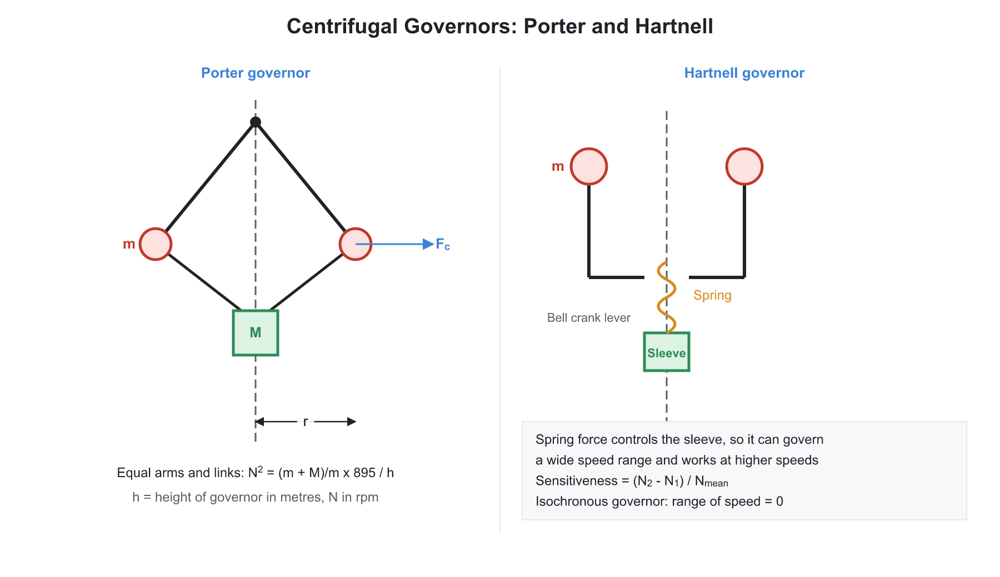
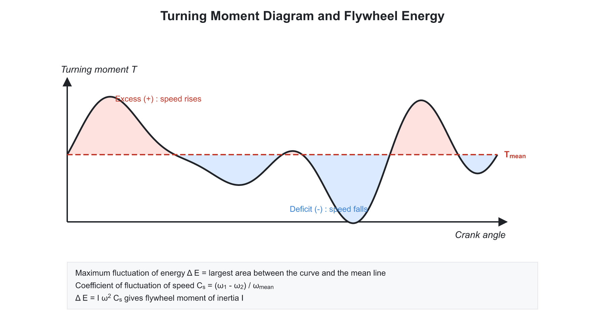

# ⚙️ 03. Governors, Flywheel, Brakes, Clutches, Belts and Gyroscope

**Exam relevance:** APPSC AEE: C | SSC JE: C | RRB JE: C/S | Category: ALL | Yield: HY

---

## 📘 Part A: Detailed Theory (read this first)

This part explains how engines are kept at steady speed (governor, flywheel), how friction devices transmit and absorb torque (clutch, brake, belt), and how a spinning rotor reacts when turned (gyroscope). Part B (from section 1 onwards) is the compact reference.

### 🔹 A1. Speed control: two different problems

An engine's speed changes for two different reasons, which need two different devices.

| Cause | Time scale | Device |
|---|---|---|
| The torque during a single cycle is not constant (power stroke versus other strokes) | Within one cycle | **Flywheel** |
| The load on the engine changes (more or less work demanded) | Over many cycles | **Governor** |

- A **flywheel** is a heavy rotating disc or rim. It stores kinetic energy when the engine torque exceeds the load torque (speed rises slightly) and gives it back when the torque is less (speed falls slightly). It does not change the mean speed, and it does not supply energy; it only smooths the cycle.
- A **governor** senses the mean speed and adjusts the fuel or steam supply to bring the speed back. If the load drops, the engine speeds up; the governor reduces the supply. If the load rises, it increases the supply.

### 🔹 A2. Centrifugal governors

Two balls rotate on arms about a vertical spindle. As the speed rises, the balls fly outward (radius increases) and, through links, **lift a sleeve**. The sleeve is connected to the throttle valve. Equilibrium at a given radius requires the balls' centrifugal force to balance the weight (and spring force or sleeve load).

**Watt governor.** The simplest; two balls hang from the spindle top by arms. For a ball of mass $m$ rotating in a horizontal circle with the arm at angle $\alpha$ to the vertical, balance of the three forces (weight, tension, centrifugal) gives $\tan\alpha = \dfrac{\omega^2 r}{g}$ and with $r = h\tan\alpha$ the height $h = \dfrac{g}{\omega^2}$. Height varies as $1/N^2$, so at high speeds the change of height per rpm becomes very small: the Watt governor is **insensitive at high speed** and is used only at low speed.

**Porter governor.** Adds a heavy central load $M$ on the sleeve. The extra load adds to the downward force that the balls must balance, so for the same height the governor runs at a higher speed. At higher speed the height changes more per rpm than in a Watt governor, so it is more sensitive. **Proell governor** carries the balls on extensions of the lower links; for the same height it runs at a higher speed than a Porter governor, with greater sensitivity.

**Hartnell governor.** A spring-loaded governor: a compression spring takes the place of the dead weight. Bell-crank levers carry the balls and press on the sleeve. Changing the spring tension changes the speed setting. It is compact and can run at high speeds. **Hartung** and **Wilson-Hartnell** governors are spring-loaded variants.

**Inertia governor.** The balls respond to angular acceleration (inertia force) instead of speed, so it reacts much faster to a change.

### 🔹 A3. Governor performance terms (understand each one)

- **Sensitiveness:** how much the speed has to change for the sleeve to move through its full lift. $\dfrac{N_2 - N_1}{N}$, where $N_1$ and $N_2$ are the minimum and maximum equilibrium speeds. A highly sensitive governor responds to a small speed change.
- **Stability:** a governor is stable if there is only **one equilibrium speed** for each radius of the ball path, and the balls return to that radius after a small disturbance. On the $F_c$ against $r$ graph this holds when $\dfrac{dF_c}{dr} > \dfrac{F_c}{r}$, that is, the curve is steeper than the straight line from the origin to the point. A straight line with a positive intercept on the $F_c$ axis meets this condition.
- **Isochronous governor:** the equilibrium speed is the same at all radii. Infinite sensitivity: the balls would move to extreme positions at the slightest change. Impractical, as it leads to hunting.
- **Hunting:** a sensitive governor overshoots; the speed fluctuates continuously above and below the required value. Avoid by damping or by reducing sensitivity.
- **Controlling force** $F_c$: the inward force that holds the balls at a radius. Plotted against radius, the shape tells about stability: a straight line with positive intercept is stable, through the origin is isochronous, negative intercept is unstable.
- **Effort:** the average force exerted at the sleeve for a given percentage change of speed. **Power:** effort multiplied by the sleeve lift. A governor with high power can overcome friction and move the valve.
- **Friction effect:** friction at the sleeve adds an insensitivity range. Both the minimum and maximum speeds are altered, so the speed must change by a certain amount before the sleeve moves.

### 🔹 A4. Flywheel in detail

**Turning moment diagram.** Plot the engine's crank-effort (torque) $T$ against crank angle. The mean torque line is $T_{mean}$ such that the area under the curve for one cycle equals the work per cycle.

- Where $T > T_{mean}$ the engine speeds up: the flywheel absorbs the surplus energy.
- Where $T < T_{mean}$ the speed falls: the flywheel gives up energy.
- Running totals of the areas above and below the mean give the energy at each point; the **maximum fluctuation of energy** $\Delta E$ is the difference between the highest and lowest values of the running total.

**Design.** The energy stored by the flywheel between the maximum and minimum speed is

$$\Delta E = \tfrac{1}{2}I\left(\omega_{max}^2 - \omega_{min}^2\right) = I\omega^2 C_s$$

where $\omega$ is the mean speed. From it, $I = \dfrac{\Delta E}{\omega^2 C_s}$. The **coefficient of fluctuation of speed** $C_s$ depends on the use: 0.2 for crushers, about 0.03 for engines in general, down to 0.003 for alternators and precision machinery.

**Why a rim and why a heavy mass.** The same $I$ is obtained with less mass if the mass is at a large radius ($I = mR^2$ for a thin rim). The limit is the rim stress $\rho v^2$: the rim speed is limited by the strength of the material (about 40 m/s for cast iron, about 100 m/s for steel).

**Engine type.** A two-stroke engine has a power stroke every revolution; a four-stroke engine has one every two revolutions, so it has larger fluctuations and needs a heavier flywheel. A multi-cylinder engine has overlapping power strokes and needs a smaller flywheel.

### 🔹 A5. Friction devices: the common principle

Friction transmits torque between a driving and a driven surface. For a normal force $W$ pressing the surfaces, the friction force is $\mu W$, and the torque is $\mu W r_{mean}$. The only complication is how the pressure is distributed over the surface, which gives two design assumptions.

- **Uniform pressure:** the pressure $p$ is the same everywhere. True for a new, rigid clutch face before wear.
- **Uniform wear:** after run-in, wear is the same everywhere. Wear is proportional to $p \times v$, and the sliding speed $v$ increases with radius, so $p\,r = $ constant: pressure is highest at the inner radius. **The torque under uniform wear is lower**, so uniform wear is the safe design assumption for clutches.

**Pivot and collar bearings.** A shaft with an axial load $W$ rotating on a flat pivot has frictional torque $\dfrac{2}{3}\mu W R$ (uniform pressure) or $\dfrac{1}{2}\mu W R$ (uniform wear). A collar (hollow) uses the mean radius for uniform wear.

**Clutch.** Connects and disconnects two shafts. **Single plate clutch** (as in cars): one friction disc between a flywheel and a pressure plate, pushed by springs. It has two friction surfaces ($n = 2$). **Multi-plate clutch** has several discs to get high torque in a small diameter (motorcycles, in oil). Number of friction surfaces: $n = n_1 + n_2 - 1$, where $n_1$ and $n_2$ are the numbers of discs on each shaft. **Cone clutch** uses the wedge effect, giving high torque; semi-cone angle must be greater than the friction angle to avoid sticking. **Centrifugal clutch** engages automatically above a set speed (scooters).

**Brakes.** A brake absorbs energy (kinetic or potential) and turns it into heat. The torque is $\mu W r$ with $W$ the shoe force. Types:

- **Block or shoe brake:** a block pressed on a drum. A single block loads the shaft sideways; double blocks cancel the side thrust.
- **Band brake:** a flexible band wraps around a drum; tight side $T_1$, slack side $T_2$, with $\dfrac{T_1}{T_2} = e^{\mu\theta}$. Brake torque $(T_1 - T_2)r$. **Band-and-block** brake adds wooden blocks to the band.
- **Internal expanding shoe brake:** shoes inside a drum (car rear brakes, truck brakes); good protection from dust.
- **Disc brake:** pads clamp a rotating disc; better heat dissipation, no fade, used in cars and aircraft.
- **Self-energising and self-locking:** if the friction force helps to apply the brake, the brake is self-energising. If the friction is so strong that no external force is needed, the brake is **self-locking**.

**Dynamometers** measure the power of an engine. **Absorption:** all power is dissipated as heat (Prony brake, rope brake, hydraulic). **Transmission:** power passes through the instrument to the load (belt transmission, epicyclic train, torsion).

### 🔹 A6. Belt, rope and chain drives

Belts transmit power between shafts that are some distance apart. They are cheap, quiet and flexible, and absorb shocks. Drawbacks: slip and creep, so the velocity ratio is not exact.

**Types:** flat belt, V-belt, rope, timing (toothed) belt. A flat belt can be **open** (shafts turn in the same direction) or **crossed** (opposite direction). V-belts use the wedge action: higher friction, so the same power at lower tension, good for short centre distances.

**How power is transmitted.** The belt is pre-tensioned (initial tension $T_0$). When the driver pulley turns, the belt on the pulling side gets tighter ($T_1$, tight side) and on the other side slacker ($T_2$, slack side). Power depends on the difference: $P = (T_1 - T_2)v$.

**Tension ratio** (Euler's capstan equation). Consider a small element of belt on the pulley. Balance of the radial and tangential forces with friction on the element gives

$$\frac{T_1}{T_2} = e^{\mu\theta}$$

where $\theta$ is the angle of lap on the **smaller pulley** (contact angle). For V-belts, $\mu$ is replaced by $\mu/\sin\beta$ where $\beta$ is the semi-groove angle. The belt slips first on the pulley with the smaller $\mu\theta$, usually the smaller pulley.

**Centrifugal tension.** The belt also experiences a centrifugal force as it goes round the pulley: $T_c = m v^2$ with $m$ = mass per metre length. It adds equally to both sides and reduces the contact pressure, so it **reduces power** at high speed. Maximum allowable tension $T_{max}$ must include it: $T_1 = T_{max} - T_c$. Power is maximum when $T_c = \dfrac{T_{max}}{3}$.

**Slip and creep.** Slip is the relative motion between the belt and pulley when the friction is insufficient. Creep is a small relative motion due to the change in belt length between the tight and slack sides (the belt stretches more on the tight side). Both lower the velocity ratio.

**Chain drive:** a positive drive, no slip, constant velocity ratio $= T_2/T_1$ (ratio of sprocket teeth), works at low speed and high torque, but noisy, with polygonal action causing speed variation.

### 🔹 A7. Gyroscope

A spinning rotor has **angular momentum** $H = I\omega$ along its spin axis. A torque is needed to change the direction of this vector (just as a force changes the direction of ordinary momentum). If the spin axis is turned (precessed) at rate $\omega_p$ about a perpendicular axis, a **gyroscopic couple** is needed:

$$C = I\,\omega\,\omega_p$$

and it acts about the third axis, perpendicular to both. The reaction on the supports (**reactive couple**) is equal and opposite.

**Rules for direction (vector method).** Represent spin and precession by vectors using the right-hand screw rule. The **active couple** (applied by the support on the rotor) tends to move the spin vector toward the precession vector. The **reactive couple** (felt by the support or frame) is opposite.

**Applications:**

- **Aeroplane turning:** the engine and propeller spin; when the plane turns in a horizontal plane, a gyroscopic couple acts in the vertical plane and tends to raise or lower the nose.
- **Ship:** pitching, rolling and steering produce gyroscopic reactions on the bearings of the turbine rotor.
- **Vehicle on a curve:** the gyroscopic effect of rotating wheels and engine parts, and the centrifugal force, both tend to push the outer wheels down and lift the inner wheels (for a four-wheeler). A **two-wheeler leans** into the curve to balance the overturning effect.
- **Stabilisers:** gyroscopes used to reduce the roll of ships, in gyrocompasses, and in missile guidance.

### 🔹 A8. Exam relevance

- Governor terms (sensitiveness, hunting, isochronous), flywheel $I = \Delta E/(\omega^2 C_s)$ (all exams).
- Clutch torque, uniform wear against uniform pressure, band brake tension ratio (SSC JE, APPSC AEE).
- Belt length, power transmitted, maximum power condition, creep and slip (all exams).
- Gyroscopic couple and direction (APPSC AEE).

---

## ⚡ Part B: Quick-reference notes, formulas, numericals and PYQs

## 🧭 1. Governors

- **Function:** maintain the mean speed of an engine under varying load by controlling the fuel supply. A **flywheel** only controls fluctuation within a cycle; a **governor** controls variation of mean speed.
- **Types:** centrifugal (dead-weight: Watt, Porter, Proell; spring-loaded: Hartnell, Hartung, Wilson-Hartnell) and inertia governors.
- **Watt governor** (height $h$ in metres, $N$ in rpm):

$$h = \frac{g}{\omega^2} = \frac{895}{N^2}$$

- **Porter governor** (ball mass $m$, central sleeve load $M$, $q = \dfrac{\tan\beta}{\tan\alpha}$):

$$N^2 = \frac{m + \dfrac{M(1+q)}{2}}{m}\times\frac{895}{h}$$

  For equal arms and links ($q = 1$): $h = \dfrac{m + M}{m}\times\dfrac{895}{N^2}$.
- **Proell governor:** a Porter governor with the balls on extensions of the links; it runs at higher speed than a Porter for the same height.
- **Hartnell governor:** spring-loaded; the sleeve load comes from the spring force.

### 🔹 Governor terms

| Term | Meaning |
|---|---|
| Sensitiveness | $\dfrac{N_2 - N_1}{N_{mean}} = \dfrac{2(N_2 - N_1)}{N_1 + N_2}$; more speed range per unit sleeve movement means more sensitive |
| Stability | One equilibrium speed for each radius of rotation |
| Isochronous | Equilibrium speed is the same at all radii (infinite sensitiveness, impractical) |
| Hunting | Continuous fluctuation of speed (over-sensitive governor) |
| Effort | Mean force on the sleeve for a given percentage change of speed |
| Power | Effort times the lift of the sleeve |
| Controlling force | Inward force on the ball, $F_c = m\omega^2 r$. Stable: the $F_c$ line has a positive intercept; isochronous: it passes through the origin; unstable: negative intercept |

## 🧭 2. Flywheel

- **Function:** stores kinetic energy during surplus and releases it when there is a deficit, reducing the **fluctuation of speed** within a cycle.
- **Coefficient of fluctuation of speed:**

$$C_s = \frac{\omega_{max} - \omega_{min}}{\omega_{mean}} = \frac{N_1 - N_2}{N}$$

- **Coefficient of fluctuation of energy:** $C_e = \dfrac{E_{max} - E_{min}}{\text{work done per cycle}}$.
- **Maximum fluctuation of energy:**

$$\Delta E = I\omega^2 C_s = mk^2\omega^2 C_s \quad\Rightarrow\quad I = \frac{\Delta E}{\omega^2 C_s}$$

  $\Delta E$ is read from the turning moment diagram as the largest difference between the maximum and minimum energies (areas above and below the mean torque line).
- A four-stroke engine needs a heavier flywheel than a two-stroke (one power stroke per two revolutions). A single-cylinder double-acting engine needs less than a single-acting one.
- Mean torque: $T_{mean} = \dfrac{\text{work per cycle}}{\text{angle per cycle}} = \dfrac{60\,P}{2\pi N}$.
- Rim-type flywheel (arms neglected): $I = mR^2$. Rim hoop stress $= \rho v^2$.
- **Flywheel vs governor:** a flywheel handles cyclic fluctuations; a governor handles variations caused by load changes.

## 🧭 3. Friction, clutches and brakes

### 🔹 Pivot and collar friction

| Case | Uniform pressure | Uniform wear |
|---|---|---|
| Flat pivot (radius $R$) | $T = \dfrac{2}{3}\mu W R$ | $T = \dfrac{1}{2}\mu W R$ |
| Flat collar (radii $R_1$, $R_2$) | $T = \dfrac{2}{3}\mu W\,\dfrac{R_1^3 - R_2^3}{R_1^2 - R_2^2}$ | $T = \mu W\,\dfrac{R_1 + R_2}{2}$ |

For a conical pivot, divide by $\sin\alpha$ ($\alpha$ is the semi-cone angle).

### 🔹 Clutches

- A single-plate clutch with both faces active has $n = 2$ friction surfaces. For a multi-plate clutch, $n = n_1 + n_2 - 1$.
- Torque for uniform wear (the usual design assumption after the initial run-in):

$$T = n\,\mu\, W\,R_{mean}, \qquad R_{mean} = \frac{R_1 + R_2}{2}$$

- **Uniform wear gives a lower torque than uniform pressure**, so it is the safer design assumption. Under uniform wear, the pressure is maximum at the inner radius ($p\,r = $ constant).
- **Cone clutch:** a small cone angle (about $12.5^\circ$) gives a large normal force for a given axial force, so more torque than a plate clutch; it must be disengaged against wedging.
- **Centrifugal clutch:** engages at a speed set by the spring.

### 🔹 Brakes

- Brakes absorb kinetic or potential energy and dissipate it as heat. Types: block (shoe), band, band-and-block, internal expanding shoe, disc.
- **Band brake:**

$$\frac{T_1}{T_2} = e^{\mu\theta}, \qquad T_{brake} = (T_1 - T_2)\,r$$

- A **self-locking** brake needs zero or negative applied force because the friction moment assists the application.
- A single block brake loads the shaft sideways; use double shoes to avoid this. For a pivoted shoe spanning angle $2\theta$, the equivalent coefficient of friction is

$$\mu' = \frac{4\mu\sin\theta}{2\theta + \sin 2\theta}$$

- **Dynamometers:** absorption (Prony brake, rope brake, hydraulic) and transmission (belt, epicyclic train, torsion). Prony brake: $P = \dfrac{2\pi N W L}{60}$.

## 🧭 4. Belt, rope and chain drives

- **Velocity ratio** (no slip): $\dfrac{N_2}{N_1} = \dfrac{d_1}{d_2}$. With slip $s\%$: $\dfrac{N_2}{N_1} = \dfrac{d_1}{d_2}\left(1 - \dfrac{s}{100}\right)$. With belt thickness $t$, use $(d + t)$.
- **Length of belt** (pulley radii $r_1$, $r_2$, centre distance $x$):

$$L_{open} = \pi(r_1 + r_2) + 2x + \frac{(r_1 - r_2)^2}{x}$$

$$L_{crossed} = \pi(r_1 + r_2) + 2x + \frac{(r_1 + r_2)^2}{x}$$

- **Angle of lap:** open belt $180^\circ - 2\alpha$ with $\sin\alpha = \dfrac{r_1 - r_2}{x}$; crossed belt $180^\circ + 2\alpha$ with $\sin\alpha = \dfrac{r_1 + r_2}{x}$.
- **Power and tension ratio:**

$$P = (T_1 - T_2)\,v, \qquad \frac{T_1}{T_2} = e^{\mu\theta} \ \text{(flat)}, \qquad \frac{T_1}{T_2} = e^{\mu\theta/\sin\beta} \ \text{(V-belt)}$$

- **Centrifugal tension:** $T_c = m v^2$ ($m$ is mass per unit length). Then $T_1 = T_{max} - T_c$.
- **Maximum power** is transmitted when $T_c = \dfrac{T_{max}}{3}$, i.e. at

$$v = \sqrt{\frac{T_{max}}{3m}}$$

- **Initial tension:** $T_0 = \dfrac{T_1 + T_2}{2}$ (neglecting centrifugal tension), or $\dfrac{T_1 + T_2 + 2T_c}{2}$ including it.
- **Creep:** small relative motion due to unequal stretch of the belt; **slip** is excessive relative motion.
- **V-belts:** wedge action gives higher power for the same tension. **Timing belts** and **chain drives** are positive drives (no slip); chain velocity ratio $= \dfrac{T_2}{T_1}$.

## 🧭 5. Gyroscope

- Angular momentum $= I\omega$. **Gyroscopic couple:**

$$C = I\,\omega\,\omega_p$$

  where $\omega_p$ is the precession speed. The couple acts about the axis perpendicular to both the spin and precession axes.
- **Direction rule:** the spin vector tends to turn toward the precession vector (right-hand rule). The reactive couple on the body is opposite to the active gyroscopic couple. Solve direction questions with this vector rule rather than memorising aeroplane and ship cases.
- **Vehicle on a curve:** the gyroscopic effect of the wheels tends to increase the load on the outer wheels and reduce the load on the inner wheels; the centrifugal effect acts the same way, so the inner wheel lifts first.
- **Gyroscopic stabilisation** is used in ships, aeroplanes and two-wheelers.

## 🧭 6. Worked numericals

1. **Flywheel.** $\Delta E = 2000$ J, $N = 300$ rpm ($\omega = 31.42$ rad/s), $C_s = 0.02$:

$$I = \frac{2000}{31.42^2 \times 0.02} = 101.3\ \text{kg}\cdot\text{m}^2$$

2. **Belt.** $\mu = 0.3$, $\theta = 180^\circ$: $\dfrac{T_1}{T_2} = e^{0.942} = 2.57$. If $T_1 = 1000$ N then $T_2 = 389$ N and $P = 611\,v$ watts.
3. **Watt governor.** $N = 300$ rpm: $h = \dfrac{895}{300^2} = 0.00994$ m $= 9.94$ mm.

## 🧭 7. Common mistakes

- Using total wheel weight instead of the rotating disc mass in gyroscopic calculations.
- Choosing uniform pressure instead of uniform wear for clutch design.
- Using the centrifugal tension on one side only (it acts on both sides equally).

## 🧭 8. Interconnections

- Governors and flywheels connect to IC engines; brakes and clutches to friction in Engineering Mechanics; the gyroscope to rigid-body dynamics and vehicle stability; belts to power transmission in Machine Design.

## 🧭 9. PYQs

| # | Question | Answer | Exam / Year | Verify |
|---|---|---|---|---|
| 1 | A governor controls | Mean speed of the engine | SSC JE 2017 | [ ] |
| 2 | A flywheel controls | Cyclic fluctuation of speed | RRB JE 2015 | [ ] |
| 3 | Hunting is caused by | An over-sensitive governor | SSC JE 2018 | [ ] |
| 4 | Sensitiveness of an isochronous governor | Infinite | RRB JE 2014 | [ ] |
| 5 | Tension ratio of a flat belt | $e^{\mu\theta}$ | SSC JE 2019 | [ ] |
| 6 | Maximum power is transmitted when centrifugal tension equals | $\dfrac{T_{max}}{3}$ | APPSC AEE 2012 | [ ] |
| 7 | Gyroscopic couple | $I\omega\omega_p$ | RRB JE 2019 | [ ] |
| 8 | Friction surfaces in a single plate clutch | 2 | SSC JE 2016 | [ ] |
| 9 | Uniform wear gives lower torque than uniform pressure | True | SSC JE 2020 | [ ] |
| 10 | A crossed belt is longer than an open belt (same pulleys) | True | RRB JE 2015 | [ ] |
| 11 | The Porter governor is a | Dead-weight governor | RRB JE 2019 | [ ] |

## 🧭 10. Revision checklist

- [ ] Governor terms table
- [ ] Flywheel $\Delta E$ formula and turning moment diagram logic
- [ ] Clutch uniform pressure vs uniform wear
- [ ] Belt tensions and power
- [ ] Gyroscopic couple direction rule
