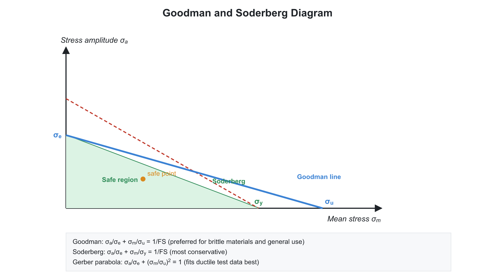
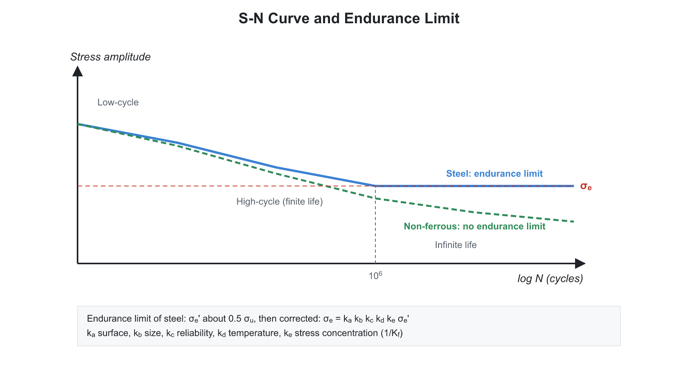
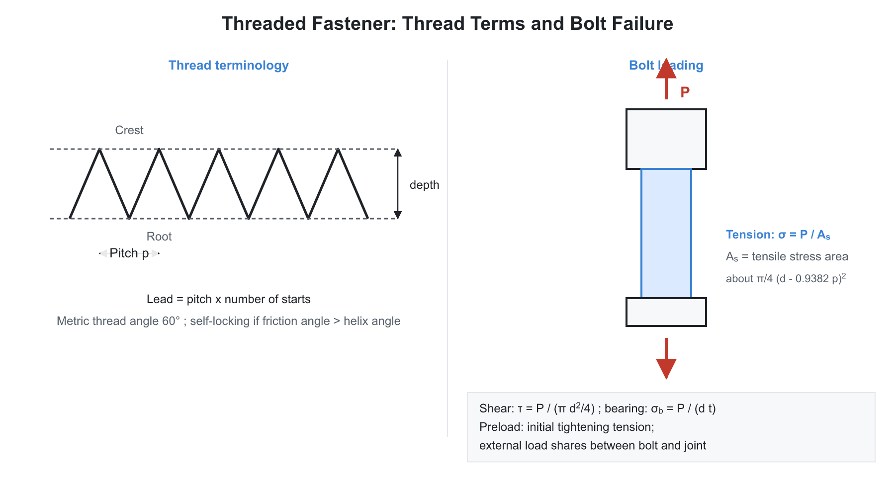
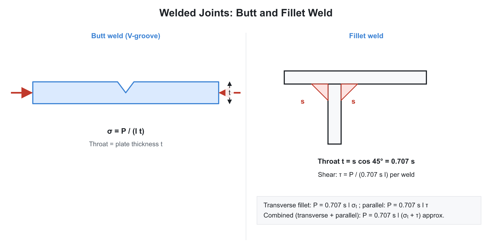
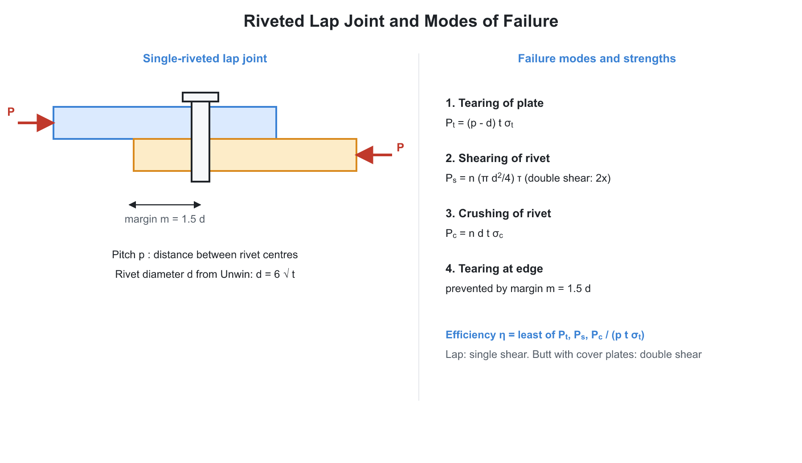

# 🛠️ 01. Design Fundamentals, Fatigue and Fasteners

**Exam relevance:** APPSC AEE: P | SSC JE: C | RRB JE: S | Category: AEE+/ALL | Yield: HY

---

## 📘 Part A: Detailed Theory (read this first)

This part explains how a machine element is designed, why parts fail under repeated loading, and how bolts, welds, rivets, keys and couplings are sized. Part B (from section 1 onwards) is the compact reference.

### 🔹 A1. What machine design is

**Machine design** is the creation of parts and assemblies that perform a required function safely, economically and reliably. The usual steps are: identify the need, write the specification, propose a concept, analyse forces and stresses, select the material, fix the dimensions, check against failure, draw, make a prototype and test.

**Types of design:** adaptive (small change to an existing design), development (new design from existing knowledge), new (original).

**Modes of failure.** A part may fail by: yielding (permanent deformation), fracture (brittle), fatigue (repeated load), buckling, wear, corrosion, creep (slow deformation at high temperature), or excessive deflection. The design is checked against the mode that governs.

**Factor of safety (FOS).** Loads, material properties, analysis and workmanship all carry uncertainty, so the working stress is set below the failure stress:

$$\text{FOS} = \frac{\text{failure stress}}{\text{allowable (working) stress}}$$

For ductile materials the failure stress is the yield strength $\sigma_y$ (for static loads). For brittle materials it is the ultimate strength $\sigma_u$. FOS is higher for shock and uncertain loads, lower for well-known loads.

**Selection of material.** Choose based on strength, stiffness, weight, cost, machinability, corrosion resistance, wear resistance and availability. Steels for strong parts, cast iron for castings in compression and vibration damping, bronze for bearings and worm wheels, aluminium for light weight.

**Standardisation and preferred numbers.** Standard sizes reduce cost and allow interchangeability. **Preferred numbers** form a geometric series so that sizes are spaced by constant percentage steps: R5 (ratio $\sqrt[5]{10} \approx 1.58$), R10 ($1.26$), R20 ($1.12$), R40 ($1.06$).

**Fits, limits and tolerances (preview of the metrology chapter).** The hole-basis system keeps the hole size fixed; the shaft size is varied to get the fit: **clearance** (always a gap, e.g. H7/g6), **transition** (either gap or interference, e.g. H7/k6), **interference** (always tight, e.g. H7/p6).

**Stress concentration.** Any abrupt change of section (hole, notch, keyway, fillet, thread root) disturbs the smooth flow of stress lines, causing a local rise of stress above the nominal value $\sigma_{nom}$. The **theoretical stress concentration factor** $K_t = \sigma_{max}/\sigma_{nom}$ depends only on geometry. For a circular hole in a wide plate in tension, $K_t = 3$. Under static load, a ductile material yields locally and redistributes the stress, so $K_t$ can be ignored. For brittle materials and under fatigue, it must be used. Remedies: generous fillet radii, relief grooves, gradual change of section, drilling a small hole at the end of a crack.

### 🔹 A2. Fatigue: why parts fail below the static strength

When a part is loaded repeatedly, even if the stress is well below the yield point, a microscopic crack can start at a surface defect or stress raiser. Each cycle grows the crack a little, until the remaining section is too small and the part breaks suddenly, **without any warning or visible yielding**. The fracture face shows a smooth region (beach marks, crack growth) and a rough region (final brittle fracture).

**Stages:** crack initiation, crack propagation, final fracture.

**Types of cyclic stress.**

- **Completely reversed:** mean stress zero, stress alternates between $+\sigma_a$ and $-\sigma_a$ (rotating shaft in bending).
- **Repeated (pulsating):** stress varies between zero and a maximum.
- **Fluctuating:** non-zero mean with an alternating part. Mean $\sigma_m = \dfrac{\sigma_{max} + \sigma_{min}}{2}$, amplitude $\sigma_a = \dfrac{\sigma_{max} - \sigma_{min}}{2}$.

**S-N curve and endurance limit.** In the rotating-beam test, specimens are run at different stress amplitudes and the number of cycles to failure $N$ is noted. Plotting $\sigma$ against $\log N$ gives the S-N curve. For steels the curve flattens at about $10^6$ cycles: below the **endurance limit** $\sigma_e$ the life is infinite. For polished steel specimens $\sigma_e \approx 0.5\sigma_u$ (up to about 700 MPa). Aluminium, copper and other non-ferrous metals have no clear endurance limit; a fatigue strength at $5 \times 10^8$ cycles is quoted.

- **Low-cycle fatigue:** below $10^3$ cycles; plastic strain involved.
- **High-cycle fatigue:** above $10^3$ cycles; stress mostly elastic. **Finite life** between $10^3$ and $10^6$ cycles. **Infinite life** if the stress is below the endurance limit.

**Real components differ from the polished test specimen.** The endurance limit of an actual part is reduced by surface finish ($k_a$, rough surfaces have more starting points), size ($k_b$, larger parts have more flaws), reliability ($k_c$), load type, temperature and stress concentration. Notch sensitivity $q$ decides how much of the theoretical $K_t$ applies: $K_f = 1 + q(K_t - 1)$.

**Design for fluctuating stress.** The designer plots **mean stress $\sigma_m$** on the horizontal axis and **alternating stress $\sigma_a$** on the vertical axis. Failure lines connect the endurance limit on the $\sigma_a$ axis with the yield or ultimate strength on the $\sigma_m$ axis.

- **Soderberg line:** from $\sigma_e$ to $\sigma_y$. Most conservative; used when yielding must be avoided.
- **Goodman line:** from $\sigma_e$ to $\sigma_u$. Straight line, fits brittle materials, widely used.
- **Gerber parabola:** from $\sigma_e$ to $\sigma_u$ as a parabola; fits test data for ductile materials best.
- **Langer line** (yield check): $\sigma_m + \sigma_a = \sigma_y$.

A point inside the failure line is safe. The FOS is the ratio of the distance to the failure line along the load line.

**Cumulative damage (Miner's rule).** For a part loaded at several stress levels with $n_i$ cycles at stress where life is $N_i$, failure occurs when $\sum \dfrac{n_i}{N_i} = 1$.

**Improving fatigue strength:** better surface finish, shot peening or cold rolling (puts compressive residual stress on the surface), carburising or nitriding, avoiding sharp corners, adequate fillet radii, avoiding corrosion.

### 🔹 A3. Threaded fasteners

A **bolt, screw or stud** with a **nut** clamps parts together. The thread acts like an inclined plane wrapped around a cylinder.

**Terms:** *major (nominal) diameter*, *minor (core) diameter*, *pitch* (distance between adjacent threads), *lead* (distance moved in one turn; equals pitch for single start and $n \times$ pitch for $n$-start), *helix (lead) angle* $\alpha$ with $\tan\alpha = \dfrac{\text{lead}}{\pi d_m}$.

**Thread forms:**

- **ISO metric (V-thread, $60^\circ$):** general fastening; high friction ensures self-locking.
- **Square thread:** efficient power transmission (zero side thrust); costly to cut.
- **Acme / trapezoidal ($29^\circ$ or $30^\circ$):** easier to make than square; used on lead screws.
- **Buttress:** high load in one direction (jacks, presses).
- **Whitworth:** $55^\circ$, rounded crests.

**Bolt design.** The tensile stress area is based on a diameter between the pitch and minor diameters; for simple problems use the core diameter: $\sigma_t = \dfrac{P}{(\pi/4)d_c^2}$. Typically $d_c \approx 0.84\,d$.

**Pre-load.** A bolt is tightened to produce an initial tension $P_i$ which clamps the joint. In service the external load only slightly increases the bolt load; the larger part of it reduces the clamping force. Pre-loading increases fatigue strength of bolts, because the stress amplitude is small. **Bolt tightening torque** $T = K P_i d$ with $K \approx 0.2$.

**Bolts loaded in shear, and bracket problems.** Bolts can be arranged in a group carrying an eccentric load $P$ at distance $e$ from the centroid. The load is replaced by a direct load $P$ at the centroid plus a moment $Pe$. Each bolt carries (1) **primary shear** $P/n$ (equal on all bolts) and (2) **secondary shear** proportional to the distance from the centroid, $F_i = \dfrac{Pe\,r_i}{\sum r^2}$, perpendicular to the radius. The resultant is the vector sum; the bolt furthest from the centroid, with the least angle between the two, is critical.

**Locking devices:** locknut (jam nut), castle nut and split pin, spring washer, toothed lock washer, Wiley nut, Grover washer, set screws. These resist loosening by vibration.

**Power screws** (lead screw, jack, press) convert rotary motion into linear. Treat as a block on an inclined plane of lead angle $\alpha$ with friction angle $\phi = \tan^{-1}\mu$: torque to raise $T = W r_m\tan(\alpha + \phi)$, to lower $T = W r_m \tan(\phi - \alpha)$. **Efficiency** $\eta = \dfrac{\tan\alpha}{\tan(\alpha+\phi)}$, maximum at $\alpha = 45^\circ - \phi/2$. **Self-locking** if $\phi > \alpha$ (the load does not run down on its own), and then $\eta < 50\%$. This is desirable for a jack, undesirable for a screw that needs to be efficient.

### 🔹 A4. Welded joints

Welding joins parts permanently using heat and filler. It is lighter, cheaper and more leak-tight than riveting.

- **Butt joint (groove weld):** the plates are in the same plane; full strength if the weld is full penetration. Throat equals the plate thickness. $\sigma = P/(t\,l)$.
- **Fillet weld:** triangular cross-section joining plates at right angles (lap and T joints). The weakest section (throat) is on the $45^\circ$ plane: throat $= s\cos 45^\circ = 0.707\,s$ where $s$ is the leg. Both transverse and parallel fillet welds are designed on the throat in shear: $\tau = \dfrac{P}{0.707\,s\,l}$. Strength of **parallel fillet** $= 1.414\,s\,l\,\tau$ for two welds, **transverse** $= 0.707\,s\,l\,\sigma$ for one weld. A **combined** joint adds the two.
- **Eccentric loads** produce a twist. Treat the weld as a line, compute the direct shear $P/A$ and the torsional shear $T r/J$, add vectorially at the critical point.
- **Defects and stresses:** residual stress from uneven cooling, distortion, porosity, undercut, incomplete fusion. Stress relief by annealing, peening or preheating.

### 🔹 A5. Riveted joints

A rivet is a short cylindrical bar with a head; it is heated, inserted through holes and the other end is hammered to make a second head. Rivets are used in boilers, ships, bridges, and aircraft (now often replaced by welds or bolts).

**Joint types.** **Lap joint** (plates overlap), **butt joint** (plates meet end to end, covered by one or two cover plates). By rows: single, double, triple riveted; by pattern: chain or zig-zag.

**Terms.** Pitch $p$ (centre-to-centre distance of adjacent rivets in a row), back pitch, diagonal pitch, margin (edge distance from the plate edge to the rivet centre, about $1.5\,d$).

**Failure modes of a riveted joint and corresponding strengths (per pitch length):**

1. **Tearing of the plate** between rivet holes: $P_t = (p - d)\,t\,\sigma_t$.
2. **Shearing of rivets:** $P_s = n\,\dfrac{\pi}{4}d^2\,\tau$ for single shear. In double shear each rivet resists across two planes, so the load is nearly doubled; Indian boiler practice (IBR) uses $1.875$ instead of $2$ for a rivet in double shear.
3. **Crushing of rivet or plate:** $P_c = n\,d\,t\,\sigma_c$.
4. **Tearing at the edge** and **shearing at the edge:** prevented by a margin $m = 1.5\,d$.

**Efficiency** of the joint is the ratio of the least of these strengths to the strength of the solid plate over a pitch: $\eta = \dfrac{\min(P_t, P_s, P_c)}{p\,t\,\sigma_t}$. Typical values: single riveted lap 45 to 60%, triple riveted butt up to 85%.

**Design.** The diameter is by Unwin's formula $d = 6\sqrt{t}$ (mm). **Caulking** (driving the plate edge down against the plate with a blunt chisel) and **fullering** (the same with a tool whose thickness equals the plate thickness) make the joint leak-proof, as needed for boilers and tanks. Boiler joints must be strong and tight; structural joints need only be strong.

### 🔹 A6. Keys and couplings

**Keys** connect a hub (gear, pulley) to a shaft so the torque is transmitted without slipping.

- **Sunk keys** (rectangular, square, gib-head, feather, woodruff) sit partly in the shaft and the hub. **Saddle key** (hollow or flat) sits on the shaft and is held by friction; for light duty. **Tangent key** for heavy reversing loads. **Splines** are multiple keys integral with the shaft for large torque and axial sliding (gearbox).
- **Failure of a sunk key:** by shear across the width $b$ or crushing on the side face of thickness $t/2$. For a key of width $b$, thickness $t$, length $l$, shaft diameter $d$, transmitted torque $T$:

$$T = l\,b\,\tau\,\frac{d}{2} \;\;(\text{shear}), \qquad T = l\,\frac{t}{2}\,\sigma_c\,\frac{d}{2} \;\;(\text{crushing})$$

Equating the two torques gives $b\,\tau = \dfrac{t}{2}\,\sigma_c$. For a **square key** ($b = t$) this means the key is equally safe in shear and crushing when $\sigma_c = 2\tau$, which is close to the usual ratio for steel, so a square key is balanced. The key is made of a weaker material than the shaft so that it fails first and protects the shaft. Key length is about $1.5\,d$.

**Couplings** connect two shafts end to end.

- **Rigid couplings** require accurate alignment: muff (sleeve), split muff, flange coupling (bolts carry the torque in shear; torque $T = n\,\dfrac{\pi}{4}d_b^2\,\tau\,\dfrac{D_p}{2}$ where $D_p$ is the pitch-circle diameter of the bolts).
- **Flexible couplings** accommodate misalignment and absorb shock: bushed-pin type, Oldham's (for parallel offset), universal (Hooke's) joint (for intersecting shafts), gear coupling, rubber (Love-Joy).
- **Clutches** are couplings that can be engaged and disengaged (see Theory of Machines).

### 🔹 A7. Exam relevance

- FOS, preferred numbers, stress concentration, S-N curve, endurance limit (all exams).
- Soderberg, Goodman, Gerber definitions and relative position (APPSC AEE).
- Power screw efficiency, self-locking; bolt design; fillet weld throat; rivet failure modes and efficiency (SSC JE, APPSC AEE).
- Key and flange coupling basics (SSC JE, APPSC AEE).

---

## ⚡ Part B: Quick-reference notes, formulas, numericals and PYQs

## 🧭 1. Design basics

- **Design process:** need, specification, concept, analysis, material selection, detailing, testing.
- **Factor of safety:**

$$\text{FOS} = \frac{\text{failure stress}}{\text{allowable stress}}$$

  Ductile materials use yield strength $\sigma_y$; brittle materials use ultimate strength $\sigma_u$.
- **Preferred numbers (Renard series):** R5, R10, R20, R40 with common ratios $\sqrt[5]{10} = 1.58$, $\sqrt[10]{10} = 1.26$, $\sqrt[20]{10} = 1.12$, $\sqrt[40]{10} = 1.06$.
- **Stress concentration factor:**

$$K_t = \frac{\sigma_{max}}{\sigma_{nominal}}$$

  It arises at holes, notches, fillets and keyways. It matters more for brittle materials and for fatigue loading; ductile materials under static load can usually ignore it.
- **Fits (Indian Standard IS 919):** clearance, transition, interference. Hole basis system keeps the hole size fixed (H), varying the shaft. Examples: H7/g6 (running fit), H7/p6 (interference/press fit).
- **Tolerance** is the permissible variation in a dimension. **Allowance** is the intentional difference between mating parts.

## 🧭 2. Fatigue

- **Fatigue** is failure under repeated or fluctuating stress at stresses below the static strength.
- **Endurance limit** $\sigma_e$: the maximum completely reversed stress that can be withstood for infinite life. Steel shows a clear endurance limit (about $0.5\,\sigma_u$ for polished specimens); aluminium and many non-ferrous metals do not.
- **S-N curve:** plot of stress amplitude versus cycles to failure. Steel knee at about $10^6$ cycles (high-cycle fatigue above about $10^3$ cycles).
- **Corrected endurance limit:**

$$\sigma_e' = k_a\,k_b\,k_c\,k_d\,\sigma_e$$

  with factors for surface finish ($k_a$), size ($k_b$), reliability ($k_c$) and other effects ($k_d$, including $\dfrac{1}{K_f}$ for stress concentration).
- **Fatigue stress concentration factor:** $K_f = 1 + q(K_t - 1)$, where $q$ is the notch sensitivity ($0 \le q \le 1$).
- **Fluctuating stress:** mean stress $\sigma_m = \dfrac{\sigma_{max} + \sigma_{min}}{2}$ and amplitude $\sigma_a = \dfrac{\sigma_{max} - \sigma_{min}}{2}$.

### 🔹 Mean stress failure criteria (design in terms of $\sigma_m$, $\sigma_a$)

| Criterion | Equation | Nature |
|---|---|---|
| Soderberg | $\dfrac{\sigma_m}{\sigma_y} + \dfrac{\sigma_a}{\sigma_e} = \dfrac{1}{\text{FOS}}$ | Most conservative |
| Goodman | $\dfrac{\sigma_m}{\sigma_u} + \dfrac{\sigma_a}{\sigma_e} = \dfrac{1}{\text{FOS}}$ | Good for brittle materials |
| Gerber | $\dfrac{\sigma_a}{\sigma_e} + \left(\dfrac{\sigma_m}{\sigma_u}\right)^2 = \dfrac{1}{\text{FOS}}$ | Parabolic, fits ductile data |

- The Soderberg line lies below the Goodman line, which lies below the Gerber parabola on the $\sigma_m$-$\sigma_a$ diagram.
- **Miner's rule (cumulative damage):**

$$\sum \frac{n_i}{N_i} = 1$$

- **Improving fatigue life:** polishing, shot peening, nitriding and carburising, avoiding sharp corners, generous fillet radii.

## 🧭 3. Threaded fasteners

- **Thread terms:** pitch, lead (for single start, lead $=$ pitch), major diameter, minor (core) diameter, thread angle ($60^\circ$ for metric ISO).
- **Types:** V-thread (fastening), square thread (power transmission, low friction), acme (power transmission, lead screws), buttress (one-directional high load), knuckle.
- **Bolt under axial load:** core area $A_c \approx \dfrac{\pi}{4}d_c^2$. Stress area is between the core and pitch circles.

$$\sigma_t = \frac{P}{A_c}$$

- **Initial tightening (empirical textbook rule):** $P_i = 2840\,d$ newtons, with $d$ the nominal bolt diameter in mm. Leak-proof (gasketed) joints use a different empirical constant; take it from your prescribed design data book rather than from memory.
- **Torque for tightening:**

$$T = 0.2\,P_i\,d$$

- **Bolts with eccentric loads** and **bolts in shear:** shear stress $\tau = \dfrac{P}{n\,A}$ per bolt. Bolts in a bracket carry primary (direct) shear plus secondary shear from the moment, proportional to distance from the centroid of the bolt group.
- **Locking devices:** lock nut, castle nut with split pin, spring washer, Wiley or toothed lock washer.

### 🔹 Power screws

For a square thread (mean radius $r$, lead angle $\alpha$, friction angle $\phi$):

$$T_{raise} = W\,r\tan(\alpha + \phi), \qquad T_{lower} = W\,r\tan(\phi - \alpha), \qquad \eta = \frac{\tan\alpha}{\tan(\alpha+\phi)}$$

- Self-locking if $\phi \ge \alpha$, and then $\eta \le 50\%$.
- For an acme or trapezoidal thread with half-angle $\beta$, replace $\mu$ by $\dfrac{\mu}{\cos\beta}$.

## 🧭 4. Welded joints

- **Types:** butt (groove) and fillet (lap, T) welds.
- **Butt weld:** $\sigma_t = \dfrac{P}{t\,l}$ where $t$ is throat (plate thickness) and $l$ is weld length.
- **Fillet weld** (leg $s$): throat thickness $t = s\cos 45^\circ = 0.707\,s$. Shear stress for a transverse or parallel fillet weld:

$$\tau = \frac{P}{0.707\,s\,l}$$

- **Standard textbook forms** (single weld of length $l$, leg $s$): single transverse fillet $P = 0.707\,s\,l\,\sigma_t$; double parallel fillet $P = 1.414\,s\,l\,\tau$ (two welds, each of throat $0.707\,s$).
- **Eccentric weld** (torsion): primary shear $\dfrac{P}{A}$ plus secondary shear $\dfrac{T\,r}{J}$; resultant by vector addition.
- **Residual stresses** arise from non-uniform cooling. Stress relief by annealing.

## 🧭 5. Riveted joints

- **Types:** lap and butt (single or double cover); single, double, triple riveted.
- **Failure modes:** (1) tearing of plate between rivet holes, (2) shearing of rivets, (3) crushing of rivets or plate, (4) tearing at the edge, (5) shear of plate at the edge.

$$P_t = (p - d)\,t\,\sigma_t, \qquad P_s = n\,\frac{\pi}{4}d^2\,\tau, \qquad P_c = n\,d\,t\,\sigma_c$$

- **Efficiency:**

$$\eta = \frac{\min(P_t, P_s, P_c)}{p\,t\,\sigma_t}$$

- **Rivet diameter** by Unwin's formula: $d = 6\sqrt{t}$ mm ($t$ in mm). **Caulking** and **fullering** make the joint leak-proof.
- A double-shear rivet carries about $1.875$ times the load of a single-shear rivet (for design), not exactly $2$.

## 🧭 6. Keys and couplings

- **Keys:** sunk (rectangular, square, gib-head, Woodruff), saddle, round. Standard key: width $b = \dfrac{d}{4}$, thickness $t = \dfrac{d}{6}$ (for shaft diameter $d$).
- **Key failure** (shaft diameter $d$, key width $b$, thickness $t$, length $l$, torque $T$):

$$\tau = \frac{2T}{d\,b\,l}, \qquad \sigma_c = \frac{4T}{d\,t\,l}$$

  The key length is chosen so that the key is no weaker than the shaft; a common rule is $l \approx 1.5\,d$ for the key to carry the full shaft torque.
- **Keyway** reduces shaft strength; strength factor $e = 1 - 0.2\dfrac{w}{d} - 1.1\dfrac{h}{d}$.
- **Couplings:** rigid (muff, split muff, flange) and flexible (bushed-pin, Oldham, universal/Hooke).

## 🧭 7. Worked numericals

1. **Bolt.** Axial load $P = 20$ kN, allowable stress $100$ MPa: $A_c = \dfrac{20000}{100} = 200$ mm$^2$, so $d_c = \sqrt{\dfrac{4\times200}{\pi}} = 15.96$ mm.
2. **Soderberg.** $\sigma_y = 300$, $\sigma_e = 200$, $\sigma_m = 100$, $\sigma_a = 50$ MPa: $\dfrac{100}{300} + \dfrac{50}{200} = 0.583$, so $\text{FOS} = \dfrac{1}{0.583} = 1.71$.
3. **Rivet joint.** $p = 50$, $d = 20$, $t = 10$ mm, $\sigma_t = 80$ MPa: $P_t = 30\times10\times80 = 24$ kN.

## 🧭 8. Common mistakes

- Using nominal diameter instead of core diameter for bolt tensile stress.
- Ignoring $K_f$ in fatigue and applying $K_t$ to ductile static loading.
- Taking the Goodman line as the conservative one (Soderberg is more conservative).

## 🧭 9. Interconnections

- Fatigue links to SOM (stress states) and Material Science (S-N behaviour).
- Screws link to Engineering Mechanics (friction, inclined plane).
- Welds, rivets, keys link to Manufacturing Processes.

## 🧭 10. PYQs

| # | Question | Answer | Exam / Year | Verify |
|---|---|---|---|---|
| 1 | Endurance limit is | Maximum completely reversed stress for infinite life | SSC JE 2017 | [ ] |
| 2 | Most conservative mean stress criterion | Soderberg | APPSC AEE 2012 | [ ] |
| 3 | Notch sensitivity $q$ ranges between | 0 and 1 | APPSC AEE 2012 | [ ] |
| 4 | Efficiency of a riveted joint | Strength of joint divided by strength of solid plate | RRB JE 2015 | [ ] |
| 5 | Throat thickness of an equal-leg fillet weld | $0.707\,s$ | SSC JE 2018 | [ ] |
| 6 | Self-locking condition of a power screw | $\phi \ge \alpha$ | SSC JE 2019 | [ ] |
| 7 | Square threads are used for | Power transmission | RRB JE 2014 | [ ] |
| 8 | Miner's rule | $\sum \dfrac{n_i}{N_i} = 1$ | APPSC AEE 2012 | [ ] |
| 9 | Standard width of a sunk key | $\dfrac{d}{4}$ | SSC JE 2016 | [ ] |
| 10 | Unwin's formula for rivet diameter | $d = 6\sqrt{t}$ | RRB JE 2019 | [ ] |

## 🧭 11. Revision checklist

- [ ] Soderberg, Goodman, Gerber lines
- [ ] $K_t$, $K_f$, $q$ relation
- [ ] Rivet failure modes and efficiency
- [ ] Fillet weld throat and stress
- [ ] Power screw torque and efficiency
