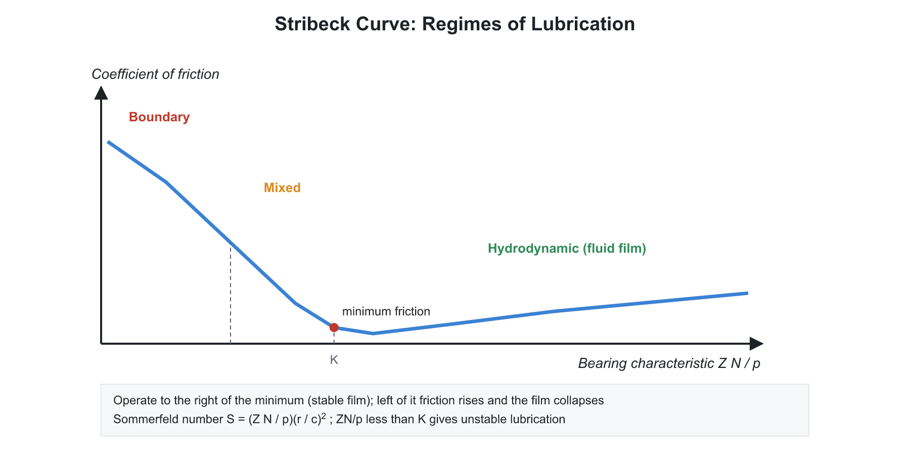
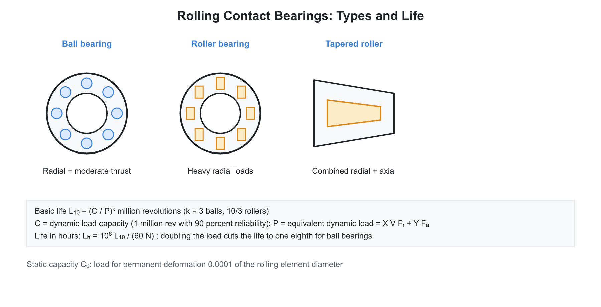

# 🛠️ 02. Shafts, Bearings and Lubrication

**Exam relevance:** APPSC AEE: P | SSC JE: S | RRB JE: S | Category: AEE+ | Yield: MY to HY

---

## 📘 Part A: Detailed Theory (read this first)

This part explains how shafts are sized, how bearings carry load and what lubrication does. Part B (from section 1 onwards) is the compact reference.

### 🔹 A1. Shafts: what they carry and how they fail

A **shaft** is a rotating member that transmits power; it carries gears, pulleys and flywheels. It is loaded in **torsion** (from the power transmitted) and **bending** (from the weights, belt pulls, gear forces on the mounted parts), and sometimes axial load.

- **Axle:** supports rotating parts but carries no torque (railway wagon axle). **Spindle:** a short shaft on a machine tool. **Counter shaft:** an intermediate shaft that transfers power from the main shaft to the machine.
- **Materials:** mild steel (C30 to C45) for general use; alloy steels (Ni-Cr, Cr-Mo) for heavy loads; shafts under 25 mm diameter are often cold-drawn.

**Design on strength.** Compute torque from power: $T = \dfrac{60 P}{2\pi N}$ (SI: $P$ in W, $N$ in rpm, $T$ in N-m). Then the shear stress in a solid shaft is $\tau = \dfrac{16T}{\pi d^3}$ and bending stress $\sigma_b = \dfrac{32M}{\pi d^3}$.

When both bending and torsion act, the state of stress at the surface is: bending stress $\sigma_b$ and torsional shear $\tau$. The principal stresses are

$$\sigma_{1,2} = \frac{\sigma_b}{2} \pm \sqrt{\left(\frac{\sigma_b}{2}\right)^2 + \tau^2}, \qquad \tau_{max} = \sqrt{\left(\frac{\sigma_b}{2}\right)^2 + \tau^2}$$

Substituting $\sigma_b = 32M/\pi d^3$ and $\tau = 16T/\pi d^3$ gives the two design equations, one for each failure theory:

$$\tau_{max} = \frac{16}{\pi d^3}\sqrt{M^2 + T^2} \;\;(\text{max shear stress theory}), \qquad \sigma_{max} = \frac{16}{\pi d^3}\left(M + \sqrt{M^2 + T^2}\right) \;\;(\text{max principal stress theory})$$

The terms $T_e = \sqrt{M^2 + T^2}$ (equivalent torque) and $M_e = \tfrac{1}{2}(M + \sqrt{M^2 + T^2})$ (equivalent bending moment) are used to simplify. The shear-stress theory suits ductile shafts and is the common choice.

**ASME code design** adds the **shock and fatigue factors** $K_m$ for bending and $K_t$ for torsion: $\sqrt{(K_m M)^2 + (K_t T)^2}$. Typical values: gradual load $K_m = 1.5$, $K_t = 1.0$; sudden load $K_m = 2.0$ to $3.0$ and $K_t = 1.5$ to $3.0$. A keyway cuts into the shaft section and creates stress concentration, so it weakens the shaft (a reduction of the order of $25\%$ is often assumed); the allowable shear stress is reduced by about $25\%$ when a keyway is present.

**Hollow shafts** are lighter and stiffer for the same strength because the core material carries little stress. With $k = d_i/d_o$: $\tau = \dfrac{16 T}{\pi d_o^3(1 - k^4)}$. A hollow shaft needs more outer diameter than a solid one for the same torque but weighs much less.

**Design on rigidity.** Strength is not enough: excessive twist ruins timing in camshafts, and excessive deflection misaligns gears and overloads bearings.

- Angle of twist $\theta = \dfrac{T L}{G J}$; allowable about $0.25^\circ$ per metre for machine shafts, up to $1^\circ$ per metre for general line shafts.
- Lateral deflection limits: about $0.0005$ to $0.003$ of span for shafts carrying gears; the slope at bearings must be small.
- Of the two criteria (strength and rigidity), use the one that gives the larger diameter.

**Critical speed.** A rotating shaft whirls if the speed matches its lateral natural frequency (see vibrations). Keep the operating speed at least $20\%$ away from the critical speed. Shafts running below the first critical speed are **stiff** (rigid); those above are **flexible**.

### 🔹 A2. Bearings: purpose and classification

A **bearing** supports a rotating shaft, carries the load and allows motion with low friction and wear.

- **By load direction:** *radial* (load perpendicular to the axis), *thrust* (load along the axis), *combined*.
- **By type of contact:**
  - **Sliding (plain, journal) bearing:** the shaft rotates inside a sleeve, separated by a film of lubricant.
  - **Rolling-contact (anti-friction) bearing:** balls or rollers between rings.

| Feature | Sliding | Rolling |
|---|---|---|
| Starting friction | High until film forms | Low |
| Running friction | Very low with full film | Low, nearly constant |
| Space | Large axial, small radial | Small axial, larger radial |
| Noise | Quiet | Noisier at high speed |
| Shock and vibration | Good damping | Poor |
| Life | Very long if lubricant clean | Finite fatigue life |
| Interchangeability | Custom | Standardised |
| Cost | Low for large sizes | Higher |

### 🔹 A3. Sliding bearings and hydrodynamic lubrication

**Regimes of lubrication.**

- **Hydrodynamic (thick film):** a full oil film separates the surfaces, so no metal contact. The film pressure is generated by the motion itself.
- **Hydrostatic:** the film is created by an external pump, so it works even at rest.
- **Elastohydrodynamic (EHL):** for non-conforming contacts like gear teeth and rolling bearings, where the film is very thin and the surfaces deform elastically.
- **Boundary (thin film):** film is too thin; surface asperities contact; friction depends on the additive and surface chemistry. Occurs at start, stop, low speed, heavy load.

**How the film forms in a journal bearing.** At rest, the shaft sits at the bottom of the bearing. When it starts, it climbs up the side (boundary lubrication) and drags oil into the converging wedge-shaped gap. Oil pressure builds in the wedge and lifts the shaft until the oil film supports the load. The shaft then runs offset from the centre (**eccentricity** $e$), displaced sideways from the load line. The minimum film thickness is $h_0 = c - e = c(1 - \epsilon)$ where $c$ is the radial clearance and $\epsilon = e/c$ the eccentricity ratio.

**Key dimensionless group:** the **Sommerfeld number** (bearing modulus)

$$S = \frac{Z N}{p}\left(\frac{r}{c}\right)^2$$

with $Z$ viscosity, $N$ speed (rps), $p$ projected-area pressure, $r$ journal radius. Higher $S$ means a higher viscosity or speed or lighter load, hence thicker film and lower eccentricity. Design charts relate $S$ to $\epsilon$, friction coefficient and flow.

**Friction in a lightly loaded bearing (Petroff's equation)** assumes concentric operation: $\mu = 2\pi^2 \dfrac{ZN}{p}\dfrac{r}{c}$.

**Heat balance.** Friction heat $= \mu W v$ has to be dissipated by the lubricant and bearing housing; operating temperature must not exceed about $60$ to $80^\circ$C for mineral oil (viscosity falls rapidly with temperature).

**Bearing materials** need: low friction, high wear resistance, **conformability** (adapting to slight misalignment), **embeddability** (absorbing dirt particles), good heat conduction, fatigue strength, corrosion resistance. White metal (babbitt, tin or lead base) is soft and excellent for conformability; bronze is stronger; cast iron and sintered metal for light loads; PTFE and nylon for dry or poorly lubricated use.

**Design parameters.** Length-to-diameter ratio $l/d$ is typically $1$ to $2$ (a long bearing carries more load but is sensitive to misalignment); pressure $p = W/(ld)$.

### 🔹 A4. Rolling-contact bearings

**Construction.** Inner ring, outer ring, rolling elements (balls or rollers) and a cage (separator) that keeps them evenly spaced.

**Types and uses.**

| Type | Carries | Notes |
|---|---|---|
| Deep-groove ball | Radial and moderate thrust both ways | Most common, high speed |
| Angular-contact ball | Radial and thrust in one direction | Often mounted in pairs |
| Self-aligning ball | Radial, tolerates misalignment | |
| Cylindrical roller | High radial, no thrust | Rollers in line contact |
| Tapered roller | Radial and thrust together | Automobile wheels |
| Spherical roller | Heavy radial, misalignment | |
| Needle roller | Radial in small space | |
| Thrust ball | Axial only | |

**Why they fail:** the contact between the rolling elements and the races is small (Hertz contact), so the contact stress is very high and repeated, causing **sub-surface fatigue and pitting (spalling)**. This is the normal end of life. Other modes: brinelling (indentation by shock), fretting, wear from dirt, corrosion, cage failure.

**Life rating.**

- **Basic dynamic load rating $C$:** the constant radial load that a group of bearings can carry for $10^6$ revolutions with $90\%$ surviving.
- **Basic static load rating $C_0$:** the load that causes a permanent deformation of $0.0001$ of the rolling element diameter.
- **$L_{10}$ life:** life at $90\%$ reliability. $L_{10} = \left(\dfrac{C}{P}\right)^k$ in millions of revolutions, with $k = 3$ for ball and $\tfrac{10}{3}$ for roller bearings. Doubling the load cuts the ball bearing life to one eighth.
- **Equivalent dynamic load** $P = X V F_r + Y F_a$ combines radial $F_r$ and axial $F_a$ loads ($V = 1$ for inner ring rotating).
- For higher reliability, multiply life by a factor less than one (for $95\%$ about $0.62$, for $99\%$ about $0.21$).
- Average life is about five times $L_{10}$ (rule of thumb).

**Mounting and lubrication.** Inner ring is a tight fit on the shaft if it rotates; outer ring fits in the housing with a loose or tight fit as required. Grease for moderate speed (sealed bearings), oil for high speed and heat removal.

### 🔹 A5. Lubrication and lubricants

**Purposes of lubrication:** reduce friction and wear, carry away heat, protect against corrosion, seal, remove debris, damp shocks.

**Properties of lubricating oil.**

- **Viscosity:** resistance to flow; the single most important property. Dynamic (absolute) viscosity $Z$ in Pa-s or poise ($1$ Pa-s $= 10$ poise $= 1000$ cP). Kinematic viscosity $\nu = Z/\rho$ in m$^2$/s or stokes. It falls rapidly as temperature rises.
- **Viscosity index (VI):** how little viscosity changes with temperature; high VI is better (multigrade oils).
- **Flash point:** lowest temperature at which vapours ignite momentarily; **fire point:** burns continuously; **pour point:** lowest temperature at which oil still flows; **cloud point**; **oxidation stability**; **oiliness** (ability to form a boundary film).

**Types of lubricants.** Mineral oils (petroleum), synthetic oils (for extreme temperatures), greases (oil plus soap thickener; stay in place, good for slow or intermittent motion), solid lubricants (graphite, MoS$_2$, PTFE; for high temperature or vacuum), gases (air bearings, at very high speed and low load).

**Methods of supply.** Drop-feed, wick, splash, ring-oiled, forced (pressure) circulation, oil-bath, grease gun.

### 🔹 A6. Exam relevance

- Torque from power; shaft design equations for combined loading; equivalent torque (all exams).
- Hollow versus solid shaft; critical speed (SSC JE, APPSC AEE).
- Sommerfeld number, regimes of lubrication, bearing materials (APPSC AEE).
- Rolling bearing life equation, $L_{10}$, types and uses (all exams).
- Viscosity, viscosity index, flash and fire point (RRB JE, SSC JE).

---

## ⚡ Part B: Quick-reference notes, formulas, numericals and PYQs

## 🧭 1. Shafts

- **Shaft:** rotating member carrying power; **axle:** non-rotating (or rotating) member carrying no torque; **spindle:** short shaft on machine tools.
- **Materials:** mild steel (C30, C40), alloy steels (Ni-Cr) for high loads, cold-drawn steel for small sizes.

### 🔹 Design on strength

| Loading | Design equation |
|---|---|
| Pure torsion | $\tau = \dfrac{16T}{\pi d^3}$ |
| Pure bending | $\sigma_b = \dfrac{32M}{\pi d^3}$ |
| Combined bending and torsion (maximum shear stress theory) | $\tau_{max} = \dfrac{16}{\pi d^3}\sqrt{M^2 + T^2}$ |
| Combined (maximum principal stress theory) | $\sigma_{max} = \dfrac{32}{\pi d^3}\cdot\dfrac{1}{2}\left(M + \sqrt{M^2 + T^2}\right)$ |

- **ASME code** for shafts with shock and fatigue factors $K_m$ (bending) and $K_t$ (torsion):

$$\tau_{max} = \frac{16}{\pi d^3}\sqrt{(K_m M)^2 + (K_t T)^2}$$

- **Hollow shaft** with diameter ratio $k = \dfrac{d_i}{d_o}$:

$$\tau = \frac{16\,T\,d_o}{\pi\,(d_o^4 - d_i^4)} = \frac{16\,T}{\pi\,d_o^3\,(1 - k^4)}$$

- **Design on rigidity:** the angle of twist is limited to about $0.25^\circ$ per metre for machine shafts and the deflection is limited for gears and bearings.

$$\theta = \frac{TL}{GJ}$$

- **Critical speed** (whirling) must be avoided: operate at least about $20\%$ away from $N_c$. See Theory of Machines, vibrations.
- **Power and torque:** $T = \dfrac{60\,P}{2\pi N}$.

## 🧭 2. Bearings

### 🔹 Classification

| Type | Features |
|---|---|
| Sliding (journal) bearings | Full film lubrication, quiet, take shock; need good lubrication system |
| Rolling-contact (antifriction) bearings | Low starting friction, standard sizes, noisy at high speed |

- **Sliding bearings:** thick-film (hydrodynamic) lubrication, thin-film (boundary) lubrication, hydrostatic lubrication (externally pressurised).
- **Bearing materials:** white metal (babbitt), bronze, brass, cast iron, sintered bronze, nylon and PTFE. Required properties: low friction, wear resistance, conformability, embeddability, thermal conductivity, fatigue strength.

### 🔹 Hydrodynamic journal bearing

- **Sommerfeld number:**

$$S = \frac{ZN}{p}\left(\frac{d}{c}\right)^2$$

  where $Z$ is the absolute viscosity, $N$ the speed (rps), $p$ the bearing pressure, $d$ the journal diameter and $c$ the radial clearance. The bearing is stable when $S$ is large.
- **Bearing characteristic number:** $\dfrac{ZN}{p}$.
- **Coefficient of friction (Petroff's law, lightly loaded):**

$$\mu = 2\pi^2\,\frac{ZN}{p}\cdot\frac{r}{c}$$

- **Minimum film thickness** $h_0$ occurs at the position shifted from the load line due to the wedge action. **Eccentricity ratio** $\epsilon = \dfrac{e}{c}$; $h_0 = c(1-\epsilon)$.
- **Heat generated** $= \mu W v$; heat dissipated depends on the bearing area and temperature rise.
- **Length to diameter ratio** $\dfrac{l}{d}$ is typically $1$ to $2$. Bearing pressure $p = \dfrac{W}{l\,d}$ (projected area).

### 🔹 Rolling-contact bearings

- **Types:** deep-groove ball, angular-contact ball, self-aligning ball, cylindrical roller, tapered roller (carries combined radial and axial loads), spherical roller, needle roller, thrust ball.
- **Static load capacity** $C_0$: load causing a permanent deformation of $0.0001$ of the rolling element diameter.
- **Dynamic load capacity** $C$: constant radial load for which $90\%$ of the bearings survive $10^6$ revolutions.
- **Life equation:**

$$L_{10} = \left(\frac{C}{P}\right)^{k}\ \text{million revolutions}$$

  with $k = 3$ for ball bearings and $k = \dfrac{10}{3}$ for roller bearings.
- **Life in hours:** $L_h = \dfrac{10^6\,L_{10}}{60\,N}$ with $N$ in rpm.
- **Equivalent dynamic load:** $P = X\,V\,F_r + Y\,F_a$ ($V = 1$ when the inner ring rotates, $1.2$ when the outer ring rotates).
- **Reliability** is $90\%$ for $L_{10}$ life. For a different reliability, use the Weibull-based correction.
- **Rolling bearing advantages over sliding:** lower starting friction, smaller axial space, easier replacement, less lubrication needs. **Disadvantages:** higher noise, poor shock tolerance, larger radial size.
- **Lubrication of rolling bearings:** grease for low to moderate speed, oil for high speed. Brinelling and fretting are common failure modes.

## 🧭 3. Lubrication

- **Viscosity:** absolute viscosity $Z$ in Pa-s (SI) or poise (CGS); $1\ \text{Pa-s} = 10$ poise. Kinematic viscosity $\nu = \dfrac{Z}{\rho}$; stokes in CGS.
- **Viscosity index (VI):** measure of how little viscosity changes with temperature; higher VI is better.
- **Flash point** and **fire point:** safety indicators. **Pour point:** lowest temperature at which oil flows.
- **Types of lubricants:** liquid (mineral oils, synthetic), semi-solid (grease), solid (graphite, MoS$_2$), gaseous (air bearings).
- **Types of lubrication:** hydrodynamic, hydrostatic, elastohydrodynamic (rolling contact and gears), boundary, solid film.

## 🧭 4. Worked numericals

1. **Shaft.** $T = 1000$ N-m, $M = 500$ N-m, $\tau_{allow} = 40$ MPa:

$$d^3 = \frac{16\sqrt{500^2 + 1000^2}\times10^3}{\pi\times40} = \frac{16\times1118\times10^3}{125.7} = 1.423\times10^5\ \text{mm}^3 \Rightarrow d \approx 52.2\ \text{mm}$$

2. **Bearing life.** $C = 30$ kN, $P = 5$ kN, ball bearing: $L_{10} = \left(\dfrac{30}{5}\right)^3 = 216$ million revolutions.
3. **Torque.** $P = 50$ kW at $500$ rpm: $T = \dfrac{60\times50000}{2\pi\times500} = 955$ N-m.

## 🧭 5. Common mistakes

- Using only bending or only torsion in a shaft carrying both.
- Using $k = 3$ for roller bearings (use $\dfrac{10}{3}$).
- Using $\mu = $ constant for hydrodynamic bearings (it varies with $\dfrac{ZN}{p}$).

## 🧭 6. Interconnections

- Shaft design combines SOM (bending, torsion), TOM (torque, critical speed) and materials.
- Bearing life links to reliability engineering.

## 🧭 7. PYQs

| # | Question | Answer | Exam / Year | Verify |
|---|---|---|---|---|
| 1 | Sommerfeld number | $\dfrac{ZN}{p}\left(\dfrac{d}{c}\right)^2$ | APPSC AEE 2012 | [ ] |
| 2 | Basic life of a bearing $L_{10}$ | Life with $90\%$ reliability | SSC JE 2018 | [ ] |
| 3 | Exponent in the life equation for ball bearings | 3 | RRB JE 2015 | [ ] |
| 4 | Exponent for roller bearings | $\dfrac{10}{3}$ | APPSC AEE 2012 | [ ] |
| 5 | A hollow shaft compared with a solid shaft of the same weight | Stronger and stiffer | SSC JE 2017 | [ ] |
| 6 | Viscosity index indicates | Rate of change of viscosity with temperature | RRB JE 2014 | [ ] |
| 7 | Bearing material with good conformability and embeddability | White metal (babbitt) | SSC JE 2019 | [ ] |
| 8 | Bearing that can take combined radial and axial loads | Tapered roller | RRB JE 2019 | [ ] |
| 9 | A shaft is subjected to combined bending and torsion; equivalent torque | $\sqrt{M^2 + T^2}$ | SSC JE 2016 | [ ] |
| 10 | A thin-film lubrication is also called | Boundary lubrication | RRB JE 2015 | [ ] |

## 🧭 8. Revision checklist

- [ ] Combined bending and torsion formulas
- [ ] Sommerfeld number and Petroff's law
- [ ] Bearing life equation for ball and roller
- [ ] Lubrication types and lubricant properties
