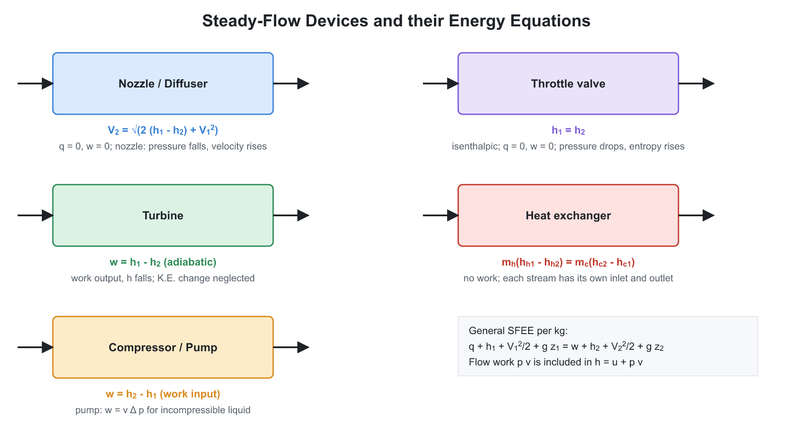

# 🌡️ 01. Basic Concepts, Zeroth Law and First Law

**Exam relevance:** APPSC AEE: C | SSC JE: C | RRB JE: C | Category: ALL | Yield: VHY

---

## 📘 Part A: Detailed Theory (read this first)

Thermodynamics is the science of energy and its conversion. It does not tell you how fast something happens (that is heat transfer and fluid mechanics); it tells you what is possible, in which direction, and how much. This part builds the subject from the ground up: what we are looking at (system), how we describe it (properties, state), how energy crosses its boundary (heat and work), and the first law that keeps the energy account.

### 🔹 A1. The thermodynamic viewpoint

- **Macroscopic view.** We describe a gas by pressure, temperature and volume, which we can measure, not by the motion of $10^{23}$ molecules. This is **classical thermodynamics**. It needs no model of matter, so its laws are extremely general.
- **Microscopic view.** **Statistical thermodynamics** derives the same properties from molecular behaviour (for example, temperature is a measure of mean molecular kinetic energy). Used only to explain why, for example, $\gamma$ depends on the number of atoms in a molecule.
- **Continuum assumption.** We treat matter as continuous, so a property such as density has a value at a point. This fails only at extremely low pressures (rarefied gas) where the mean free path becomes comparable to the size of the device.

### 🔹 A2. System, surroundings and control volume

- A **system** is a fixed quantity of matter (closed system or **control mass**), or a fixed region of space (open system or **control volume**), selected for study. The choice is ours, and a good choice makes the problem easy.
- **Closed system:** nothing crosses the boundary except energy. A gas in a piston-cylinder with the valves shut is the classic example. The boundary may move (boundary work).
- **Open system:** mass and energy cross the **control surface**. Turbines, compressors, nozzles, boilers, pumps and radiators are all analysed as control volumes.
- **Isolated system:** neither mass nor energy crosses. The universe is the ultimate isolated system, which is why the second law is stated for "system plus surroundings".
- **Rule to remember:** use the closed-system equation $Q = \Delta U + W$ for a batch process (piston-cylinder, rigid tank), and the steady-flow equation for anything with a continuous inlet and outlet.

### 🔹 A3. Properties, state and the state postulate

- A **property** is any measurable characteristic of the system that has a single value when the system is in a given state. Pressure, temperature, volume, internal energy, enthalpy and entropy are properties. Heat and work are not; they are **energy in transit** and exist only during a process.
- Mathematical test: a property has an **exact differential**, so $\oint dX = 0$ over a cycle. Heat and work have inexact differentials, written $\delta Q$ and $\delta W$, and $\oint \delta Q \ne 0$ in general (it equals the net work).
- **Intensive** properties do not change if you split the system in two (pressure, temperature, density, specific properties). **Extensive** properties add up (mass, volume, energy). A quick test: halve the system and see whether the value halves.
- **State postulate.** The number of independent intensive properties needed to fix the state of a simple compressible substance is two. Hence a point on a $P$-$v$ diagram fixes everything; for a two-phase mixture, $P$ and $T$ are not independent and you need a third quantity (quality $x$).
- **State** is a snapshot; **process** is the path between two states; **cycle** returns to the starting state.

### 🔹 A4. Equilibrium, quasi-static and reversible processes

- **Equilibrium** means no tendency for spontaneous change. It has four parts: thermal (no temperature differences), mechanical (no unbalanced forces), chemical (no reactions or diffusion) and phase (no phase change tendency). Properties are defined only in equilibrium states.
- A real process, such as rapid compression, passes through non-equilibrium states, so it cannot be drawn on a property diagram. We draw a dashed line to show that the end states are known but the path is not.
- **Quasi-static (quasi-equilibrium) process.** Go so slowly that the system always has time to adjust, so every intermediate state is an equilibrium state. Then the process can be drawn as a line, and $\int P\,dV$ can be evaluated.
- **Reversible process.** One that can be reversed so that both system and surroundings return exactly to their initial states with no trace. A reversible process is quasi-static **and** free from dissipation. Sources of **irreversibility**: friction, unrestrained (free) expansion, heat transfer across a finite temperature difference, mixing of different substances, electric resistance, inelastic deformation, chemical reactions.
- **Why it matters.** The reversible process gives the **maximum work output** (or minimum work input) between given end states. All real devices are compared with their reversible limit to define efficiency.

### 🔹 A5. Temperature and the zeroth law

- Two bodies in contact eventually reach the same temperature. The **zeroth law** (equilibrium with a third body implies equilibrium with each other) is what lets a thermometer work: the thermometer is the "third body".
- To build a temperature scale, choose a **thermometric property** that changes with temperature and a fixed reference. The **ideal-gas (Kelvin) scale** uses a constant-volume gas thermometer extrapolated to zero pressure. The reference is the **triple point of water**, $273.16$ K.
- The **thermodynamic (Kelvin) scale** is independent of any substance and is defined through the Carnot cycle (see second law). It coincides with the ideal-gas scale.
- **Absolute zero** is the limit at which an ideal gas would have zero pressure. It cannot be reached in a finite number of steps (third law).
- **Types of thermometer and what each measures:**

| Thermometer | Property measured | Typical remark |
|---|---|---|
| Liquid-in-glass | Volume (length) | Cheap, limited range |
| Constant-volume gas | Pressure | Primary standard |
| Resistance (RTD) | Electrical resistance | Platinum, very accurate |
| Thermocouple | EMF (Seebeck effect) | Wide range, fast response |
| Optical pyrometer | Radiation intensity | No contact, high temperatures |

### 🔹 A6. Pressure

- Pressure is the normal force per unit area, $P = F/A$, in pascal ($1\ \text{Pa} = 1\ \text{N/m}^2$). $1\ \text{bar} = 10^5$ Pa.
- **Absolute pressure** is measured from perfect vacuum. A gauge reads relative to the atmosphere, so
  $P_{abs} = P_{atm} + P_{gauge}$, and in a vacuum, $P_{abs} = P_{atm} - P_{vac}$. **Only absolute pressure is used in gas laws and thermodynamic tables.**
- A **manometer** balances pressure by a liquid column: $P = \rho g h$. A **Bourdon gauge** uses a flattened curved tube that straightens with pressure. A **barometer** measures atmospheric pressure.

### 🔹 A7. Work: what it really is

- In mechanics, work is force times displacement. In thermodynamics, **work is any interaction between system and surroundings that is not caused by a temperature difference**, and which could in principle be used to raise a weight.
- **Boundary work.** If a gas pushes a piston of area $A$ through $dx$ against pressure $P$, then $\delta W = P\,A\,dx = P\,dV$. For a finite quasi-static process, $W = \int_1^2 P\,dV$, which is the area under the curve on the $P$-$V$ diagram. Since the area depends on the path, **work is a path function**.
- For a **cycle**, the net work equals the area enclosed. A clockwise loop gives positive net work (engine); an anticlockwise loop gives negative net work (refrigerator or heat pump).
- **Polytropic process.** If $PV^n = C$, then $P = C V^{-n}$ and
$$W = \int_1^2 C V^{-n}\,dV = \frac{P_1 V_1 - P_2 V_2}{n - 1} \qquad (n \ne 1)$$
  and for $n = 1$ the integral gives the logarithmic (isothermal) result. Every basic process is a special case: $n = 0$ isobaric, $n = 1$ isothermal, $n = \gamma$ adiabatic, $n = \infty$ isochoric.
- **Free expansion.** Gas rushes into vacuum with no resistance. There is no force opposing, so $W = 0$. The process is irreversible and not quasi-static, so $\int P\,dV$ is **not** applicable.
- **Sign convention.** Work done **by** the system is positive; heat **to** the system is positive. Some textbooks use the opposite for work; check which one is used when you read a question.

### 🔹 A8. Heat

- **Heat** is energy transferred across a boundary because of a temperature difference. Once inside the system it is stored as internal energy, not as "heat". A body does not contain heat.
- **Modes:** conduction, convection, radiation (see Heat Transfer).
- **Adiabatic process:** no heat transfer ($Q = 0$) because the system is insulated or the process is too fast for heat to flow. **Isothermal** does not mean adiabatic; heat flows in to keep the temperature constant.
- **Specific heat** $c = \dfrac{1}{m}\dfrac{\delta Q}{dT}$ depends on the process: $c_v$ at constant volume and $c_p$ at constant pressure. For solids and liquids $c_p \approx c_v$.

### 🔹 A9. Internal energy and enthalpy

- **Internal energy $U$** is the sum of all microscopic energies: translational, rotational and vibrational motion of the molecules plus intermolecular potential energy. It is a property. We never measure its absolute value; only changes matter.
- **Enthalpy** $H = U + PV$ is defined for convenience. It arises naturally when a fluid flows, because pushing a fluid element of volume $v$ into a control volume at pressure $P$ costs flow work $Pv$. Hence for flow processes, the energy carried by the fluid is $u + Pv = h$.
- For a **constant-pressure** closed process, $Q = \Delta U + P\Delta V = \Delta H$. This is why heat of reaction and boiling are given as enthalpy changes.

### 🔹 A10. Ideal gas: the model and its limits

- **Assumptions.** Molecules have negligible volume, and there are no intermolecular forces except at collision. This is true at low pressure and high temperature.
- **Equation of state.** Combining Boyle ($PV$ constant at constant $T$), Charles ($V/T$ constant at constant $P$) and Gay-Lussac ($P/T$ constant at constant $V$) gives $Pv = RT$, or $PV = mRT$. With the universal gas constant, $PV = n R_u T$ where $n$ is the number of kmol. $R = R_u/M$.
- **Joule's law.** An ideal gas has no intermolecular forces, so its internal energy depends only on temperature: $u = u(T)$. Then $du = c_v\,dT$ for any process. Since $h = u + RT$, $h$ also depends only on $T$ and $dh = c_p\,dT$ for any process.
- **Mayer's relation.** From $h = u + RT$, $dh = du + R\,dT$, so $c_p - c_v = R$. Since $c_p > c_v$ always, because at constant pressure some heat goes into expansion work.
- **Molecular explanation of $\gamma$.** Degrees of freedom $f$ give $c_v = \dfrac{f}{2}R$. Monatomic: $f = 3$, $\gamma = 5/3$. Diatomic at room temperature: $f = 5$, $\gamma = 7/5$. Nonlinear polyatomic: $f = 6$, $\gamma = 4/3$.
- **Real gas behaviour.** Near the saturation line or at high pressure, deviation is large. The **compressibility factor** $Z = Pv/(RT)$ measures the deviation. The **van der Waals equation** adds $b$ for the finite molecular volume and $a/v^2$ for the intermolecular attraction. The **reduced properties** $P_R = P/P_c$ and $T_R = T/T_c$ allow a generalised compressibility chart for all gases.
- **Mixtures.** Dalton: $P = \sum P_i$ where $P_i = y_i P$. Amagat: $V = \sum V_i$. Mixture gas constant $R_m = \sum m_i R_i / m$, and mixture molar mass $M_m = \sum y_i M_i$.

### 🔹 A11. First law of thermodynamics: derivation logic

- **Joule's experiment.** Stirring water adiabatically with a paddle wheel and measuring the temperature rise showed that a definite amount of work always gives the same rise. This proves that **adiabatic work depends only on end states**, which means there is a property whose change equals the adiabatic work. That property is **internal energy**.
- **Cycle statement.** In a cycle, $\oint \delta Q = \oint \delta W$. Net heat equals net work.
- **Process statement.** Heat is not purely adiabatic work, so the non-adiabatic part is $Q$: $Q - W = \Delta E$. Neglecting changes in macroscopic kinetic and potential energy of a stationary closed system, $Q = \Delta U + W$.
- **Differential form.** $\delta Q = dU + \delta W$, with $\delta W = P\,dV$ for a quasi-static process, so $\delta Q = dU + P\,dV$. Using $H$, this becomes $\delta Q = dH - V\,dP$.
- **Consequences.** (i) Energy is conserved. (ii) A **PMM1** is impossible. (iii) Internal energy and enthalpy exist as properties.

**Applying the first law to each ideal-gas process (for $m$ kg):**

| Process | $W$ | $\Delta U$ | $Q$ |
|---|---|---|---|
| Constant volume | $0$ | $m c_v \Delta T$ | $m c_v \Delta T$ |
| Constant pressure | $mR\Delta T$ | $m c_v \Delta T$ | $m c_p \Delta T$ |
| Isothermal | $mRT\ln\dfrac{V_2}{V_1}$ | $0$ | $W$ |
| Adiabatic | $\dfrac{mR(T_1 - T_2)}{\gamma - 1}$ | $m c_v \Delta T$ | $0$ |

- **Derivation of the adiabatic law.** Start with $\delta Q = 0 = c_v\,dT + P\,dv$ and $P = RT/v$. Divide by $T$: $c_v\dfrac{dT}{T} + R\dfrac{dv}{v} = 0$. Integrate: $c_v \ln T + R \ln v = $ const., so $T v^{R/c_v} = T v^{\gamma - 1} = $ const. Combining with $Pv = RT$ gives $Pv^\gamma = $ const.
- **Why an adiabatic curve is steeper than an isothermal curve on a $P$-$v$ diagram.** For an isothermal, $dP/dv = -P/v$. For an adiabatic, $dP/dv = -\gamma P/v$. Since $\gamma > 1$, the adiabatic is steeper. Therefore, an adiabatic expansion gives less work than an isothermal one between the same volumes, and an adiabatic compression needs more work.

### 🔹 A12. Steady-flow energy equation (SFEE): derivation logic

- **Control volume, steady state.** Mass flow rate in equals out; properties at each point do not change with time; energy in the control volume is constant.
- Energy entering with the fluid, per unit mass: $u_1 + \dfrac{V_1^2}{2} + g z_1$. To push the fluid in against the inlet pressure requires flow work $P_1 v_1$. Add to that $q$ (heat in) and subtract $w$ (shaft work out) to get the energy leaving:
$$q + \left(u_1 + P_1 v_1 + \frac{V_1^2}{2} + g z_1\right) = w + \left(u_2 + P_2 v_2 + \frac{V_2^2}{2} + g z_2\right)$$
  Using $h = u + Pv$ gives the SFEE shown in Part B.
- **Which terms can be neglected?** In turbines and compressors, velocity and height changes are usually small compared with $\Delta h$. In nozzles and diffusers, $Q$ and $W$ are zero and the kinetic energy change equals the enthalpy drop. In a throttle valve, $\Delta h = 0$ because the velocity change is small and there is no heat or work.
- **Steady-flow work in a reversible process:** $w = -\int v\,dP$ (neglecting KE and PE changes). Compare with closed-system work $\int P\,dV$. For an adiabatic reversible gas process, steady-flow work is $\gamma$ times the closed-system work.
- **Unsteady flow (charging and discharging).** Filling a tank is analysed with a control volume with changing mass. The usual result for a rigid insulated tank filled from a supply line at $h_i$ is $u_2 = h_i$ if the tank is initially empty, so the final temperature is higher than the line temperature by a factor of $\gamma$ for an ideal gas ($T_2 = \gamma T_i$).

### 🔹 A13. Throttling and the Joule-Thomson effect

- **Throttling** is the flow of a fluid through a restriction (valve, orifice, porous plug) with a pressure drop, no work and negligible heat. Applying the SFEE gives $h_1 = h_2$.
- It is highly **irreversible**: the pressure drop is a loss of availability. For an ideal gas, $T$ does not change because $h = h(T)$. For a real gas, temperature may fall (liquefaction, refrigeration expansion valve), rise, or remain unchanged depending on whether the state is below or above the **inversion curve**.
- **Throttling calorimeter** estimates the dryness fraction of wet steam by throttling it to a superheated state, where two properties ($P$ and $T$) fix $h$.

### 🔹 A14. What examiners test from this chapter

| Topic | APPSC AEE | SSC JE | RRB JE |
|---|---|---|---|
| Intensive/extensive, path/point function, system types | Direct | Very common | Very common |
| Work in each ideal-gas process, $P$-$V$ diagram area | Numerical | Numerical | Numerical |
| $c_p - c_v = R$, $\gamma$ values, polytropic exponents | Direct | Direct | Direct |
| SFEE applications (nozzle, turbine, throttle) | Numerical | Numerical | Direct |
| Joule-Thomson, Joule's law, van der Waals, compressibility | Common | Occasional | Rare |

---

## ⚡ Part B: Quick-reference notes, formulas, numericals and PYQs

## 🧭 1. Fundamental concepts

- **Thermodynamics** studies energy transformations and the relations among properties of matter. **Classical (macroscopic)** thermodynamics ignores molecular structure; **statistical (microscopic)** thermodynamics uses it.
- **System:** the matter or region chosen for study. **Surroundings:** everything outside. **Boundary:** the real or imaginary surface between them.

| System | Mass transfer | Energy transfer |
|---|---|---|
| Closed (control mass) | No | Yes |
| Open (control volume) | Yes | Yes |
| Isolated | No | No |
| Adiabatic | Depends on the system | Work only (no heat) |

- **Property:** a quantity that depends only on the state. **Intensive** properties are independent of mass (pressure, temperature, specific volume, density); **extensive** properties depend on mass (volume, energy, enthalpy, entropy). An extensive property per unit mass becomes intensive (specific property).
- **Point function** (properties; exact differentials) versus **path function** (heat, work; inexact differentials).
- **Thermodynamic equilibrium** needs thermal, mechanical, chemical and phase equilibrium together.
- **Quasi-static process:** an infinitely slow process passing through a sequence of equilibrium states. A **reversible** process is quasi-static and has no dissipative effects (friction, unrestrained expansion, heat transfer across a finite temperature difference, mixing).
- **State postulate:** the state of a simple compressible system is fixed by two independent intensive properties.
- **Cycle:** a process series returning the system to its initial state; the net change of every property over a cycle is zero.

## 🧭 2. Zeroth law and temperature

- **Zeroth law:** if two bodies are each in thermal equilibrium with a third, they are in thermal equilibrium with each other. It is the basis of temperature measurement.
- **Temperature scales:**

$$T(\text{K}) = t(^\circ\text{C}) + 273.15, \qquad t(^\circ\text{F}) = \tfrac{9}{5}\,t(^\circ\text{C}) + 32, \qquad T(\text{R}) = t(^\circ\text{F}) + 459.67$$

- The triple point of water is $273.16$ K ($0.01^\circ$C) at $0.6113$ kPa. The ice point is $273.15$ K and the steam point is $373.15$ K.
- **Thermometers:** constant-volume gas thermometer (pressure is the property), mercury-in-glass (length), resistance thermometer (resistance), thermocouple (EMF, Seebeck effect), pyrometer (radiation).
- **Pressure:** $P_{abs} = P_{atm} + P_{gauge}$ and $P_{abs} = P_{atm} - P_{vac}$. $1\ \text{atm} = 101.325$ kPa $= 1.01325$ bar $= 760$ mm Hg.

## 🧭 3. Work and heat

- **Work** is energy transferred across a boundary by a force acting through a distance (or any non-thermal driving force). **Heat** is energy transferred because of a temperature difference.
- **Sign convention:** heat added to a system is $+$; work done by the system is $+$.
- **Displacement (boundary) work** in a reversible process:

$$W = \int_1^2 P\,dV$$

  The area under the process on a $P$-$V$ diagram is the work.

| Process | Work |
|---|---|
| Constant volume | $0$ |
| Constant pressure | $P\,(V_2 - V_1)$ |
| Isothermal (ideal gas) | $P_1 V_1 \ln\dfrac{V_2}{V_1} = mRT\ln\dfrac{V_2}{V_1}$ |
| Polytropic $PV^n = C$ | $\dfrac{P_1 V_1 - P_2 V_2}{n - 1}$ |
| Adiabatic (reversible) | $\dfrac{P_1 V_1 - P_2 V_2}{\gamma - 1}$ |

- **Other work modes:** shaft work $T\omega$, electrical work $VI$, spring work $\tfrac{1}{2}k(x_2^2 - x_1^2)$, stretching a film $\sigma\,dA$.
- **Free expansion** (into vacuum) does no work and is irreversible.

## 🧭 4. Ideal gas

$$PV = mRT, \qquad R = \frac{R_u}{M}, \qquad R_u = 8.314\ \text{kJ/(kmol}\cdot\text{K)}$$

- $R_{air} = 0.287$ kJ/kg-K. Avogadro's law: equal volumes of ideal gases at the same $P$ and $T$ contain equal numbers of molecules. At STP, $1$ kmol occupies $22.4$ m$^3$.
- **Specific heats:**

$$C_p - C_v = R, \qquad \gamma = \frac{C_p}{C_v}, \qquad C_v = \frac{R}{\gamma - 1}, \qquad C_p = \frac{\gamma R}{\gamma - 1}$$

- $\gamma = 1.67$ (monatomic), $1.4$ (diatomic), $1.33$ (triatomic). For an ideal gas, $u$ and $h$ depend on temperature only: $du = C_v\,dT$, $dh = C_p\,dT$.
- **Joule's law:** internal energy of an ideal gas is a function of temperature only.
- **Dalton's law:** total pressure $=$ sum of partial pressures. **Amagat's law:** total volume $=$ sum of partial volumes. For a mixture, the mole fraction equals the volume fraction equals the pressure fraction.
- **Real gas:** van der Waals equation

$$\left(P + \frac{a}{v^2}\right)(v - b) = R_u T$$

  The compressibility factor $Z = \dfrac{Pv}{RT}$ equals $1$ for an ideal gas. At the critical point: $Z_c = \dfrac{3}{8} = 0.375$ for van der Waals gas.
- **Law of corresponding states:** all fluids have approximately the same $Z$ at the same reduced pressure and temperature.

## 🧭 5. First law of thermodynamics

- **Closed system, cycle:**

$$\oint \delta Q = \oint \delta W$$

- **Closed system, process:**

$$Q = \Delta U + W$$

- **Enthalpy:** $H = U + PV$. At constant pressure, $Q = \Delta H$. At constant volume, $Q = \Delta U$.
- The first law defines **internal energy** as a property. It also shows that **perpetual motion machine of the first kind (PMM1)**, a machine that produces work without energy input, is impossible.

### 🔹 Ideal gas process relations

| Process | Relation | $\Delta U$ | Heat $Q$ |
|---|---|---|---|
| Isochoric ($V$ const.) | $\dfrac{P}{T} = $ const. | $mC_v\Delta T$ | $mC_v\Delta T$ |
| Isobaric ($P$ const.) | $\dfrac{V}{T} = $ const. | $mC_v\Delta T$ | $mC_p\Delta T$ |
| Isothermal ($T$ const.) | $PV = $ const. | $0$ | $= W$ |
| Adiabatic | $PV^\gamma = $ const. | $mC_v\Delta T$ | $0$ |
| Polytropic | $PV^n = $ const. | $mC_v\Delta T$ | $W\,\dfrac{\gamma - n}{\gamma - 1}$ |

For a reversible adiabatic process on an ideal gas:

$$\frac{T_2}{T_1} = \left(\frac{P_2}{P_1}\right)^{\frac{\gamma-1}{\gamma}} = \left(\frac{V_1}{V_2}\right)^{\gamma-1}$$

- Specific heat for a polytropic process: $C_n = C_v\,\dfrac{\gamma - n}{1 - n}$.

## 🧭 6. Steady-flow energy equation (SFEE)

For an open system in steady state (one inlet, one outlet):

$$\dot{Q} - \dot{W} = \dot{m}\left[(h_2 - h_1) + \frac{V_2^2 - V_1^2}{2} + g\,(z_2 - z_1)\right]$$

- **Flow work** per unit mass is $Pv$. Enthalpy $h = u + Pv$ includes it.
- **Applications of SFEE:**

| Device | Simplification | Result |
|---|---|---|
| Nozzle | $Q = 0$, $W = 0$, $\Delta z = 0$ | $V_2 = \sqrt{2\,(h_1 - h_2) + V_1^2}$ |
| Diffuser | Like a nozzle (decelerates flow) | Enthalpy rises |
| Turbine | $Q \approx 0$ | $w = h_1 - h_2$ |
| Compressor/pump | $Q \approx 0$ | $w = h_2 - h_1$ |
| Throttle valve | $Q = 0$, $W = 0$ | $h_1 = h_2$ (isenthalpic) |
| Heat exchanger | $W = 0$ | Heat gained by one stream is lost by the other |
| Boiler | $W = 0$ | $q = h_2 - h_1$ |

- **Joule-Thomson coefficient:** $\mu_{JT} = \left(\dfrac{\partial T}{\partial P}\right)_h$. Zero for an ideal gas. Positive means cooling on throttling; the inversion temperature separates heating and cooling.

## 🧭 7. Worked numericals

1. **Isothermal expansion.** $1$ kg of air at $300$ K expands from $1$ MPa to $0.5$ MPa:

$$W = RT\ln\frac{P_1}{P_2} = 0.287\times300\times\ln 2 = 59.7\ \text{kJ}$$

2. **Adiabatic compression.** Air from $300$ K, compression ratio $8$, $\gamma = 1.4$:

$$T_2 = 300\times8^{0.4} = 689\ \text{K}$$

3. **Nozzle.** $h_1 - h_2 = 100$ kJ/kg, negligible inlet velocity: $V_2 = \sqrt{2\times100\times10^3} = 447$ m/s.

## 🧭 8. Common mistakes

- Using $Q = \Delta U$ for constant-pressure heating (it is $\Delta H$).
- Using the boundary-work formula for free expansion.
- Applying $PV^\gamma = $ const. to an irreversible adiabatic process.

## 🧭 9. Interconnections

- The first law feeds every cycle and device analysis. Enthalpy is central to steam tables, turbines, boilers and refrigeration.

## 🧭 10. PYQs

| # | Question | Answer | Exam / Year | Verify |
|---|---|---|---|---|
| 1 | Which is an intensive property | Specific entropy (or pressure, temperature) | RRB JE 2015 | [ ] |
| 2 | Zeroth law basis for | Temperature measurement | SSC JE 2017 | [ ] |
| 3 | Heat and work are | Path functions | SSC JE 2018 | [ ] |
| 4 | Relation between $C_p$, $C_v$ and $R$ | $C_p - C_v = R$ | RRB JE 2014 | [ ] |
| 5 | Work in isothermal process for an ideal gas | $P_1V_1\ln\dfrac{V_2}{V_1}$ | SSC JE 2016 | [ ] |
| 6 | Throttling process is | Isenthalpic | SSC JE 2019 | [ ] |
| 7 | $\gamma$ for air | $1.4$ | RRB JE 2019 | [ ] |
| 8 | Internal energy of an ideal gas depends on | Temperature only | APPSC AEE 2012 | [ ] |
| 9 | Polytropic work | $\dfrac{P_1V_1 - P_2V_2}{n-1}$ | SSC JE 2020 | [ ] |
| 10 | Joule-Thomson coefficient of an ideal gas | Zero | APPSC AEE 2012 | [ ] |

## 🧭 11. Revision checklist

- [ ] System types and property classification
- [ ] Work formulas for each process
- [ ] $C_p - C_v = R$ and $\gamma$ values
- [ ] SFEE and its applications
- [ ] Ideal gas process table
