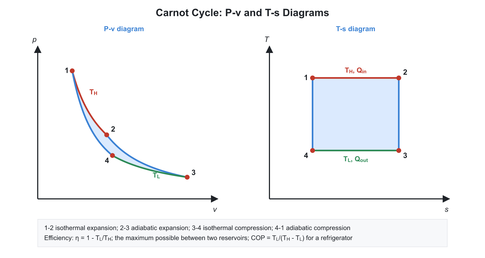

# 02. Second Law, Entropy and Availability

**Exam relevance:** APPSC AEE: C | SSC JE: C | RRB JE: C | Category: ALL | Yield: VHY

---

## Part A: Detailed Theory (read this first)

The first law says energy is conserved, but it allows processes that never happen: a hot cup does not cool by pushing heat into the hotter room, and a ship cannot run by cooling the ocean. The **second law** gives direction to natural processes and sets the upper limit on how well heat can be turned into work. **Entropy** is the property that quantifies it, and **availability** (exergy) measures how much useful work is really available.

### A1. Why a second law is needed
```text
 Hot reservoir                 Work output
      |                            ^
     QH                            |
      v                            |
  +---------+     rejected QL   +--------+
  |  ENGINE | ----------------> | sink   |
  +---------+                    +--------+
```


- Energy conversion is **asymmetric**. Work converts to heat completely (friction, electric heating, paddle stirring). Heat converts to work only partly, and only while a part is rejected to a colder sink.
- A thermodynamic process must satisfy the first law **and** the second law. A process can obey the first law and still be impossible.
- Examples of one-way processes: heat flows from hot to cold, a gas expands into a vacuum, a gas mixes with another, a current heats a resistor. The reverse never occurs spontaneously.

### A2. Thermal reservoirs, heat engines and the efficiency definition

- A **thermal energy reservoir (TER)** is a body so large that it can supply or absorb any amount of heat without a change in its temperature. The **source** is the high-temperature reservoir at $T_H$; the **sink** is the low-temperature reservoir at $T_L$.
- A **heat engine** (i) receives heat from a high-temperature source, (ii) converts part of it into work, (iii) rejects the remainder to a low-temperature sink, and (iv) operates in a cycle.
- Thermal efficiency is the desired output over the cost paid: $\eta = W_{net}/Q_H$. **Why not 100%?** Because the second law forbids it; some heat $Q_L$ must always be rejected.
- A **refrigerator** removes $Q_L$ from a cold space by consuming work. A **heat pump** delivers $Q_H$ to a warm space by consuming work. They are the same machine; they differ in what you want. COP can exceed unity because the device moves heat rather than creating it.

### A3. Kelvin-Planck and Clausius statements

- **Kelvin-Planck.** It is impossible to build a device that operates in a cycle, exchanges heat with a single reservoir and produces net work. A device that violates this is a **PMM2** (perpetual motion machine of the second kind). It would obey the first law but extract work from the ocean's heat.
- **Clausius.** It is impossible to build a device that operates in a cycle and does nothing except transfer heat from a cold body to a hotter body. A refrigerator needs a work input.
- **Equivalence (proof idea).** Suppose a Kelvin-Planck violator existed. Use its work to drive a refrigerator; the pair would move heat from cold to hot with no net work, violating Clausius. The reverse argument works too. Hence both statements are two faces of the same law.

### A4. Reversibility, Carnot cycle and Carnot theorems


- **Internally reversible process:** no irreversibility inside the system. **Externally reversible:** no irreversibility outside the boundary. A **totally reversible** process is both.
- The **Carnot cycle** consists of four reversible processes:
  1. Isothermal heat addition at $T_H$ (expansion).
  2. Reversible adiabatic (isentropic) expansion from $T_H$ to $T_L$.
  3. Isothermal heat rejection at $T_L$ (compression).
  4. Isentropic compression from $T_L$ to $T_H$.
- On a $T$-$s$ diagram, the Carnot cycle is a **rectangle**. Heat added $=T_H\,\Delta s$ and heat rejected $= T_L\,\Delta s$. So $\dfrac{Q_L}{Q_H} = \dfrac{T_L}{T_H}$ and $\eta = 1 - \dfrac{T_L}{T_H}$.
- **Carnot's theorems** (proved by contradiction using the Kelvin-Planck statement):
  1. No heat engine operating between two reservoirs can be more efficient than a reversible engine between the same two reservoirs.
  2. All reversible engines between the same two reservoirs have the same efficiency, independent of the working substance.
- **The absolute temperature scale.** Because the efficiency of a reversible engine depends only on the reservoir temperatures, we can *define* temperature by $\dfrac{Q_H}{Q_L} = \dfrac{T_H}{T_L}$. This is the Kelvin scale, independent of any substance.
- **Practical limits.** A Carnot engine is impractical: isothermal heat transfer is slow, and the work ratio is small. It is a **benchmark**. To raise efficiency, raise $T_H$ (limited by materials) or reduce $T_L$ (limited by the environment, about $300$ K).

### A5. Clausius inequality and the definition of entropy

- For a reversible engine, $\dfrac{Q_H}{T_H} - \dfrac{Q_L}{T_L} = 0$. For an irreversible engine, $\eta$ is lower, so $\dfrac{Q_H}{T_H} - \dfrac{Q_L}{T_L} < 0$. Generalising to any cycle:
$$\oint \frac{\delta Q}{T} \le 0$$
- For a **reversible** cycle, the integral is zero. That is exactly the condition that $\dfrac{\delta Q_{rev}}{T}$ is the exact differential of a property. We call that property **entropy**: $dS = \dfrac{\delta Q_{rev}}{T}$.
- **Entropy is a property**, so $\Delta S$ between two states is the same for any path, reversible or not. To compute it for an irreversible process, invent a reversible path between the same end states.
- **Interpretation.** Entropy measures the degree of molecular disorder (statistical view: $S = k\ln W$) and the quality of energy. High entropy means the energy is spread out and less useful.

### A6. The principle of increase of entropy

- For a closed system, $dS \ge \dfrac{\delta Q}{T}$, with equality for a reversible process. So $dS = \dfrac{\delta Q}{T} + \delta S_{gen}$, with $S_{gen} \ge 0$.
- For an isolated system, $\delta Q = 0$, so $\Delta S_{isolated} \ge 0$. Applied to system plus surroundings, $\Delta S_{universe} \ge 0$. This is the formal statement of the second law.
- **Entropy generation $S_{gen}$:** $=0$ reversible, $>0$ irreversible, $<0$ impossible. It quantifies how irreversible a process is.
- The **entropy of a system can decrease** (cooling a body), but only if the entropy of the surroundings rises by at least as much.
- **Heat transfer across a finite $\Delta T$.** Heat $Q$ leaves a body at $T_H$ and enters one at $T_L$: $S_{gen} = Q\left(\dfrac{1}{T_L} - \dfrac{1}{T_H}\right) > 0$. So all real heat transfer is irreversible; it is reversible only as $\Delta T \to 0$.
- **Entropy change relations for ideal gas.** From $T\,ds = du + P\,dv$, with $du = c_v\,dT$ and $P/T = R/v$: $ds = c_v\dfrac{dT}{T} + R\dfrac{dv}{v}$. Integrate to get the formulas of Part B. From $T\,ds = dh - v\,dP$ we get the $c_p$, $P$ form.
- **Isentropic relations** follow by setting $\Delta s = 0$, giving $Pv^\gamma = $ constant.
- **Liquids and solids** (incompressible): $\Delta s = c\ln\dfrac{T_2}{T_1}$.
- **Phase change:** at constant $T$ and $P$, $s_{fg} = \dfrac{h_{fg}}{T_{sat}}$.

### A7. Isentropic efficiencies of steady-flow devices

- Real turbines, compressors, pumps and nozzles lose performance through friction and turbulence, so the actual process has $\Delta s > 0$ even when adiabatic.
- The ideal reference is the **isentropic** process between the same inlet state and the same exit pressure. Hence:
  - Turbine: $\eta_T = \dfrac{\text{actual work}}{\text{isentropic work}} = \dfrac{h_1 - h_2}{h_1 - h_{2s}}$
  - Compressor/pump: $\eta_C = \dfrac{\text{isentropic work}}{\text{actual work}} = \dfrac{h_{2s} - h_1}{h_2 - h_1}$
  - Nozzle: $\eta_N = \dfrac{\text{actual KE gain}}{\text{isentropic KE gain}} = \dfrac{h_1 - h_2}{h_1 - h_{2s}}$
- These are not reversibility measures against the Carnot limit; they compare with the isentropic process.

### A8. Availability (exergy) and irreversibility

- **Idea.** Not all energy is equally useful. Heat at a high temperature can generate more work than the same quantity at a low temperature. Energy at the dead state (environment, $T_0$, $P_0$) can produce no work.
- **Dead state.** The state in which the system is in thermal and mechanical equilibrium with the surroundings. Available work is zero.
- **Available energy** (AE) of heat $Q$ at $T$ with surroundings at $T_0$: the work of a reversible engine operating between $T$ and $T_0$: $AE = Q\left(1 - \dfrac{T_0}{T}\right)$. **Unavailable energy** $= T_0\,\Delta s$ (the heat rejected).
- **Closed-system availability:** $\phi = (u - u_0) - T_0(s - s_0) + P_0(v - v_0)$. The maximum useful work from a closed system as it comes to the dead state, excluding work against the atmosphere.
- **Steady-flow availability:** $\psi = (h - h_0) - T_0(s - s_0) + \dfrac{V^2}{2} + g z$.
- **Irreversibility (lost work):** $I = W_{rev} - W_{actual} = T_0\,S_{gen}$. This is the **Gouy-Stodola theorem**: the lost work is proportional to the entropy generated.
- **Second-law efficiency:** $\eta_{II} = \dfrac{\text{actual useful work}}{\text{reversible (maximum) work}}$. A resistance heater is $100\%$ efficient by the first law but has a poor second-law efficiency, because it converts high-grade work into low-grade heat.
- **Why this matters in design.** It tells where the biggest losses are located (boiler combustion, throttling, condenser), not just how much energy leaves. Rankine cycle analysis shows that the largest exergy destruction is in the boiler, even though the largest energy loss is in the condenser.

### A9. Third law and absolute entropy

- The **third law** states that the entropy of a pure crystalline substance at absolute zero is zero. This gives a starting point for *absolute* entropy values in tables. It also implies that absolute zero cannot be reached by a finite number of processes.

### A10. What examiners test from this chapter

| Topic | APPSC AEE | SSC JE | RRB JE |
|---|---|---|---|
| Kelvin-Planck vs Clausius, PMM2 | Direct | Direct | Direct |
| Carnot efficiency and COP numerics | Numerical | Numerical | Numerical |
| Entropy change of ideal gas, $T$-$s$ diagram | Numerical | Common | Common |
| Clausius inequality, entropy generation, increase of entropy | Conceptual | Common | Common |
| Availability, irreversibility, isentropic efficiency | Numerical | Occasional | Occasional |

---

## Part B: Quick-reference notes, formulas, numericals and PYQs


## 🧭 1. Second law statements

- **Kelvin-Planck:** no cyclic device can receive heat from a single reservoir and produce a net amount of work. Equivalently, a heat engine cannot have a thermal efficiency of $100\%$ (**PMM2** is impossible).
- **Clausius:** no cyclic device can transfer heat from a cold body to a hot body without work input.
- The two statements are equivalent: a violation of one implies a violation of the other.

## 🧭 2. Heat engines, refrigerators and heat pumps

$$\eta = \frac{W_{net}}{Q_H} = 1 - \frac{Q_L}{Q_H}$$

$$\text{COP}_{ref} = \frac{Q_L}{W} = \frac{Q_L}{Q_H - Q_L}, \qquad \text{COP}_{HP} = \frac{Q_H}{W} = \frac{Q_H}{Q_H - Q_L}$$

$$\text{COP}_{HP} = \text{COP}_{ref} + 1$$

- A heat pump's COP is always greater than $1$. A refrigerator's COP can exceed $1$.
- **Kelvin temperature scale:** $\dfrac{Q_H}{Q_L} = \dfrac{T_H}{T_L}$ for a reversible engine.

## 🧭 3. Carnot cycle and theorem

- **Carnot cycle:** two reversible isothermal processes and two reversible adiabatic processes.
- **Carnot efficiency:**

$$\eta_{Carnot} = 1 - \frac{T_L}{T_H}$$

- **Carnot's theorems:** (1) no engine between two reservoirs can be more efficient than a reversible one; (2) all reversible engines between the same two reservoirs have the same efficiency.
- Efficiency rises by raising $T_H$ or lowering $T_L$; for the same temperature change, lowering $T_L$ gives a larger gain.
- **Carnot refrigerator and heat pump:**

$$\text{COP}_{ref} = \frac{T_L}{T_H - T_L}, \qquad \text{COP}_{HP} = \frac{T_H}{T_H - T_L}$$

- Work output per cycle from a Carnot engine with heat addition $Q_H$ is $Q_H\left(1 - \dfrac{T_L}{T_H}\right)$.
- Combined arrangement: if a Carnot engine drives a Carnot refrigerator between the same reservoirs, the net heat exchange with the reservoirs is zero.

## 🧭 4. Clausius inequality and entropy

- **Clausius inequality:**

$$\oint \frac{\delta Q}{T} \le 0$$

  Equality holds for a reversible cycle; inequality for an irreversible cycle.
- **Entropy** is defined for a reversible process by

$$dS = \left(\frac{\delta Q}{T}\right)_{rev}$$

  Entropy is a property (point function). Units: kJ/K (total), kJ/kg-K (specific).
- **Principle of increase of entropy:** for an isolated system (or system plus surroundings), $\Delta S \ge 0$. Entropy generation $S_{gen} \ge 0$: zero for reversible, positive for irreversible, negative (impossible).
- **$T$-$s$ diagram:** area under the curve is the heat transfer in a reversible process.

### Entropy change formulas for an ideal gas

$$s_2 - s_1 = C_v\ln\frac{T_2}{T_1} + R\ln\frac{v_2}{v_1} = C_p\ln\frac{T_2}{T_1} - R\ln\frac{P_2}{P_1}$$

| Process | Entropy change |
|---|---|
| Isothermal | $R\ln\dfrac{v_2}{v_1} = -R\ln\dfrac{P_2}{P_1}$ |
| Isochoric | $C_v\ln\dfrac{T_2}{T_1}$ |
| Isobaric | $C_p\ln\dfrac{T_2}{T_1}$ |
| Reversible adiabatic (isentropic) | $0$ |

- **Heat transfer at finite temperature difference:** entropy generation is $Q\left(\dfrac{1}{T_L} - \dfrac{1}{T_H}\right) > 0$.
- **Entropy of mixing** two ideal gases is positive.
- **Entropy and the $T$-$ds$ relations:**

$$T\,ds = du + P\,dv, \qquad T\,ds = dh - v\,dP$$

- **Isentropic efficiency:**

$$\eta_{turbine} = \frac{h_1 - h_2}{h_1 - h_{2s}}, \qquad \eta_{compressor} = \frac{h_{2s} - h_1}{h_2 - h_1}$$

- **Third law:** the entropy of a pure crystalline substance at absolute zero is zero.

## 🧭 5. Availability (exergy)

- **Available energy** is the maximum useful work obtainable from heat $Q$ at $T$ with the surroundings at $T_0$:

$$AE = Q\left(1 - \frac{T_0}{T}\right)$$

- **Unavailable energy:** the remainder, rejected to the surroundings, $Q\,\dfrac{T_0}{T}$ (in a reversible cycle).
- **Closed-system availability:** $\phi = (u - u_0) - T_0\,(s - s_0) + P_0\,(v - v_0)$.
- **Steady-flow availability:** $\psi = (h - h_0) - T_0\,(s - s_0) + \dfrac{V^2}{2} + g z$.
- **Irreversibility (lost work):**

$$I = T_0\,S_{gen}$$

- **Second law (exergy) efficiency:** $\eta_{II} = \dfrac{\text{useful exergy output}}{\text{exergy input}}$.
- **Dead state:** state in equilibrium with the environment; exergy is zero there.

## 🧭 6. Irreversibility sources

Friction, unrestrained expansion, heat transfer across a finite $\Delta T$, mixing of different substances, chemical reaction, electrical resistance, inelastic deformation, throttling.

## 🧭 7. Worked numericals

1. **Carnot engine.** $T_H = 800$ K, $T_L = 300$ K: $\eta = 1 - \dfrac{300}{800} = 62.5\%$.
2. **Refrigerator.** $T_L = 270$ K, $T_H = 300$ K: $\text{COP}_{max} = \dfrac{270}{30} = 9$.
3. **Entropy change.** $2$ kg of air heated at constant pressure from $300$ K to $600$ K: $\Delta S = 2\times1.005\times\ln 2 = 1.393$ kJ/K.
4. **Entropy generation.** $1000$ kJ moves from $600$ K to $300$ K: $S_{gen} = 1000\left(\dfrac{1}{300} - \dfrac{1}{600}\right) = 1.667$ kJ/K.

## 🧭 8. Common mistakes

- Using temperatures in Celsius in Carnot formulas (use Kelvin).
- Assuming entropy of an irreversible adiabatic process stays constant (it increases).
- Treating COP of a heat pump and refrigerator as the same (they differ by 1).

## 🧭 9. Interconnections

- Entropy underlies cycle analysis (Rankine, Otto, Diesel, Brayton) and property diagrams (Mollier $h$-$s$).
- Isentropic efficiency is used for turbines, compressors, pumps and nozzles.

## 🧭 10. PYQs

| # | Question | Answer | Exam / Year | Verify |
|---|---|---|---|---|
| 1 | Carnot efficiency | $1 - \dfrac{T_L}{T_H}$ | SSC JE 2017 | [ ] |
| 2 | Entropy of the universe | Always increases | RRB JE 2015 | [ ] |
| 3 | Clausius inequality | $\oint \dfrac{\delta Q}{T} \le 0$ | SSC JE 2018 | [ ] |
| 4 | Heat pump COP in terms of refrigerator COP | $\text{COP}_{ref} + 1$ | RRB JE 2014 | [ ] |
| 5 | Entropy change for reversible adiabatic process | Zero | SSC JE 2016 | [ ] |
| 6 | Area under the $T$-$s$ curve | Heat transfer (reversible) | RRB JE 2019 | [ ] |
| 7 | Kelvin-Planck statement concerns | Heat engine | SSC JE 2019 | [ ] |
| 8 | PMM2 violates | Second law | RRB JE 2015 | [ ] |
| 9 | Lost work (irreversibility) | $T_0\,S_{gen}$ | APPSC AEE 2012 | [ ] |
| 10 | Third law of thermodynamics | Entropy of a perfect crystal at $0$ K is zero | SSC JE 2020 | [ ] |

## 🧭 11. Revision checklist

- [ ] Kelvin-Planck and Clausius statements
- [ ] Carnot efficiency and COP formulas
- [ ] Entropy formulas for each ideal-gas process
- [ ] Availability and irreversibility
- [ ] Isentropic efficiencies
