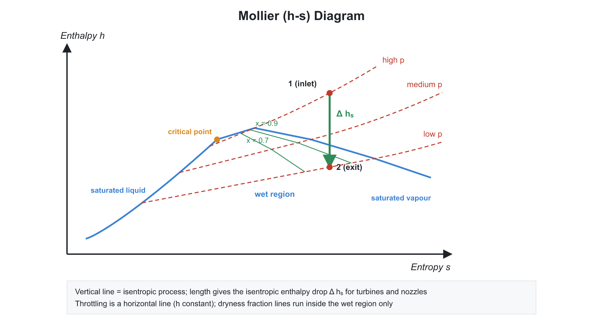
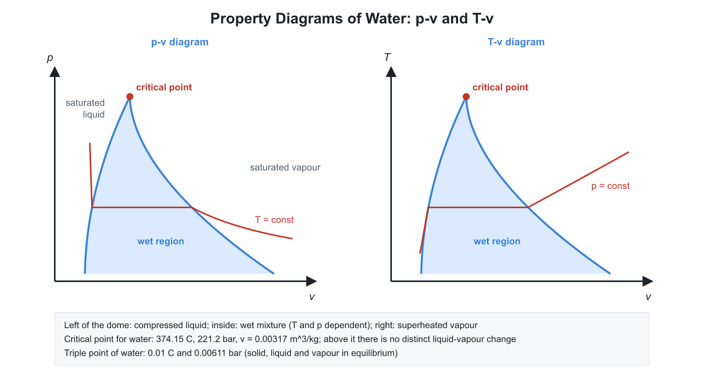

# 🌡️ 03. Pure Substances, Steam Properties and Psychrometric Basics

**Exam relevance:** APPSC AEE: C | SSC JE: C | RRB JE: C/S | Category: ALL | Yield: HY

---

## 📘 Part A: Detailed Theory (read this first)

Steam and other vapours are the working fluids of power plants and refrigerators, and their properties cannot be found from the ideal-gas law. This part explains what happens when a liquid is heated until it boils, why tables and charts are used instead of equations, and how every number in a steam table is built.

### 🔹 A1. Pure substance

- A **pure substance** has a fixed chemical composition throughout. Water, nitrogen and refrigerant R-134a are pure substances. A mixture of liquid water and steam is still pure because both phases have the same composition. A mixture of liquid air and gaseous air is not, because the phases have different compositions.
- A pure substance can exist in three **phases**: solid, liquid, vapour. A phase is a physically distinct, homogeneous part with its own properties.

### 🔹 A2. Constant-pressure heating of water: what happens step by step

Heat $1$ kg of ice-cold water in a piston-cylinder with a weight on the piston, so the pressure stays constant (for example $1$ atm).

1. **Compressed (subcooled) liquid.** Temperature rises, volume expands slightly. The liquid could still take more heat as sensible heat before it boils.
2. **Saturated liquid.** At $100^\circ$C (at $1$ atm), the liquid is about to vaporise. Any extra heat starts the boiling.
3. **Saturated mixture (wet steam).** Heat now goes into **latent heat**, not temperature. Temperature and pressure stay constant. Liquid and vapour coexist. The fraction of vapour is the **quality** $x$. Volume increases a great deal, because $v_g$ is about $1700$ times $v_f$ at atmospheric pressure.
4. **Saturated vapour.** The last drop has vaporised. $x = 1$.
5. **Superheated vapour.** Further heating raises the temperature again. Behaviour approaches an ideal gas as the superheat grows.

- At a given pressure there is exactly one **saturation temperature**; at a given temperature there is exactly one **saturation pressure**. In the wet region, $P$ and $T$ are not independent, so a third property ($x$, or $v$, or $h$) is needed to fix the state. This is the state postulate applied to a two-phase mixture.
- **Increasing the pressure** raises $T_{sat}$, and the latent heat $h_{fg}$ falls. The horizontal line representing evaporation becomes shorter.
- **Critical point.** At $22.09$ MPa and $374.14^\circ$C for water, the latent heat is zero and liquid and vapour phases become identical. Above critical pressure (supercritical), heating converts liquid to vapour continuously with no boiling. Modern supercritical boilers exploit this.
- **Triple point.** Solid, liquid and vapour coexist at one temperature and pressure ($273.16$ K and $0.6113$ kPa for water). Below triple-point pressure, ice goes straight to vapour (sublimation), which is the principle of freeze-drying.
- **Why ice floats / negative slope of the fusion curve.** Water expands on freezing, so the solid-liquid line on the $P$-$T$ diagram has a negative slope, which is unusual among substances.

### 🔹 A3. Property diagrams

- **$T$-$v$ diagram.** Constant-pressure lines rise, run flat across the dome, then rise again in the superheat region. The dome (saturated liquid line on the left, saturated vapour line on the right) peaks at the critical point.
- **$P$-$v$ diagram.** The constant-temperature lines slope downward, and flat in the dome.
- **$T$-$s$ diagram.** The dome is a bell shape. Area under a reversible path is heat. A vertical line is an isentropic process. This is the standard diagram for Rankine and refrigeration cycles.
- **$h$-$s$ (Mollier) chart.** Uses enthalpy against entropy. Turbine work is the vertical distance (enthalpy drop) for an isentropic expansion, so it is the working chart for steam turbines. In the wet region, constant-pressure lines are straight with slope $T_{sat}$ because $dh = T\,ds$ at constant $P$.
- **$P$-$h$ chart** is used for refrigerants, where the compressor, condenser, throttle and evaporator appear as simple lines.

### 🔹 A4. Quality and the property of a wet mixture

- Dryness fraction $x = m_{vapour}/m_{total}$. It applies only inside the dome.
- A mixture of $m_f$ of liquid and $m_g$ of vapour has an extensive property $X = m_f X_f + m_g X_g$. Dividing by the total mass gives the specific value:
$$X = (1-x)\,X_f + x\,X_g = X_f + x\,X_{fg}$$
  This is the origin of $v = v_f + x v_{fg}$, $h = h_f + x h_{fg}$, $s = s_f + x s_{fg}$. If $x$ is unknown, a measured property can be used to find it: $x = \dfrac{h - h_f}{h_{fg}}$.
- **Latent heat** $h_{fg} = h_g - h_f$ equals the heat of vaporisation at constant pressure, because $q = \Delta h$ at constant pressure. Also $s_{fg} = h_{fg}/T_{sat}$ because the evaporation is isothermal.
- **Superheated steam:** $h = h_g + c_p(T - T_{sat})$ roughly. Properties are in the superheat table, indexed by $P$ and $T$. **Compressed liquid** is usually taken as $h \approx h_f$ at the same temperature, as liquids are nearly incompressible.
- **Internal energy** from $u = h - Pv$. For a wet mixture $u = u_f + x u_{fg}$.

### 🔹 A5. How steam tables are organised

- **Table 1 (temperature table):** for a chosen $T_{sat}$ gives $P_{sat}$, $v_f$, $v_g$, $h_f$, $h_{fg}$, $h_g$, $s_f$, $s_{fg}$, $s_g$.
- **Table 2 (pressure table):** same data indexed by pressure.
- **Table 3 (superheated):** for each pressure and temperature gives $v$, $u$, $h$, $s$. Interpolation is needed between rows.
- **Table 4 (compressed liquid):** used only at high pressure; otherwise use saturated liquid data.
- **Procedure to find the state.** Compare the given property with saturated values: if $v_f < v < v_g$ (or $h_f < h < h_g$), it is a wet mixture; if above $v_g$, it is superheated; if below $v_f$, it is compressed liquid.

### 🔹 A6. Measuring dryness fraction: calorimeters

- Dryness fraction cannot be read directly. It is measured by sampling steam.
- **Throttling calorimeter.** Wet steam is throttled through a small orifice to a pressure low enough to make it superheated; then $h_1 = h_2$ so $x_1 = \dfrac{h_2 - h_{f1}}{h_{fg1}}$. It works only when the steam is nearly dry, because the throttled steam must become superheated; for very wet steam, the throttled steam stays wet and gives no unique temperature.
- **Separating calorimeter.** Steam is made to change direction suddenly so moisture separates; the mass of condensate collected and the mass of dry steam give $x$. Suitable for very wet steam.
- **Combined calorimeter.** Separating in series with throttling for the whole range.
- **Barrel calorimeter.** Steam is condensed in a known mass of cold water; an energy balance gives $x$. The result has errors due to heat losses.

### 🔹 A7. Real gases, generalised charts and thermodynamic relations

- Ideal gas fails near the critical point or at high pressure. The **van der Waals equation** corrects for molecular size ($b$) and attractive forces ($a$). Using the condition that the critical isotherm has an inflection point ($\partial P/\partial v = 0$ and $\partial^2 P/\partial v^2 = 0$) gives $v_c = 3b$, $P_c = \dfrac{a}{27b^2}$, $T_c = \dfrac{8a}{27Rb}$ and $Z_c = 3/8$.
- **Principle of corresponding states.** If gases are compared at the same reduced pressure and temperature, they have nearly the same compressibility factor $Z$. This gives a **generalised compressibility chart**, applicable to any gas.
- **Clapeyron equation.** Along the saturation line, $\dfrac{dP_{sat}}{dT} = \dfrac{h_{fg}}{T\,v_{fg}}$. It allows $h_{fg}$ to be found from $P$-$T$ data and explains the negative slope of the water fusion curve ($v_{fg}<0$ on melting). For vaporisation of low-pressure vapour with $v_g \gg v_f$ and ideal-gas behaviour, it reduces to the **Clausius-Clapeyron** form $\dfrac{d\ln P}{dT} = \dfrac{h_{fg}}{R T^2}$.
- **Maxwell relations** come from the exactness of $dU$, $dH$, $dF$, $dG$. For example, $\left(\dfrac{\partial T}{\partial v}\right)_s = -\left(\dfrac{\partial P}{\partial s}\right)_v$. They convert quantities that are hard to measure (entropy) into quantities that are easy to measure ($P$, $v$, $T$).
- **Gibbs function** $G = H - TS$: phases in equilibrium have equal $g$. **Helmholtz function** $F = U - TS$: its decrease is the maximum work at constant temperature.

### 🔹 A8. What examiners test from this chapter

| Topic | APPSC AEE | SSC JE | RRB JE |
|---|---|---|---|
| Definitions: saturated, superheated, quality, critical point | Direct | Very common | Very common |
| $h = h_f + x h_{fg}$ numericals | Numerical | Common | Common |
| Mollier chart features | Conceptual | Common | Common |
| Calorimeters | Conceptual | Common | Occasional |
| van der Waals constants, Clapeyron | Common | Occasional | Rare |

---

## ⚡ Part B: Quick-reference notes, formulas, numericals and PYQs

## 🧭 1. Pure substance and phase change

- **Pure substance:** homogeneous and invariable in chemical composition (water, a mixture of gases like air is treated as one while it remains gaseous).
- **Phases:** solid, liquid, vapour. **Saturation temperature** $T_{sat}$ at a given pressure is the boiling temperature; **saturation pressure** is the pressure at which boiling occurs at a given temperature.

| Term | Meaning |
|---|---|
| Compressed (sub-cooled) liquid | $T < T_{sat}$ at the given $P$ |
| Saturated liquid | Liquid at $T_{sat}$, about to vaporise |
| Wet (saturated) mixture | Liquid and vapour coexist at $T_{sat}$ |
| Saturated vapour | Vapour at $T_{sat}$, about to condense |
| Superheated vapour | $T > T_{sat}$ at the given $P$ |
| Degree of superheat | $T - T_{sat}$ |

- **Triple point:** solid, liquid and vapour coexist (water: $273.16$ K, $0.6113$ kPa). **Critical point:** liquid and vapour phases become indistinguishable. For water: $P_c = 22.09$ MPa, $T_c = 374.14^\circ$C ($647.3$ K), $v_c = 0.00317$ m$^3$/kg. Above $P_c$ there is no distinct boiling.
- Normal boiling point of water: $100^\circ$C at $101.325$ kPa. Latent heat of vaporisation falls to zero at the critical point.

## 🧭 2. Dryness fraction and properties of wet steam

- **Dryness fraction (quality)** $x = \dfrac{m_g}{m_g + m_f}$. It is $0$ for saturated liquid and $1$ for saturated vapour. **Wetness fraction** $= 1 - x$.

$$v = v_f + x\,v_{fg}, \qquad h = h_f + x\,h_{fg}, \qquad s = s_f + x\,s_{fg}, \qquad u = u_f + x\,u_{fg}$$

- For low pressure, $v \approx x\,v_g$ because $v_f$ is very small compared with $v_g$.
- **Enthalpy of superheated steam:**

$$h_{sup} = h_g + C_{p,steam}\,(T_{sup} - T_{sat})$$

  with $C_{p,steam} \approx 2.1$ kJ/kg-K.
- **Internal energy:** $u = h - Pv$.
- **Entropy of wet steam** from the steam tables or the Mollier chart.
- **Enthalpy of compressed liquid** is approximately $h_f$ at the same temperature.
- **Latent heat:** $h_{fg} = h_g - h_f$. At higher pressure, $h_{fg}$ is smaller.

## 🧭 3. Property diagrams

- **$T$-$v$ and $P$-$v$ diagrams:** the saturation dome; the critical point is its top. The constant-pressure line in the wet region is horizontal on a $T$-$s$ diagram.
- **$T$-$s$ diagram:** area under the curve represents heat transfer. Constant-pressure lines rise in the superheat region.
- **Mollier ($h$-$s$) chart:** used for adiabatic expansion; vertical line for isentropic expansion; the vertical length between two states is the isentropic enthalpy drop (work of a turbine). Constant-pressure lines are straight in the wet region (slope $= T$).
- **Throttling** of wet steam is a horizontal line on the Mollier chart.

## 🧭 4. Steam calorimeters

| Calorimeter | Measures | Notes |
|---|---|---|
| Barrel calorimeter | Dryness fraction of wet steam | Steam condensed in water; energy balance |
| Separating calorimeter | $x$ of very wet steam | Moisture separated mechanically |
| Throttling calorimeter | $x$ of nearly dry steam ($x > 0.95$) | Throttle to superheated state; $h_1 = h_2$ |
| Combined (separating + throttling) | Wide range of $x$ | Used for very wet steam |

- Throttling calorimeter relation: $h_f + x\,h_{fg} = h_2$ (superheated state after throttling).

## 🧭 5. Real gas and generalised relations

- **Van der Waals equation:** accounts for molecular volume ($b$) and attraction ($a$).
- **Critical constants:** $v_c = 3b$, $T_c = \dfrac{8a}{27 R b}$, $P_c = \dfrac{a}{27 b^2}$.
- **Reduced properties:** $P_r = \dfrac{P}{P_c}$, $T_r = \dfrac{T}{T_c}$, $v_r = \dfrac{v}{v_c}$.
- **Clapeyron equation** for phase change:

$$\frac{dP}{dT} = \frac{h_{fg}}{T\,v_{fg}}$$

- **Maxwell relations** connect partial derivatives of $T$, $P$, $v$, $s$.
- **Gibbs and Helmholtz functions:** $G = H - TS$ and $F = U - TS$. At equilibrium of phases, $G$ is equal in both phases.

## 🧭 6. Psychrometry basics (see RAC chapter for detail)

- **Dalton's law of partial pressure** for moist air: $P = P_a + P_v$.
- **Specific humidity** $\omega = 0.622\,\dfrac{P_v}{P - P_v}$. **Relative humidity** $\phi = \dfrac{P_v}{P_{sat}}$.

## 🧭 7. Worked numericals

1. **Wet steam.** At $1$ MPa, $x = 0.9$, $h_f = 762.8$, $h_{fg} = 2015.3$ kJ/kg: $h = 762.8 + 0.9\times2015.3 = 2576.6$ kJ/kg.
2. **Superheat.** Steam at $1$ MPa and $300^\circ$C: degree of superheat $= 300 - 179.9 = 120.1^\circ$C.
3. **Throttling.** Steam at $2$ MPa throttled to $0.1$ MPa and $120^\circ$C, $h_2 = 2716$ kJ/kg. If $h_f = 908.8$, $h_{fg} = 1890.7$ at $2$ MPa: $x = \dfrac{2716 - 908.8}{1890.7} = 0.956$.

## 🧭 8. Common mistakes

- Using $x$ for superheated steam (dryness fraction applies only in the wet region).
- Taking $h_{fg}$ as constant across pressures.
- Applying $h = h_f + x\,h_{fg}$ to a compressed liquid.

## 🧭 9. Interconnections

- Steam properties are the basis for Rankine cycle, boilers, turbines, condensers and refrigeration ($P$-$h$ charts).

## 🧭 10. PYQs

| # | Question | Answer | Exam / Year | Verify |
|---|---|---|---|---|
| 1 | Dryness fraction of saturated liquid | 0 | SSC JE 2017 | [ ] |
| 2 | Critical pressure of water | $22.09$ MPa | RRB JE 2015 | [ ] |
| 3 | Triple point of water | $273.16$ K | RRB JE 2019 | [ ] |
| 4 | Enthalpy of wet steam | $h_f + x\,h_{fg}$ | SSC JE 2018 | [ ] |
| 5 | Throttling calorimeter measures | Dryness fraction of nearly dry steam | SSC JE 2016 | [ ] |
| 6 | Latent heat at the critical point | Zero | RRB JE 2014 | [ ] |
| 7 | Degree of superheat | $T_{sup} - T_{sat}$ | SSC JE 2019 | [ ] |
| 8 | Slope of a constant-pressure line on the Mollier chart (wet region) | Equals temperature $T$ | APPSC AEE 2012 | [ ] |
| 9 | Clapeyron equation | $\dfrac{dP}{dT} = \dfrac{h_{fg}}{T\,v_{fg}}$ | APPSC AEE 2012 | [ ] |
| 10 | Compressibility factor of an ideal gas | 1 | SSC JE 2020 | [ ] |

## 🧭 11. Revision checklist

- [ ] Definitions: saturated, wet, superheated, critical, triple
- [ ] $h$, $s$, $v$ for wet steam using $x$
- [ ] Mollier chart reading
- [ ] Calorimeters and their use
