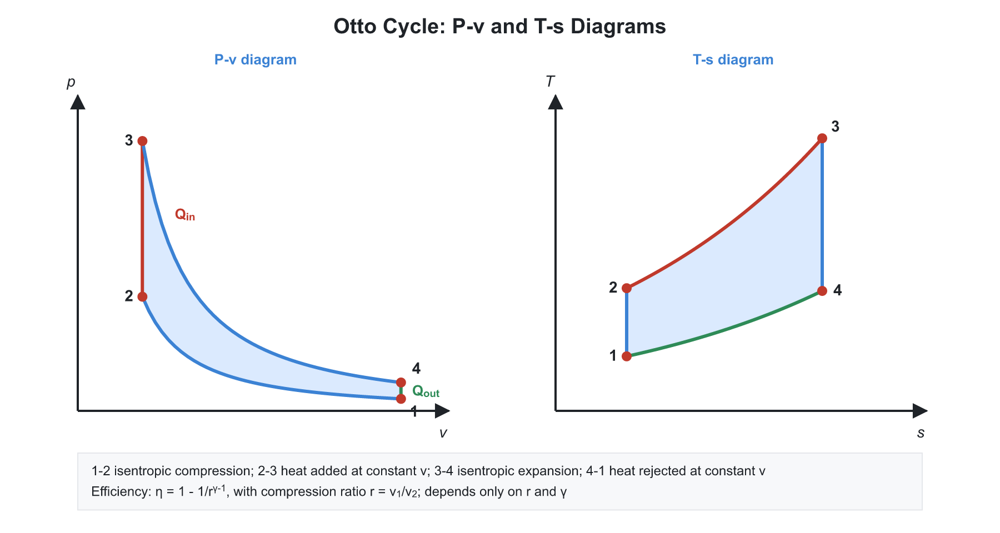
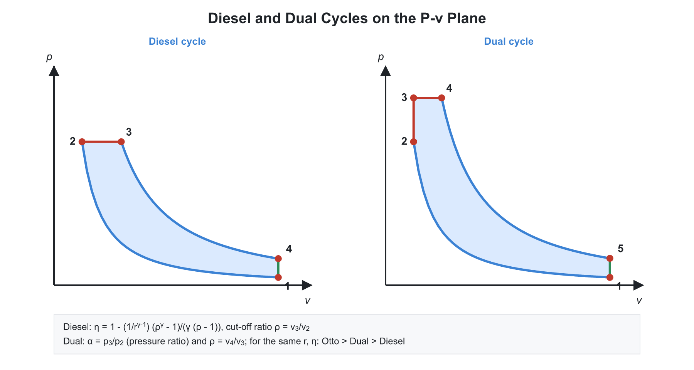
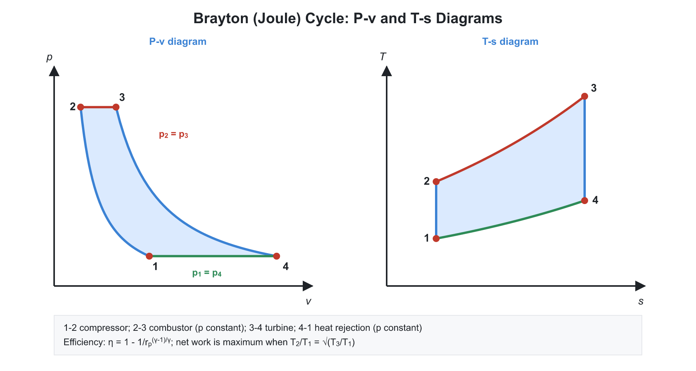
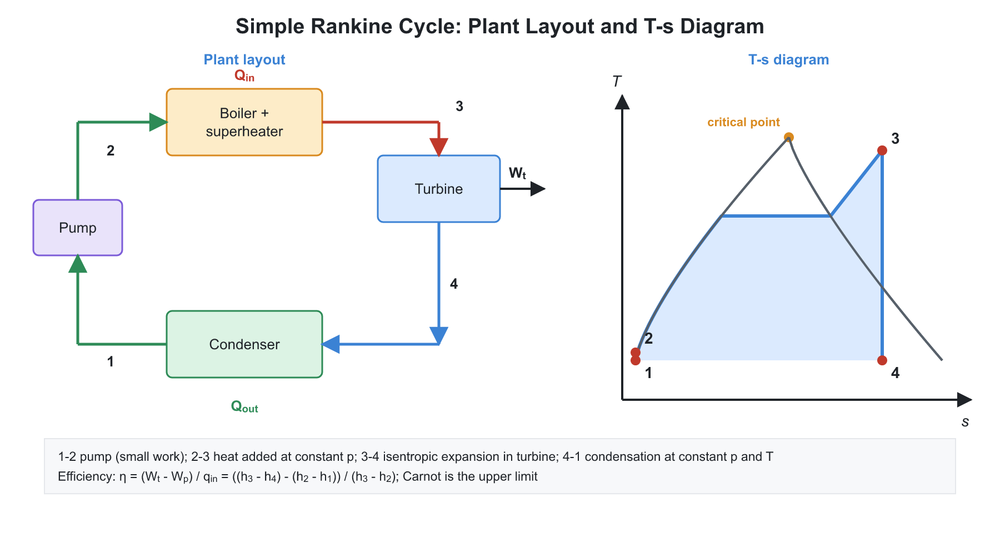
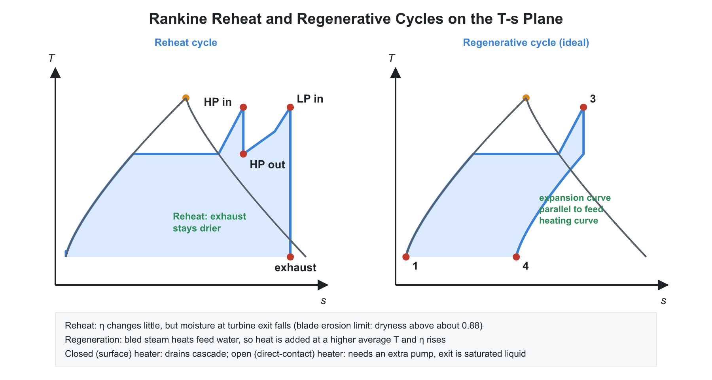

# 04. Gas Power Cycles and Vapour Power Cycles

**Exam relevance:** APPSC AEE: C | SSC JE: C | RRB JE: C | Category: ALL | Yield: VHY

---

## Part A: Detailed Theory (read this first)

A power cycle is a series of processes that returns the working fluid to its starting state while delivering net work. Real engines are too complicated to analyse directly, so we study idealised cycles that keep the essential physics and let us compare designs. This part explains how each cycle is built, why its efficiency has the form it has, and what limits it in practice.

### A1. How to analyse any cycle
```text
     P
     ^       3 <----- 2
     |       |         /
     |       v        /
     |       4 -----> 1
     +--------------------> V
       closed cycle (P-v)
```


- **Efficiency** $\eta = \dfrac{W_{net}}{Q_{in}} = 1 - \dfrac{Q_{out}}{Q_{in}}$. Net work equals the area enclosed on the $P$-$V$ diagram, and also equals $Q_{in} - Q_{out}$ on the $T$-$s$ diagram.
- **Method.** (1) Identify the four processes. (2) Find the temperatures at each state using isentropic and ideal-gas relations. (3) Find $Q_{in}$ and $Q_{out}$ from $c_v\Delta T$ or $c_p\Delta T$. (4) Form $\eta$.
- **Carnot efficiency is the upper bound** for any cycle operating between the same maximum and minimum temperatures. Practical cycles fall short because heat is not added or rejected isothermally.
- **Mean effective pressure** (mep) is the constant pressure that, acting through the swept volume, would give the same net work: $\text{mep} = W_{net}/(V_{max} - V_{min})$. It is used to compare engines of different sizes; a higher mep means more work from a given size of engine.

### A2. Air-standard assumptions

Real engines burn fuel inside the cylinder and exchange gas. To make the problem tractable, the **air-standard cycle** assumes:

1. The working fluid is a fixed mass of air, treated as an ideal gas, circulating in a closed loop.
2. All processes are internally reversible.
3. Combustion is replaced by heat addition from an external source.
4. Exhaust is replaced by heat rejection to restore the initial state.
5. Specific heats are constant at room temperature (the cold-air-standard assumption).

These make the results qualitative guides. Actual efficiencies are lower by $\approx 30$ to $40\%$ because real $\gamma$ is lower at high temperature, and because of friction, heat loss and incomplete combustion.

### A3. Otto cycle: the spark-ignition engine


- **Sequence.** Isentropic compression (1-2), constant-volume heat addition (2-3, the spark ignites the charge so fast the piston barely moves), isentropic expansion (3-4, power stroke), constant-volume heat rejection (4-1, exhaust valve opens).
- **Derivation.**
$$Q_{in} = m c_v (T_3 - T_2), \quad Q_{out} = m c_v (T_4 - T_1)$$
  $$\eta = 1 - \frac{T_4 - T_1}{T_3 - T_2}$$
  For isentropic compression and expansion, $\dfrac{T_2}{T_1} = r^{\gamma-1}$ and $\dfrac{T_3}{T_4} = r^{\gamma-1}$, so $T_3 - T_2 = r^{\gamma-1}(T_4 - T_1)$, giving
$$\eta_{Otto} = 1 - \frac{1}{r^{\gamma-1}}$$
- **Meaning.** The efficiency depends only on the compression ratio. A higher $r$ increases the average temperature of heat addition and reduces the mean temperature of heat rejection.
- **Limit on $r$.** A fuel-air mixture is compressed. At high $r$ the end-gas auto-ignites before the flame reaches it, which causes **knock**. Hence $r \approx 6$ to $10$ for petrol engines. Higher octane fuel resists knock.
- **Effect of $\gamma$.** A larger $\gamma$ (monatomic gas like argon) increases efficiency for the same $r$.

### A4. Diesel cycle: the compression-ignition engine


- **Sequence.** Only air is compressed. Because no fuel is present during compression, there is no knock, so $r$ can be very high (14 to 22). Fuel is injected near the top and burns as it enters, adding heat at roughly constant pressure while the piston moves down (2-3). Then isentropic expansion (3-4) and constant-volume rejection (4-1).
- **Derivation.** $Q_{in} = m c_p (T_3 - T_2)$ and $Q_{out} = m c_v (T_4 - T_1)$. Using the cut-off ratio $\rho = V_3/V_2 = T_3/T_2$:
$$\eta_{Diesel} = 1 - \frac{1}{r^{\gamma - 1}}\left[\frac{\rho^\gamma - 1}{\gamma(\rho - 1)}\right]$$
- The bracket is greater than $1$ for $\rho > 1$ and tends to $1$ as $\rho \to 1$. So at the **same compression ratio**, Diesel is less efficient than Otto, and a **later cut-off (higher load)** lowers the efficiency. Diesel engines are, in practice, more efficient because $r$ is much higher.
- **Cut-off ratio** is a measure of the duration of fuel injection and increases with load.

### A5. Comparing Otto and Diesel: why the basis matters

| Basis | Result |
|---|---|
| Same compression ratio and same heat input | Otto more efficient |
| Same maximum pressure and same heat input | Diesel more efficient |
| Same maximum pressure and maximum temperature | Diesel more efficient |

- **Reasoning for equal peak pressure.** For the same peak pressure, Otto must have a lower compression ratio, because its heat addition raises the pressure at constant volume. With a lower $r$, its efficiency falls below that of Diesel.
- Mechanical design is set by the maximum pressure the structure can bear, so the same-peak-pressure comparison is the relevant one for real engines.

### A6. Dual cycle

- Real diesel engines add part of the heat quickly at constant volume (premixed burning of the injected fuel) and the rest at constant pressure (diffusion burning). The **dual (limited-pressure) cycle** models this:
$$\eta_{Dual} = 1 - \frac{1}{r^{\gamma-1}}\left[\frac{\alpha\rho^\gamma - 1}{(\alpha - 1) + \gamma\alpha(\rho - 1)}\right]$$
- It reduces to Otto if $\rho = 1$ (no constant-pressure part) and to Diesel if $\alpha = 1$ (no constant-volume part). It is the best match with the real indicator diagram of a high-speed diesel.

### A7. Brayton cycle: the gas turbine


- **Components.** Compressor, combustion chamber, turbine. In the ideal **closed** cycle, a heat exchanger replaces the combustor. In the open cycle, air is taken in and exhaust gas is released.
- **Sequence.** Isentropic compression (1-2), constant-pressure heat addition (2-3), isentropic expansion (3-4), constant-pressure heat rejection (4-1).
- **Derivation.** $Q_{in} = m c_p(T_3 - T_2)$ and $Q_{out} = m c_p(T_4 - T_1)$. For isentropes between the same two pressures, $\dfrac{T_2}{T_1} = \dfrac{T_3}{T_4} = r_p^{(\gamma-1)/\gamma}$, therefore
$$\eta_{Brayton} = 1 - \frac{T_1}{T_2} = 1 - \frac{1}{r_p^{(\gamma-1)/\gamma}}$$
- **Back work ratio.** The turbine produces a lot of work, but the compressor consumes $40$ to $80\%$ of it (a gas needs a lot of work to compress, unlike a liquid in a pump). Component efficiencies therefore matter greatly. A low compressor efficiency can cut net work to nothing.
- **Optimum pressure ratio.** Net work $= c_p[(T_3 - T_4) - (T_2 - T_1)]$. For given $T_1$ and $T_3$, net work is zero at $r_p = 1$ and again where $T_2 = T_3$, with a maximum in between at $r_{p} = (T_3/T_1)^{\gamma/[2(\gamma-1)]}$. At this optimum, $T_2 = T_4$.
- **Improvements:**
  - **Intercooling** cools air between compressor stages; reduces the compressor work (work is proportional to the inlet temperature) but needs more heat in the combustor, so efficiency may fall unless regeneration is used.
  - **Reheating** adds a second combustor between turbine stages, increasing turbine work.
  - **Regeneration** uses hot turbine exhaust to preheat compressed air. This saves fuel. It only makes sense when $T_4 > T_2$, which means a low pressure ratio. At a high pressure ratio, the exhaust is cooler than the compressed air and regeneration cannot help.
  - Together, multistage compression with intercooling, multistage expansion with reheating, and regeneration approach the **Ericsson cycle**, which has Carnot efficiency.

### A8. Stirling, Ericsson, and other cycles

- **Stirling:** two isothermal and two constant-volume processes with perfect regeneration. **Ericsson:** two isothermal and two constant-pressure processes with perfect regeneration. With perfect regeneration, both reach Carnot efficiency, since all external heat exchange is isothermal.
- **Atkinson cycle:** expansion ratio is larger than compression ratio, so exhaust pressure is nearly atmospheric. Used in hybrid-vehicle engines.
- **Lenoir cycle:** no compression stage; heat addition at constant volume. Poor efficiency.
- **Reversed Brayton (Bell-Coleman)** is the air refrigeration cycle used in aircraft cabin cooling.

### A9. Rankine cycle: the steam power plant



- **Why not Carnot with steam?** Carnot would need isentropic compression of a wet mixture (a two-phase compressor is impractical and damaging) and would place the pump at the high pressure end. Rankine modifies it by **fully condensing** the steam to liquid and pumping the liquid, which takes very little work because the specific volume is small.
- **Processes.** 1-2 isentropic pumping; 2-3 constant-pressure heating in the boiler (sensible heating, evaporation, superheating); 3-4 isentropic expansion in the turbine; 4-1 constant-pressure condensation.
- **Energy balances.**
$$w_{pump} = v_f (P_2 - P_1), \qquad w_{turb} = h_3 - h_4, \qquad q_{in} = h_3 - h_2, \qquad q_{out} = h_4 - h_1$$
- **Why Rankine efficiency is lower than Carnot.** The heat addition takes place over a range of temperatures, from the compressed liquid temperature up to the superheat temperature, so the mean temperature of heat addition is lower than the maximum.
- **How to raise Rankine efficiency:** raise the mean temperature of heat addition or lower the mean temperature of rejection.

| Change | Effect on efficiency | Side effect |
|---|---|---|
| Lower condenser pressure | Increases | More moisture at turbine exit; limited by cooling water temperature and air leakage |
| Higher boiler pressure | Increases | More moisture at turbine exit; higher pressure ratings and cost |
| Superheating | Increases | Reduces moisture; limited by metallurgy |
| Reheating | Small increase | Reduces moisture; adds equipment |
| Regeneration | Increases | Complex; needs feedwater heaters |

- **Moisture limit.** Blade erosion is serious when exit steam quality falls below about $0.88$ to $0.90$. This is why reheat and superheat are used.
- **Reheat.** Steam is expanded in a high-pressure turbine, returned to the boiler (reheater), and expanded in a low-pressure turbine. Its main purpose is to control moisture, with a modest gain in efficiency.
- **Regeneration.** Bleeding some steam from the turbine to warm the feedwater makes heat addition happen at a higher mean temperature. **Open feedwater heater:** bled steam mixes directly with feedwater (needs a pump after each heater). **Closed heater:** shell-and-tube, with drains cascaded back or pumped forward. For an open heater, an energy balance gives the bled mass fraction $y$: $y\,h_{bled} + (1-y)\,h_{pump,out} = h_{f}$.
- **Ideal regeneration** with infinitely many heaters makes the heating of the feedwater follow the turbine expansion line and would give Carnot-like efficiency.
- **Combined and cogeneration cycles.** A **binary cycle** couples two fluids (mercury at the top, steam at the bottom). A **combined gas-steam cycle** uses the Brayton exhaust to raise steam in a heat recovery boiler, giving $55$ to $60\%$ efficiency. **Cogeneration** extracts steam for process heat, achieving a high overall energy utilisation factor.
- **Performance measures:** specific steam consumption (kg/kWh), heat rate (kJ/kWh), and back work ratio (nearly $1$ minus a small value for Rankine, because pump work is tiny).

### A10. Actual versus ideal cycles

- Real turbines and compressors are not isentropic (isentropic efficiency $85$ to $92\%$). Pumps and boilers have pressure drops. Piping loses heat. The actual cycle therefore falls short of the ideal.
- On the $T$-$s$ diagram, the actual expansion line tilts to the right (entropy increases), giving a higher exit enthalpy and a smaller work output.

### A11. What examiners test from this chapter

| Topic | APPSC AEE | SSC JE | RRB JE |
|---|---|---|---|
| Efficiency formulas for Otto, Diesel, Brayton | Direct | Very common | Very common |
| Comparison of Otto and Diesel on a given basis | Conceptual | Common | Common |
| Rankine modifications: superheat, reheat, regeneration | Conceptual | Common | Common |
| Back work ratio, mep, optimum pressure ratio | Numerical | Occasional | Occasional |
| Stirling/Ericsson, Atkinson, Bell-Coleman | Occasional | Common | Common |

---

## Part B: Quick-reference notes, formulas, numericals and PYQs


## 🧭 1. Air-standard assumptions

- Working fluid is air, an ideal gas with constant specific heats. All processes are internally reversible. Combustion is replaced by heat addition from an external source, and exhaust by heat rejection.

## 🧭 2. Otto cycle (constant-volume heat addition)

Processes: 1-2 isentropic compression; 2-3 constant-volume heat addition; 3-4 isentropic expansion; 4-1 constant-volume heat rejection.

$$\eta_{Otto} = 1 - \frac{1}{r^{\gamma - 1}}$$

- $r = \dfrac{V_1}{V_2}$ is the compression ratio. Efficiency depends only on $r$ and $\gamma$. It rises with $r$ but is limited by knocking in SI engines (typically $r = 6$ to $10$).
- **Mean effective pressure:**

$$\text{mep} = \frac{W_{net}}{V_1 - V_2}$$

- Heat added: $Q_{in} = m\,C_v\,(T_3 - T_2)$. Heat rejected: $Q_{out} = m\,C_v\,(T_4 - T_1)$.

## 🧭 3. Diesel cycle (constant-pressure heat addition)

Processes: 1-2 isentropic compression; 2-3 constant-pressure heat addition; 3-4 isentropic expansion; 4-1 constant-volume heat rejection.

$$\eta_{Diesel} = 1 - \frac{1}{r^{\gamma-1}}\cdot\frac{\rho^{\gamma} - 1}{\gamma\,(\rho - 1)}$$

- $\rho = \dfrac{V_3}{V_2}$ is the cut-off ratio. The bracketed factor $\dfrac{\rho^\gamma - 1}{\gamma(\rho - 1)}$ is greater than $1$, so for the same $r$, $\eta_{Otto} > \eta_{Diesel}$.
- **Comparison basis matters:** for the same compression ratio and same heat input, Otto is more efficient than Diesel. For the same maximum pressure and same heat input, Diesel is more efficient than Otto (it can use a higher compression ratio). Dual cycle lies between the two.
- Diesel engines use $r = 14$ to $22$.

## 🧭 4. Dual cycle

Heat addition partly at constant volume and partly at constant pressure.

$$\eta_{Dual} = 1 - \frac{1}{r^{\gamma-1}}\cdot\frac{\alpha\,\rho^\gamma - 1}{(\alpha - 1) + \gamma\,\alpha\,(\rho - 1)}$$

- $\alpha = \dfrac{P_3}{P_2}$ is the pressure ratio, $\rho$ the cut-off ratio. For $\rho = 1$ it reduces to Otto; for $\alpha = 1$ it reduces to Diesel.

## 🧭 5. Brayton (gas turbine) cycle

Processes: 1-2 isentropic compression; 2-3 constant-pressure heat addition; 3-4 isentropic expansion; 4-1 constant-pressure heat rejection.

$$\eta_{Brayton} = 1 - \frac{1}{r_p^{\frac{\gamma-1}{\gamma}}}, \qquad r_p = \frac{P_2}{P_1}$$

- Efficiency depends only on the pressure ratio. **Back work ratio** $= \dfrac{W_{compressor}}{W_{turbine}}$ is high ($40\%$ to $80\%$) for gas turbines.
- **Optimum pressure ratio** for maximum net work (for fixed $T_1$ and $T_3$):

$$r_{p,opt} = \left(\frac{T_3}{T_1}\right)^{\frac{\gamma}{2(\gamma-1)}}$$

- **Improvements:** regeneration (heat exchanger using turbine exhaust to preheat compressed air; it works only when $T_4 > T_2$), intercooling (reduces compressor work), reheating (increases turbine work). Intercooling plus reheating plus regeneration move the cycle toward Ericsson cycle efficiency.
- **Regenerative Brayton efficiency** (ideal, effectiveness 1): $\eta = 1 - \dfrac{T_1}{T_3}\,r_p^{\frac{\gamma-1}{\gamma}}$. It falls as pressure ratio rises.
- **Ericsson cycle:** isothermal compression and expansion with constant-pressure regeneration; **Stirling cycle:** isothermal processes with constant-volume regeneration. Both have the Carnot efficiency with perfect regeneration.
- Jet engines use an open Brayton cycle: turbojet thrust $F = \dot{m}\,(V_{exit} - V_{inlet})$ (plus pressure terms).

## 🧭 6. Rankine cycle

Ideal steam power cycle: 1-2 isentropic compression in pump; 2-3 constant-pressure heat addition in boiler; 3-4 isentropic expansion in turbine; 4-1 constant-pressure heat rejection in condenser.

$$w_{pump} = v_f\,(P_2 - P_1) \approx h_2 - h_1$$

$$\eta_{Rankine} = \frac{(h_3 - h_4) - (h_2 - h_1)}{h_3 - h_2}$$

- **Work ratio** $= \dfrac{W_{net}}{W_{turbine}}$ is close to $1$ for Rankine (small pump work).
- **Specific steam consumption (SSC):** $\dfrac{3600}{W_{net}}$ kg/kWh. **Heat rate** $= \dfrac{3600}{\eta}$ kJ/kWh.
- **Effect of boiler pressure:** efficiency rises; quality at turbine exit falls (more moisture). **Effect of condenser pressure:** lower pressure raises efficiency but increases moisture. **Effect of superheat:** raises efficiency and reduces moisture in the turbine exit.
- **Reheat Rankine:** steam is expanded partially, reheated at constant pressure and expanded again; it reduces moisture and slightly increases efficiency.
- **Regenerative Rankine:** feedwater heated with steam extracted from the turbine. **Open feedwater heater** mixes steam and feedwater; **closed feedwater heater** transfers heat via surfaces. With an infinite number of heaters, efficiency approaches Carnot.
- **Mass fraction** of bled steam (open heater): $y = \dfrac{h_f - h_{pump,out}}{h_{bled} - h_{pump,out}}$.
- **Binary vapour cycle:** mercury-steam. **Cogeneration** uses a back-pressure or extraction turbine to supply process heat as well as power.
- **Carnot vapour cycle** is not practical: it needs compression of wet vapour and a very high pressure at maximum temperature.

## 🧭 7. Other cycles

- **Atkinson cycle:** expansion ratio exceeds compression ratio; **Lenoir cycle:** heat addition at constant volume without compression.
- **Reversed Brayton (Bell-Coleman) cycle:** air refrigeration; $\text{COP} = \dfrac{1}{r_p^{(\gamma-1)/\gamma} - 1}$.

## 🧭 8. Worked numericals

1. **Otto.** $r = 8$, $\gamma = 1.4$: $\eta = 1 - 8^{-0.4} = 1 - 0.435 = 56.5\%$.
2. **Diesel.** $r = 16$, $\rho = 2$, $\gamma = 1.4$:

$$\eta = 1 - \frac{1}{16^{0.4}}\cdot\frac{2^{1.4} - 1}{1.4\times(2-1)} = 1 - 0.330\times\frac{1.639}{1.4} = 0.614$$

3. **Brayton.** $r_p = 10$, $\gamma = 1.4$: $\eta = 1 - 10^{-0.2857} = 48.2\%$.
4. **Rankine.** $h_3 = 3200$, $h_4 = 2200$, pump work $= 10$, $h_2 - h_1 = 10$ kJ/kg, $h_1 = 190$: $\eta = \dfrac{1000 - 10}{3200 - 200} = 33\%$.

## 🧭 9. Common mistakes

- Using $\gamma = 1.4$ for combustion products; air-standard uses fixed $\gamma$.
- Comparing Otto and Diesel without stating the basis (same $r$, same peak pressure, or same heat input).
- Applying the Brayton formula to a regenerative cycle.

## 🧭 10. Interconnections

- Otto and Diesel link to IC engines; Brayton to gas turbines and jet propulsion; Rankine to steam power plants.

## 🧭 11. PYQs

| # | Question | Answer | Exam / Year | Verify |
|---|---|---|---|---|
| 1 | Otto cycle efficiency | $1 - \dfrac{1}{r^{\gamma-1}}$ | SSC JE 2017 | [ ] |
| 2 | For the same compression ratio, higher efficiency | Otto cycle | RRB JE 2015 | [ ] |
| 3 | Brayton cycle efficiency depends on | Pressure ratio | SSC JE 2018 | [ ] |
| 4 | Heat addition in the Diesel cycle | At constant pressure | RRB JE 2014 | [ ] |
| 5 | Cut-off ratio | $\dfrac{V_3}{V_2}$ | SSC JE 2016 | [ ] |
| 6 | Effect of lowering condenser pressure in Rankine | Efficiency increases, more moisture | SSC JE 2019 | [ ] |
| 7 | Pump work in Rankine | $v_f\,(P_2 - P_1)$ | APPSC AEE 2012 | [ ] |
| 8 | Reheating in Rankine mainly | Reduces moisture in the turbine | RRB JE 2019 | [ ] |
| 9 | Regeneration in Rankine | Raises feedwater temperature using extracted steam | SSC JE 2020 | [ ] |
| 10 | Stirling cycle consists of | Two isothermal and two isochoric processes | RRB JE 2015 | [ ] |
| 11 | Back work ratio is high in | Gas turbine (Brayton) cycle | SSC JE 2019 | [ ] |

## 🧭 12. Revision checklist

- [ ] Efficiency formulas of Otto, Diesel, Dual, Brayton, Rankine
- [ ] Comparison conditions for Otto vs Diesel
- [ ] Rankine modifications: superheat, reheat, regeneration
- [ ] Brayton modifications: regeneration, intercooling, reheating
