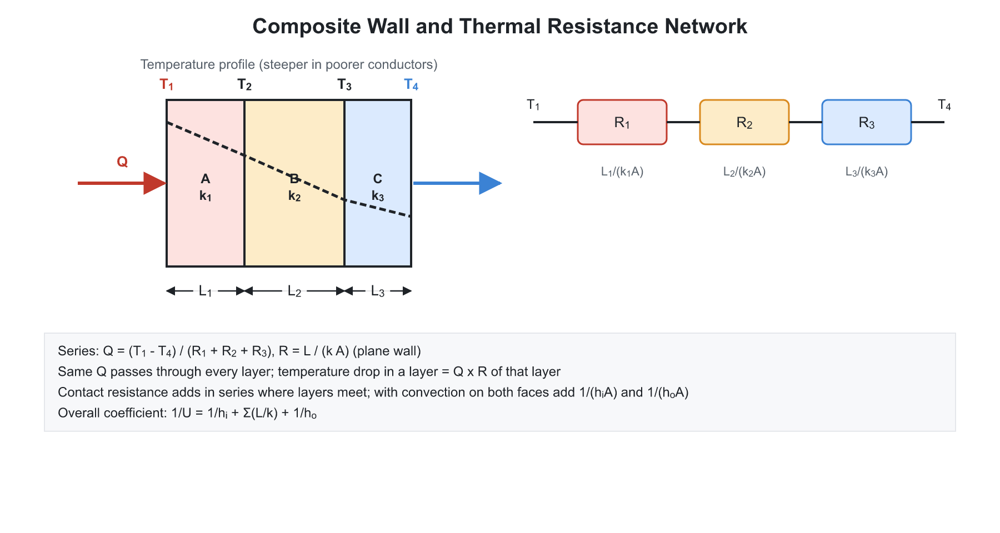
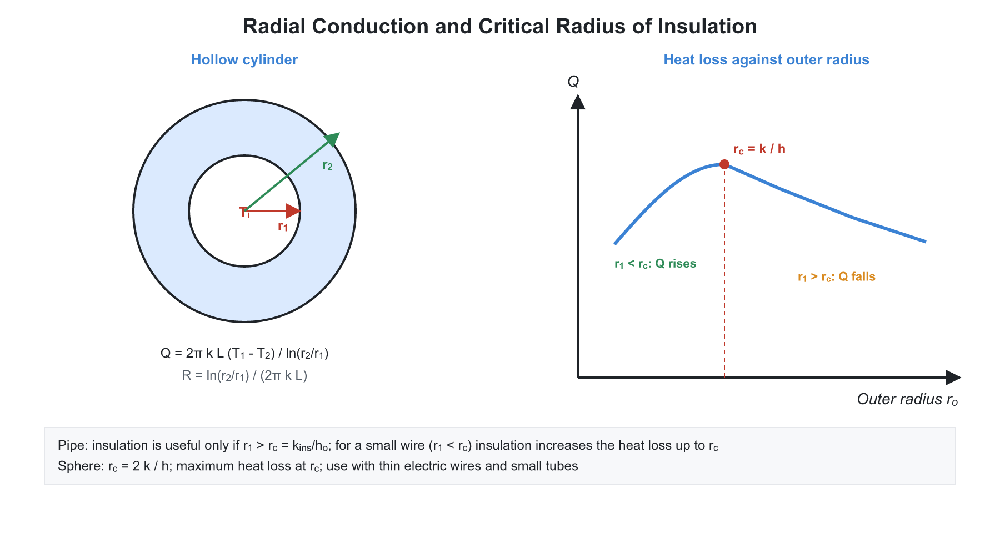
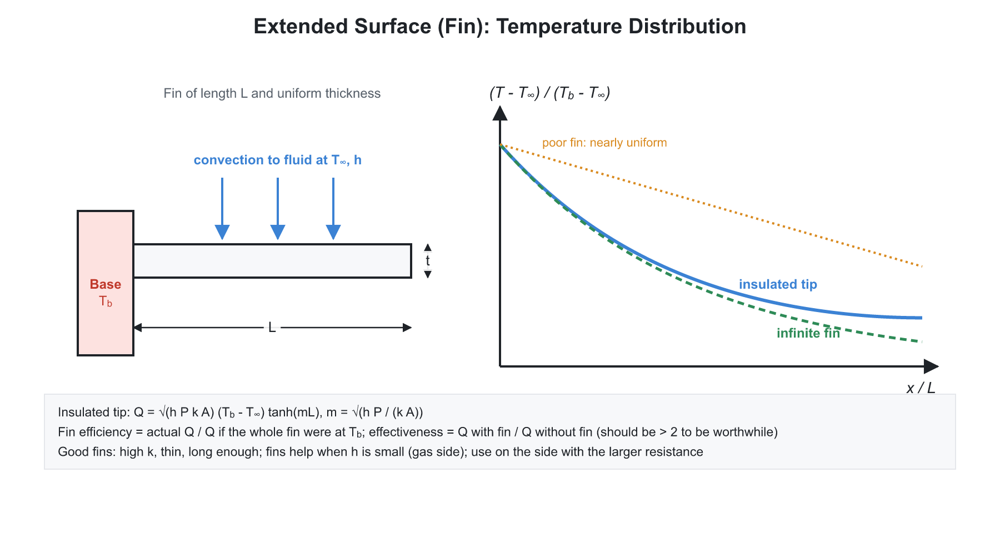
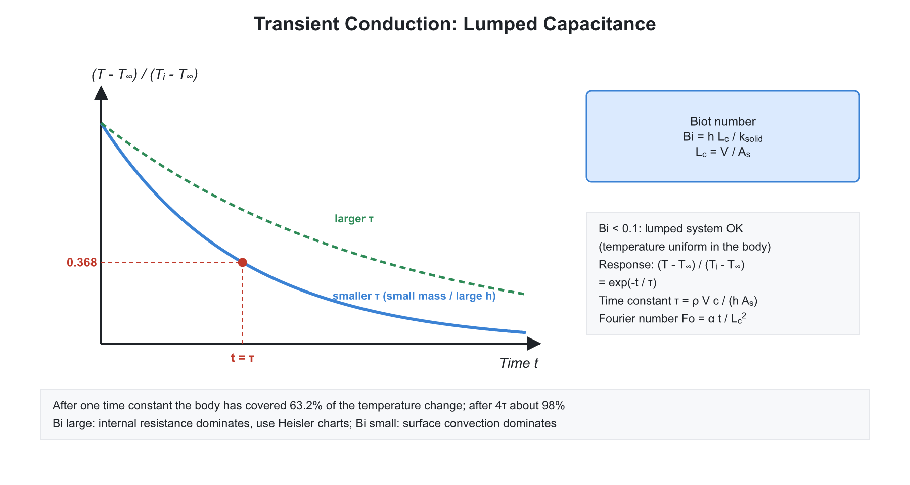

# 01. Conduction

**Exam relevance:** APPSC AEE: C | SSC JE: C | RRB JE: C | Category: ALL | Yield: VHY

---

## Part A: Detailed Theory (read this first)

Thermodynamics tells us how much heat moves between two states; **heat transfer** tells us how fast it moves and what temperature distribution results. It is the basis for the design of boilers, condensers, radiators, furnaces, cooling of electronics and insulation of buildings. This chapter covers conduction, the transport of heat through a stationary medium by molecular activity.

### A1. Driving force, three modes and the resistance idea
```text
hot face       solid wall        cold face
  Th     |====================|    Tc
                 heat ---->
```


- Heat flows whenever there is a temperature difference, always from high to low temperature (second law). The rate is proportional to the temperature difference and inversely proportional to a **resistance**:
$$q = \frac{\Delta T}{R_{th}}$$
  This is exactly like Ohm's law ($I = \Delta V / R$), with temperature as voltage and heat flow as current. The electrical analogy works for series and parallel combinations and is the most useful tool in this chapter.
- **Conduction:** energy passes from more energetic to less energetic molecules by collisions (in gases and liquids) and by lattice vibrations and free electrons (in solids). No bulk motion. It occurs in solids, and in fluids at rest.
- **Convection:** conduction combined with the bulk motion of fluid. **Radiation:** electromagnetic waves emitted by all bodies above absolute zero; no medium needed.
- **Heat flux** $q'' = q/A$ in W/m$^2$.

### A2. Fourier's law and thermal conductivity

- **Fourier's law** is an experimental observation: the heat flow in a direction is proportional to the area normal to it and to the temperature gradient in that direction:
$$q_x = -kA\frac{dT}{dx}$$
  The minus sign shows that heat flows toward falling temperature, so $q$ is positive when $dT/dx$ is negative.
- **Thermal conductivity $k$** is a property of the material (W/m-K). Understanding its ranking helps in design:

| Material class | $k$ (W/m-K) | Reason |
|---|---|---|
| Pure metals (Ag, Cu, Al) | 200 to 430 | Free electrons carry heat |
| Alloys, steel | 15 to 60 | Electron scattering by impurities |
| Non-metals (brick, concrete, glass) | 0.5 to 2 | Lattice vibration only |
| Insulators (glass wool, foam) | 0.02 to 0.05 | Trapped air |
| Liquids | 0.1 to 0.7 | Closely spaced molecules |
| Gases | 0.01 to 0.2 | Large molecular spacing |

- **Variation with temperature.** The conductivity of most pure metals falls as temperature rises (more lattice scattering of electrons). That of gases rises (faster molecules). That of most liquids falls, with water an exception up to about $130^\circ$C. Insulation $k$ rises with temperature and with moisture content, which is why wet insulation fails.
- **Assumptions of Fourier's law:** steady-state, one-dimensional, homogeneous isotropic material, constant $k$ (unless stated), no internal generation.
- **Thermal diffusivity** $\alpha = \dfrac{k}{\rho c_p}$ measures how fast a temperature disturbance spreads (compared with how much energy is stored). Large $\alpha$ means the body reaches a uniform temperature quickly.

### A3. The general heat conduction equation: derivation logic

- Consider a small control volume $dx\,dy\,dz$ inside a solid. By an energy balance: net heat conducted in $+$ heat generated $=$ rate of energy storage.
- Net conduction in the $x$-direction is $-\dfrac{\partial}{\partial x}\left(-k\dfrac{\partial T}{\partial x}\right)dx\,dy\,dz$. Adding the three directions, generation $\dot q_g\,dx\,dy\,dz$, and storage $\rho c_p\dfrac{\partial T}{\partial t}\,dx\,dy\,dz$ gives (for constant $k$):
$$\nabla^2 T + \frac{\dot q_g}{k} = \frac{1}{\alpha}\frac{\partial T}{\partial t}$$
- **Special cases (memorise):**

| Condition | Equation | Name |
|---|---|---|
| Steady, no generation | $\nabla^2 T = 0$ | Laplace |
| Steady, with generation | $\nabla^2 T + \dot q_g/k = 0$ | Poisson |
| Unsteady, no generation | $\nabla^2 T = \frac{1}{\alpha}\frac{\partial T}{\partial t}$ | Fourier |

- **Boundary conditions** are needed to obtain a unique solution: (i) specified surface temperature (Dirichlet), (ii) specified heat flux (Neumann) with the insulated case $dT/dx = 0$, (iii) convection at the surface $-k\dfrac{dT}{dx} = h(T_s - T_\infty)$ (Robin), and (iv) radiation at the surface.
- **Initial condition** is needed for transient problems.

### A4. Steady one-dimensional conduction and thermal resistance


- **Plane wall.** Integrating Fourier's law with constant $k$ gives a linear temperature profile and $q = \dfrac{kA(T_1 - T_2)}{L}$. The resistance is $R = \dfrac{L}{kA}$. The profile is linear only if $k$ is constant; if $k$ increases with temperature, the profile bows.
- **Composite wall in series.** Same $q$ through every layer; the resistances add. The temperature drop in each layer is proportional to its resistance, so **the insulating layer takes most of the drop**. Convection at each surface adds resistances $1/(hA)$.
- **Parallel layers.** The same temperature difference, flows add; $\dfrac{1}{R} = \sum\dfrac{1}{R_i}$.
- **Contact resistance.** Two solid surfaces touching make real contact only at high points; air-filled gaps conduct poorly, causing a temperature jump at the interface. It is reduced by pressure, soft metal foils or thermal grease.
- **Cylinder.** The area changes with radius ($A = 2\pi r L$), so $q$ is constant but flux decreases outward. Integrating $q = -k\,2\pi r L\,\dfrac{dT}{dr}$ gives $q = \dfrac{2\pi k L(T_1 - T_2)}{\ln(r_2/r_1)}$ and a **logarithmic** profile.
- **Sphere.** $A = 4\pi r^2$; integration gives a profile in $1/r$.
- **Overall heat-transfer coefficient.** $UA = 1/R_{total}$. It combines convection and conduction resistances into one number used in heat exchanger design.

### A5. Critical radius of insulation: the physical reasoning


- For a flat wall, insulation always reduces heat loss. For a **cylinder or sphere**, adding insulation does two opposing things: the conduction resistance increases (good), and the outer surface area for convection increases (bad: the convective resistance $1/(h\,2\pi r L)$ decreases).
- Total resistance $R = \dfrac{\ln(r/r_1)}{2\pi k L} + \dfrac{1}{h\,2\pi r L}$. Setting $\dfrac{dR}{dr} = 0$ gives $r_c = \dfrac{k}{h}$ for the cylinder (and $\dfrac{2k}{h}$ for the sphere). This point is a **minimum** of total resistance, i.e. maximum heat loss.
- **Consequence:** if the bare radius is **less** than $r_c$, insulation first raises heat loss until $r = r_c$, and only after the outer radius exceeds a value $r > r_c$ (at which the loss returns to the bare value) does the insulation help. If the bare radius is **greater** than $r_c$, any insulation reduces the loss.
- **Where it matters.** Thin electric wires (insulation helps cool them), small-diameter steam pipes. For large pipes $r_1 > r_c$ and the effect disappears. Using a low-$k$ insulation reduces $r_c$, which is why good insulation for steam lines is always safe.

### A6. Conduction with internal heat generation

- Heat is generated within a body by electric current (I$^2$R heating), nuclear fission, chemical reaction or friction. At steady state, all generated heat must leave through the surface.
- Solving the Poisson equation gives a **parabolic** profile for a plane wall and a profile in $r^2$ for a cylinder and sphere. The **maximum temperature is at the centre**, with the symmetric condition $dT/dr = 0$ there.
- For a slab of thickness $2L_h$ with both surfaces at $T_w$: $T_{max} - T_w = \dfrac{\dot q_g L_h^2}{2k}$. Equivalently, with total thickness $L = 2L_h$, $\dfrac{\dot q_g L^2}{8k}$. For a solid cylinder, $\dfrac{\dot q_g R^2}{4k}$; for a sphere, $\dfrac{\dot q_g R^2}{6k}$.
- Heat leaving the surface equals total generation: $q = \dot q_g \times V$. This is used to find the surface temperature when the convection condition is given: $T_w = T_\infty + \dfrac{\dot q_g V}{h A_s}$.

### A7. Extended surfaces (fins)


- **Why fins.** The convection rate $q = hA(T_s - T_\infty)$ can be raised by increasing $h$, increasing $\Delta T$, or increasing the area $A$. Often only $A$ can be changed economically, so fins are added: especially on the gas side of a heat exchanger, where $h$ is small. Examples: engine cylinder, motorcycle engine fins, radiators, heat sinks, condenser tubes.
- **Derivation logic.** Take a thin slice of a fin. Heat conducted in minus heat conducted out equals heat convected from the surface of the slice. With $\theta = T - T_\infty$:
$$\frac{d^2\theta}{dx^2} - m^2\theta = 0, \qquad m = \sqrt{\frac{hP}{kA_c}}$$
  The solution is a combination of exponentials (or hyperbolic functions). Boundary conditions at the tip lead to three cases as shown in Part B.
- **Assumptions.** One-dimensional conduction along the fin; constant $k$ and $h$; steady state; uniform base temperature; no heat generation; temperature uniform over the cross-section (small Biot number $hL/k$ across the thickness).
- **Fin parameter $mL$.** For $mL > 3$, $\tanh(mL) \approx 1$ so additional length adds nothing: the fin behaves as infinitely long.
- **Efficiency** is a measure of how well the fin metal is used. It falls with length, as the tip gets cooler. A short, thick fin has efficiency near $1$ but little area; a long thin fin has more area but low efficiency.
- **Effectiveness** $\varepsilon_f = q_{with\ fin}/q_{without\ fin}$. For the infinitely long fin $\varepsilon_f = \sqrt{\dfrac{kP}{hA_c}}$. So fins are most effective for high-$k$ materials (aluminium, copper), when $h$ is low (gas flow, natural convection), and when $P/A_c$ is large (thin, closely spaced fins). Fins should be used only if $\varepsilon_f > 2$.
- **Relationship:** $\varepsilon_f = \eta_f\dfrac{A_{fin}}{A_{c}}$.
- **Fin measurement:** a rod, heated at one end and fitted with thermocouples, can be used to measure the fin temperature profile and $k$ in the laboratory.

### A8. Transient conduction


- When the boundary condition or heat generation changes suddenly, temperature varies with both position and time.
- **Biot number.** $Bi = \dfrac{hL_c}{k} = \dfrac{R_{conduction\ inside}}{R_{convection\ outside}}$. If $Bi \ll 1$, the inside resistance is so small that the temperature stays uniform in space during cooling: only time dependence remains. This is the **lumped system** approximation, accepted when $Bi < 0.1$.
- **Lumped capacitance derivation.** Energy balance: rate of heat loss by convection equals the rate of decrease of stored energy: $-hA_s(T - T_\infty) = \rho V c_p\dfrac{dT}{dt}$. Integrate:
$$\frac{T - T_\infty}{T_i - T_\infty} = e^{-t/\tau}, \qquad \tau = \frac{\rho V c_p}{hA_s}$$
  The time constant $\tau$ is the time at which the excess temperature falls to $e^{-1} = 36.8\%$. A thermocouple with small $\tau$ responds quickly: use a thin wire of small diameter.
- **Characteristic length** $L_c = V/A_s$: sphere $R/3$, long cylinder $R/2$, plane wall (both faces exposed) half-thickness.
- **Fourier number** $Fo = \dfrac{\alpha t}{L^2}$ is a dimensionless time. The lumped result is $e^{-Bi\,Fo}$.
- **When $Bi > 0.1$:** the temperature varies within the body. Use **Heisler charts** (which give centre temperature as a function of $Bi$ and $Fo$), or analytic series solutions. For very short times, treat the body as a **semi-infinite solid**, for which the penetration depth grows like $\sqrt{\alpha t}$.

### A9. Two-dimensional and numerical conduction (outline)

- For complex geometries with 2-D steady conduction, a **shape factor** $S$ simplifies the problem: $q = S\,k\,\Delta T$. Known shapes such as a buried pipe have tabulated $S$.
- **Numerical methods (finite difference):** the region is divided into nodes. For an interior node in steady 2-D conduction with equal spacing and no generation, the temperature is the average of its four neighbours: $T_{i,j} = \dfrac{1}{4}(T_{i+1,j} + T_{i-1,j} + T_{i,j+1} + T_{i,j-1})$.
- For explicit transient schemes, stability requires $Fo \le 1/2$ for 1-D and $\le 1/4$ for 2-D.

### A10. What examiners test from this chapter

| Topic | APPSC AEE | SSC JE | RRB JE |
|---|---|---|---|
| Fourier's law, properties of $k$, $\alpha$ | Direct | Very common | Very common |
| Series wall, cylinder numericals | Numerical | Very common | Common |
| Critical radius of insulation | Conceptual | Common | Common |
| Fin types, efficiency, effectiveness | Numerical | Common | Common |
| Biot number, lumped capacitance | Numerical | Common | Common |

---

## Part B: Quick-reference notes, formulas, numericals and PYQs


## 🧭 1. Modes of heat transfer

| Mode | Mechanism | Governing law |
|---|---|---|
| Conduction | Molecular energy exchange in a stationary medium | Fourier's law |
| Convection | Bulk fluid motion plus conduction | Newton's law of cooling |
| Radiation | Electromagnetic waves, needs no medium | Stefan-Boltzmann law |

$$q = -kA\frac{dT}{dx} \ \text{(Fourier)}, \qquad q = hA\,(T_s - T_\infty) \ \text{(Newton)}, \qquad q = \varepsilon\sigma A\,T^4 \ \text{(Stefan-Boltzmann)}$$

- **Thermal conductivity** $k$ (W/m-K): highest for pure metals (silver, copper), lower for alloys, lowest for gases. Diamond is also very high. Conductivity of metals falls with temperature (except aluminium and some alloys increase), of gases rises with temperature, and of liquids generally falls (water is an exception).
- **Thermal diffusivity:**

$$\alpha = \frac{k}{\rho\,C_p}\ \text{(m}^2\text{/s)}$$

  A high $\alpha$ means heat spreads quickly through the material.

## 🧭 2. General heat conduction equation

$$\frac{\partial^2T}{\partial x^2} + \frac{\partial^2T}{\partial y^2} + \frac{\partial^2T}{\partial z^2} + \frac{\dot{q}_g}{k} = \frac{1}{\alpha}\frac{\partial T}{\partial t}$$

- Steady state: $\dfrac{\partial T}{\partial t} = 0$ (Poisson's equation with generation; **Laplace's equation** without it). No generation: **Fourier equation**.
- **Boundary conditions:** (1) fixed surface temperature (Dirichlet); (2) fixed heat flux or insulated (Neumann; $\dfrac{dT}{dx} = 0$ for insulated); (3) convection at the surface: $-k\dfrac{dT}{dx} = h\,(T_s - T_\infty)$.

## 🧭 3. One-dimensional steady conduction

### Plane wall (thickness $L$)

$$q = \frac{kA\,(T_1 - T_2)}{L}, \qquad R = \frac{L}{kA}$$

The temperature profile is linear.

### Composite wall (layers in series)

$$q = \frac{T_1 - T_n}{\sum R}, \qquad R_{total} = \frac{1}{h_1A} + \sum\frac{L_i}{k_iA} + \frac{1}{h_2A}$$

- Layers in parallel: reciprocal of the total resistance is the sum of the reciprocals.
- **Overall heat transfer coefficient:** $U = \dfrac{1}{A\,R_{total}}$, with $q = U A\,\Delta T$.
- **Contact resistance** arises at an imperfect interface and lowers heat flow.

### Cylinder (inner radius $r_1$, outer $r_2$, length $L$)

$$q = \frac{2\pi kL\,(T_1 - T_2)}{\ln(r_2/r_1)}, \qquad R = \frac{\ln(r_2/r_1)}{2\pi kL}$$

The temperature profile is logarithmic.

### Sphere

$$q = \frac{4\pi k\,(T_1 - T_2)}{\dfrac{1}{r_1} - \dfrac{1}{r_2}}, \qquad R = \frac{r_2 - r_1}{4\pi k\,r_1 r_2}$$

## 🧭 4. Critical radius of insulation

- Adding insulation to a small cylinder or sphere can increase heat loss because the outer convection area grows faster than the conduction resistance.

$$r_c = \frac{k}{h} \ \text{(cylinder)}, \qquad r_c = \frac{2k}{h} \ \text{(sphere)}$$

- If $r_1 < r_c$, insulation increases heat loss until $r = r_c$, then reduces it. If $r_1 > r_c$, insulation always reduces heat loss. This matters for electrical wires and small pipes. A flat wall has no critical thickness.

## 🧭 5. Heat generation

- **Plane wall** with generation $\dot{q}_g$ and both faces at $T_w$: maximum temperature at the centre.

$$T_{max} - T_w = \frac{\dot{q}_g L^2}{8k}$$

  with $L$ the wall thickness.
- **Solid cylinder** (radius $R$): $T_{max} - T_w = \dfrac{\dot{q}_g R^2}{4k}$.
- **Solid sphere:** $T_{max} - T_w = \dfrac{\dot{q}_g R^2}{6k}$.

## 🧭 6. Extended surfaces (fins)

For a fin of perimeter $P$, cross-section $A$, conductivity $k$:

$$m = \sqrt{\frac{hP}{kA}}$$

| Fin condition | Heat transfer rate |
|---|---|
| Infinitely long | $q = \sqrt{hPkA}\,\theta_0$ |
| Insulated tip | $q = \sqrt{hPkA}\,\theta_0\tanh(mL)$ |
| Convective tip | $q = \sqrt{hPkA}\,\theta_0\,\dfrac{\tanh(mL) + \dfrac{h}{mk}}{1 + \dfrac{h}{mk}\tanh(mL)}$ |

with $\theta_0 = T_0 - T_\infty$ at the base.

- **Fin efficiency:** $\eta_f = \dfrac{\text{actual heat transfer}}{\text{heat transfer if the whole fin were at base temperature}}$. For an insulated-tip fin: $\eta_f = \dfrac{\tanh(mL)}{mL}$.
- **Fin effectiveness:** $\varepsilon_f = \dfrac{\text{heat with fin}}{\text{heat without fin}}$. A fin is worthwhile if $\varepsilon_f > 2$. Fins help most when $h$ is small (gases) and $k$ is large.
- **Biot number** for a fin: $Bi = \dfrac{hL}{k}$ must be small for a fin to work well.

## 🧭 7. Transient conduction

- **Biot number:**

$$Bi = \frac{h\,L_c}{k}, \qquad L_c = \frac{V}{A_s}$$

  $Bi$ is the ratio of internal conduction resistance to external convection resistance.
- **Lumped capacitance method** is valid for $Bi < 0.1$ (uniform temperature within the body):

$$\frac{T - T_\infty}{T_i - T_\infty} = \exp\left(-\frac{h A_s}{\rho V C_p}\,t\right) = \exp(-Bi\cdot Fo)$$

- **Time constant** $\tau = \dfrac{\rho V C_p}{h A_s}$; after $t = \tau$ the temperature difference falls to $36.8\%$ of its initial value.
- **Fourier number:** $Fo = \dfrac{\alpha t}{L_c^2}$, a dimensionless time.
- For $Bi > 0.1$, use Heisler charts or semi-infinite solid solutions.

## 🧭 8. Worked numericals

1. **Composite wall.** Brick $0.2$ m ($k = 0.8$) and insulation $0.05$ m ($k = 0.04$): $R'' = \dfrac{0.2}{0.8} + \dfrac{0.05}{0.04} = 0.25 + 1.25 = 1.5$ m$^2$K/W. For $\Delta T = 30$ K: $q/A = \dfrac{30}{1.5} = 20$ W/m$^2$.
2. **Critical radius.** $k = 0.15$ W/m-K, $h = 10$ W/m$^2$K: $r_c = \dfrac{0.15}{10} = 15$ mm.
3. **Biot number.** Steel sphere of diameter $20$ mm, $h = 100$, $k = 50$: $L_c = \dfrac{r}{3} = 3.33$ mm, $Bi = \dfrac{100\times0.00333}{50} = 0.0067 < 0.1$, so the lumped method applies.

## 🧭 9. Common mistakes

- Using the plane-wall formula for a cylinder.
- Forgetting to convert thickness to metres.
- Treating critical radius as relevant for a flat wall.

## 🧭 10. Interconnections

- Conduction resistance combines with convection and radiation resistances in heat exchangers, boilers and IC engine cooling.

## 🧭 11. PYQs

| # | Question | Answer | Exam / Year | Verify |
|---|---|---|---|---|
| 1 | Fourier's law | $q = -kA\dfrac{dT}{dx}$ | SSC JE 2017 | [ ] |
| 2 | Critical radius of insulation for a cylinder | $\dfrac{k}{h}$ | RRB JE 2015 | [ ] |
| 3 | Thermal diffusivity | $\dfrac{k}{\rho C_p}$ | SSC JE 2018 | [ ] |
| 4 | Biot number | $\dfrac{hL_c}{k}$ | RRB JE 2014 | [ ] |
| 5 | Lumped analysis valid for | $Bi < 0.1$ | SSC JE 2019 | [ ] |
| 6 | Temperature profile in a plane wall | Linear | SSC JE 2016 | [ ] |
| 7 | Temperature profile in a cylindrical wall | Logarithmic | RRB JE 2019 | [ ] |
| 8 | Fin efficiency (insulated tip) | $\dfrac{\tanh(mL)}{mL}$ | APPSC AEE 2012 | [ ] |
| 9 | Material with the highest thermal conductivity | Silver (among common metals; diamond is higher) | RRB JE 2015 | [ ] |
| 10 | Thermal resistance of a plane wall | $\dfrac{L}{kA}$ | SSC JE 2020 | [ ] |

## 🧭 12. Revision checklist

- [ ] Fourier, Newton and Stefan-Boltzmann laws
- [ ] Resistance formulas for plane wall, cylinder and sphere
- [ ] Critical radius
- [ ] Fin equations, efficiency and effectiveness
- [ ] Biot, Fourier numbers and lumped criterion
