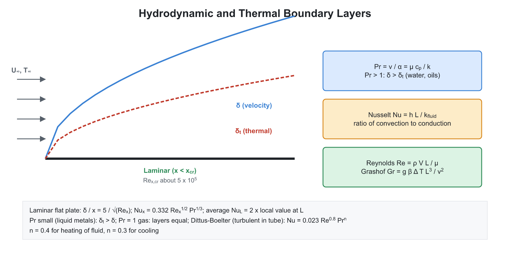
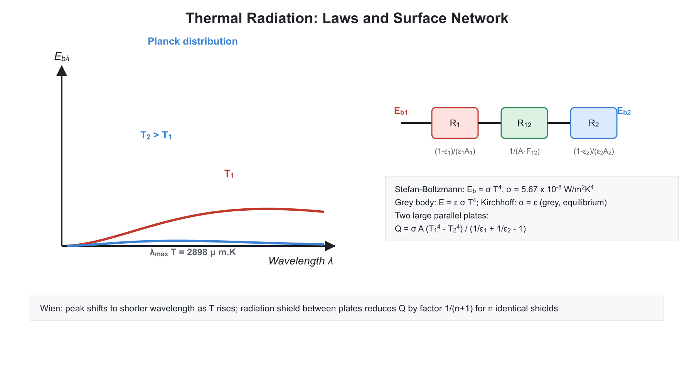
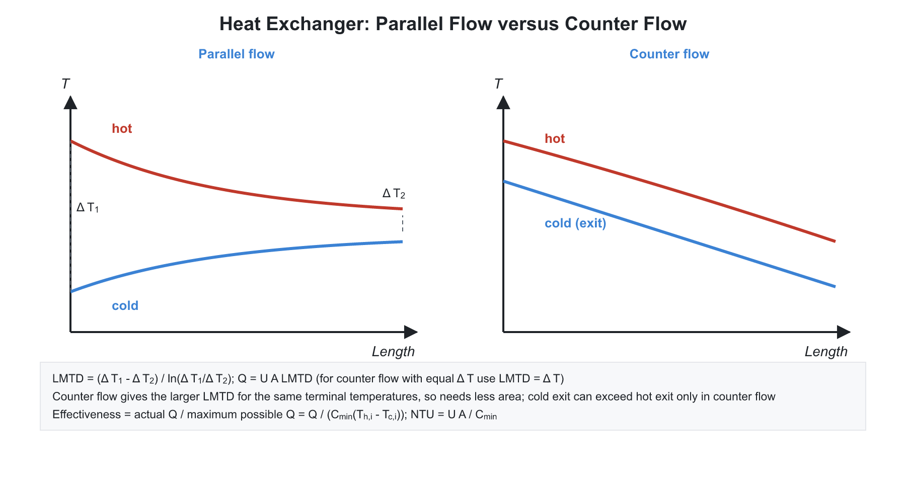

# 🔥 02. Convection, Radiation and Heat Exchangers

**Exam relevance:** APPSC AEE: C | SSC JE: C | RRB JE: C/S | Category: ALL | Yield: HY

---

## 📘 Part A: Detailed Theory (read this first)

Convection and radiation complete the picture of heat transfer, and heat exchangers are where all three modes are put to use. The difficulty in convection is that the heat transfer coefficient $h$ is not a material property; it depends on the fluid, the flow and the geometry. The whole chapter is about finding $h$ (through dimensionless numbers), and then using it.

### 🔹 A1. What convection really is

- Convection is **conduction into a moving fluid plus bulk transport of energy by that fluid**. At the wall surface the fluid velocity is zero (**no-slip condition**), so heat leaves the wall by pure conduction into the stationary fluid layer: $q = -k_f A\left.\dfrac{\partial T}{\partial y}\right|_{y=0}$. Equating this with Newton's law, $q = hA(T_s - T_\infty)$, gives $h = \dfrac{-k_f\,(\partial T/\partial y)_0}{T_s - T_\infty}$. **A steeper temperature gradient at the wall means a larger $h$.** Anything that thins the boundary layer (higher velocity, turbulence, a finer surface) raises $h$.
- **Forced convection:** an external agent (fan, pump, wind) moves the fluid. **Natural (free) convection:** the fluid moves because heating changes its density, and buoyancy drives the flow. **Mixed convection** has both.
- $h$ is **not** a property of the fluid alone. It depends on velocity, geometry, fluid properties ($\mu$, $k$, $\rho$, $c_p$), surface condition and whether the flow is laminar or turbulent.

### 🔹 A2. Boundary layer concept

- **Hydrodynamic (velocity) boundary layer.** When a fluid flows over a plate, the layer touching the plate sticks to it. A region grows where velocity increases from $0$ at the wall to $99\%$ of the free-stream velocity $U_\infty$. Its thickness $\delta$ increases along the plate.
- **Laminar to turbulent transition.** Near the leading edge, the layers slide smoothly (laminar). At about $Re_x = 5\times10^5$ for a flat plate, disturbances grow and the flow becomes turbulent. Turbulent mixing thickens the layer but steepens the wall gradient, so **$h$ is larger in turbulent flow**. A tiny **viscous sublayer** remains next to the wall.
- **Thermal boundary layer.** Region where temperature changes from $T_s$ to $T_\infty$. Its thickness $\delta_t$ relates to $\delta$ through the Prandtl number: $\delta/\delta_t \approx Pr^{1/3}$ for laminar flow. For oils ($Pr \gg 1$) the thermal layer is much thinner than the velocity layer; for liquid metals ($Pr \ll 1$) it is thicker.
- **Local and average coefficient.** $h_x$ falls along the plate in the laminar region (thickening layer), jumps up at transition and then falls slowly. The average over length $L$ is $\bar h = \dfrac{1}{L}\int_0^L h_x\,dx$. For laminar flow, $\bar h = 2h_{x=L}$ because $h_x \propto x^{-1/2}$.

### 🔹 A3. Dimensionless numbers: meaning and use

Dimensional analysis shows that the convective problem is governed by a few groups. Each is a ratio of two physical effects, so it tells you which effect dominates.

| Number | Ratio | Interpretation |
|---|---|---|
| Reynolds $Re = \rho V L/\mu$ | inertia / viscous | Laminar or turbulent |
| Prandtl $Pr = \mu c_p/k = \nu/\alpha$ | momentum diffusivity / thermal diffusivity | A fluid property; relative thickness of the two boundary layers |
| Nusselt $Nu = hL/k_f$ | convection / conduction in the fluid | Dimensionless heat transfer coefficient; $Nu = 1$ means pure conduction |
| Grashof $Gr = g\beta\Delta T L^3/\nu^2$ | buoyancy / viscous | Natural convection analogue of $Re$ |
| Rayleigh $Ra = Gr\,Pr$ | buoyancy driving / diffusion | Onset of natural convection |
| Stanton $St = Nu/(Re\,Pr)$ | heat transferred / fluid thermal capacity | Used in the Reynolds-Colburn analogy |
| Biot $Bi = hL/k_s$ | internal resistance / external resistance | Conduction in the solid |

- **Typical Prandtl numbers:** liquid metals $0.01$ to $0.03$, gases $\approx 0.7$, water $\approx 1.7$ to $7$, oils $50$ to $10^5$.
- **Nusselt versus Biot** looks identical in form but $Nu$ uses the conductivity of the fluid and $Bi$ that of the solid.
- A correlation has the form $Nu = f(Re, Pr)$ for forced convection and $Nu = f(Gr, Pr)$ for natural convection. Properties are evaluated at the **film temperature** $T_f = \dfrac{T_s + T_\infty}{2}$.

### 🔹 A4. Forced convection correlations

- **Laminar flow over a flat plate**, from the exact Blasius solution: $Nu_x = 0.332 Re_x^{1/2} Pr^{1/3}$ (local); averaging over length gives $\overline{Nu}_L = 0.664 Re_L^{1/2} Pr^{1/3}$.
- **Turbulent flat plate:** $\overline{Nu}_L = 0.037 Re_L^{4/5} Pr^{1/3}$ (valid when transition occurs very near the leading edge).
- **Flow inside a tube.** The fluid enters with uniform velocity and the boundary layer grows until it fills the tube. Beyond the **entry length** the flow is **fully developed**: velocity profile is parabolic (laminar) and the dimensionless temperature profile is constant. Hydrodynamic entry length is about $0.05\,Re\,D$ for laminar flow, and about $10$ to $60$ diameters for turbulent flow.
- **Laminar fully developed:** $Nu$ is constant, independent of $Re$ and $Pr$: $3.66$ (constant wall temperature), $4.36$ (constant heat flux).
- **Turbulent fully developed (Dittus-Boelter):** $Nu = 0.023 Re^{0.8} Pr^n$, with $n = 0.4$ for heating of the fluid and $0.3$ for cooling. Valid for $Re > 10^4$, $0.7 < Pr < 160$ and $L/D > 10$.
- **Non-circular ducts:** replace $D$ by the hydraulic diameter $D_h = 4A_c/P_{wet}$.
- **Mean temperature of the fluid.** For flow in a tube, the fluid temperature changes along the length, so the **bulk mean temperature** is used. With constant wall heat flux the fluid temperature rises linearly; with constant wall temperature the difference to the wall decays exponentially.
- **Reynolds-Colburn analogy.** Heat and momentum transfer are both due to molecular and turbulent diffusion, so friction and heat transfer are linked: $St\,Pr^{2/3} = C_f/2$. If you know the skin friction coefficient, you know the heat transfer.
- **Why do roughness and turbulence promoters help?** They raise turbulence near the wall and thin the viscous sublayer.

### 🔹 A5. Natural convection

- A heated surface warms the neighbouring fluid, which becomes lighter and rises; cooler fluid replaces it. The velocity is produced by the buoyancy itself, so there is no free-stream velocity.
- **Volumetric expansion coefficient** $\beta = -\dfrac{1}{\rho}\left(\dfrac{\partial\rho}{\partial T}\right)_P$. For an ideal gas, $\beta = 1/T$ with absolute temperature.
- **Grashof number** takes the role of Reynolds number. For a vertical plate the transition from laminar to turbulent is at $Ra \approx 10^9$.
- **Correlation:** $Nu = C(Gr\,Pr)^n$ with $n = 1/4$ for laminar, $1/3$ for turbulent. In the turbulent regime the heat transfer coefficient becomes independent of the size of the surface, as $L^3$ in $Gr$ cancels the $L$ in $Nu$.
- **Practical cases.** Radiator, heated room walls, pipes in still air, electronic components. Typical $h$ in air is only $5$ to $25$ W/m$^2$K, so radiation is often comparable and must be added.

### 🔹 A6. Boiling and condensation

- **Pool boiling curve** (heat flux versus excess temperature $\Delta T_e = T_s - T_{sat}$) has four regimes: natural convection boiling; **nucleate boiling** (bubbles form, grow and detach; very high $h$); **transition boiling** (unstable vapour film); and **film boiling** (stable vapour blanket; low $h$, radiation important).
- **Critical heat flux (burnout)** is the maximum of the curve, at the end of nucleate boiling. In a **heat-flux-controlled** system (electrical heater, nuclear fuel), exceeding it makes the surface temperature jump to the film-boiling branch, often melting the heater. In practice, designs keep operation in the nucleate regime, below CHF. The **Leidenfrost point** is the minimum heat flux at the start of stable film boiling.
- **Condensation.** In **film condensation** the liquid wets the surface and forms a continuous film whose thickness adds a thermal resistance. In **dropwise condensation** the vapour touches the bare surface between droplets, so $h$ can be $5$ to $10$ times higher. Dropwise is hard to maintain, so industrial condensers are designed for filmwise. Non-condensable gases (air) greatly reduce $h$.
- For laminar film condensation on a vertical plate, $h \propto \left[\dfrac{\rho_l(\rho_l - \rho_v)\,g\,h_{fg}\,k_l^3}{\mu_l(T_{sat} - T_w)L}\right]^{1/4}$ (Nusselt theory). Horizontal tubes give higher $h$ than vertical ones, because the film is thinner.

### 🔹 A7. Thermal radiation: physical picture

- Every body above $0$ K emits electromagnetic radiation because of its thermal energy. Thermal radiation covers wavelengths of about $0.1$ to $100\ \mu$m (UV, visible, infrared). Unlike conduction and convection, it needs **no medium** and passes through vacuum. Radiation dominates at high temperature (furnaces, boilers, sun) and in vacuum (space).
- **Blackbody.** The idealised perfect absorber and emitter. It absorbs all incident radiation at every wavelength and direction and emits the maximum possible at a given temperature. A small hole in a hollow cavity is a good approximation.
- **Stefan-Boltzmann law.** Total emissive power of a blackbody $E_b = \sigma T^4$. The fourth power means radiation is very sensitive to temperature, and that temperatures must be absolute. A real surface emits $E = \varepsilon\sigma T^4$ where **emissivity** $\varepsilon \le 1$.
- **Planck's law** gives the spectrum, which peaks at wavelength $\lambda_{max}$. **Wien's displacement law** $\lambda_{max}T = 2898\ \mu\text{m}\cdot\text{K}$ shows that hotter bodies glow at shorter wavelengths (red hot, then white hot). The sun at $5800$ K peaks in the visible; a body at room temperature peaks in the infrared at about $10\ \mu$m.
- **Radiation properties.** Of the incident radiation (irradiation $G$), a fraction is absorbed ($\alpha$), reflected ($\rho$) and transmitted ($\tau$): $\alpha + \rho + \tau = 1$. For an opaque body $\tau = 0$. A **white body** reflects all, a **transparent body** transmits all.
- **Kirchhoff's law.** At thermal equilibrium, $\varepsilon_\lambda = \alpha_\lambda$: a good emitter is a good absorber. For a grey body, $\varepsilon = \alpha$ generally.
- **Grey body** has $\varepsilon$ independent of wavelength. **Selective surfaces** (solar collectors) have high absorptivity for solar radiation but low emissivity in the infrared, to retain heat.
- **Diffuse surface and Lambert's cosine law.** For a diffuse emitter, the intensity $I$ is independent of direction and $E = \pi I$. The emission varies as $\cos\theta$ along a direction.

### 🔹 A8. Radiation exchange between surfaces

- **View (shape) factor** $F_{12}$ is the fraction of radiation leaving surface 1 that strikes surface 2. It depends only on geometry. Its rules:
  - Reciprocity: $A_1F_{12} = A_2F_{21}$.
  - Summation in an enclosure: $\sum_j F_{ij} = 1$.
  - $F_{ii} = 0$ for a flat or convex surface; non-zero for a concave surface.
- **Blackbody exchange:** $q_{1\to2} = A_1F_{12}\,\sigma(T_1^4 - T_2^4)$.
- **Grey surfaces.** Reflections complicate the analysis. Define **radiosity** $J$ (total radiation leaving a surface, emitted plus reflected) and **irradiation** $G$ (total incident). The network (electrical analogy) method uses:
  - **Surface resistance** $\dfrac{1-\varepsilon}{\varepsilon A}$, which is zero for a blackbody.
  - **Space resistance** $\dfrac{1}{A_1F_{12}}$.
  - The "potential" difference is $E_b - J$ at a surface, and $J_1 - J_2$ across space.
- **Special results:**
  - Large parallel plates: $q = \dfrac{\sigma(T_1^4 - T_2^4)}{1/\varepsilon_1 + 1/\varepsilon_2 - 1}$.
  - Small convex body in a large enclosure: $q = \varepsilon_1A_1\sigma(T_1^4 - T_2^4)$, independent of the enclosure's emissivity.
  - Concentric long cylinders or spheres: replace the second term by $\dfrac{A_1}{A_2}\left(\dfrac{1}{\varepsilon_2} - 1\right)$.
- **Radiation shields.** A thin sheet of low emissivity placed between two surfaces adds two surface resistances and cuts the exchange. With $n$ shields of equal emissivity as the surfaces, the heat exchange is reduced to $\dfrac{1}{n+1}$ of the unshielded value.
- **Radiation heat transfer coefficient:** $h_r = \varepsilon\sigma(T_s + T_\infty)(T_s^2 + T_\infty^2)$ lets radiation be added to convection: $q = (h_c + h_r)A\,\Delta T$.
- **Gas radiation and solar radiation** (outline). Gases such as CO$_2$ and H$_2$O absorb and emit in specific bands. Solar constant $\approx 1367$ W/m$^2$.

### 🔹 A9. Heat exchangers: classification and design basics

- A **heat exchanger** transfers heat between two fluids at different temperatures, usually separated by a wall (recuperator), sometimes by alternate storage (regenerator), or through direct mixing (open heater, cooling tower).
- **Flow arrangement:**
  - **Parallel flow:** both fluids enter at the same end and flow in the same direction. The temperature difference is large at inlet and small at outlet; the cold fluid's exit temperature can never exceed the hot fluid's exit temperature.
  - **Counter flow:** fluids flow in opposite directions; the most efficient arrangement; the cold outlet can be hotter than the hot outlet.
  - **Cross flow:** fluids flow at right angles (car radiator, air coolers); mixed or unmixed.
- **Construction:** double pipe, shell and tube with baffles (most common in industry), plate type, finned tube/compact. **Compactness** is the ratio of heat-transfer surface to volume.
- **Overall heat transfer coefficient.** Series resistances: inner convection, fouling, wall, fouling, outer convection: $\dfrac{1}{UA} = \dfrac{1}{h_iA_i} + \dfrac{R_{f,i}}{A_i} + R_{wall} + \dfrac{R_{f,o}}{A_o} + \dfrac{1}{h_oA_o}$. **Fouling** (scale, deposits) builds up with time and lowers $U$; designers include a fouling factor.
- **Energy balance:** $q = C_h(T_{h,in} - T_{h,out}) = C_c(T_{c,out} - T_{c,in})$, with $C = \dot m c_p$.
- **LMTD method.** Because the temperature difference between the fluids varies along the exchanger, the mean driving force that gives the correct total heat transfer is the logarithmic mean: $\Delta T_{lm} = \dfrac{\Delta T_1 - \Delta T_2}{\ln(\Delta T_1/\Delta T_2)}$. This results from integrating the local $dq = U\,\Delta T\,dA$ along the exchanger. For counter flow it is always larger than for parallel flow with the same terminal temperatures, so less area is needed. For cross-flow and multipass shell-and-tube units, multiply by a correction factor $F < 1$. Use LMTD when all four terminal temperatures are known (design problems).
- **Condensers and evaporators:** one fluid is at constant temperature, so parallel and counter flow arrangement give the same LMTD.
- **Effectiveness-NTU method.** When outlet temperatures are unknown (rating problems), use effectiveness $\varepsilon = q_{actual}/q_{max}$, where $q_{max} = C_{min}(T_{h,in} - T_{c,in})$. The **number of transfer units** $NTU = UA/C_{min}$ is a dimensionless size. Effectiveness is a function of NTU and the capacity ratio $C_r = C_{min}/C_{max}$ and of the flow arrangement. For $C_r \to 0$ (boiling/condensing), $\varepsilon = 1 - e^{-NTU}$ for any arrangement. For counter flow with $C_r = 1$, $\varepsilon = \dfrac{NTU}{1+NTU}$.
- **Why is $C_{min}$ the limit?** The fluid with the smaller capacity rate has the larger temperature change, and the maximum possible change equals the maximum inlet temperature difference.
- **Pressure drop and pumping power** are part of the design as well as the heat duty. A higher velocity gives a larger $h$ but increases pressure drop (proportional to roughly $V^2$), so there is an economic optimum.

### 🔹 A10. What examiners test from this chapter

| Topic | APPSC AEE | SSC JE | RRB JE |
|---|---|---|---|
| Dimensionless numbers: definitions and meaning | Direct | Very common | Very common |
| Boundary layer, Dittus-Boelter, $Nu$ constants | Conceptual | Common | Common |
| Stefan-Boltzmann, Wien, Kirchhoff, view factors | Numerical | Common | Very common |
| Parallel-plate radiation, shields | Numerical | Common | Occasional |
| LMTD, effectiveness-NTU, counter versus parallel | Numerical | Very common | Common |
| Boiling curve, dropwise condensation | Conceptual | Occasional | Occasional |

---

## ⚡ Part B: Quick-reference notes, formulas, numericals and PYQs

## 🧭 1. Convection fundamentals

- **Natural (free) convection:** fluid motion due to buoyancy from density differences. **Forced convection:** motion due to a pump, fan or wind.
- **Newton's law of cooling:** $q = hA\,(T_s - T_\infty)$. Units of $h$: W/m$^2$K. Typical values: free convection in gases $2$ to $25$; free convection in liquids $50$ to $1000$; forced convection in gases $25$ to $250$; forced convection in liquids $50$ to $20000$; boiling and condensation $2500$ to $100000$.
- **Hydrodynamic boundary layer:** region near the wall where velocity changes from $0$ to the free stream value. **Thermal boundary layer:** region where temperature changes from $T_s$ to $T_\infty$.
- **Relative thickness:** $\dfrac{\delta}{\delta_t} = Pr^{1/3}$ for laminar flow. For $Pr > 1$ the thermal layer is thinner; for liquid metals ($Pr \ll 1$) it is thicker.

## 🧭 2. Dimensionless numbers (very high yield)

| Number | Expression | Physical meaning |
|---|---|---|
| Reynolds | $Re = \dfrac{\rho V L}{\mu}$ | Inertia force to viscous force |
| Prandtl | $Pr = \dfrac{\mu C_p}{k} = \dfrac{\nu}{\alpha}$ | Momentum diffusivity to thermal diffusivity |
| Nusselt | $Nu = \dfrac{hL}{k}$ | Convective to conductive heat transfer at the fluid |
| Grashof | $Gr = \dfrac{g\beta\,\Delta T\,L^3}{\nu^2}$ | Buoyancy force to viscous force |
| Rayleigh | $Ra = Gr\cdot Pr$ | Natural convection strength |
| Stanton | $St = \dfrac{Nu}{Re\,Pr} = \dfrac{h}{\rho V C_p}$ | Heat transferred to thermal capacity of the flow |
| Biot | $Bi = \dfrac{hL}{k_{solid}}$ | Internal to external resistance (solid) |
| Peclet | $Pe = Re\cdot Pr$ | Advection to diffusion of heat |

- For ideal gases, $\beta = \dfrac{1}{T}$ (absolute temperature).
- **Nusselt vs Biot:** $Nu$ uses the fluid conductivity; $Bi$ uses the solid conductivity.

## 🧭 3. Correlations

| Case | Correlation |
|---|---|
| Laminar flow over a flat plate (local) | $Nu_x = 0.332\,Re_x^{1/2}\,Pr^{1/3}$ |
| Laminar flow over a flat plate (average) | $\overline{Nu} = 0.664\,Re_L^{1/2}\,Pr^{1/3}$ (twice the local value at $L$) |
| Turbulent flow over a flat plate | $\overline{Nu} = 0.037\,Re_L^{4/5}\,Pr^{1/3}$ |
| Fully developed laminar flow in a tube, constant wall temperature | $Nu = 3.66$ |
| Fully developed laminar flow in a tube, constant heat flux | $Nu = 4.36$ |
| Turbulent flow in a tube (Dittus-Boelter) | $Nu = 0.023\,Re^{0.8}\,Pr^{n}$ ($n = 0.4$ heating, $0.3$ cooling) |

- **Critical Reynolds number:** flat plate $5\times10^5$; pipe flow $2300$ (laminar below, turbulent above $4000$).
- **Hydraulic diameter:** $D_h = \dfrac{4A}{P_{wetted}}$.
- **Reynolds analogy:** $St = \dfrac{C_f}{2}$ (for $Pr = 1$); **Colburn analogy:** $St\,Pr^{2/3} = \dfrac{C_f}{2}$.
- **Natural convection** from vertical plate: $Nu = C\,(Gr\,Pr)^n$ with $n = \dfrac{1}{4}$ (laminar), $\dfrac{1}{3}$ (turbulent).

## 🧭 4. Boiling and condensation

- **Pool boiling regimes** (curve of heat flux versus excess temperature): natural convection, nucleate boiling, transition boiling, film boiling. **Critical heat flux (burnout point)** is the peak of nucleate boiling; exceeding it causes sudden jump to film boiling and possible equipment failure. **Leidenfrost point:** the minimum of the curve.
- **Condensation:** filmwise (lower $h$) and dropwise (much higher $h$, often $5$ to $10$ times). Dropwise is hard to sustain; surfaces are treated to promote it.

## 🧭 5. Radiation

- **Stefan-Boltzmann law:** blackbody emissive power $E_b = \sigma T^4$ with $\sigma = 5.67\times10^{-8}$ W/m$^2$K$^4$. Real surface: $E = \varepsilon\sigma T^4$.
- **Planck's law** gives spectral distribution. **Wien's displacement law:**

$$\lambda_{max}\,T = 2898\ \mu\text{m}\cdot\text{K}$$

  Hotter bodies emit at shorter wavelengths. The sun emits most near $0.5\ \mu$m.
- **Kirchhoff's law:** at thermal equilibrium, emissivity equals absorptivity ($\varepsilon = \alpha$) for a given wavelength and direction. A **grey body** has $\varepsilon$ independent of wavelength.
- **Absorptivity + reflectivity + transmissivity = 1** ($\alpha + \rho + \tau = 1$). For an opaque body $\alpha + \rho = 1$. A **blackbody** has $\alpha = 1$, $\varepsilon = 1$.
- **Lambert's cosine law:** intensity emitted by a diffuse surface is independent of direction; emissive power $E = \pi I$.
- **View factor** $F_{12}$: fraction of radiation leaving surface 1 that reaches surface 2.
  - Reciprocity: $A_1F_{12} = A_2F_{21}$.
  - Summation: $\sum_j F_{ij} = 1$.
  - A flat or convex surface has $F_{11} = 0$.
- **Net radiation between two blackbodies:** $q_{12} = A_1F_{12}\,\sigma\,(T_1^4 - T_2^4)$.
- **Two large parallel grey plates:**

$$q = \frac{\sigma\,(T_1^4 - T_2^4)}{\dfrac{1}{\varepsilon_1} + \dfrac{1}{\varepsilon_2} - 1}$$

- **Small body inside a large enclosure:** $q = \varepsilon_1 A_1\sigma\,(T_1^4 - T_2^4)$.
- **Radiation shields:** a shield between two plates reduces heat transfer; with $n$ identical shields of the same emissivity, the transfer is reduced to $\dfrac{1}{n+1}$ of the original.
- **Radiosity** $J$ and **irradiation** $G$ are used in the network method; **surface resistance** $\dfrac{1-\varepsilon}{\varepsilon A}$ and **space resistance** $\dfrac{1}{A_1F_{12}}$.

## 🧭 6. Heat exchangers

### 🔹 Classification

| Basis | Types |
|---|---|
| Flow arrangement | Parallel flow, counter flow, cross flow |
| Construction | Shell and tube, double pipe, plate, compact |
| Function | Condenser, evaporator, regenerator, recuperator |

### 🔹 LMTD method

$$q = U\,A\,\Delta T_{lm}, \qquad \Delta T_{lm} = \frac{\Delta T_1 - \Delta T_2}{\ln(\Delta T_1/\Delta T_2)}$$

- For parallel flow, $\Delta T_1 = T_{h,in} - T_{c,in}$ and $\Delta T_2 = T_{h,out} - T_{c,out}$. For counter flow, $\Delta T_1 = T_{h,in} - T_{c,out}$ and $\Delta T_2 = T_{h,out} - T_{c,in}$.
- **Counter flow** gives a larger LMTD than parallel flow for the same terminal temperatures, so a smaller area is needed. In counter flow, the cold fluid outlet can exceed the hot fluid outlet.
- For cross flow and multi-pass exchangers, multiply by a correction factor $F < 1$.
- If $\Delta T_1 = \Delta T_2$, then $\Delta T_{lm} = \Delta T_1$. When one fluid changes phase (condenser or boiler), its temperature is constant and parallel and counter flow give the same LMTD.
- **Heat balance:** $q = \dot{m}_h C_{ph}\,(T_{h,in} - T_{h,out}) = \dot{m}_c C_{pc}\,(T_{c,out} - T_{c,in})$.
- **Overall coefficient:** $\dfrac{1}{U} = \dfrac{1}{h_i} + R_{wall} + \dfrac{1}{h_o} + R_{fouling}$. **Fouling factor** $R_f$ increases resistance.

### 🔹 Effectiveness-NTU method

$$\varepsilon = \frac{q_{actual}}{q_{max}} = \frac{C_h\,(T_{h,in} - T_{h,out})}{C_{min}\,(T_{h,in} - T_{c,in})}, \qquad NTU = \frac{UA}{C_{min}}, \qquad C_r = \frac{C_{min}}{C_{max}}$$

| Arrangement | Effectiveness |
|---|---|
| Parallel flow | $\varepsilon = \dfrac{1 - e^{-NTU(1+C_r)}}{1 + C_r}$ |
| Counter flow | $\varepsilon = \dfrac{1 - e^{-NTU(1-C_r)}}{1 - C_r e^{-NTU(1-C_r)}}$ |
| Counter flow, $C_r = 1$ | $\varepsilon = \dfrac{NTU}{1 + NTU}$ |
| Any exchanger, $C_r = 0$ (boiler or condenser) | $\varepsilon = 1 - e^{-NTU}$ |

- NTU method is preferred when outlet temperatures are unknown.
- $C = \dot{m}\,C_p$ is the **heat capacity rate** (W/K).

## 🧭 7. Worked numericals

1. **Radiation.** Two large parallel plates at $500$ K and $300$ K, $\varepsilon_1 = \varepsilon_2 = 0.8$: denominator $= \dfrac{1}{0.8} + \dfrac{1}{0.8} - 1 = 1.5$, so $q = \dfrac{5.67\times10^{-8}\,(500^4 - 300^4)}{1.5} = \dfrac{5.67\times10^{-8}\times5.44\times10^{10}}{1.5} = 2056$ W/m$^2$.
2. **LMTD.** Counter flow, $\Delta T_1 = 60$ K, $\Delta T_2 = 20$ K: $\Delta T_{lm} = \dfrac{40}{\ln 3} = 36.4$ K.
3. **Wien's law.** At $T = 1000$ K, $\lambda_{max} = \dfrac{2898}{1000} = 2.9\ \mu$m.

## 🧭 8. Common mistakes

- Using Celsius in radiation formulas (must use Kelvin).
- Using $\Delta T_{lm}$ of a counter flow in parallel flow.
- Confusing Nusselt with Biot (fluid vs solid conductivity).

## 🧭 9. Interconnections

- Heat exchangers link to boilers, condensers, intercoolers, refrigeration condensers and evaporators, IC engine radiators.

## 🧭 10. PYQs

| # | Question | Answer | Exam / Year | Verify |
|---|---|---|---|---|
| 1 | Nusselt number | $\dfrac{hL}{k}$ | SSC JE 2017 | [ ] |
| 2 | Prandtl number | $\dfrac{\mu C_p}{k}$ | RRB JE 2015 | [ ] |
| 3 | Grashof number relates to | Natural convection | SSC JE 2018 | [ ] |
| 4 | Stefan-Boltzmann law | $E_b = \sigma T^4$ | RRB JE 2014 | [ ] |
| 5 | Wien's displacement law | $\lambda_{max}T = $ constant | SSC JE 2016 | [ ] |
| 6 | Kirchhoff's law | $\varepsilon = \alpha$ at equilibrium | SSC JE 2019 | [ ] |
| 7 | LMTD | $\dfrac{\Delta T_1 - \Delta T_2}{\ln(\Delta T_1/\Delta T_2)}$ | RRB JE 2019 | [ ] |
| 8 | Heat exchanger with the greater LMTD | Counter flow | SSC JE 2020 | [ ] |
| 9 | NTU | $\dfrac{UA}{C_{min}}$ | APPSC AEE 2012 | [ ] |
| 10 | Dropwise condensation compared with filmwise | Higher $h$ | RRB JE 2015 | [ ] |
| 11 | $Nu$ for fully developed laminar flow in a tube (constant wall temperature) | $3.66$ | APPSC AEE 2012 | [ ] |

## 🧭 11. Revision checklist

- [ ] All dimensionless numbers with meanings
- [ ] Flat plate and tube correlations
- [ ] Radiation laws and view factor rules
- [ ] LMTD and effectiveness-NTU formulas
