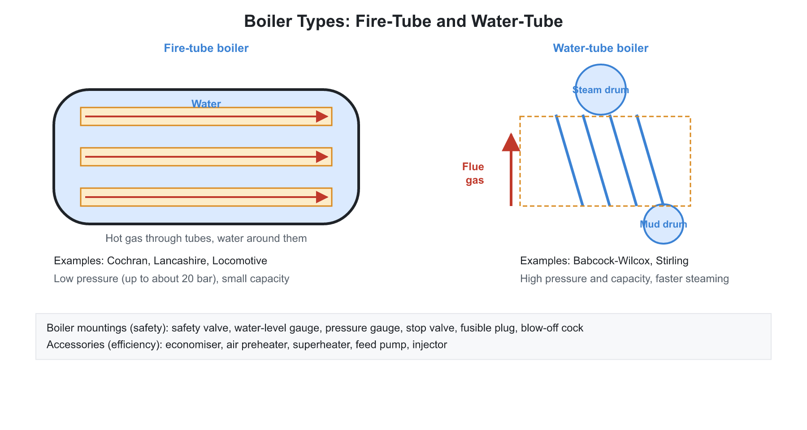
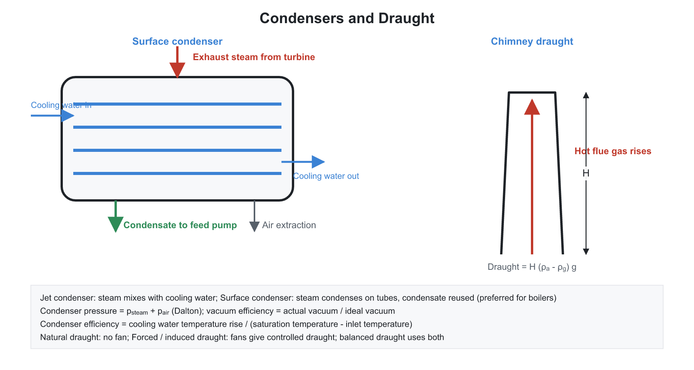
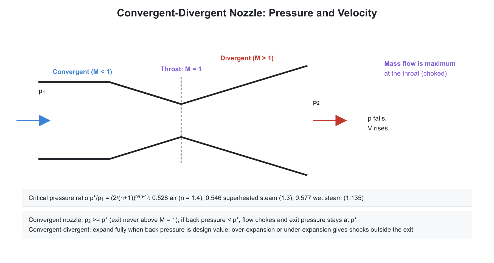
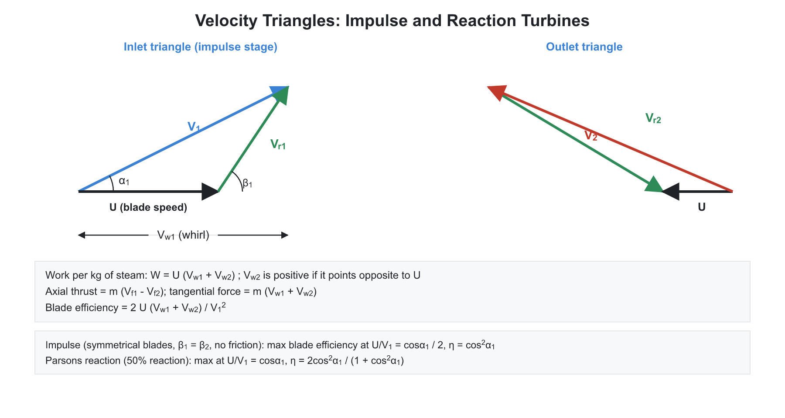
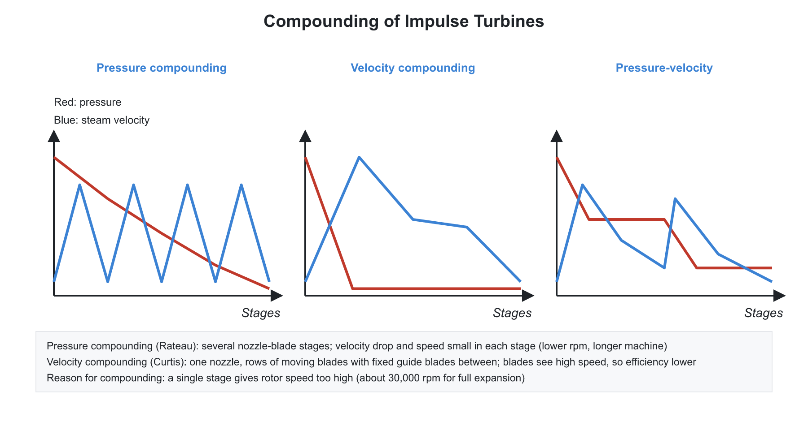

# 🏭 01. Boilers, Nozzles, Steam Turbines and Condensers

**Exam relevance:** APPSC AEE: C | SSC JE: C | RRB JE: C | Category: ALL | Yield: VHY

---

## 📘 Part A: Detailed Theory (read this first)

This chapter follows the path of the working fluid in a steam power plant: the boiler makes steam, nozzles turn its pressure energy into a fast jet, the turbine extracts work from that jet, and the condenser returns the exhaust to liquid so the cycle can repeat. Each device is an application of the steady-flow energy equation, so keep $q - w = \Delta h + \Delta KE$ in mind throughout.

### 🔹 A1. Boilers: purpose and heat flow

- A **boiler (steam generator)** is a closed vessel in which water is heated and converted to steam at constant pressure by the heat from burning fuel. Heat travels from the hot flue gas to water by radiation (furnace), then convection (tube banks), then conduction through the tube wall.
- **Fire-tube boilers** pass hot gas through tubes surrounded by water in a large shell. The large water volume gives a steady steam supply under fluctuating load, but the shell is a pressure vessel, so pressure is limited (about 20 bar) and an explosion would release a lot of energy. Examples: Cochran (vertical), Lancashire (two large flues), locomotive, Scotch marine.
- **Water-tube boilers** pass water through small tubes surrounded by hot gas. Small tube diameters can withstand very high pressure and give a large heating surface for the volume, quick steam raising and lower explosion hazard. Examples: Babcock and Wilcox, Stirling, Yarrow. Needs better feedwater quality.
- **Circulation.** In **natural circulation**, water in the heated tubes is lighter than in the downcomers; the density difference moves water through the loop. It becomes ineffective at high pressure, because the densities of water and steam approach each other. **Forced circulation** (La Mont) uses a pump. **Once-through** boilers (Benson, Sulzer) pump water through a single path and convert it fully to steam without a drum; they work at and above the critical pressure.
- **Mountings** are the fittings necessary for **safe operation**; **accessories** are the auxiliary units added for **better efficiency**. This distinction is a frequent question. Mountings: safety valve, water level gauge, pressure gauge, stop valve, feed check valve, blow-off cock, fusible plug, manhole. Accessories: economiser, air preheater, superheater, feed pump, injector.
- **Safety valves** release steam if the pressure exceeds a set value. A **fusible plug** melts if the water level falls too low and the crown is exposed, giving a warning. The **blow-off cock** removes sludge and scale from the lowest point.
- **Superheater** raises steam above saturation temperature, increasing the cycle efficiency and reducing moisture in the turbine. **Economiser** preheats feedwater using flue gas. **Air preheater** heats combustion air with flue gas.

### 🔹 A2. Draught

- Combustion needs a continuous flow of air through the fuel bed and removal of flue gas. The pressure difference to drive it is **draught**.
- **Natural draught.** A chimney contains hot, light flue gas; outside is cold, denser air. The pressure difference at the base is $\Delta p = H g(\rho_a - \rho_g)$. It depends on the height, not the cross-sectional area. Cheap, no fan power; but weak, depends on weather, and the chimney must be tall.
- **Artificial draught** uses fans: **forced draught** (fan at inlet, furnace at positive pressure), **induced draught** (fan at outlet, furnace at slight negative pressure; avoids flame leakage), or **balanced** (both). Induced draught fans handle hot gas.
- A chimney's draught is expressed as an equivalent water column height $h_w = \dfrac{\Delta p}{\rho_w g}$.
- **Boiler performance measures:** equivalent evaporation (steam output normalised to "from and at $100^\circ$C" so that boilers can be compared), factor of evaporation, boiler efficiency (heat absorbed by water and steam divided by heat supplied by fuel; $75$ to $90\%$), and boiler power.
- **Heat balance** of a boiler: part of the fuel energy goes to steam; the rest is lost in dry flue gas (largest), moisture in fuel, incomplete combustion and radiation.

### 🔹 A3. Nozzles: energy conversion from first principles

- A **nozzle** is a duct that increases fluid velocity at the expense of pressure. A **diffuser** does the opposite.
- **Velocity from SFEE.** For adiabatic flow with no work and negligible change in height: $h_1 + \dfrac{V_1^2}{2} = h_2 + \dfrac{V_2^2}{2}$, hence $V_2 = \sqrt{2(h_1 - h_2) + V_1^2}$. The enthalpy drop is the source of kinetic energy.
- **Continuity.** $\dot m = \rho AV = AV/v$ is constant. Combining with the isentropic energy equation shows how area must change.
- **Area-velocity relation.** From $dP = -\rho V\,dV$ (Euler) and $a^2 = dP/d\rho$ (isentropic):
$$\frac{dA}{A} = \frac{dV}{V}(M^2 - 1)$$
  This explains everything:
  - Subsonic ($M < 1$): $dA$ and $dV$ have opposite signs. To accelerate, the area must **decrease** (converging nozzle).
  - Supersonic ($M > 1$): to accelerate, the area must **increase** (diverging nozzle).
  - At the minimum area (throat), $M = 1$ at the most. A **convergent-divergent (de Laval) nozzle** is needed to achieve supersonic flow.
- **Critical pressure ratio.** As the back pressure is lowered, the mass flow rate rises, then reaches a maximum at which the throat velocity equals the local speed of sound. This ratio is $\dfrac{p^*}{p_1} = \left(\dfrac{2}{n+1}\right)^{n/(n-1)}$. For a lower back pressure than critical, the flow in a convergent nozzle is **choked**: the mass flow stays constant and extra expansion happens outside the nozzle. In a convergent-divergent nozzle, the throat pressure stays at $p^*$ and the divergent portion expands the flow further.
- **Mass flow maximum.** $\dot m_{max}$ is proportional to throat area and to $\sqrt{p_1/v_1}$ with a constant that depends on $n$.
- **Real nozzle.** Friction between steam and the wall, and turbulence, convert some kinetic energy back to heat, which raises the exit enthalpy, increases entropy, and reduces velocity. $\eta_n = \dfrac{h_1 - h_2}{h_1 - h_{2s}}$ and the **velocity coefficient** $K_v = V_{act}/V_{isen}$, so $\eta_n = K_v^2$. Typical $\eta_n = 0.9$ to $0.98$. Friction is mainly in the divergent part.
- **Supersaturation.** Steam expands so quickly that condensation lags behind; steam persists as a vapour below the saturation line (metastable). This is stable until the **Wilson line** (about $3.5\%$ moisture), where it suddenly condenses. Consequences: the exit velocity is slightly lower, and the flow rate is about $2$ to $5\%$ larger than the equilibrium value.
- **Off-design operation.** With the back pressure above the design value the nozzle is over-expanded (shock waves in the divergent part); below it, under-expanded (expansion occurs outside).

### 🔹 A4. Steam turbines: why they work this way

- A turbine converts the thermal energy of steam to rotational mechanical energy in two steps: (i) expand steam in a **nozzle** (or fixed blades) to a high-velocity jet; (ii) direct the jet onto **moving blades**, which deflect it and absorb its momentum change as torque.
- **Impulse principle.** The pressure of steam is constant over the moving blades; the force on them arises only from the change in the direction of the velocity of the jet. The velocity relative to the blade is nearly constant in magnitude ($V_{r2} = kV_{r1}$ with $k \le 1$) but changes in direction. All the pressure drop occurs in the nozzles, which makes the turbine compact. Examples: De Laval, Curtis, Rateau.
- **Reaction principle.** Steam expands in both the fixed and moving blades; the moving blade passages form a nozzle in which the relative velocity increases. The reaction force on the blade is due to this acceleration, in addition to the impulse effect. Example: Parsons.
- **Degree of reaction** $R = \dfrac{\text{enthalpy drop in moving blades}}{\text{enthalpy drop in the stage}}$. It is $0$ for an impulse, $0.5$ for a Parsons turbine.
- **Comparison.** A single impulse stage can handle a large pressure drop, but the jet speed is very high so the rotor must spin at an excessive speed; reaction turbines deal with small pressure drops per stage, so they need many stages, but they have higher stage efficiency and a smoother flow.

### 🔹 A5. Velocity triangles and work done: the derivation

- At blade inlet, the absolute velocity of the steam is $V_1$ at the nozzle angle $\alpha$ to the plane of rotation. The blade moves at $U$. The velocity of steam relative to the blade is the vector difference $V_{r1} = V_1 - U$. Resolve it into the whirl (tangential) and flow (axial) components.
- At outlet, the relative velocity is $V_{r2}$ (for symmetric blades with no friction equal to $V_{r1}$), the absolute velocity $V_2 = V_{r2} + U$ (vector sum).
- **Euler (momentum) equation.** Force on blade in the direction of motion = rate of change of momentum in that direction. Hence tangential force per unit mass flow is $V_{w1} + V_{w2}$ (adding magnitudes if the outlet whirl is opposite to blade motion), and work per kg of steam is $w = U(V_{w1} + V_{w2})$.
- **Axial thrust** arises from the change in the axial velocity, $\dot m(V_{f1} - V_{f2})$. In an impulse turbine, it is nonzero only because of friction; in a reaction turbine, there is also a pressure difference across the blades that produces additional axial thrust, which is balanced by a **dummy piston** or by a double-flow arrangement.
- **Blade efficiency.** Work done per kg divided by the kinetic energy of the jet entering the blades: $\eta_b = \dfrac{2U(V_{w1} + V_{w2})}{V_1^2}$.
- **Optimum blade speed for a single-stage impulse turbine.** Work is zero when the blade is stationary ($U = 0$) and again when it runs so fast that the steam cannot catch it; so there is a maximum in between. For symmetrical blades without friction, $\eta_{b,max} = \cos^2\alpha$ at $U/V_1 = \dfrac{\cos\alpha}{2}$. A small nozzle angle (typically $15^\circ$ to $20^\circ$) gives a high $\cos^2\alpha$.
- **Leaving loss.** The absolute velocity $V_2$ at exit carries kinetic energy $V_2^2/2$ out of the stage. At the optimum speed this is minimum.

### 🔹 A6. Compounding of impulse turbines: why and how

- If the entire pressure drop from boiler to condenser is used in one nozzle, the jet velocity would be about $1000$ to $1400$ m/s, and the optimum blade speed would be roughly half of that, around $600$ m/s or more: too high for the bearings and blade stresses. A single-stage De Laval turbine spins at up to $30{,}000$ rpm and needs a reduction gear.
- **Compounding** solves this by splitting the total drop:
  - **Velocity compounding (Curtis).** One nozzle drops the full pressure and produces a high-velocity jet. The jet passes through a row of moving blades, then fixed guide blades redirect the steam into a second row of moving blades, and so on. The jet's velocity is absorbed in steps, so the rotor speed is lower: optimum $U/V_1 = \dfrac{\cos\alpha}{2Z}$ for $Z$ rows. The ideal work ratio between rows of a two-row wheel is $3:1$, a three-row wheel $5:3:1$. Efficiency is lower because of friction and the high leaving loss, so it is used only as the first stage of large turbines.
  - **Pressure compounding (Rateau).** The pressure drop is divided among several stages, each with a nozzle and a row of moving blades. The velocity from each nozzle is moderate, so the blade speed is manageable and the efficiency is higher.
  - **Pressure-velocity compounding** combines both: a Curtis first stage, then Rateau stages.

### 🔹 A7. Reaction turbine (Parsons)

- Identical fixed and moving blades (mirror images), so the velocity triangles at inlet and outlet are symmetrical: $V_1 = V_{r2}$, $V_2 = V_{r1}$, $\alpha = \beta_2$. The enthalpy drop is shared equally between fixed and moving rows ($R = 0.5$).
- **Work per kg:** $w = U(V_{w1} + V_{w2})$. **Blade efficiency** depends on the speed ratio $\rho = U/V_1$ and is maximum at $\rho = \cos\alpha$, with $\eta_{b,max} = \dfrac{2\cos^2\alpha}{1 + \cos^2\alpha}$. Note that this peak is flatter and higher than that of the impulse stage.
- **Blade speed comparison.** For the same blade speed, the steam velocity at the nozzle outlet of a Parsons turbine is half that of an impulse stage, so a pressure drop per stage is only a quarter of that in an impulse stage; hence many more stages are needed.
- **Practical features.** Full (all-round) admission, leakage across the tips of the moving blades matters because the pressure difference exists across them (use shrouds and labyrinth seals), blade heights increase toward the low-pressure end because the specific volume of steam rises.
- **Reheat factor.** On an $h$-$s$ diagram constant-pressure lines diverge toward higher entropy. Friction in each stage reheats the steam and makes the next stage's isentropic enthalpy drop larger. The sum of isentropic drops over all stages is thus larger than the isentropic drop across the whole turbine; the ratio is the reheat factor, $1.02$ to $1.06$. It is not a real loss; it is a result of the geometry of the chart. It explains why the internal efficiency of the whole turbine is higher than the stage efficiency.

### 🔹 A8. Losses, efficiencies, governing

- **Losses in a turbine:** nozzle friction, blade friction, leaving (carry-over) loss, leakage, disc friction and windage (especially in partial admission), moisture, and mechanical friction in bearings.
- **Efficiency chain:** nozzle efficiency, blade efficiency, stage efficiency (product), internal efficiency (actual enthalpy drop over isentropic drop for the whole machine), mechanical efficiency, and overall efficiency.
- **Governing** matches steam supply to load to hold the speed constant. **Throttle governing** reduces the inlet pressure with a valve (simple but loses availability at part load). **Nozzle control governing** opens or closes groups of nozzles (efficient at part load but only for impulse stages with partial admission). **Bypass governing** admits steam to later stages in overload.
- **Types of turbine by use:** condensing (exhausts below atmospheric pressure, for power), back-pressure (exhausts above atmospheric pressure to process heat), pass-out or extraction (steam bled for process or feed heating).

### 🔹 A9. Condensers

- A **condenser** converts turbine exhaust steam to water at a low pressure (high vacuum). A lower back pressure increases the enthalpy drop (more work) and therefore improves the Rankine efficiency. It also recovers the pure condensate for use as boiler feed.
- **Jet condensers** mix cooling water and steam directly. They are cheap, compact and need little maintenance but the condensate is lost, mixed with cooling water. **Surface condensers** keep them separate; cooling water in tubes, steam condensing outside. Used in all large power plants, because the condensate is clean.
- **Air in the condenser** comes from leaks in the vacuum system and dissolved gases in feedwater. Air forms an insulating layer on the tubes and raises the condenser pressure (Dalton: $p_{cond} = p_{steam} + p_{air}$). It is removed by an air ejector or vacuum pump.
- **Vacuum efficiency** and **condenser efficiency** are measures of performance. The lowest possible condenser temperature is the temperature of the cooling water plus a terminal temperature difference; the pressure cannot be lower than the saturation pressure at the exhaust steam temperature.
- **Cooling tower** rejects the heat in the warmed cooling water to the atmosphere, mainly by evaporation of a small portion of the water. The **range** is the temperature drop of the water; the **approach** is the closeness of the outlet water to the ambient wet-bulb temperature (it cannot be below it). A smaller approach means a better, larger tower.

### 🔹 A10. What examiners test from this chapter

| Topic | APPSC AEE | SSC JE | RRB JE |
|---|---|---|---|
| Boiler types, mountings versus accessories | Direct | Very common | Very common |
| Nozzle: area-velocity relation, critical ratio, choking | Numerical | Common | Common |
| Impulse versus reaction, degree of reaction | Conceptual | Very common | Very common |
| Velocity diagram work and blade efficiency, optimum speed ratio | Numerical | Common | Occasional |
| Compounding, reheat factor, governing | Conceptual | Common | Common |
| Condenser types, vacuum and condenser efficiency, cooling tower | Direct | Common | Common |

---

## ⚡ Part B: Quick-reference notes, formulas, numericals and PYQs

## 🧭 1. Steam generators (boilers)

- A **boiler** converts water into steam at constant pressure by transferring heat from fuel combustion.
- **Classification:**

| Basis | Types |
|---|---|
| Tube content | **Fire-tube** (hot gas inside tubes): Cochran, Lancashire, Locomotive, Scotch marine. **Water-tube** (water inside tubes): Babcock and Wilcox, Stirling, Yarrow |
| Pressure | Low (below 80 bar), high (above 80 bar), supercritical (above 221 bar) |
| Circulation | Natural, forced (La Mont, Benson, Velox) |
| Use | Stationary, mobile |
| Firing | Internally fired, externally fired |

| Feature | Fire-tube | Water-tube |
|---|---|---|
| Pressure | Up to about 20 bar | Up to supercritical |
| Steam output | Small | Large |
| Steam raising time | Slow | Quick |
| Floor space | More | Less |
| Explosion risk | Higher (large water volume) | Lower |

- **Benson boiler** is a once-through supercritical boiler with no drum. **Velox** is a forced-circulation boiler with supersonic gas flow. **La Mont** uses a pump for forced circulation.
- **Mountings** (for safety and control, fitted on the boiler): **safety valve** (spring, dead-weight, lever, high-steam-low-water type), **water level indicator**, **pressure gauge**, **stop valve**, **feed check valve**, **blow-off cock**, **fusible plug**, **man-hole**.
- **Accessories** (to improve efficiency): **economiser** (preheats feedwater with flue gas), **air preheater**, **superheater**, **feed pump**, **injector**.
- **Draught:** produces flow of air and flue gas. **Natural** (chimney), **artificial**: forced (fan before furnace), induced (fan after boiler), balanced.
- **Natural draught** produced by a chimney of height $H$: pressure difference $\Delta p = H\,g\,(\rho_a - \rho_g)$. In metres of water, $h_w = \dfrac{H\,(\rho_a - \rho_g)}{\rho_w}$; in metres of hot-gas column, $h_g = H\left(\dfrac{\rho_a}{\rho_g} - 1\right)$.
- **Boiler performance:**
  - **Equivalent evaporation** $= \dfrac{\dot{m}_s\,(h_s - h_{fw})}{2257}$ kg of steam from and at $100^\circ$C (latent heat $2257$ kJ/kg).
  - **Factor of evaporation** $= \dfrac{h_s - h_{fw}}{2257}$.
  - **Boiler efficiency** $= \dfrac{\dot{m}_s\,(h_s - h_{fw})}{\dot{m}_f\,CV}$.
  - **Boiler power** $= $ equivalent evaporation per hour divided by $15.65$ (a standard unit; one boiler horse power equals $15.65$ kg/h from and at $100^\circ$C).

## 🧭 2. Nozzles

A **nozzle** is a passage of varying cross-section that converts the pressure energy of a fluid into kinetic energy.

- **Steady flow energy equation** for an adiabatic nozzle (negligible inlet velocity):

$$V_2 = \sqrt{2\,(h_1 - h_2)} \quad (h\ \text{in J/kg}),\qquad V_2 = 44.72\sqrt{h_1 - h_2}\ \text{m/s}\ (h\ \text{in kJ/kg})$$

- **Mass flow (continuity):** $\dot{m} = \dfrac{A\,V}{v}$.
- **Area-velocity relation:**

$$\frac{dA}{A} = \frac{dV}{V}\,(M^2 - 1)$$

  - Subsonic ($M < 1$): nozzle converges to accelerate; diffuser diverges to decelerate.
  - Supersonic ($M > 1$): nozzle **diverges** to accelerate; diffuser converges.
  - At the throat, $M = 1$ (when flow is choked).
- **Critical pressure ratio** (where $M = 1$ at the throat):

$$\frac{p^*}{p_1} = \left(\frac{2}{n+1}\right)^{\frac{n}{n-1}}$$

| Fluid | $n$ | Critical ratio |
|---|---|---|
| Air, diatomic gases | $1.4$ | $0.528$ |
| Superheated steam | $1.3$ | $0.546$ |
| Dry saturated steam | $1.135$ | $0.577$ |
| Wet steam (Zeuner) | $1.035 + 0.1x$ | about $0.58$ |

- **Maximum discharge:** for given inlet conditions the mass flow reaches a maximum at the critical pressure ratio. Once the back pressure falls below critical, the flow is **choked** and the mass flow no longer increases. For a convergent nozzle, throat pressure stays at $p^*$ and further expansion occurs outside (shock/expansion waves).
- **Maximum mass flow per unit throat area (superheated steam, $n = 1.3$):** $\dot{m} = 0.667\,A_t\sqrt{\dfrac{p_1}{v_1}}$ (with $p_1$ in Pa gives kg/s).
- **Nozzle efficiency:** $\eta_n = \dfrac{\text{actual enthalpy drop}}{\text{isentropic enthalpy drop}}$ = $\dfrac{\text{actual KE}}{\text{isentropic KE}}$.
- **Coefficient of velocity** $C_v = \dfrac{V_{actual}}{V_{isentropic}}$; nozzle efficiency $= C_v^2$.
- **Friction in the nozzle** reheats the steam, moves the end state to a higher enthalpy, and lowers exit velocity. Friction occurs mainly in the diverging portion.
- **Supersaturation (metastable flow):** in a nozzle expansion steam may remain in the vapour state below the saturation line for a short time. It increases mass flow by about $2\%$ to $5\%$ (with a higher density), and the state returns suddenly to equilibrium at the **Wilson line**.
- **Overexpansion and underexpansion:** If the back pressure is below the design exit pressure the nozzle is **underexpanded**; above it, **overexpanded**.
- **Nozzle shape for steam turbine:** convergent-divergent for large pressure drop, convergent for small drop.

## 🧭 3. Steam turbines: basics

A **steam turbine** is a rotary machine that converts the heat energy of steam to mechanical work: steam expands in nozzles (or blades) to produce high-velocity jets, which strike the blades attached to a rotor.

| Feature | Impulse turbine | Reaction turbine |
|---|---|---|
| Pressure drop | Only in the nozzle; constant pressure across moving blades | Both fixed and moving blades |
| Blade shape | Symmetrical | Aerofoil, asymmetrical |
| Degree of reaction | $0$ | $0.5$ (Parsons) |
| Admission | Partial | Full |
| Size | Smaller | Larger, more stages |
| Example | De Laval, Curtis, Rateau | Parsons |
| Efficiency | Lower per stage | Higher |

- **De Laval** is a single-stage impulse turbine with a very high speed (up to $30000$ rpm), requiring a reduction gear.

## 🧭 4. Velocity diagrams (impulse turbine)

Let $V_1$ = absolute velocity of steam at inlet, $V_{r1}$ = relative velocity at inlet, $U$ = blade speed, $\alpha$ = nozzle angle, $\beta_1, \beta_2$ = blade inlet and outlet angles, $V_{w1}, V_{w2}$ = whirl components, $V_{f1}, V_{f2}$ = flow components.

- **Blade friction coefficient** $k = \dfrac{V_{r2}}{V_{r1}}$.
- **Force on the blades (tangential):**

$$F_x = \dot{m}\,(V_{w1} + V_{w2})$$

(taking $V_{w2}$ in the opposite direction with the sign convention positive when it points against the blade motion).

- **Power developed:** $P = \dot{m}\,(V_{w1} + V_{w2})\,U$.
- **Axial thrust:** $F_y = \dot{m}\,(V_{f1} - V_{f2})$.
- **Blade (diagram) efficiency:**

$$\eta_b = \frac{2\,U\,(V_{w1} + V_{w2})}{V_1^2}$$

- **Stage efficiency** $= \eta_b \times \eta_n$ (nozzle efficiency).
- **Maximum blade efficiency for a single-stage impulse turbine (equiangular blades, no friction):**

$$\eta_{b,max} = \cos^2\alpha\qquad\text{at}\qquad \frac{U}{V_1} = \frac{\cos\alpha}{2}$$

With friction ($k$): $\eta_{b,max} = \dfrac{\cos^2\alpha\,(1 + k\,\frac{\cos\beta_2}{\cos\beta_1})}{2}$ at $\dfrac{U}{V_1} = \dfrac{\cos\alpha}{2}$.

- **Optimum blade-speed ratio for single-stage impulse** $\rho = \dfrac{U}{V_1} = \dfrac{\cos\alpha}{2}$. For a $Z$-stage velocity-compounded (Curtis) turbine, it is $\dfrac{\cos\alpha}{2Z}$.
- **Maximum blade efficiency (Curtis, ideal):** same $\cos^2\alpha$, but achieved at a lower blade speed, which is the point of compounding.

## 🧭 5. Compounding of impulse turbines

A single stage with a large pressure drop gives a very high jet velocity, so the rotor speed becomes excessive. **Compounding** reduces rotor speed.

| Type | Method | Example |
|---|---|---|
| Velocity compounding | Single pressure drop in nozzle; steam passes through several rows of moving blades with fixed guide blades between | Curtis |
| Pressure compounding | Pressure drop in several stages (nozzle plus moving blades in each stage) | Rateau |
| Pressure-velocity compounding | Combination | Modern large impulse turbines |

- **Velocity compounding:** work output ratio among rows in a two-row Curtis wheel is about $3:1$ (first row $\approx$ $75\%$, second $\approx 25\%$ for ideal case); for a three-row wheel, $5:3:1$. In general, $2Z-1 : \dots : 3 : 1$.
- **Pressure compounding** keeps each stage's velocity moderate, with the blade speed ratio near optimum.

## 🧭 6. Reaction turbine (Parsons)

- In a **Parsons turbine** the fixed and moving blades are identical in shape (mirror images), so the velocity triangles are symmetrical: $V_1 = V_{r2}$, $V_{r1} = V_2$, and $\alpha = \beta_2$.
- **Degree of reaction:**

$$R = \frac{\text{enthalpy drop in moving blades}}{\text{enthalpy drop in the stage}}$$

For Parsons, $R = 0.5$. For a pure impulse stage, $R = 0$.

- **Work per kg:** $w = U\,(V_{w1} + V_{w2})$.
- **Blade efficiency of a Parsons turbine:**

$$\eta_b = \frac{2\,\rho\,(2\cos\alpha - \rho)}{1 + 2\,\rho\cos\alpha - \rho^2}\qquad\text{where}\ \rho = \frac{U}{V_1}$$

Maximum at $\rho = \cos\alpha$, giving

$$\eta_{b,max} = \frac{2\cos^2\alpha}{1 + \cos^2\alpha}$$

- **Comparison of speed:** the optimum $U/V_1$ is $\cos\alpha$ for Parsons and $\dfrac{\cos\alpha}{2}$ for single-stage impulse. So for the same blade speed, the Parsons turbine's steam velocity is half that of an impulse turbine's.
- **Reheat factor:** because of friction, the constant-pressure lines diverge on the $h$-$s$ diagram. The sum of isentropic enthalpy drops in the individual stages exceeds the isentropic drop across the whole turbine. 

$$\text{Reheat factor} = \frac{\sum \Delta h_{stage}}{\Delta h_{overall}}\ (\approx 1.02\text{ to }1.06)$$

  - **Internal efficiency** $= \eta_{stage}\times\text{reheat factor}$.
- **Blade height** $\propto$ steam volume flow; the blades are of varying height from the high-pressure to the low-pressure end. Tip leakage losses are reduced by **shrouding** and **labyrinth seals**.

## 🧭 7. Losses and efficiencies in a steam turbine

- **Losses:** nozzle friction, blade friction, leakage (gland), windage and disc friction, mechanical (bearing) loss, carry-over (exit kinetic energy), radiation, and moisture loss in the last stages.
- **Efficiencies:**
  - **Blade efficiency** $= \dfrac{\text{work done on blades}}{\text{energy supplied to blades}}$.
  - **Stage efficiency** $= \dfrac{\text{work done on blades}}{\text{isentropic enthalpy drop in the stage}}$.
  - **Internal efficiency** $= \dfrac{\text{actual enthalpy drop}}{\text{isentropic enthalpy drop (overall)}}$.
  - **Mechanical efficiency** $= \dfrac{\text{shaft work}}{\text{work at blades}}$.
  - **Overall efficiency** $=$ internal $\times$ mechanical.
- **Governing of steam turbines:** **throttle governing** (a valve reduces pressure), **nozzle control governing** (nozzles cut in/out; efficient), **bypass governing**, and **combination governing**.
- **Steam extraction** (bleeding), **back-pressure turbine** (exhaust at above atmospheric pressure for process use), **condensing turbine**, **reheat turbine**, **mixed pressure turbine**.
- **Critical speed** and **overspeed trip** are important safety design aspects.

## 🧭 8. Condensers

- A **condenser** condenses the exhaust steam at a low pressure (vacuum). Lower back pressure increases the turbine's work and efficiency. It also provides pure condensate (feedwater).
- **Types:**
  - **Jet (direct contact) condenser:** cooling water mixes with the steam. Low cost but the condensate is lost (cannot be reused unless the water is pure). Types: parallel flow, counter flow, ejector.
  - **Surface (indirect) condenser:** water flows through tubes, steam outside. The condensate is recovered. Types: down-flow, central-flow, regenerative, evaporative.
- **Air leakage** into the condenser is removed by an **air extraction pump** (dry-air pump, ejector). Air reduces the vacuum and heat transfer.
- **Vacuum efficiency** $= \dfrac{\text{actual vacuum}}{\text{ideal vacuum}}$, where the ideal vacuum is $\text{barometer} - p_{sat}(T_{steam})$.
- **Condenser efficiency** $= \dfrac{\text{rise in cooling water temperature}}{\text{saturation temperature at condenser pressure} - \text{inlet cooling water temperature}}$.
- **Cooling water required (surface condenser):**

$$\dot{m}_w = \frac{\dot{m}_s\,(h_{exhaust} - h_{condensate})}{C_{pw}\,(T_{out} - T_{in})}$$

- **Dalton's law of partial pressures** gives the condenser pressure: $p_{condenser} = p_{steam} + p_{air}$.
- **Cooling towers** reject heat from cooling water: **natural draught**, **mechanical draught** (forced, induced), **wet** and **dry**. **Range** $= T_{w,in} - T_{w,out}$; **approach** $= T_{w,out} - T_{wb}$; **cooling tower efficiency** $= \dfrac{\text{range}}{\text{range} + \text{approach}}$.

## 🧭 9. Worked numericals

1. **Nozzle exit velocity.** Enthalpy drop $= 200$ kJ/kg: $V = 44.72\sqrt{200} = 632$ m/s.
2. **Single-stage impulse.** $\alpha = 20^\circ$, equiangular blades with no friction: $\eta_{b,max} = \cos^2 20^\circ = 0.883$.
3. **Parsons.** $\alpha = 20^\circ$: $\eta_{b,max} = \dfrac{2(0.883)}{1 + 0.883} = 0.938$.
4. **Equivalent evaporation.** $\dot{m}_s = 5$ kg/s, $h_s = 3000$, $h_{fw} = 400$ kJ/kg: $\dfrac{5(2600)}{2257} = 5.76$ kg/s from and at $100^\circ$C.
5. **Condenser efficiency.** Cooling water $20^\circ$C in, $30^\circ$C out, steam saturation $40^\circ$C: $\dfrac{10}{20} = 50\%$.

## 🧭 10. Common mistakes

- Using the sonic-throat concept for subsonic flow; a nozzle is choked only when the back pressure is at or below critical.
- Saying that the Parsons turbine has $\cos\alpha / 2$ as the optimum speed ratio; that value is for single-stage impulse.
- Confusing **mountings** (safety and control) with **accessories** (efficiency).
- Forgetting that the diverging part of a supersonic nozzle accelerates the flow, whereas in a subsonic diffuser it decelerates.

## 🧭 11. Interconnections

- **Thermodynamics:** Rankine cycle, steam tables, entropy, Mollier chart.
- **Fluid mechanics:** compressible flow, Mach number, continuity and momentum.
- **Power plants:** boilers, turbines and condensers are the core of a steam power plant.

## 🧭 12. PYQs

| # | Question | Answer | Exam / Year | Verify |
|---|---|---|---|---|
| 1 | Critical pressure ratio for superheated steam is | $0.546$ | SSC JE 2017 | [ ] |
| 2 | In a convergent-divergent nozzle at the throat, Mach number is | $1$ | RRB JE 2015 | [ ] |
| 3 | Degree of reaction of a Parsons turbine | $0.5$ | SSC JE 2018 | [ ] |
| 4 | Degree of reaction of an impulse turbine | Zero | RRB JE 2014 | [ ] |
| 5 | Maximum blade efficiency of a single-stage impulse turbine | $\cos^2\alpha$ (with $U/V_1 = \cos\alpha / 2$) | APPSC AEE 2012 | [ ] |
| 6 | De Laval turbine is | Simple single-stage impulse | SSC JE 2016 | [ ] |
| 7 | Curtis turbine is | Velocity-compounded impulse turbine | SSC JE 2019 | [ ] |
| 8 | Rateau turbine is | Pressure-compounded impulse turbine | RRB JE 2019 | [ ] |
| 9 | An economiser in a boiler is used to | Preheat feedwater using flue gas | SSC JE 2015 | [ ] |
| 10 | Which is a boiler mounting | Safety valve | RRB JE 2016 | [ ] |
| 11 | Benson boiler is | Once-through supercritical boiler | SSC JE 2020 | [ ] |
| 12 | Factor of evaporation formula | $\dfrac{h_s - h_{fw}}{2257}$ | RRB JE 2018 | [ ] |
| 13 | Fire-tube boiler example | Cochran / Lancashire / Locomotive | SSC JE 2021 | [ ] |
| 14 | Surface condenser advantage over jet condenser | Condensate can be reused as feedwater | RRB JE 2017 | [ ] |
| 15 | Wilson line relates to | Supersaturated flow of steam in nozzles | APPSC AEE 2016 | [ ] |
| 16 | In a supersonic nozzle the diverging section | Increases velocity | SSC JE 2022 | [ ] |

## 🧭 13. Revision checklist

- [ ] Boiler types, mountings and accessories
- [ ] Critical pressure ratio values and choked flow
- [ ] Impulse vs reaction table, degree of reaction
- [ ] Blade efficiency formulas and optimum speed ratios
- [ ] Compounding types
- [ ] Condenser types, vacuum and condenser efficiency
