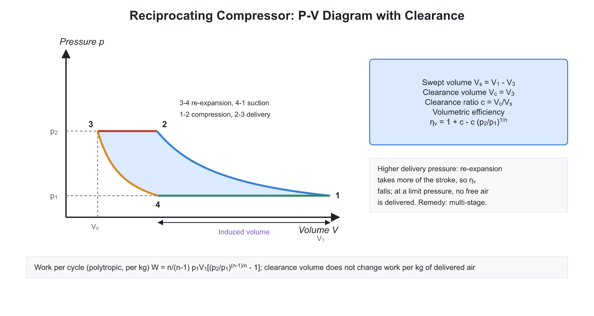
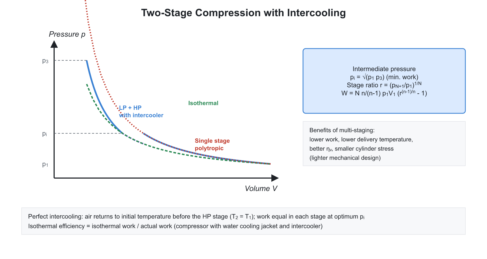
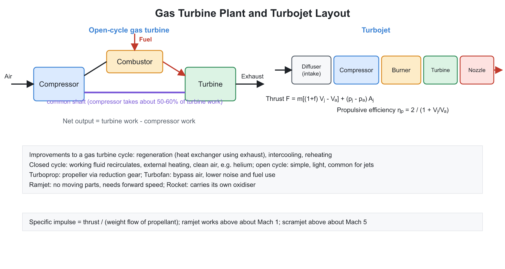
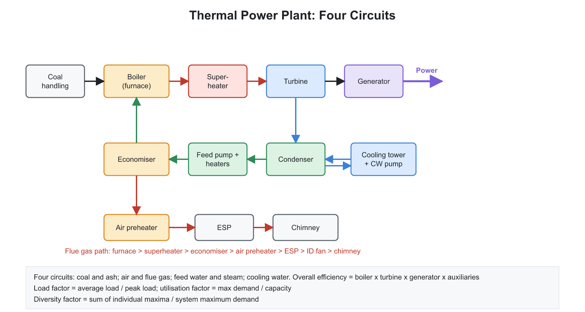
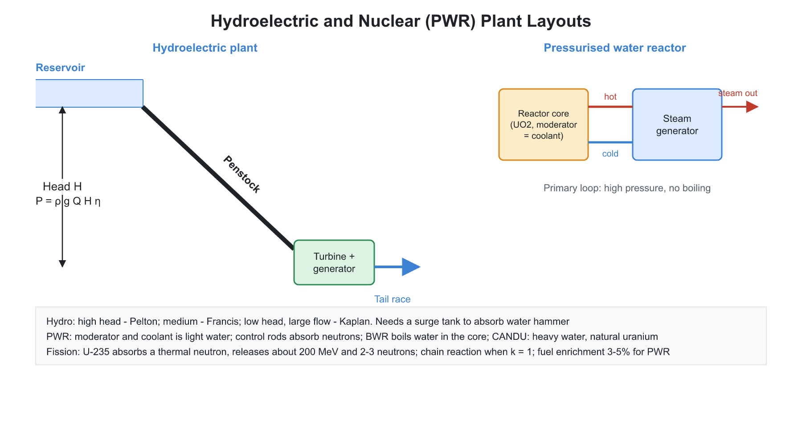
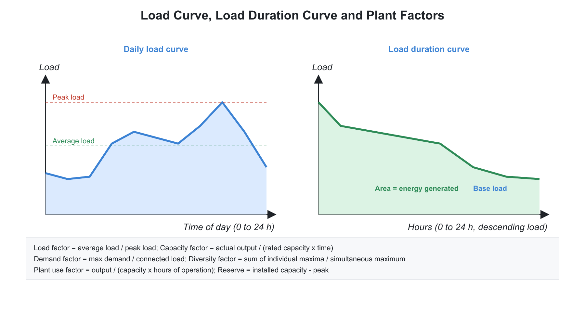

# 02. Compressors, Gas Turbines and Power Plants

**Exam relevance:** APPSC AEE: C | SSC JE: C | RRB JE: C | Category: ALL | Yield: HY

---

## Part A: Detailed Theory (read this first)

This chapter covers three machine families that all revolve around raising or exploiting the pressure of a gas: compressors (which supply it), gas turbines (which release it), and power plants (the complete systems that convert primary energy to electricity). The theory of compressors is the mirror image of turbines, so read the Brayton cycle material in the Thermodynamics chapter alongside it.

### A1. Why compress a gas and how compressors are classified
```text
air ---> [compressor] ---> [combustor] ---> [turbine] ---> exhaust
             ^                                  |
             +----------- shaft power ----------+
```


- Compressed air and gases drive pneumatic tools, supply combustion air (gas turbines, IC engines), refrigerant circuits, and process plants. A compressor adds energy to the gas through shaft work, raising its pressure (and temperature).
- **Positive displacement** machines trap a fixed volume of gas and reduce it mechanically (piston, vane, screw, lobe). They deliver a nearly constant volume per revolution irrespective of the pressure ratio, and are used for high pressure and small flow.
- **Dynamic** machines first raise the gas velocity with a rotating impeller or blades and then convert the kinetic energy to pressure in a diffuser. They give a continuous flow, are compact for large volumes, and are used for large flows and moderate pressure ratios.
- **Rough ranking by pressure ratio:** fan (up to $1.1$), blower ($1.1$ to $4$), compressor (above $4$).

### A2. Reciprocating compressor: how the cycle works


- The piston moves down; the suction valve opens and gas enters at $p_1$ (suction, line 4-1 on the $p$-$V$ diagram). Both valves close and the piston compresses the gas to $p_2$ (1-2). The delivery valve opens and the gas is pushed out at constant pressure (2-3). A small clearance volume must remain at the end of the stroke; the trapped gas re-expands as the piston returns (3-4) until the suction valve can open.
- **Work from the indicator diagram.** The area of the loop 1-2-3-4 is the work per cycle. For polytropic compression $pV^n = C$, integrating $-\int V\,dp$ over the path gives
$$W = \frac{n}{n-1}\,p_1V_1\left[\left(\frac{p_2}{p_1}\right)^{\frac{n-1}{n}} - 1\right]$$
  where $V_1$ is the gas actually drawn in (not the swept volume). The result is the *steady-flow* work: delivered mass times $\int v\,dp$.
- **Why isothermal is the ideal.** Compare the paths from $p_1$ to $p_2$ on a $p$-$V$ diagram: the isothermal curve is flatter than the adiabatic one, so the area to the left of it (the work) is smaller. Isothermal compression needs the least work, adiabatic the most. Practical compressors use water jackets, fins and intercoolers to bring the actual index $n$ closer to $1$ (typically $1.25$ to $1.35$ for air).
- **Efficiencies.** **Isothermal efficiency** (isothermal work over actual indicated work) is the usual measure for water-cooled machines; **adiabatic or isentropic efficiency** is used for uncooled or high-speed machines. **Mechanical efficiency** for a compressor is the ratio of indicated power to the shaft power input.
- **Free air delivery (FAD).** Compressors are rated by the volume of air delivered, converted to standard atmospheric conditions so that machines in different locations can be compared.

### A3. Clearance and volumetric efficiency

- **Clearance volume** is needed to avoid piston-head collision and to accommodate valves. Its penalty: the gas trapped in it expands on the return stroke, occupying part of the swept volume before suction can begin, so the volume of fresh gas drawn in is less than the swept volume.
- **Volumetric efficiency.** $\eta_v = \dfrac{V_1}{V_s} = 1 + c - c\left(\dfrac{p_2}{p_1}\right)^{1/n}$. It decreases when the pressure ratio increases or the clearance ratio $c$ increases. At the limiting pressure ratio, $\eta_v = 0$: the compressed gas in the clearance fills the whole stroke and no fresh gas is admitted.
- **Clearance and work.** The extra work spent compressing the clearance gas is recovered when it expands, so the work **per kg of gas delivered** is unchanged by clearance. Clearance reduces the capacity (mass per stroke), not the specific work, so a bigger cylinder is needed for a given output.
- **Other causes of low volumetric efficiency:** valve resistance and pressure drop, leakage past the piston and valves, heating of the incoming charge by hot cylinder walls.

### A4. Multistage compression and intercooling


- **Why stage?** A single stage at a high pressure ratio gives (i) a very high delivery temperature (oil breakdown, fire hazard), (ii) low volumetric efficiency, (iii) large work, and (iv) a heavy, large cylinder. Multistage compression divides the work and cools the gas between stages (**intercooling**) to bring it back toward the inlet temperature.
- **Optimum intermediate pressure.** For two stages with perfect intercooling, the total work is minimum when the work in each stage is equal, which happens at $p_i = \sqrt{p_1p_3}$, that is, **equal pressure ratio in every stage**: $\left(\dfrac{p_{final}}{p_1}\right)^{1/z}$. With perfect intercooling the heat removed in every intercooler is also equal.
- The saving relative to single-stage compression increases as the pressure ratio and number of stages increase, but each extra stage adds cost and pressure losses in the intercooler; so $2$ to $4$ stages are used.
- **Aftercooler** cools the final delivered air to condense moisture before the receiver.

### A5. Rotary and dynamic compressors

- **Roots blower.** Two figure-eight lobes rotate in opposite directions; they carry the gas around the casing without internal compression. Pressure rises when the trapped gas is exposed to the delivery pressure (backflow compression), so efficiency is low. Good for low-pressure, high-flow duty.
- **Vane and screw types.** The compressing volume decreases inside the casing, giving internal compression. Screw compressors are widely used for industrial air supply, with smooth flow and few moving parts.
- **Centrifugal compressor.** Gas enters near the axis, is flung outward by the rotating impeller (gaining kinetic energy and some pressure), then slows in the diffuser (kinetic to pressure energy) and leaves through the volute. Euler's turbomachine equation gives the work per kg, $w = U_2V_{w2} - U_1V_{w1}$. Because the flow cannot be guided perfectly by a finite number of vanes, the actual whirl velocity is less than the ideal; the ratio is the **slip factor**. Disc friction is accounted for by the power input factor. A radial-tip impeller has $w = \sigma U_2^2$.
- **Operating problems.** **Surging** is the flow reversal and cyclic pulsation that occurs when the flow is reduced below a limit at a given speed: the pressure the compressor can produce is less than the system pressure. It causes vibration and damage. **Choking** is the upper flow limit when the gas reaches sonic velocity at some section. **Stalling** is flow separation from the blades. The stable operating zone lies between the surge line and the choke line on the performance map.
- **Axial compressor.** Alternate rows of rotating (rotor) and stationary (stator) blades diffuse the flow in a series of small stages. The pressure ratio per stage is small ($\approx 1.2$) because the flow must decelerate against an adverse pressure gradient without separating (the **de Haller criterion** limits the deceleration, $V_{r2}/V_{r1} \ge 0.72$). Many stages are needed, but the efficiency and flow capacity are high, so they are used in jet engines and large gas turbines. A common design uses $50\%$ reaction.
- **Comparison.** Centrifugal machines are rugged, cheap, and have a wide stable range; axial machines are more efficient at high flow with a smaller frontal area, but are delicate and expensive.

### A6. Gas turbine plant


- **Layout.** Air is compressed, fuel is burnt at nearly constant pressure in a combustion chamber, and the hot gas expands through a turbine. Part of the turbine work drives the compressor (a large fraction: the **back work ratio**), and the remainder is the net output (shaft power or jet thrust).
- **Real cycle.** The compressor and turbine are not isentropic; the real compression requires more work, and real expansion yields less. With isentropic efficiencies, $\eta_C = \dfrac{T_{2s} - T_1}{T_2 - T_1}$ and $\eta_T = \dfrac{T_3 - T_4}{T_3 - T_{4s}}$. Because the compressor consumes so much of the turbine work, small drops in component efficiency greatly reduce the net work. This is why efficient component design (and high turbine inlet temperature, limited by blade metallurgy and cooling) dictates gas turbine progress.
- **Improvements** (see Thermodynamics): regeneration, intercooling, reheating. A **combined cycle** uses the hot exhaust (about $500$ to $600^\circ$C) in a heat-recovery steam generator to run a Rankine bottoming cycle, giving $55$ to $60\%$ overall efficiency, the highest of any thermal plant.
- **Compared with IC engines:** continuous combustion gives smooth running, little vibration, high power-to-weight ratio, and the ability to burn many fuels; but small units have lower efficiency, and materials must withstand high temperature and rotational speed.

### A7. Jet propulsion

- **Principle.** Thrust is the reaction to the momentum given to the working fluid: $F = \dot m_a[(1+f)V_j - V_a] + (p_j - p_a)A_j$, where $f$ is the fuel-air ratio, $V_j$ the jet velocity and $V_a$ the flight speed.
- **Efficiencies.** The **propulsive efficiency** is the fraction of the jet's kinetic energy that does useful propulsive work, $\eta_p = \dfrac{2V_a}{V_j + V_a}$. It approaches $1$ when the jet speed is close to the flight speed: therefore, it is better to accelerate a large mass of air by a small amount (turbofan, propeller) than a small mass by a large amount (pure turbojet) at subsonic speed. **Thermal efficiency** is the rate of kinetic energy gain of the jet over the energy rate from fuel. **Overall efficiency** is the product.
- **Types:**
  - **Turbojet.** All air passes through the core. Good at high subsonic and supersonic speeds.
  - **Turbofan.** A large fan drives a bypass stream around the core; lowers jet speed, raises propulsive efficiency and reduces noise. Standard for airliners.
  - **Turboprop.** A turbine drives a propeller through a gearbox; most efficient at low speeds.
  - **Ramjet.** No compressor: the high flight speed itself compresses the air ("ram effect"). Cannot operate at standstill. Used at supersonic speeds.
  - **Rocket.** Carries both fuel and oxidiser, so it works in space. Specific impulse $I_{sp} = F/(\dot m_pg)$ measures effectiveness.

### A8. Steam power plant (thermal) as a system


- **Four circuits:** coal and ash handling; air and flue gas; feedwater and steam (the Rankine cycle); cooling water. Together they convert chemical energy to electricity.
- **Overall efficiency** is the product of boiler efficiency, cycle efficiency, turbine efficiency and generator efficiency. Because the cycle efficiency is limited by thermodynamics, the final value is about $30$ to $40\%$. Raising steam pressure and temperature (supercritical, ultra-supercritical) raises it to $40$ to $45\%$.
- **Pulverised coal firing.** Coal is ground to a fine powder and blown into the furnace with primary air; the large surface area gives fast, efficient combustion. **Fluidised bed combustion** burns coal suspended in an upward air stream; the lower temperature ($\approx 850^\circ$C) reduces NOx and limestone in the bed captures SO$_2$.
- **Environmental control:** electrostatic precipitators remove fly ash (efficiency up to $99\%$), flue gas desulphurisation removes SO$_2$, tall stacks disperse remaining gas.

### A9. Hydroelectric power plant


- The potential energy of stored or flowing water is converted to electricity: $P = \rho g Q H\eta$. The power depends on **discharge** $Q$ and **head** $H$. A plant with a high head needs a small flow, and vice versa.
- **Plant layout.** Reservoir and dam (storage), intake with trash rack, penstock (high-pressure pipe), **surge tank** (absorbs pressure surges from sudden closure of the turbine valve, preventing water hammer), turbine, draft tube, tailrace, and spillway for floods.
- **Types:** run-of-river (no storage, uses natural flow), storage (a reservoir regulates the supply), pumped storage (excess off-peak power pumps water up to the upper reservoir; released at peak), tidal.
- **Matching the turbine to the head:** Pelton for high head and low flow; Francis for medium head and medium flow; Kaplan for low head and large flow (see Fluid Machinery).
- **Hydrological tools:** hydrograph (flow against time), flow duration curve (flow against the percentage of time exceeded; used to select the capacity), mass curve (cumulative inflow; used to determine reservoir storage).

### A10. Nuclear power plant

- **Fission.** A slow (thermal) neutron absorbed by U-235 makes the nucleus split into two fragments, releasing about $200$ MeV of energy (mainly as kinetic energy of fragments, which becomes heat) and $2$ to $3$ more neutrons, which can sustain a chain reaction. Mass is converted to energy according to $E = \Delta m c^2$.
- **Fuel.** Natural uranium contains $0.7\%$ fissile U-235; the rest is U-238, which is **fertile** (capturing a neutron it becomes Pu-239, which is fissile). Thorium-232 is likewise fertile and converts to U-233.
- **Core components and their functions:** fuel; **moderator** (slows fast neutrons to thermal energies, which are more likely to cause fission: heavy water, graphite, light water); **control rods** (absorb neutrons: cadmium, boron, hafnium); **coolant** (carries heat to the steam generator); **reflector** (returns escaping neutrons); **shield** (protects against radiation).
- **Multiplication factor** $k$. If $k = 1$, the reactor is critical (steady power); $k > 1$ power rises; $k < 1$ power falls. Control rods keep $k$ at $1$. A small fraction of **delayed neutrons** makes control feasible.
- **Reactor types:** PWR and BWR (light-water reactors, enriched fuel); PHWR (CANDU: heavy water moderator, natural uranium; the basis of the Indian programme); FBR (fast breeder; no moderator; liquid sodium coolant; breeds more fissile fuel than it consumes); gas-cooled reactors.
- **Safety:** multiple barriers (fuel cladding, coolant boundary, containment), emergency core cooling, and safe waste storage.

### A11. Renewable energy

- **Solar.** Photovoltaic cells convert sunlight directly to electricity (semiconductor junction); solar thermal systems concentrate sunlight to heat a fluid (flat plate collector for low temperatures, parabolic trough and tower for power generation).
- **Wind.** The kinetic energy flux through the rotor area is $\dfrac{1}{2}\rho AV^3$. Not all can be extracted, because the air must leave the rotor with some velocity; the maximum is the **Betz limit**, $16/27 \approx 0.593$. Output varies with the cube of wind speed, which makes site selection crucial.
- **Other sources:** biomass and biogas, geothermal, tidal, wave and ocean thermal energy conversion.

### A12. Power plant economics


- **Load curve** shows the demand against time of day. **Load duration curve** re-orders the loads in descending order, useful for deciding which plants to run as base load and which as peak load.
- **Key factors** (Part B table): demand factor, load factor, diversity factor, capacity factor, use factor, utilisation factor. A higher load factor spreads the fixed cost over more units, so the cost of energy falls. A higher diversity factor reduces the capacity needed for a group of consumers.
- **Base load vs peak load.** High-capital, low-running-cost plants (nuclear, large thermal) are run continuously as base load. Low-capital, high-running-cost plants (diesel, gas turbine) and quick-start hydro/pumped storage serve the peak.
- **Cost of generation** has fixed charges (interest, depreciation), semi-fixed and running charges (fuel, maintenance). Depreciation methods: straight line, diminishing balance, sinking fund.

### A13. What examiners test from this chapter

| Topic | APPSC AEE | SSC JE | RRB JE |
|---|---|---|---|
| Reciprocating compressor work, volumetric efficiency, clearance | Numerical | Common | Common |
| Multistage and intercooling, optimum intermediate pressure | Numerical | Very common | Common |
| Surging, choking, centrifugal vs axial | Conceptual | Common | Common |
| Gas turbine and jet propulsion basics | Conceptual | Common | Occasional |
| Power plant types, components, nuclear reactor parts | Direct | Very common | Very common |
| Load factor, diversity factor, capacity factor numericals | Numerical | Very common | Common |

---

## Part B: Quick-reference notes, formulas, numericals and PYQs


## 🧭 SECTION I: COMPRESSORS AND GAS TURBINES

## 🧭 1. Classification

| Type | Examples | Pressure ratio / use |
|---|---|---|
| Positive displacement, reciprocating | Piston compressor | High pressure, small flow |
| Positive displacement, rotary | Roots blower, vane, screw, lobe | Moderate pressure, steady flow |
| Dynamic, centrifugal | Centrifugal compressor | Moderate pressure ratio per stage, large flow |
| Dynamic, axial | Axial flow compressor | Low ratio per stage ($\approx 1.2$), very large flow (jet engines) |

- **Fan:** pressure ratio up to about $1.1$. **Blower:** $1.1$ to $4$. **Compressor:** above $4$.

## 🧭 2. Single-stage reciprocating compressor

- **Cycle on the $p$-$V$ diagram:** suction (4-1), compression (1-2), delivery (2-3), and expansion of clearance gas (3-4).
- **Work of compression per cycle** for polytropic $pV^n = C$ (area of the indicator diagram):

$$W = \frac{n}{n-1}\,p_1\,V_1\left[\left(\frac{p_2}{p_1}\right)^{\frac{n-1}{n}} - 1\right]$$

where $V_1$ is the **volume of gas actually inhaled** (not the swept volume).

  - For isothermal ($n = 1$): $W = p_1V_1\ln\dfrac{p_2}{p_1}$. For isentropic, $n = \gamma$. Work is **least for isothermal** compression and **greatest for adiabatic**.
  - **Isothermal efficiency** $= \dfrac{W_{isothermal}}{W_{actual\ (indicated)}}$.
  - **Isentropic (adiabatic) efficiency** $= \dfrac{W_{isentropic}}{W_{actual}}$.
  - **Mechanical efficiency** (compressor) $= \dfrac{IP}{BP}$, that is, indicated power over shaft power, which is the inverse of the engine definition because power flows into the compressor.
- **Clearance volume** $V_c$ is the volume between piston at end of delivery and the cylinder head. **Clearance ratio** $c = \dfrac{V_c}{V_s}$.
- **Volumetric efficiency:**

$$\eta_v = \frac{V_1}{V_s} = 1 + c - c\left(\frac{p_2}{p_1}\right)^{1/n}$$

  - Falls with pressure ratio and clearance. It becomes **zero** at a limiting pressure ratio, $\left(\dfrac{p_2}{p_1}\right)_{max} = \left(1 + \dfrac{1}{c}\right)^n$.
  - **Clearance does not affect the work per kg of air** delivered (it only reduces the capacity), because the compression and re-expansion of clearance gas cancel in the work.
- **Free air delivery (FAD):** discharge expressed at atmospheric conditions (standard $1.013$ bar and $15^\circ$C or $20^\circ$C).

## 🧭 3. Multistage compression with intercooling

- Required for high pressure ratios to: reduce the work of compression, limit delivery temperature (prevents lubricating oil breakdown and auto-ignition), improve the volumetric efficiency, and give smaller and balanced cylinders.
- **Ideal intercooling:** air is cooled back to the initial temperature after each stage.
- **Minimum work condition** (for $z$ stages, perfect intercooling, same $n$): equal pressure ratio per stage,

$$\frac{p_2}{p_1} = \frac{p_3}{p_2} = \dots = \left(\frac{p_{final}}{p_1}\right)^{1/z}$$

  - For two stages: intermediate pressure $p_i = \sqrt{p_1\,p_3}$.
- **Total minimum work for $z$ stages:**

$$W_{min} = \frac{z\,n}{n-1}\,p_1V_1\left[\left(\frac{p_{final}}{p_1}\right)^{\frac{n-1}{z\,n}} - 1\right]$$

  - Equal work is done in each stage, and the intercooler heat load is the same for each.
- **Number of stages** is limited by the benefit versus complexity; commonly chosen so that the delivery temperature is controlled.

## 🧭 4. Rotary and dynamic compressors

- **Roots blower:** two lobed rotors, no internal compression, the pressure rises when the delivery side is connected (volume-flow oriented). Efficiency is low.
- **Vane compressor:** eccentric rotor with sliding vanes; internal compression.
- **Screw compressor:** two meshing helical rotors; smooth and oil-free options.
- **Centrifugal compressor:** impeller, diffuser, volute. Pressure rises in the impeller (by centrifugal action) and in the diffuser (kinetic energy to pressure).
  - **Euler's equation:** $w = U_2V_{w2} - U_1V_{w1}$. For radial entry and ideal radial vanes, $w = U_2^2$.
  - **Slip factor** $\sigma = \dfrac{V_{w2}}{V'_{w2}}$ (actual to ideal whirl velocity): flow does not follow the blade perfectly.
  - **Power input factor** $\psi$ accounts for disc friction.
  - **Surging:** unstable, pulsating flow when the delivery pressure exceeds the compressor capacity at low flow. **Choking:** maximum flow limited by sonic velocity at the throat. **Stalling:** flow separation from blades.
- **Axial flow compressor:** many stages of rotor and stator blades; **degree of reaction** commonly $0.5$; **de Haller number** limit $V_{r2}/V_{r1} \ge 0.72$ (to avoid blade stall).
- **Comparison:** centrifugal has a robust construction, lower cost, a wide operating range, and a lower efficiency per frontal area; axial has a high efficiency, high flow and a small frontal area but is more sensitive and costly.

## 🧭 5. Gas turbines

- **Brayton cycle** formulas are in the Thermodynamics folder. Components: compressor, combustor, turbine. **Open cycle** (air drawn from and exhausted to the atmosphere) and **closed cycle** (working fluid recirculates through heat exchangers, can use gases like helium).
- **Net work** $= W_T - W_C$; high **back work ratio** means compressor consumes a large part of turbine work.
- **Actual cycle with efficiencies:**

$$\eta_C = \frac{T_{2s} - T_1}{T_2 - T_1},\qquad \eta_T = \frac{T_3 - T_4}{T_3 - T_{4s}}$$

- **Regeneration** raises efficiency; **intercooling and reheating** raise net work (and efficiency when combined with regeneration).
- **Advantages over IC engines:** smooth, high power-to-weight ratio, burn many fuels, little vibration. **Disadvantages:** lower thermal efficiency in small sizes, high-speed and high-temperature materials, noise.
- **Jet propulsion:**
  - **Thrust** $F = \dot{m}_a\,[(1+f)V_j - V_a] + (p_j - p_a)A_j$, where $f$ is the fuel-air ratio.
  - **Propulsive power** $= F\,V_a$. **Propulsive efficiency** $\eta_p = \dfrac{2\,V_a}{V_j + V_a}$ (neglecting fuel mass and pressure thrust).
  - **Thermal efficiency** $= \dfrac{\text{change in kinetic energy rate}}{\text{energy supplied by fuel}}$; **overall efficiency** $= \eta_p\,\eta_{th}$.
  - **Types:** turbojet, turbofan (bypass air gives better propulsive efficiency at subsonic speeds), turboprop (most efficient at low speed), ramjet (no compressor, works only at high speed, needs initial boost), pulse jet, **rocket** (carries its own oxidiser, works in space).
  - **Specific impulse** (rockets) $I_{sp} = \dfrac{F}{\dot{m}_p\,g}$.

## 🧭 SECTION II: POWER PLANTS

## 🧭 6. Steam (thermal) power plant

- Four circuits: **coal and ash**, **air and flue gas**, **feedwater and steam**, **cooling water**. The Rankine cycle gives the thermodynamic basis.
- Overall plant efficiency $\approx$ boiler $\times$ cycle $\times$ turbine $\times$ generator $\approx 0.88 \times 0.40 \times 0.88 \times 0.98 \approx 30\%$ to $38\%$.
- **Supercritical** and **ultra-supercritical** units (above $221$ bar) achieve $40\%$ to $45\%$.
- **Coal handling**: crusher, conveyor, **pulverised coal firing** (mill), **fluidised bed combustion** (reduces SO2 and NOx using limestone). **Ash handling**; **electrostatic precipitator (ESP)** for fly ash (up to $99\%$ efficiency); **FGD** for sulphur removal.
- **Combined cycle plant:** gas turbine exhaust heat feeds a **Heat Recovery Steam Generator (HRSG)** which drives a steam turbine; efficiency reaches $55\%$ to $60\%$.

## 🧭 7. Hydroelectric power plant

- **Power:** $P = \rho\,g\,Q\,H\,\eta_{overall}$ (W). **Hydraulic power** $= \rho g Q H$.
- **Classification:** run-of-river, storage (reservoir), pumped storage (peak shaving). By head: low ($<30$ m, Kaplan), medium ($30$ to $300$ m, Francis), high ($>300$ m, Pelton).
- **Components:** reservoir, dam, intake, penstock, **surge tank** (relieves water hammer), turbine, draft tube, tailrace, powerhouse, spillway.
- **Merits:** no fuel, renewable, low running cost, quick start. **Demerits:** high capital cost, dependence on rainfall, ecological impact.
- **Hydrograph** plots flow versus time; **flow duration curve** plots flow versus the percentage of time that flow is equalled or exceeded; **mass curve** gives the storage required.

## 🧭 8. Diesel and gas power plants

- **Diesel plant:** quick starting, low capital cost, used for standby and remote areas. Limited unit size and higher fuel cost.
- **Gas turbine plant:** quick start, compact, low capital cost, but lower efficiency; used for peak load and in combined cycle.

## 🧭 9. Nuclear power plant

- **Fission:** a neutron splits a heavy nucleus (U-235, Pu-239) releasing about $200$ MeV and $2$ to $3$ neutrons. **Fuel:** U-235 (natural uranium has $0.7\%$ U-235), **fertile materials** U-238 and Th-232 convert to fissile Pu-239 and U-233 respectively.
- **Components:**

| Component | Function | Materials |
|---|---|---|
| Fuel | Sustains the chain reaction | UO2, enriched uranium |
| Moderator | Slows fast neutrons to thermal energies | Heavy water, graphite, light water |
| Control rods | Absorb neutrons to control reactor power | Cadmium, boron, hafnium |
| Coolant | Removes heat | Water, heavy water, CO2, liquid sodium |
| Reflector | Reduces neutron leakage | Graphite, beryllium |
| Shield | Radiation protection | Concrete, lead |

- **Multiplication factor** $k = \dfrac{\text{neutrons in one generation}}{\text{neutrons in the preceding generation}}$: $k < 1$ subcritical, $k = 1$ critical, $k > 1$ supercritical.
- **Reactor types:** **PWR** (pressurised water), **BWR** (boiling water), **PHWR/CANDU** (pressurised heavy water, natural uranium; the basis of the Indian programme), **FBR** (fast breeder, no moderator, liquid sodium coolant), **HTGR** (gas cooled).
- India's three-stage nuclear programme: PHWR (natural U), FBR (Pu with Th blanket), then thorium-U233 reactors.
- **Radiation waste** is stored and reprocessed; safety by containment structure.

## 🧭 10. Renewable energy

- **Solar:** photovoltaic (direct conversion), solar thermal (flat plate collector, parabolic trough, power tower). Solar constant $\approx 1367$ W/m$^2$.
- **Wind:** power in wind $= \dfrac{1}{2}\rho A V^3$; the theoretical maximum extractable fraction is the **Betz limit** $\dfrac{16}{27} = 0.593$. Output is proportional to $V^3$.
- **Biomass and biogas** (methane from anaerobic digestion), **geothermal**, **tidal** and **ocean thermal (OTEC)**.

## 🧭 11. Power plant economics

| Term | Definition |
|---|---|
| Connected load | Sum of ratings of all the equipment connected |
| Maximum demand | Greatest demand over a period |
| Demand factor | $\dfrac{\text{maximum demand}}{\text{connected load}}$ |
| Load factor | $\dfrac{\text{average load}}{\text{maximum demand}}$ |
| Diversity factor | $\dfrac{\sum \text{individual maximum demands}}{\text{maximum demand of the system}}\ (\ge 1)$ |
| Plant capacity factor | $\dfrac{\text{actual energy produced}}{\text{max. possible energy at rated capacity}}$ |
| Plant use factor | $\dfrac{\text{energy produced}}{\text{rated capacity} \times \text{hours the plant was in operation}}$ |
| Utilisation factor | $\dfrac{\text{maximum demand}}{\text{rated plant capacity}}$ |
| Reserve capacity | Installed capacity $-$ maximum demand |

- **Base load plants:** thermal, nuclear (high capital, low running cost). **Peak load:** hydro, pumped storage, gas turbine, diesel.
- **Load curve** plots load versus time; **load duration curve** plots loads arranged in descending order.
- **Cost of generation:** fixed charges (interest, depreciation, taxes), semi-fixed (salaries) and running charges (fuel, maintenance). **Depreciation methods:** straight line, sinking fund, diminishing balance.
- Higher load factor reduces the cost per unit of electricity.

## 🧭 12. Worked numericals

1. **Reciprocating compressor.** $p_1 = 1$ bar, $p_2 = 8$ bar, $n = 1.3$, $V_1 = 0.1$ m$^3$/cycle. 

$$W = \frac{1.3}{0.3}(10^5)(0.1)\left[8^{0.2308} - 1\right] = 43333\times 0.616 = 26.7\ \text{kJ per cycle}$$

2. **Two-stage intermediate pressure.** $p_1 = 1$, $p_3 = 16$ bar: $p_i = \sqrt{16} = 4$ bar.
3. **Volumetric efficiency.** $c = 0.05$, $p_2/p_1 = 6$, $n = 1.3$:

$$\eta_v = 1 + 0.05 - 0.05\times 6^{0.769} = 1.05 - 0.05\times 3.965 = 0.852$$

4. **Hydropower.** $Q = 20$ m$^3$/s, $H = 100$ m, $\eta = 0.85$: $P = 1000\times 9.81\times 20\times 100\times 0.85 = 16.7$ MW.
5. **Load factor.** Average load $40$ MW, maximum demand $80$ MW: load factor $= 0.5$.
6. **Wind.** $\rho = 1.2$, $A = 100$ m$^2$, $V = 10$ m/s: $\tfrac12(1.2)(100)(1000) = 60$ kW available; at most $0.593 \times 60 = 35.6$ kW can be extracted.

## 🧭 13. Common mistakes

- Using swept volume instead of inhaled volume $V_1$ in compressor work.
- Believing that clearance volume increases the work per kg of air; it reduces only the capacity.
- Writing the optimum intermediate pressure as the arithmetic mean instead of the geometric mean.
- Mixing up load factor, capacity factor and utilisation factor.
- Using $\dfrac{1}{2}\rho A V^2$ for wind power (the correct power is cubic in $V$).

## 🧭 14. Interconnections

- **Thermodynamics:** polytropic work, Brayton cycle, Rankine cycle.
- **Fluid machinery:** hydro turbines, centrifugal compressors share Euler's equation with pumps.
- **Refrigeration:** compressors are a key component in vapour compression systems.

## 🧭 15. PYQs

| # | Question | Answer | Exam / Year | Verify |
|---|---|---|---|---|
| 1 | Work required for compression is minimum for | Isothermal compression | SSC JE 2017 | [ ] |
| 2 | Perfect intercooling for minimum work gives pressure ratio | Equal in every stage | RRB JE 2015 | [ ] |
| 3 | For a two-stage compressor, intermediate pressure | $\sqrt{p_1 p_3}$ | SSC JE 2018 | [ ] |
| 4 | Volumetric efficiency of reciprocating compressor decreases with | Increase in pressure ratio and clearance | RRB JE 2014 | [ ] |
| 5 | Surging occurs in | Centrifugal and axial compressors | SSC JE 2016 | [ ] |
| 6 | Betz limit | $0.593$ | APPSC AEE 2016 | [ ] |
| 7 | Moderator in a nuclear reactor | Slows down neutrons | SSC JE 2019 | [ ] |
| 8 | Control rods are made of | Cadmium or boron | RRB JE 2019 | [ ] |
| 9 | Load factor is | Average load divided by maximum demand | SSC JE 2015 | [ ] |
| 10 | Diversity factor is | Always greater than one | RRB JE 2016 | [ ] |
| 11 | Medium head hydro plant uses | Francis turbine | SSC JE 2020 | [ ] |
| 12 | Surge tank is used to | Relieve water hammer in the penstock | RRB JE 2018 | [ ] |
| 13 | A fast breeder reactor uses | Liquid sodium coolant and no moderator | APPSC AEE 2012 | [ ] |
| 14 | Pressure ratio of a blower | Between $1.1$ and $4$ | SSC JE 2021 | [ ] |
| 15 | Thrust of a rocket | Depends on exhaust velocity and mass flow of propellant | RRB JE 2017 | [ ] |
| 16 | Ramjet cannot work at | Zero forward speed | SSC JE 2022 | [ ] |

## 🧭 16. Revision checklist

- [ ] Compressor work, volumetric efficiency, limits of clearance
- [ ] Intercooling: minimum work condition
- [ ] Gas turbine and jet propulsion formulas
- [ ] Nuclear reactor components and materials
- [ ] Hydro power formula, turbine selection by head
- [ ] Load, demand, diversity, capacity factors
