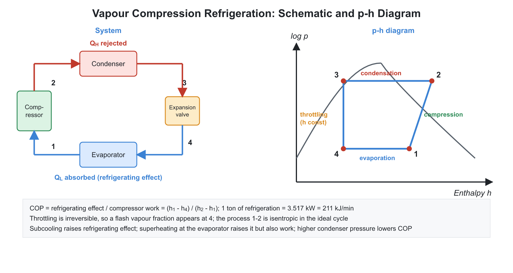
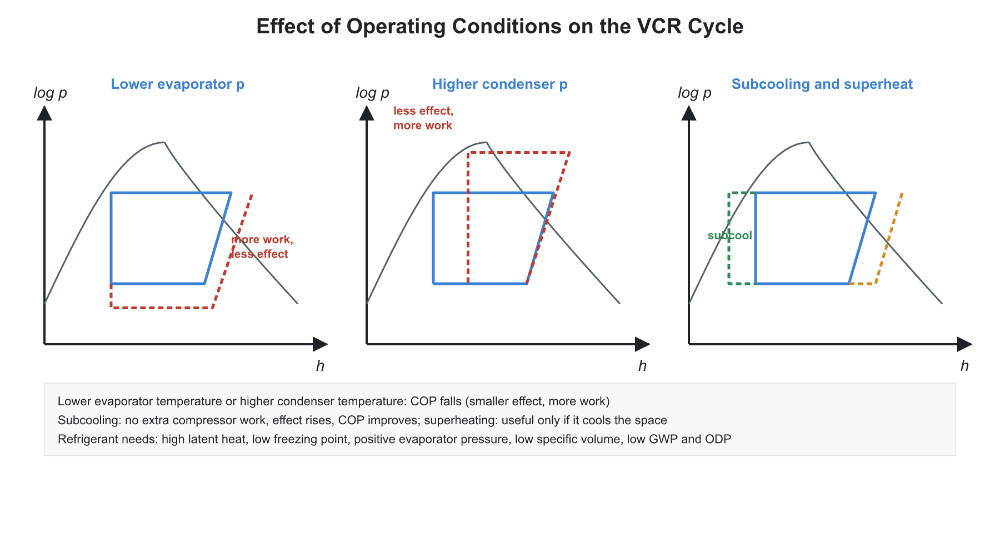
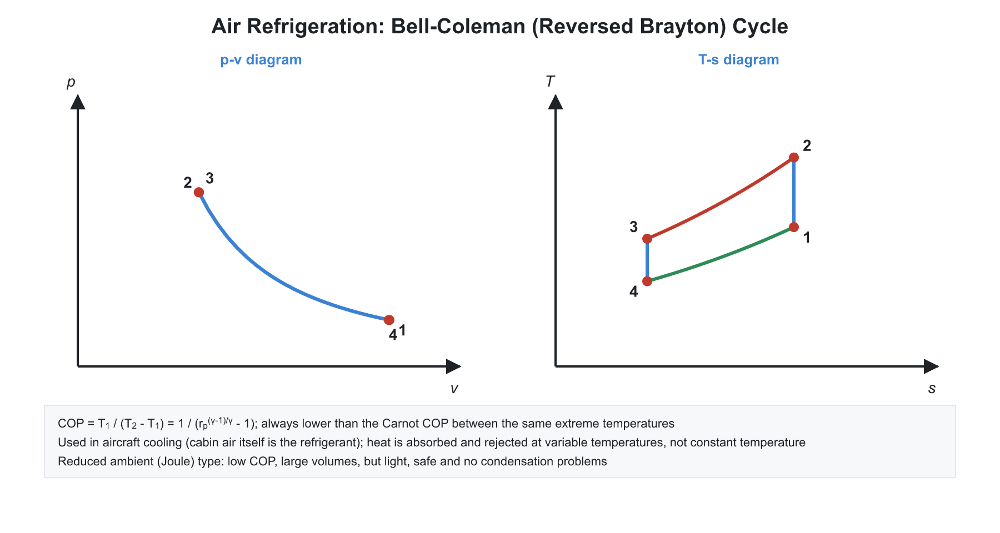
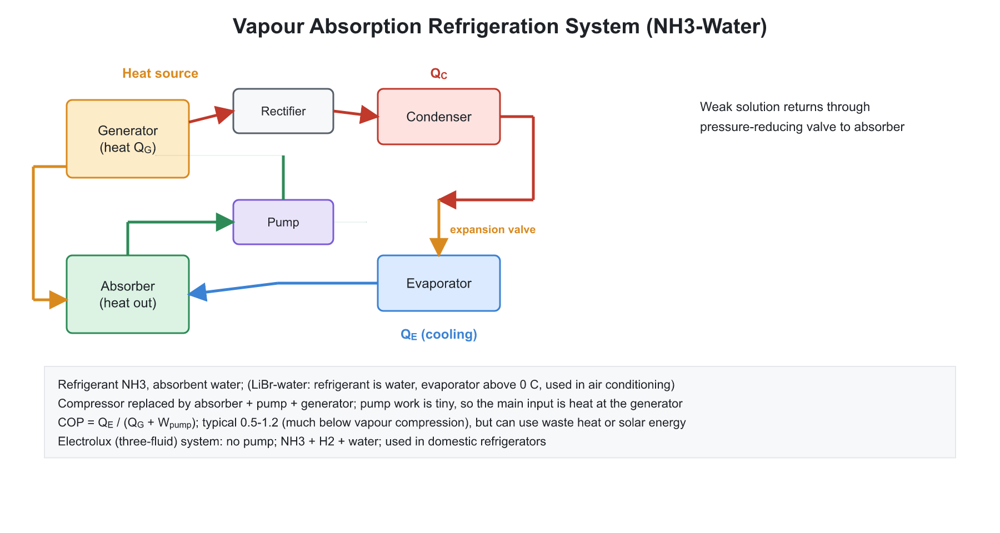

# ❄️ 01. Refrigeration Cycles and Refrigerants

**Exam relevance:** APPSC AEE: C | SSC JE: C | RRB JE: C | Category: ALL | Yield: VHY

---

## 📘 Part A: Detailed Theory (read this first)

Refrigeration moves heat from a cold space to a warm one, which the second law says cannot happen without an energy input. This chapter explains why the vapour-compression cycle takes the shape it does, what each component does, how refrigerants are chosen, and how absorption systems replace electrical work with heat.

### 🔹 A1. Principle: the reversed heat engine

- A heat engine takes heat $Q_H$ from a hot source, produces work and rejects $Q_L$ to a cold sink. Reverse every arrow and you have a **refrigerator**: work $W$ goes in, heat $Q_L$ is lifted from the cold space, and $Q_H = Q_L + W$ is rejected to the surroundings.
- A **heat pump** is the same machine used to deliver $Q_H$ to a warm space. The only difference is the purpose.
- **Coefficient of performance.** $\text{COP}_{ref} = Q_L/W$ (what you want over what you pay for). It can exceed $1$ because the machine only moves energy. $\text{COP}_{HP} = Q_H/W = \text{COP}_{ref} + 1$ (always greater than $1$).
- **Carnot limit.** For reservoirs at $T_L$ and $T_H$: $\text{COP}_{Carnot} = \dfrac{T_L}{T_H - T_L}$. The COP is high when the temperature lift $T_H - T_L$ is small. Every extra degree of lift costs work. This single idea explains most of the practical rules (keep condensers clean, avoid very low evaporator temperature).
- **Unit.** One **ton of refrigeration (TR)** is the rate of heat removal needed to freeze one short ton ($2000$ lb) of water at $0^\circ$C into ice at $0^\circ$C in 24 hours: $1\ \text{TR} = 3.517$ kW. In exams, $1\ \text{TR} = 3.5$ kW or $211$ kJ/min is used (the SI latent heat of ice of $335$ kJ/kg applied to a metric tonne would give about $3.88$ kW, which is not the standard definition).

### 🔹 A2. Why not the reversed Carnot cycle?

- A reversed Carnot cycle would have two isothermal and two isentropic steps. In a vapour system, the isothermal processes are easy (evaporation and condensation at constant pressure). The problems are in the other two:
  - **Compression of wet vapour** (starting inside the dome) is harmful. Liquid droplets in the cylinder cause erosion and "slugging" (liquid is incompressible, so the machine may break).
  - **Isentropic expansion** of a liquid-vapour mixture in an engine recovers very little work and is mechanically complicated.
- The practical **vapour compression cycle** modifies the Carnot cycle in two ways: (i) compress **dry** (saturated or slightly superheated) vapour, and (ii) replace the expander by a **throttle valve** (an isenthalpic process). The price is some loss of refrigerating effect and COP, and the gain is reliability and simplicity.

### 🔹 A3. Vapour compression cycle: step-by-step

1. **Evaporator (4 to 1).** Cold, low-pressure liquid-vapour mixture absorbs heat from the refrigerated space and boils at constant pressure and temperature. The exit is saturated vapour (or slightly superheated). The temperature of the boiling refrigerant must be below that of the space (a few degrees to $10$ K) for heat to flow.
2. **Compressor (1 to 2).** Raises the pressure to the condenser pressure. Ideally isentropic. The exit is superheated vapour at a temperature well above ambient, so heat can be rejected to air or cooling water.
3. **Condenser (2 to 3).** Heat rejection at constant pressure: first desuperheating, then condensation to saturated liquid. The condenser temperature must be above the temperature of the cooling medium.
4. **Expansion device (3 to 4).** Throttling lowers the pressure to evaporator pressure. No work, no heat: $h_3 = h_4$. Some liquid flashes to vapour, which cools the rest. The mixture at 4 has a low quality (about $0.2$ to $0.3$).
5. **Energy accounting.**
$$q_L = h_1 - h_4,\quad w = h_2 - h_1,\quad q_H = h_2 - h_3 = q_L + w,\quad \text{COP} = \frac{h_1 - h_4}{h_2 - h_1}$$
- **On the $T$-$s$ and $p$-$h$ diagrams.** In the $p$-$h$ chart each process is a simple line: horizontal for heat exchange in evaporator and condenser, a vertical line for throttling, and a sloping isentrope for compression. Because enthalpy differences are read as horizontal lengths, the COP is a ratio of two lengths on the $p$-$h$ chart. This is why the chart is the standard design tool.
- **Mass flow and capacity.** The refrigerant flow rate needed for a given load is $\dot m = Q_L/(h_1 - h_4)$. The compressor swept volume follows from the specific volume at suction; a vapour with a large specific volume (low-pressure refrigerant) needs a large compressor.

### 🔹 A4. Effect of operating conditions: understanding, not memorising

- **Lower evaporator temperature** means greater lift and a lower suction pressure and density. The refrigerating effect decreases and the compressor work per kg increases, so COP falls. The compressor must also be larger for the same capacity.
- **Higher condenser temperature** (dirty condenser, hot weather) increases the head pressure and the work, reduces the refrigerating effect (more flash gas at throttling), and COP falls.
- **Subcooling** the liquid below the saturation temperature before the expansion valve reduces the flash vapour and increases the refrigerating effect with no extra compressor work, so COP rises. It is achieved with a liquid-suction heat exchanger or an oversized condenser.
- **Superheating** at the compressor inlet is beneficial if the heat comes from the cooled space (it adds to the refrigerating effect) but not if it comes from outside. It also protects the compressor from liquid slugging. The net effect on COP depends on the refrigerant and is usually small.
- **Multistage compression with intercooling and flash chamber** reduces compressor work and delivers a high pressure ratio with better volumetric efficiency; **cascade systems** use two cycles with different refrigerants to reach very low temperatures where a single refrigerant would have too low a pressure or too high a freezing point.

### 🔹 A5. Refrigerants

- **Desirable properties.**
  - *Thermodynamic:* high latent heat (low flow rate), evaporator pressure above atmospheric (so air does not leak in), moderate condenser pressure (light, cheap construction), high critical temperature (so the cycle can be run efficiently; near-critical operation reduces the latent heat), low freezing point, high COP.
  - *Safety and chemical:* non-toxic, non-flammable, chemically stable, non-corrosive, compatible with oil and materials.
  - *Environmental:* zero **ODP** (ozone depletion potential) and low **GWP** (global warming potential).
  - *Practical:* cheap, easy to detect leaks.
- **Designation (R-number).** For R-$xyz$ halocarbons from the methane, ethane or propane series: the hundreds digit plus $1$ gives the number of carbon atoms (omitted if zero, i.e. methane), the tens digit minus $1$ gives hydrogen atoms, the units digit gives fluorine atoms; chlorine fills the remaining bonds. Example: R-12 is CCl$_2$F$_2$; R-22 is CHClF$_2$; R-134a is C$_2$H$_2$F$_4$ (the letter 'a' indicates an isomer). For inorganic fluids, R-7xx with xx the molecular mass: ammonia R-717, water R-718, CO$_2$ R-744, air R-729.
- **Environmental history.** CFCs (R-11, R-12) damage the ozone layer, so they were banned by the **Montreal Protocol**. HCFCs (R-22) are being phased out. HFCs (R-134a) have zero ODP but high GWP, so the **Kigali Amendment** phases them down. Replacements: hydrocarbons (R-600a, R-290), CO$_2$, ammonia and HFOs.
- **Ammonia (R-717).** Excellent thermodynamic performance and low cost; toxic, pungent, and corrosive to copper and its alloys, so used in large industrial plants with steel piping.
- **Secondary refrigerants (brines)** such as chilled water, brine and glycol transport cold from a central plant to the load, which limits the quantity of primary refrigerant.
- **Leak detection:** halide torch for halocarbons (flame colour changes), sulphur candle for ammonia (white smoke), soap bubbles in general, and electronic detectors.

### 🔹 A6. Components of the vapour compression system

- **Compressor.** Reciprocating (small to medium duty), rotary and scroll (domestic, small commercial), screw (medium and large), centrifugal (very large capacity). *Hermetic* units enclose the motor and compressor in a welded shell (no shaft seal, no leaks, not serviceable); *semi-hermetic* have a bolted shell; *open* units have an external drive.
- **Condenser.** Air-cooled (domestic and small commercial), water-cooled (shell-and-tube; cooling tower), and evaporative (spray water over the coil in an air stream; uses latent heat of water for good cooling).
- **Evaporator.** Dry-expansion (refrigerant fully evaporated inside tubes), flooded (tubes covered with liquid refrigerant; high heat transfer).
- **Expansion devices.** **Capillary tube**: long narrow tube giving a fixed pressure drop; simple, used in domestic refrigerators and small units; cannot adjust to load. **Thermostatic expansion valve (TEV)**: senses the superheat at the evaporator outlet using a bulb and adjusts the opening to keep the superheat constant. **Automatic expansion valve** holds constant evaporator pressure. **Float valve** maintains the liquid level in flooded evaporators.
- **Accessories.** Liquid receiver, filter-drier (removes moisture and dirt: moisture freezes at the valve and blocks it), accumulator (stops liquid reaching the compressor), oil separator, sight glass, solenoid valve and pressure controls (high-pressure and low-pressure cut-outs).

### 🔹 A7. Air refrigeration (Bell-Coleman) cycle

- It is the reversed Brayton cycle. Air is compressed (isentropically), cooled at constant pressure by ambient air, then expanded isentropically in a turbine to a temperature below that of the cold space, and finally takes up heat from the cold space at constant pressure.
- The COP is $\dfrac{1}{r_p^{(\gamma-1)/\gamma} - 1}$. It falls with increasing pressure ratio. Compared with a vapour system, the COP is low and the equipment is large (air has a low specific heat and no latent heat), but air is safe and free, and the system is light enough for aircraft. Air cycle is used for aircraft cooling (simple, bootstrap and regenerative systems; ram air provides pressure rise) and is attractive for very low temperatures.

### 🔹 A8. Vapour absorption refrigeration

- **Idea.** Vapour compression raises the refrigerant pressure by compressing a *vapour*, which takes a lot of work. It is much cheaper to raise the pressure of a *liquid* (small pump work). So the absorption system dissolves the low-pressure refrigerant vapour in a liquid absorbent in the **absorber**, pumps the solution to the high pressure, and then boils the refrigerant out of the solution using heat in the **generator**. The condenser, expansion valve and evaporator are the same as in a vapour compression system.
- **Energy source.** The main input is heat at a moderate temperature (waste heat, solar, steam, natural gas); only a very small pump work is needed. This makes the system attractive where waste heat or cheap fuel is available, and in places without reliable electricity.
- **Working pairs.**
  - *Ammonia-water:* refrigerant is NH$_3$, absorbent is water. Both are volatile, so the vapour leaving the generator contains some water; a **rectifier** and an **analyser** are needed to purify it. Can reach below $0^\circ$C.
  - *Lithium bromide-water:* refrigerant is water and absorbent is LiBr salt (non-volatile, so no rectifier). Because the refrigerant is water, evaporator temperature must stay above $0^\circ$C, so it is used in air conditioning and chillers. Crystallisation of LiBr at high concentration is a risk.
- **Maximum COP.** Treat the system as three reservoirs: generator ($T_G$), evaporator ($T_E$), and ambient ($T_A$). A reversible engine between $T_G$ and $T_A$ drives a reversible refrigerator between $T_E$ and $T_A$: $\text{COP}_{max} = \dfrac{T_G - T_A}{T_G}\cdot\dfrac{T_E}{T_A - T_E}$. Actual COP is $0.6$ to $1.2$.
- **Electrolux refrigerator.** A three-fluid (ammonia, water, hydrogen) absorption system with no pump. Hydrogen makes the total pressure uniform, so ammonia evaporates at low partial pressure. A small heat source (gas flame or electric heater) circulates the fluids by thermosiphon (bubble pump). Silent and has no moving parts.

### 🔹 A9. Other methods

- **Steam jet refrigeration.** High-pressure steam passes through an ejector, entraining and compressing the vapour from a flash chamber. The flash chamber stays at a very low pressure, so some water evaporates and cools the rest. Water is the refrigerant; suitable for chilling to above about $4^\circ$C, and using plant steam.
- **Thermoelectric (Peltier) refrigeration.** Current through a junction of two dissimilar semiconductors absorbs heat at one junction and releases it at the other. No moving parts or refrigerant, but low COP; used in small coolers and electronic devices.
- **Vortex tube.** Compressed air entering tangentially splits into a hot and a cold stream; no moving parts; low efficiency.
- **Dry ice** (solid CO$_2$) sublimates at $-78.5^\circ$C at atmospheric pressure.

### 🔹 A10. What examiners test from this chapter

| Topic | APPSC AEE | SSC JE | RRB JE |
|---|---|---|---|
| COP, TR, Carnot COP numericals | Numerical | Very common | Very common |
| VCRS cycle on $p$-$h$ and $T$-$s$, effect of subcooling and superheat | Numerical | Common | Common |
| Refrigerants: designation, properties, ODP and GWP | Direct | Very common | Very common |
| Components: capillary tube, TEV, compressors, condensers | Direct | Common | Common |
| Absorption systems: LiBr-water, NH$_3$-water, Electrolux | Conceptual | Common | Common |
| Air refrigeration, aircraft cooling | Conceptual | Common | Occasional |

---

## ⚡ Part B: Quick-reference notes, formulas, numericals and PYQs

## 🧭 1. Foundations

- **Refrigeration:** removal of heat from a body or space so as to keep it at a temperature lower than its surroundings. A **refrigerator** is a reversed heat engine.
- **Unit:** **1 ton of refrigeration (TR)** is the heat extraction rate needed to freeze 1 tonne of water at $0^\circ$C into ice at $0^\circ$C in 24 hours.

$$1\ \text{TR} = 3.5167\ \text{kW} \approx 211\ \text{kJ/min} \approx 12000\ \text{Btu/h}$$

- **COP (coefficient of performance):**

$$\text{COP}_{ref} = \frac{Q_L}{W},\qquad \text{COP}_{HP} = \frac{Q_H}{W} = \text{COP}_{ref} + 1$$

- **Carnot (reversed) refrigerator:** $\text{COP}_{Carnot} = \dfrac{T_L}{T_H - T_L}$; no real cycle can exceed it.
- **Relative COP** $= \dfrac{\text{actual COP}}{\text{theoretical COP}}$.
- **Sub-cooling** and **superheating** change COP; **refrigerating effect** $= h_1 - h_4$ per kg of refrigerant.

## 🧭 2. Air refrigeration (Bell-Coleman / reversed Brayton)

- Air is compressed, cooled at constant pressure, expanded in a turbine (or expander) to a low temperature, and absorbs heat at constant pressure.

$$\text{COP} = \frac{T_1 - T_4}{(T_2 - T_1) - (T_3 - T_4)} = \frac{1}{r_p^{\frac{\gamma-1}{\gamma}} - 1}$$

- **Features:** low COP, large air flow rate and equipment; but air is safe, free and light, so it is used in **aircraft cooling**. Air cycles can reach very low temperatures.
- **Aircraft refrigeration systems:** simple, bootstrap, regenerative, and reduced ambient. **Ram effect** converts the velocity of air relative to the aircraft into pressure rise.
- **Higher the pressure ratio, the lower the COP** (but a lower temperature is achievable).

## 🧭 3. Vapour compression refrigeration system (VCRS)

Components and processes (ideal cycle):

| Process | Component | Nature |
|---|---|---|
| 1-2 | Compressor | Isentropic compression of saturated vapour to superheated vapour |
| 2-3 | Condenser | Constant-pressure heat rejection, desuperheating then condensing to saturated liquid |
| 3-4 | Expansion valve (throttle) | Isenthalpic expansion, $h_3 = h_4$ |
| 4-1 | Evaporator | Constant-pressure, constant-temperature heat absorption |

$$\text{COP} = \frac{h_1 - h_4}{h_2 - h_1}$$

- **Refrigerating effect** $q_L = h_1 - h_4$. **Compressor work** $w = h_2 - h_1$. **Heat rejected** $q_H = h_2 - h_3$.
- **Mass flow of refrigerant** $\dot{m} = \dfrac{Q_L}{h_1 - h_4}$. **TR relation:** $\dot{m} = \dfrac{211\ \text{TR}}{(h_1 - h_4)\times 60}$ kg/s with $h$ in kJ/kg.
- **Why a throttle valve rather than an expansion engine?** Work recovery is tiny (liquid expansion), and a valve is simple and cheap and allows control of the flow.
- **Why vapour (not wet) at compressor inlet?** Wet compression (liquid droplets) damages the compressor ("liquid slugging"). So dry compression is used: the suction state is saturated or slightly superheated vapour.
- **Effect of operating conditions:**

| Change | Effect on COP |
|---|---|
| Lower evaporator temperature | Decreases |
| Higher condenser temperature | Decreases |
| Sub-cooling of liquid before the expansion valve | Increases |
| Superheating of vapour at compressor suction | Usually decreases (small useful superheat increases refrigerating effect) |

- **Liquid-suction heat exchanger** subcools the liquid with cold suction vapour.
- **Practical improvements:** multistage compression with intercooling (flash chamber), multi-evaporator systems, and cascade systems for very low temperature ($-80^\circ$C or below).
- **Actual cycle deviations:** pressure drops in lines, superheating, subcooling, irreversibility in compression.

### 🔹 p-h chart (pressure-enthalpy)

- Vertical axis: pressure (log scale); horizontal axis: enthalpy. The dome shows saturated liquid on the left and saturated vapour on the right. Constant-entropy lines slope upward steeply to the right; constant-temperature lines are vertical in the liquid region, horizontal inside the dome and drop sharply in the superheat region.
- Compression follows a constant-entropy line, condensation a horizontal line, throttling a vertical line, and evaporation a horizontal line.

## 🧭 4. Refrigerants

| Class | Examples | Notes |
|---|---|---|
| Halocarbons | R-11, R-12 (CFC); R-22 (HCFC); R-134a (HFC) | CFC are banned; R-22 being phased out; R-134a is widely used |
| Hydrocarbons | R-600a (isobutane), R-290 (propane) | Flammable; used in domestic refrigerators |
| Inorganic | R-717 (ammonia), R-718 (water), R-744 (CO2), R-729 (air) | Ammonia toxic and efficient for industrial plants |
| Azeotropes | R-500, R-502 | Behave as a single substance |
| Zeotropes | R-404A, R-407C | Blends with temperature glide |

- **Numbering:** for an R-$xyz$ halocarbon: $x+1$ is the number of carbon atoms ($x = 0$ is omitted for methane), $y - 1$ is the number of hydrogen atoms, $z$ is the number of fluorine atoms; the rest of the bonds are chlorine. For example, R-12: $\mathrm{CCl_2F_2}$; R-22: $\mathrm{CHClF_2}$; R-134a: $\mathrm{C_2H_2F_4}$. For R-7xx, the number is $700 + $ molecular mass (ammonia R-717, water R-718, CO2 R-744).
- **Desirable properties:** high latent heat, low freezing point, positive (above atmospheric) evaporator pressure to prevent air leaking in, moderate condenser pressure, high critical temperature, non-toxic, non-flammable, non-corrosive, miscible with oil (or easily separated), low cost, and ease of leak detection.
- **Environmental indices:** **ODP** (Ozone Depletion Potential; zero for HFCs), **GWP** (Global Warming Potential, relative to CO2). **Montreal Protocol** controls ozone-depleting substances; **Kigali Amendment** phases down HFCs.
- **Secondary refrigerants (brines):** chilled water, calcium chloride and sodium chloride brine, and ethylene glycol solutions carry cold from the primary refrigerant to the load.
- **Leak detection:** halide torch for halocarbons (flame turns green or blue-green), sulphur candle for ammonia (white fumes), soap solution for others.
- **Ammonia (R-717)** has the highest latent heat among common refrigerants but is toxic and attacks copper and its alloys.

## 🧭 5. Components of VCRS

- **Compressors:** reciprocating (small and medium), rotary, scroll, screw, centrifugal (large capacities). **Hermetic** (sealed motor and compressor; common in domestic units), **semi-hermetic**, **open type**.
- **Condensers:** air-cooled (small), water-cooled (shell-and-tube, double pipe), evaporative (combines air and water). 
- **Evaporators:** dry expansion, flooded, natural convection, forced convection.
- **Expansion devices:** **capillary tube** (domestic refrigerators, fixed), **thermostatic expansion valve (TEV)** (maintains constant superheat at evaporator outlet), automatic expansion valve (constant evaporator pressure), float valve (flooded systems), electronic expansion valve.
- **Accessories:** receiver, drier, filter, accumulator, oil separator, sight glass.

## 🧭 6. Vapour absorption refrigeration system (VARS)

- Replaces the mechanical compressor with an **absorber, pump, generator and rectifier**; the energy input is mainly **heat** (waste heat, solar, steam, gas), with only a small pump work.
- **Ammonia-water (NH3-H2O)**: refrigerant is ammonia, absorbent is water; needs a **rectifier** and **analyser** because water vapour leaves with ammonia. 
- **Lithium bromide-water (LiBr-H2O)**: refrigerant is water, absorbent is LiBr; used in air conditioning (above $0^\circ$C) with no rectifier needed, because LiBr is non-volatile.

$$\text{COP}_{VARS} = \frac{Q_{evap}}{Q_{gen} + W_{pump}} \approx \frac{Q_{evap}}{Q_{gen}}$$

- **Maximum COP** (three-reservoir model, generator at $T_G$, evaporator at $T_E$, ambient at $T_A$):

$$\text{COP}_{max} = \left(\frac{T_G - T_A}{T_G}\right)\left(\frac{T_E}{T_A - T_E}\right)$$

- **Electrolux (three-fluid) refrigerator:** ammonia, water and hydrogen; no pump or moving parts; the hydrogen equalises pressure in the evaporator and absorber. Used in hotels and caravans (silent).
- **Comparison:**

| Feature | VCRS | VARS |
|---|---|---|
| Energy source | Electrical work | Heat |
| Moving parts | Compressor | Almost none (pump only) |
| COP | Higher | Lower ($0.6$ to $1.2$) |
| Noise | More | Quiet |
| Part-load performance | Poor | Good |
| Capital cost | Lower | Higher |
| Best use | General | Where cheap waste heat is available |

## 🧭 7. Other refrigeration methods

- **Steam jet refrigeration:** uses high-pressure steam in an ejector to maintain a vacuum over the water; water is the refrigerant; suitable for chilled water above $4^\circ$C.
- **Thermoelectric (Peltier effect):** current through a junction of dissimilar semiconductors absorbs heat at one junction; no moving parts.
- **Vortex tube:** compressed air splits into hot and cold streams.
- **Dry ice (solid CO2)** sublimates at $-78.5^\circ$C at atmospheric pressure.
- **Cascade system:** two or more vapour compression cycles in series, each with a different refrigerant, to reach $-40^\circ$C to $-150^\circ$C.

## 🧭 8. Worked numericals

1. **TR to power.** 5 TR $= 5\times 3.517 = 17.58$ kW.
2. **VCRS.** $h_1 = 380$, $h_2 = 430$, $h_3 = h_4 = 240$ kJ/kg: 

$$\text{COP} = \frac{380 - 240}{430 - 380} = 2.8$$

3. **Mass flow for 10 TR.** $\dot{m} = \dfrac{10\times 211}{60\times 140} = 0.251$ kg/s.
4. **Carnot COP.** $T_L = 263$ K, $T_H = 303$ K: $\dfrac{263}{40} = 6.58$.
5. **Bell-Coleman.** $r_p = 4$, $\gamma = 1.4$: $\dfrac{1}{4^{0.2857} - 1} = \dfrac{1}{0.486} = 2.06$.

## 🧭 9. Common mistakes

- Using a heat pump COP for a refrigerator (they differ by exactly $1$).
- Using temperatures in Celsius in Carnot COP.
- Saying that VARS produces refrigeration without any work; a small pump work is needed.
- Confusing the roles: in LiBr-water, **water is the refrigerant**; in ammonia-water, **ammonia is the refrigerant**.
- Reading R-134a as a CFC; it is an HFC with zero ODP.

## 🧭 10. Interconnections

- **Thermodynamics:** reversed Carnot, second law, throttling (Joule-Thomson).
- **Heat transfer:** condenser and evaporator are heat exchangers.
- **Compressors:** the compressor chapter provides the work theory.

## 🧭 11. PYQs

| # | Question | Answer | Exam / Year | Verify |
|---|---|---|---|---|
| 1 | One ton of refrigeration equals | $3.5167$ kW (about $211$ kJ/min) | SSC JE 2017 | [ ] |
| 2 | COP of a heat pump minus COP of a refrigerator | $1$ | RRB JE 2015 | [ ] |
| 3 | Expansion in a refrigerator is | Isenthalpic | SSC JE 2018 | [ ] |
| 4 | Capillary tube is used in | Domestic refrigerators | RRB JE 2014 | [ ] |
| 5 | Refrigerant R-717 | Ammonia | SSC JE 2016 | [ ] |
| 6 | Refrigerant R-134a | Tetrafluoroethane (HFC) | SSC JE 2019 | [ ] |
| 7 | In an Electrolux refrigerator the gas used to reduce partial pressure | Hydrogen | RRB JE 2019 | [ ] |
| 8 | Absorbent in a LiBr system | Lithium bromide, with water as the refrigerant | APPSC AEE 2012 | [ ] |
| 9 | Bell-Coleman cycle is | Reversed Brayton | SSC JE 2015 | [ ] |
| 10 | The refrigerant with the highest latent heat | Ammonia | RRB JE 2016 | [ ] |
| 11 | Sub-cooling the liquid in a VCRS | Increases COP | SSC JE 2020 | [ ] |
| 12 | Air refrigeration is used in | Aircraft | RRB JE 2018 | [ ] |
| 13 | Halide torch detects leak of | Halocarbon refrigerants (flame colour changes) | SSC JE 2021 | [ ] |
| 14 | Thermostatic expansion valve controls | Superheat at the evaporator outlet | APPSC AEE 2016 | [ ] |
| 15 | Montreal Protocol deals with | Ozone-depleting substances | RRB JE 2017 | [ ] |

## 🧭 12. Revision checklist

- [ ] TR, COP of refrigerator, heat pump, Carnot
- [ ] VCRS $p$-$h$ diagram and COP calculation
- [ ] Refrigerant numbering and properties
- [ ] VARS pairs and COP; Electrolux
- [ ] Air refrigeration cycle
