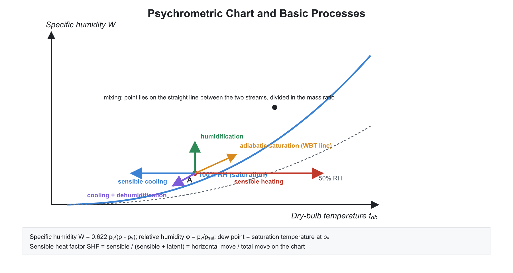
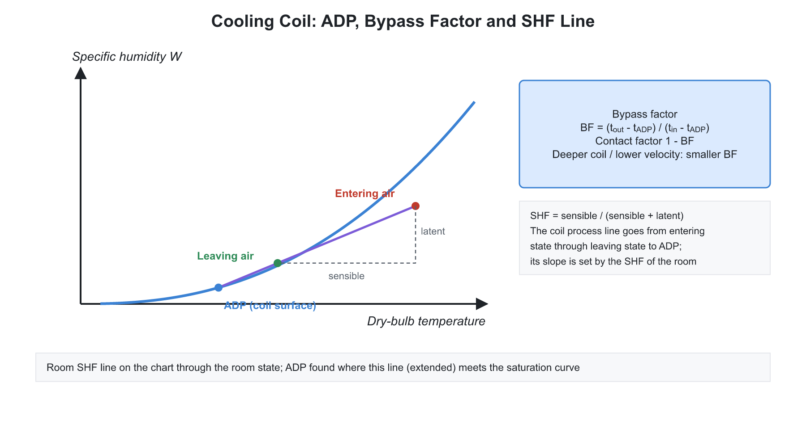

# 02. Psychrometry and Air Conditioning

**Exam relevance:** APPSC AEE: C | SSC JE: C | RRB JE: C | Category: ALL | Yield: VHY

---

## Part A: Detailed Theory (read this first)

Atmospheric air always contains some water vapour. Psychrometry is the study of this air-vapour mixture, and air conditioning is its practical use: controlling temperature, humidity, cleanliness and air motion in a space. Almost every question reduces to three ideas: (i) the mixture is treated as two ideal gases, (ii) a process on the psychrometric chart is an energy and mass balance, and (iii) the cooling coil is the main equipment.

### A1. Moist air as a mixture of ideal gases

- Moist air at ambient pressure and temperature is a mixture of **dry air** (a fixed composition: $78\%$ N$_2$, $21\%$ O$_2$ by volume) and **water vapour**. The vapour is at a very low partial pressure, far below saturation at room conditions, so it can be treated as an ideal gas.
- **Dalton's law.** Total pressure is the sum of partial pressures: $p = p_a + p_v$. Each component fills the whole volume at the mixture temperature and has its own gas constant: $R_a = 0.287$ and $R_v = 0.4615$ kJ/kg-K.
- **Why the 0.622?** The ratio of molar masses of water to dry air is $18/28.96 = 0.622$. From the ideal gas law, $\dfrac{m_v}{m_a} = \dfrac{p_vV/(R_vT)}{p_aV/(R_aT)} = \dfrac{R_a}{R_v}\cdot\dfrac{p_v}{p_a} = 0.622\,\dfrac{p_v}{p - p_v}$.
- **Basis of calculation.** All specific properties are expressed per kg of **dry air**, because the mass of dry air stays constant through heating, cooling, humidification and dehumidification, while the vapour mass changes.

### A2. Psychrometric properties: physical meaning

- **Dry bulb temperature (DBT).** What an ordinary thermometer reads. It measures the sensible state.
- **Wet bulb temperature (WBT).** A thermometer bulb covered with a wet wick, in a moving air stream. Water evaporates from the wick, taking latent heat from the bulb, until the heat gained from the air by convection equals the heat carried away by evaporation. The drier the air, the faster the evaporation, and the lower the WBT. So WBT is always below DBT unless the air is saturated. A **sling psychrometer** or aspirated psychrometer measures DBT and WBT, from which all other properties can be read from the chart.
- **Adiabatic saturation temperature.** The temperature to which air would cool if it passed over a long water surface in an insulated duct until it was saturated. For air-water mixtures it is almost identical to the WBT. This is why the WBT line and the constant enthalpy line are nearly parallel on the chart.
- **Dew point temperature (DPT).** The temperature at which vapour in the air starts to condense when cooled at constant pressure. It equals the saturation temperature corresponding to the partial pressure $p_v$. Cooling below DPT produces fog, dew or condensation on a cold surface. DPT is a direct measure of moisture content.
- **Specific humidity (humidity ratio) $\omega$.** Mass of vapour per kg of dry air. Does not change in sensible heating or cooling.
- **Relative humidity $\phi = p_v/p_{sat}$ at DBT.** How close the air is to saturation. Unlike $\omega$, RH changes when DBT changes. Heating air at constant $\omega$ lowers RH, cooling raises it.
- **Degree of saturation** $\mu = \omega/\omega_s$ at the same DBT. Close to $\phi$ but not identical.
- **Ordering.** For unsaturated air: DBT $>$ WBT $>$ DPT. For saturated air: all three are equal and $\phi = 100\%$.
- **Enthalpy of moist air** (per kg dry air) is the sum of dry air and the vapour: $h = 1.005t + \omega(2500 + 1.88t)$ kJ/kg. The term $2500$ is the latent heat of vaporisation at $0^\circ$C, so the vapour enthalpy is measured from liquid water at $0^\circ$C.

### A3. The psychrometric chart and how to read it


- The chart plots **specific humidity** (vertical axis, right) against **DBT** (horizontal axis), at a fixed pressure (normally $1.013$ bar). Any state needs two independent properties.
- **Lines on the chart.**
  - Vertical lines: constant DBT. Horizontal lines: constant $\omega$ and constant DPT.
  - Curved lines: constant RH; the top curve is $100\%$ (saturation).
  - Slanting lines: constant WBT (almost the same as constant enthalpy).
  - Steeper lines: constant specific volume.
  - A **protractor** on the chart has the sensible heat factor (SHF) and the room ratio lines.
- **Direction rules.** Heating moves a state horizontally to the right; cooling to the left; adding moisture moves up; removing moisture, down. Remember these and every process can be sketched without calculation.

### A4. Basic psychrometric processes: balances

For all processes, apply mass balance of dry air, mass balance of water, and energy balance.

- **Sensible heating or cooling.** DBT changes, $\omega$ stays constant: horizontal line. Heat load $Q = \dot m_a c_{pm}\Delta t$, with humid specific heat $c_{pm} = 1.005 + 1.88\omega$. Cooling to the DPT without condensation is the limit.
- **Cooling with dehumidification.** If the coil surface is below the DPT of the incoming air, the air close to the coil is cooled to saturation and moisture condenses. The exit air has a lower DBT and lower $\omega$. The total load is the enthalpy drop $\dot m_a(h_1 - h_2)$, minus the small enthalpy of the condensate.
- **Humidification.** Adding water spray or steam raises $\omega$. Steam injection moves the state nearly vertically upward (at almost constant DBT). Spraying water at the WBT is evaporative cooling.
- **Evaporative (adiabatic) cooling.** Air passes through a wet pad or spray. Latent heat of evaporation comes from the air itself, so DBT falls while $\omega$ rises and enthalpy stays nearly constant, along a constant-WBT line. The lowest temperature achievable is the WBT. It works best in hot dry climates (desert cooler) and is poor in humid ones.
- **Heating and humidification (winter air conditioning).** Air is first heated sensibly, then humidified; or humidified with steam.
- **Chemical dehumidification.** A desiccant (silica gel, activated alumina, lithium chloride) absorbs the moisture; the heat released raises the DBT, so DBT increases while $\omega$ falls, at nearly constant enthalpy.
- **Adiabatic mixing of two streams.** Mass balance for dry air and water, and energy balance, yield
$$\omega_m = \frac{\dot m_1\omega_1 + \dot m_2\omega_2}{\dot m_1 + \dot m_2},\qquad h_m = \frac{\dot m_1h_1 + \dot m_2h_2}{\dot m_1 + \dot m_2}$$
  The mixture state lies on the straight line joining the two states, dividing it inversely in the ratio of the dry air masses (a lever rule). DBT of the mixture is approximately the mass-weighted mean.

### A5. Cooling coil: ADP, bypass factor, sensible heat factor
```text
warm, moist air ---> [ cooling coil ] ---> cool, drier air
             |
             v
           condensate
```



- In a real cooling coil, not every particle of air touches the cold surface. A portion passes through without contact, the **bypass factor (BPF)**, and the rest is brought to the coil surface temperature, the **apparatus dew point (ADP)**. The exit state is the mixture of the two, so it lies on a straight line from the inlet state to the ADP on the saturation curve:
$$\text{BPF} = \frac{t_{out} - t_{ADP}}{t_{in} - t_{ADP}}, \qquad \text{contact factor} = 1 - \text{BPF}$$
- **Reducing BPF** (more contact): more rows of tubes, closer fin spacing, lower air velocity, larger face area. A lower BPF gives better dehumidification but a higher pressure drop and cost.
- **Sensible heat factor.** The ratio of sensible heat load to the total load, $\text{SHF} = \dfrac{Q_s}{Q_s + Q_L}$. A low SHF (many people, high humidity) means more latent load, so the coil must be colder and must dehumidify more. The SHF line on the chart (drawn through the room state) fixes the required supply air condition and the ADP.
  - **RSHF** applies to the room's own loads only.
  - **ESHF** (effective SHF) and **GSHF** (grand SHF) include the effect of the fresh air and bypassed air.
- **Load equations (practical).** For airflow $\dot V$ (m$^3$/s): sensible $Q_s \approx 1.23\dot V\Delta t$ kW; latent $Q_L \approx 3000\dot V\Delta\omega$ kW.

### A6. Human comfort

- Humans generate heat by metabolism ($\approx 100$ W at rest, more with activity) and must reject it to maintain a body temperature of about $37^\circ$C. Comfort is when this rejection happens without effort. The body loses heat by convection, radiation and evaporation (skin moisture and breath). Hot, humid air blocks evaporation, so humidity matters as much as temperature.
- **Factors:** air temperature, humidity, air velocity, mean radiant temperature of the surroundings, clothing, and activity level.
- **Effective temperature (ET)** is the index that combines DBT, humidity and air velocity into a single number: the temperature of still saturated air that would give the same feeling of warmth. The **comfort zone** for summer is about $22$ to $27^\circ$C DBT, $40$ to $60\%$ RH. Air velocity of $0.1$ to $0.25$ m/s is comfortable.
- **Indoor air quality.** Supply of fresh (ventilation) air to dilute CO$_2$ and odours (about $0.25$ to $0.5$ m$^3$/min per person), filtration, and avoiding draughts.

### A7. Cooling load estimation

- The cooling load is the rate at which heat must be removed from the space to hold the design conditions. Sources:
  - **External:** conduction through walls and roof (driven by the **sol-air temperature**, which includes the solar absorption on the outer surface), solar radiation through glass (often the largest part), infiltration and ventilation air (sensible plus latent).
  - **Internal:** occupants (sensible and latent), lights, motors, appliances.
- **Time lag and decrement factor.** Heat through massive walls reaches the inside several hours later and is reduced in magnitude, so the peak load is not at the peak outside temperature.
- **Sensible versus latent.** Sensible loads change DBT; latent loads add moisture (people, infiltration, cooking). The total load sets the plant capacity in TR.

### A8. Air conditioning systems and distribution

- **By operating season:** summer (cooling and dehumidification), winter (heating and humidification), year-round (both).
- **By equipment:**
  - **Window and split units** (direct expansion, for a single room).
  - **Central plant:** chilled water produced in a chiller circulates to **air handling units** (AHU: filter, cooling coil, heating coil, humidifier, fan) serving many zones.
  - **VAV** (variable air volume): supply temperature is constant, and the air quantity varies with load; saves fan energy.
  - **VRF/VRV:** one outdoor unit and many indoor units with variable-speed compressor and refrigerant flow.
  - By the medium that carries the load: all-air, all-water (fan-coil units), air-water, and direct refrigerant.
- **Air distribution.** Supply ducts, diffusers and grilles; return ducts. **Duct design methods:** equal friction (most common), velocity reduction, static regain (recovers the velocity pressure as static pressure after each branch). Total pressure = static pressure + velocity pressure. Equivalent diameter for a rectangular duct of sides $a$ and $b$: $D_e = 1.3\,\dfrac{(ab)^{0.625}}{(a+b)^{0.25}}$.
- **Fans.** Centrifugal types (forward-curved for low pressure and quiet service, backward-curved for high efficiency) and axial. **Fan laws** at constant diameter: flow $\propto N$, pressure $\propto N^2$, power $\propto N^3$. A small speed reduction gives a large power saving, which is why variable-speed drives are used.
- **Heat pump mode** in reversible units provides winter heating with a COP greater than one.

### A9. What examiners test from this chapter

| Topic | APPSC AEE | SSC JE | RRB JE |
|---|---|---|---|
| Definitions: DBT, WBT, DPT, RH, specific humidity, ordering | Direct | Very common | Very common |
| Psychrometric processes and their direction on the chart | Conceptual | Very common | Very common |
| Specific humidity numerical, sensible/latent load | Numerical | Common | Common |
| Bypass factor, ADP, SHF | Numerical | Common | Common |
| Comfort, effective temperature, AC systems, fan laws | Direct | Common | Common |

---

## Part B: Quick-reference notes, formulas, numericals and PYQs


## 🧭 1. Foundations

- **Psychrometry:** study of the properties of moist air (a mixture of dry air and water vapour). By **Dalton's law**, $p_{total} = p_a + p_v$.
- **Air conditioning:** control of temperature, humidity, cleanliness and distribution of air to meet the requirements of the conditioned space.

## 🧭 2. Psychrometric properties

| Property | Definition / formula |
|---|---|
| Dry bulb temperature (DBT) | Temperature read by an ordinary thermometer |
| Wet bulb temperature (WBT) | Temperature of a thermometer with a wetted wick in moving air; $\text{WBT} \le \text{DBT}$ |
| Dew point temperature (DPT) | Temperature at which vapour in the air starts condensing on cooling at constant pressure; it is the saturation temperature at $p_v$ |
| Wet bulb depression | $\text{DBT} - \text{WBT}$ |
| Specific humidity (humidity ratio) $\omega$ | $\dfrac{m_v}{m_a} = 0.622\,\dfrac{p_v}{p - p_v}$ kg per kg of dry air |
| Relative humidity $\phi$ | $\dfrac{p_v}{p_{sat}}$ at the DBT |
| Degree of saturation $\mu$ | $\dfrac{\omega}{\omega_s}$ at the same DBT |
| Specific volume | Volume per kg of dry air |
| Enthalpy of moist air | $h = 1.005\,t + \omega\,(2500 + 1.88\,t)$ kJ/kg of dry air, with $t$ in $^\circ$C |

- For saturated air: DBT $=$ WBT $=$ DPT, and $\phi = 100\%$.
- For unsaturated air: DBT $>$ WBT $>$ DPT.
- **Adiabatic saturation temperature** is the thermodynamic wet bulb temperature (approximately equal to WBT for the air-water system).
- **Sling psychrometer** measures WBT and DBT. 
- **Relative humidity and specific humidity relation:** $\omega = 0.622\,\dfrac{\phi\,p_{sat}}{p - \phi\,p_{sat}}$.
- **Humid specific heat:** $c_{pm} = 1.005 + 1.88\,\omega$ kJ/(kg K).

## 🧭 3. Psychrometric chart

- Axes: DBT (horizontal), specific humidity (vertical). The saturation curve is the $100\%$ RH line. WBT lines slope downward to the right; enthalpy lines are nearly parallel to WBT lines; constant specific volume lines are steeper. 
- Constant DPT lines are horizontal (constant $\omega$). Sensible heat factor (SHF) lines are drawn from a protractor on the chart.

## 🧭 4. Psychrometric processes

| Process | Change | Remarks |
|---|---|---|
| Sensible heating | DBT rises, $\omega$ constant | Horizontal line to the right; RH falls |
| Sensible cooling | DBT falls, $\omega$ constant | Horizontal line to the left; RH rises |
| Cooling and dehumidification | DBT and $\omega$ both fall | Coil surface temperature below DPT |
| Humidification | $\omega$ rises | Water spray or steam injection |
| Heating and humidification | DBT and $\omega$ rise | Winter air conditioning |
| Chemical dehumidification | $\omega$ falls, DBT rises | Silica gel, activated alumina |
| Adiabatic mixing | Mix of two streams | Mixture state lies on the straight line joining the states |
| Evaporative (adiabatic) cooling | DBT falls, $\omega$ rises, enthalpy constant | Moves along WBT line |

- **Sensible heat load:** $Q_s = \dot{m}_a\,c_{pm}\,\Delta t$. With volume flow $\dot{V}$ in m$^3$/s of air at about $1.2$ kg/m$^3$ and $c_{pm} \approx 1.022$ kJ/(kg K):

$$Q_s \approx 1.2\times 1.022\times \dot{V}\,\Delta t = 1.23\,\dot{V}\,\Delta t\ \text{kW}$$

- **Latent heat load:** $Q_L = \dot{m}_a\,\Delta\omega\,h_{fg} \approx 3000\,\dot{V}\,\Delta\omega\ \text{kW}$ (for $\dot{V}$ in m$^3$/s and $\Delta \omega$ in kg/kg).
- **Total load** $= Q_s + Q_L = \dot{m}_a\,\Delta h$.
- **Sensible Heat Factor:**

$$\text{SHF} = \frac{Q_s}{Q_s + Q_L}$$

- **Room Sensible Heat Factor (RSHF)** applies to the room load only; **Grand SHF (GSHF)** includes fresh air load on the coil.
- **Mixing of two streams:**

$$\omega_m = \frac{\dot{m}_1\omega_1 + \dot{m}_2\omega_2}{\dot{m}_1 + \dot{m}_2},\qquad h_m = \frac{\dot{m}_1h_1 + \dot{m}_2h_2}{\dot{m}_1 + \dot{m}_2}$$

  and DBT is mixed approximately by the mass-weighted average.
- **Bypass Factor (BPF)** of a cooling coil: fraction of air that does not contact the coil.

$$\text{BPF} = \frac{t_{out} - t_{ADP}}{t_{in} - t_{ADP}}$$

  - **Contact factor** (coil efficiency) $= 1 - \text{BPF}$.
  - **ADP (apparatus dew point)** is the effective coil surface temperature. The process line on the chart joins the inlet state to the ADP. BPF reduces when the coil has more rows, closer fin spacing, lower air velocity, or more surface area.
- **Cooling load with fresh air (ventilation):** air changes per hour (ACH) and CFM per person are used.

## 🧭 5. Human comfort

- Depends on **dry bulb temperature, humidity, air velocity, mean radiant temperature, activity level and clothing**.
- **Effective temperature (ET):** an index combining DBT, humidity and air velocity into a single number that gives the same sensation of warmth or cold as the actual conditions. The **comfort zone** in summer is around $22^\circ$C to $27^\circ$C DBT and $40\%$ to $60\%$ RH. Winter comfort is at lower temperatures.
- A human body at rest releases about $100$ W (sensible and latent combined); the share changes with activity.
- Air velocity of $0.1$ to $0.25$ m/s is comfortable. **Wind chill** matters for cold.

## 🧭 6. Cooling load estimation

- **Sources of heat gain:** conduction through walls, roof and glass; solar radiation through glass; infiltration and ventilation air; occupants; lights and appliances; process equipment.
- **Sol-air temperature** includes the effect of solar radiation on the outer surface.
- **Load components:** sensible (raises DBT), latent (adds moisture).

## 🧭 7. Air conditioning systems

| System | Description |
|---|---|
| Window / split unit | Individual room; direct expansion |
| Central plant | Chilled water through air handling units (AHU) |
| VAV (variable air volume) | Constant supply temperature, volume varies with load |
| VRF (variable refrigerant flow) | Multi-split systems with variable-speed compressors |
| All-air, all-water, air-water | By the medium carrying the cooling load |
| Unitary vs central | Factory-assembled packages vs field-built |

- **Winter air conditioning:** heating and humidification. **Summer air conditioning:** cooling and dehumidification. **Year-round:** combined.
- **Air distribution:** supply ducts, return ducts, diffusers, grilles; the **air handling unit** consists of a filter, cooling coil, heating coil, humidifier and fan.
- **Duct design methods:** equal friction, velocity reduction, static regain. **Duct pressure:** total pressure $=$ static $+$ velocity pressure. **Equivalent diameter** of a rectangular duct for equal friction and flow: $D_e = 1.3\,\dfrac{(ab)^{0.625}}{(a+b)^{0.25}}$.
- **Fans:** centrifugal (forward-curved, backward-curved, radial) and axial; **fan laws:** flow $\propto N$, pressure $\propto N^2$, power $\propto N^3$.
- **Noise and vibration control** are required in ducts.

## 🧭 8. Worked numericals

1. **Specific humidity.** $p = 1.013$ bar, $p_v = 0.02$ bar: 

$$\omega = 0.622\times\frac{0.02}{1.013 - 0.02} = 0.01253\ \text{kg/kg}$$

2. **Relative humidity.** $p_v = 0.02$ bar at $30^\circ$C where $p_{sat} = 0.04246$ bar: $\phi = \dfrac{0.02}{0.04246} = 47.1\%$.
3. **Sensible heat.** $\dot{V} = 2$ m$^3$/s heated from $15^\circ$C to $35^\circ$C: $Q_s = 1.23\times 2\times 20 = 49.2$ kW.
4. **SHF.** $Q_s = 30$ kW, $Q_L = 10$ kW: $\text{SHF} = \dfrac{30}{40} = 0.75$.
5. **BPF.** $t_{in} = 30$, $t_{out} = 20$, $t_{ADP} = 15$: $\text{BPF} = \dfrac{5}{15} = 0.333$, contact factor $= 0.667$.

## 🧭 9. Common mistakes

- Treating RH and specific humidity as the same; RH changes with temperature, but $\omega$ stays the same during sensible heating or cooling.
- Saying that WBT can exceed DBT.
- Stating that the DPT changes on sensible heating; it stays constant because $\omega$ is constant.
- Mixing up BPF and contact factor.
- Evaporative cooling: enthalpy stays nearly constant, but sensible heat is converted into latent heat.

## 🧭 10. Interconnections

- **Thermodynamics:** Dalton's law, ideal gas mixtures.
- **Refrigeration:** the cooling coil is the evaporator of a VCRS.
- **Heat transfer:** coil design, condensation.
- **Fluid mechanics:** duct flow and fans.

## 🧭 11. PYQs

| # | Question | Answer | Exam / Year | Verify |
|---|---|---|---|---|
| 1 | In sensible heating, the specific humidity | Remains constant | SSC JE 2017 | [ ] |
| 2 | Dew point temperature is the temperature at which | Water vapour begins to condense when cooled at constant pressure | RRB JE 2015 | [ ] |
| 3 | For saturated air | DBT $=$ WBT $=$ DPT | SSC JE 2018 | [ ] |
| 4 | Relative humidity formula | $\dfrac{p_v}{p_{sat}}$ | RRB JE 2014 | [ ] |
| 5 | Sensible heat factor | $\dfrac{Q_s}{Q_s + Q_L}$ | SSC JE 2016 | [ ] |
| 6 | Bypass factor of a coil | $\dfrac{t_{out} - t_{ADP}}{t_{in} - t_{ADP}}$ | APPSC AEE 2012 | [ ] |
| 7 | Evaporative cooling is a process at constant | Wet bulb temperature (enthalpy) | SSC JE 2019 | [ ] |
| 8 | Specific humidity of moist air | $0.622\,\dfrac{p_v}{p - p_v}$ | RRB JE 2019 | [ ] |
| 9 | Winter air conditioning needs | Heating and humidification | SSC JE 2015 | [ ] |
| 10 | Effective temperature depends on | DBT, humidity and air velocity | RRB JE 2016 | [ ] |
| 11 | Fan power varies with speed as | Cube | SSC JE 2020 | [ ] |
| 12 | Cooling and dehumidification requires coil temperature | Below the dew point of the entering air | RRB JE 2018 | [ ] |
| 13 | Comfort conditions in summer, approximately | $22^\circ$C to $27^\circ$C and $40\%$ to $60\%$ RH | APPSC AEE 2016 | [ ] |

## 🧭 12. Revision checklist

- [ ] Definitions: DBT, WBT, DPT, RH, specific humidity
- [ ] Psychrometric processes on the chart
- [ ] SHF, BPF, ADP and contact factor
- [ ] Comfort, effective temperature
- [ ] Fan laws and duct basics
