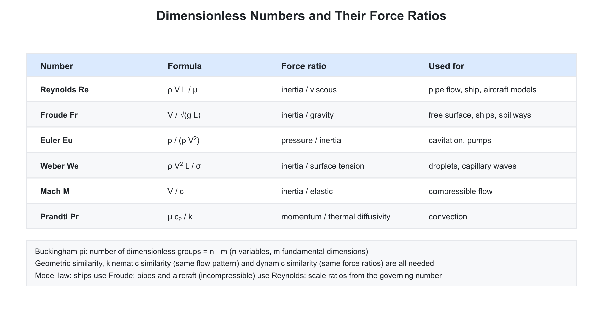
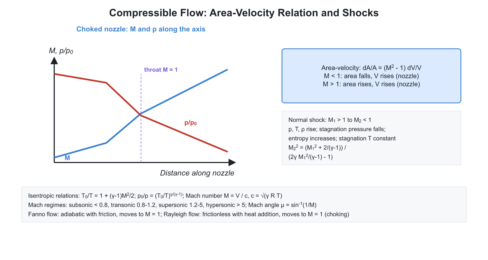

# 03. Dimensional Analysis, Similitude and Compressible Flow

**Exam relevance:** APPSC AEE: C | SSC JE: B | RRB JE: B | Category: ALL | Yield: HY

---

## Part A: Detailed Theory (read this first)

This chapter answers two practical questions. First, how can we test a small model and trust the result for a full-size machine (dimensional analysis and similitude)? Second, what changes when the fluid is compressible, so that density varies with speed (compressible flow)? Both rest on one idea: physical laws do not depend on the unit system, so they can be written in terms of dimensionless groups. Compressibility enters through a single group, the Mach number.

### A1. Dimensions and dimensional homogeneity

**Physical picture.** Any physical quantity is a number times a unit, and the unit is built from a small set of fundamental dimensions: mass $[M]$, length $[L]$, time $[T]$ and, when heat is involved, temperature $[\Theta]$. Force is a derived dimension in the MLT system, $[F] = MLT^{-2}$ (from $F = ma$).

**Principle of dimensional homogeneity.** In a physically correct equation every additive term has the same dimensions. This has two uses:

- It is a check on any derived formula. If the two sides differ in dimensions, the formula is wrong.
- It lets us derive relations between variables without solving the governing equations.

**Dimensions to memorise (derive them instead of memorising).**

| Quantity | Derivation | Dimensions |
|---|---|---|
| Velocity | length / time | $LT^{-1}$ |
| Acceleration | velocity / time | $LT^{-2}$ |
| Force | mass x acceleration | $MLT^{-2}$ |
| Pressure, stress | force / area | $ML^{-1}T^{-2}$ |
| Work, energy, torque | force x length | $ML^2T^{-2}$ |
| Power | energy / time | $ML^2T^{-3}$ |
| Dynamic viscosity | shear stress / velocity gradient | $ML^{-1}T^{-1}$ |
| Kinematic viscosity | $\mu/\rho$ | $L^2T^{-1}$ |
| Surface tension | force / length | $MT^{-2}$ |
| Density | mass / volume | $ML^{-3}$ |

Angles, strains, specific gravity and Reynolds number are dimensionless.

### A2. Rayleigh's method and Buckingham's pi theorem

**Rayleigh's method.** Assume the dependent variable is a product of the independent variables raised to unknown powers, $y = K\,x_1^a x_2^b x_3^c$. Equate the powers of $M$, $L$ and $T$ on both sides. This gives as many equations as fundamental dimensions. It works well when there are three or four variables; with more, there are more unknowns than equations and the powers cannot be fixed.

**Buckingham pi theorem.** If a physical phenomenon involves $n$ variables and $m$ fundamental dimensions, it can be expressed as a relation among $(n - m)$ independent dimensionless groups:

$$f(\pi_1, \pi_2, \ldots, \pi_{n-m}) = 0$$

**Procedure.**

- List all variables that affect the phenomenon, and count $n$ and $m$.
- Select $m$ repeating variables. Together they must contain all fundamental dimensions, must not form a dimensionless group among themselves, and must not include the dependent variable. A standard choice is one geometric variable ($D$ or $L$), one kinematic variable ($V$) and one dynamic variable ($\rho$ or $\mu$).
- Form each $\pi$ group by combining the repeating variables with one non-repeating variable, and find the exponents which make the group dimensionless.
- Express the final answer as $\pi_1 = \phi(\pi_2, \pi_3, \ldots)$. Any $\pi$ can be replaced by a product, a quotient or a power of the others, so the same result can be written in different but equivalent forms.

**Limit.** The method gives the form of the relation, not the numerical constant. The constant must come from experiment.

### A3. Dimensionless numbers: force ratios


Each dimensionless number is a ratio of two forces acting on a fluid element. Knowing which two forces gives the number's meaning and its use.

| Number | Expression | Forces compared | Where it governs |
|---|---|---|---|
| Reynolds | $\rho V L/\mu$ | inertia / viscous | pipe flow, boundary layer, submarines |
| Froude | $V/\sqrt{gL}$ | inertia / gravity | free-surface flow, ships, spillways |
| Euler | $\Delta p/\rho V^2$ | pressure / inertia | pressure-driven flow, cavitation |
| Mach | $V/c$ | inertia / elastic | compressible flow |
| Weber | $\rho V^2 L/\sigma$ | inertia / surface tension | droplets, capillary waves |
| Cauchy | $\rho V^2/K$ | inertia / elastic | equals $M^2$ for an ideal gas |
| Strouhal | $fL/V$ | unsteady / convective inertia | vortex shedding |
| Prandtl | $\mu c_p/k$ | momentum / thermal diffusivity | heat transfer |

The cavitation number is $\sigma_c = (p - p_v)/(\tfrac{1}{2}\rho V^2)$; cavitation starts when it falls below a critical value for the geometry.

**How to remember the origin.** Inertia force scales as $\rho V^2 L^2$. Divide by viscous force $\mu V L$ to get Reynolds; by gravity force $\rho g L^3$ to get Froude (squared); by surface tension force $\sigma L$ to get Weber; by elastic force $K L^2$ to get Cauchy.

### A4. Similitude and model testing
```text
+---------+    matching dimensionless groups    +-------------+
|  model  | ----------------------------------> | prototype   |
+---------+                                     +-------------+
```


**Why models.** Testing a dam, ship or aircraft at full size is costly or impossible. A scaled model is tested, and results are transferred to the prototype using similarity laws.

**Three kinds of similarity.**

- **Geometric:** all lengths have the same ratio $L_r = L_p/L_m$, and angles are equal. Roughness must also scale.
- **Kinematic:** velocities at corresponding points have the same ratio and the same direction, so streamline patterns are similar.
- **Dynamic:** forces at corresponding points have the same ratio. This is guaranteed when all relevant dimensionless numbers are equal for model and prototype.

Dynamic similarity includes the other two, but geometric similarity alone does not imply the others.

**Model laws.** In practice, only one dominant force can be matched. That determines the model law.

| Law | Matching condition | Typical use |
|---|---|---|
| Reynolds | $Re_m = Re_p$ | closed conduits, pipes, submarines, low-speed aircraft |
| Froude | $Fr_m = Fr_p$ | open channels, spillways, weirs, ship wave resistance |
| Euler | $Eu_m = Eu_p$ | cavitation, pressure systems |
| Weber | $We_m = We_p$ | capillary waves, very small heads over weirs |
| Mach | $Ma_m = Ma_p$ | high-speed compressible flows |

**Reynolds model scale ratios (same fluid in model and prototype).** From $V_r L_r = \nu_r = 1$:

$$V_r = \frac{1}{L_r}, \qquad F_r = 1$$

A small model therefore needs a high velocity, which is often impractical; wind tunnels are pressurised or use a denser gas to compensate.

**Froude model scale ratios.** From $V_r = \sqrt{L_r}$ (since $g$ is the same):

- Time ratio: $T_r = L_r/V_r = \sqrt{L_r}$
- Discharge ratio: $Q_r = V_r L_r^2 = L_r^{5/2}$
- Force ratio (same fluid): $F_r = \rho_r L_r^2 V_r^2 = L_r^3$
- Power ratio: $P_r = F_r V_r = L_r^{7/2}$

Exam tip: the discharge exponent is $5/2$ and the power exponent is $7/2$.

**Distorted models.** For rivers and harbours the horizontal extent is very large relative to the depth. A true-scale model would have a few millimetres of water, dominated by surface tension and with laminar flow. Therefore the vertical scale is exaggerated relative to the horizontal scale, which gives a distorted model.

**Scale effects.** When two or more forces matter (for example a ship, with both viscous and gravity forces), exact similarity is impossible. The dominant force is matched and the effect of the other is corrected by calculation or a separate test.

### A5. Compressible flow: the physical picture

**When compressibility matters.** In low-speed flow, pressure changes are small, so density is almost constant. At higher speeds the pressure changes are large enough to change density significantly. The key parameter is the Mach number:

$$M = \frac{V}{c}, \qquad c = \sqrt{\gamma R T}\quad\text{(ideal gas)}$$

The speed of sound is the speed at which a small pressure disturbance travels. It increases with temperature and does not depend on pressure for an ideal gas.

| Regime | Mach number | Remark |
|---|---|---|
| Incompressible | $M < 0.3$ | density change under 5 percent |
| Subsonic | $M < 1$ | disturbances travel upstream |
| Transonic | about 0.8 to 1.2 | mixed subsonic and supersonic zones |
| Sonic | $M = 1$ | |
| Supersonic | $M > 1$ | disturbances confined to a Mach cone |
| Hypersonic | $M > 5$ | strong heating, dissociation |

**Mach cone.** A source moving faster than sound outruns its own waves. They form a cone with half-angle $\mu$ given by $\sin\mu = 1/M$. A listener inside the cone ("zone of action") hears the source; outside ("zone of silence") does not.

### A6. Stagnation properties and isentropic relations

**Stagnation state.** The state the fluid would attain if brought to rest isentropically. For a perfect gas, applying the steady-flow energy equation $h + V^2/2 = h_0$ with $h = c_p T$ and $c_p = \gamma R/(\gamma - 1)$ gives:

$$\frac{T_0}{T} = 1 + \frac{\gamma - 1}{2}M^2$$

Isentropic relations $p \propto T^{\gamma/(\gamma - 1)}$ and $\rho \propto T^{1/(\gamma - 1)}$ then give:

$$\frac{p_0}{p} = \left(1 + \frac{\gamma - 1}{2}M^2\right)^{\frac{\gamma}{\gamma - 1}}, \qquad \frac{\rho_0}{\rho} = \left(1 + \frac{\gamma - 1}{2}M^2\right)^{\frac{1}{\gamma - 1}}$$

The stagnation temperature is constant for any adiabatic flow, with or without friction. The stagnation pressure is constant only for isentropic flow; any irreversibility (friction, shock) lowers it.

**Critical conditions at $M = 1$ (air, $\gamma = 1.4$).**

$$\frac{p^*}{p_0} = 0.528, \qquad \frac{T^*}{T_0} = 0.833, \qquad \frac{\rho^*}{\rho_0} = 0.634$$

**Pitot tube in compressible flow.** The Pitot reading is the stagnation pressure. Above $M = 0.3$, the incompressible formula $p_0 - p = \tfrac{1}{2}\rho V^2$ underestimates $V$ and the isentropic relation must be used. For $M > 1$, a normal shock forms ahead of the probe and the Rayleigh Pitot formula applies.

### A7. Area-velocity relation: nozzles and diffusers


Starting from continuity ($\rho A V$ constant) and Euler's equation, one derives:

$$\frac{dA}{A} = (M^2 - 1)\frac{dV}{V}$$

**Meaning.**

- Subsonic ($M < 1$): $dA$ and $dV$ have opposite signs. A converging duct accelerates the flow (nozzle), a diverging duct slows it (diffuser). This matches everyday intuition.
- Supersonic ($M > 1$): the signs are the same. A diverging duct accelerates the flow, a converging duct decelerates it. Intuition reverses because density falls faster than velocity rises.
- Sonic ($M = 1$): $dA = 0$, so sonic flow can occur only at the minimum area, the throat.

**Consequence.** To accelerate from subsonic to supersonic, use a converging-diverging (de Laval) nozzle with the sonic condition at the throat.

**Choking.** As back pressure is lowered the flow rate rises, until the throat reaches $M = 1$. Further reduction of back pressure does not change the mass flow, because information about downstream pressure cannot travel upstream through a sonic throat. The maximum mass flow is:

$$\dot{m}_{max} = A^*\,p_0\sqrt{\frac{\gamma}{R T_0}}\left(\frac{2}{\gamma + 1}\right)^{\frac{\gamma + 1}{2(\gamma - 1)}}$$

For a given stagnation state, $\dot{m}_{max}$ depends only on the throat area. This result also governs steam nozzles (see the steam chapter).

### A8. Normal shock waves

**What a shock is.** A very thin region (a few mean free paths thick) across which pressure, temperature, density and velocity change almost discontinuously. The process is adiabatic but irreversible.

**Conditions.**

- A normal shock exists only when upstream flow is supersonic ($M_1 > 1$). Downstream is subsonic ($M_2 < 1$).
- A shock with $M_1 < 1$ would imply a decrease in entropy, violating the second law, so it cannot exist.

**Property changes across a normal shock.**

| Property | Change |
|---|---|
| Static pressure | rises |
| Static temperature | rises |
| Density | rises |
| Velocity | falls |
| Mach number | falls to below 1 |
| Stagnation temperature | unchanged |
| Stagnation pressure | falls |
| Entropy | rises |

**Relations.**

$$M_2^2 = \frac{(\gamma - 1)M_1^2 + 2}{2\gamma M_1^2 - (\gamma - 1)}, \qquad \frac{p_2}{p_1} = 1 + \frac{2\gamma}{\gamma + 1}\left(M_1^2 - 1\right)$$

These come from conservation of mass, momentum and energy (the Rankine-Hugoniot relations). The shock strength increases with $M_1$.

**Oblique shocks and expansion.** When a supersonic flow meets a concave corner or a wedge, an oblique shock inclined at angle $\beta$ forms, and the downstream flow may stay supersonic. At a convex corner the flow expands through a Prandtl-Meyer expansion fan, with no entropy rise.

**Shocks in a nozzle.** If the back pressure is between the design value and the first critical value, a normal shock sits inside the diverging part. The flow after the shock is subsonic, so the diverging section now acts as a diffuser.

### A9. Fanno and Rayleigh flow

Real ducts have friction (Fanno) or heat transfer (Rayleigh). Both are one-dimensional flows in a constant-area duct.

| Feature | Fanno flow | Rayleigh flow |
|---|---|---|
| Effect | friction, adiabatic | heat addition, frictionless |
| Conserved | stagnation enthalpy | momentum (impulse function) |
| Maximum entropy point | $M = 1$ | $M = 1$ |
| Subsonic entry | $M$ rises toward 1 | $M$ rises with heating toward 1 |
| Supersonic entry | $M$ falls toward 1 | $M$ falls with heating toward 1 |

In both, the flow cannot cross $M = 1$ within the duct. Once the sonic point is reached at the exit, the flow is choked and a further increase in duct length (Fanno) or heat input (Rayleigh) reduces the mass flow. In Fanno flow, friction always drives the Mach number toward 1; in Rayleigh flow, heating drives it toward 1, and cooling moves it away from 1.

### A10. What examiners test from this chapter

| Topic | APPSC AEE | SSC JE | RRB JE |
|---|---|---|---|
| Dimensions of physical quantities | Direct | Very common | Common |
| Buckingham pi: number of groups | Direct | Common | Common |
| Meaning of Re, Fr, We, Ma, Eu | Direct | Very common | Common |
| Choice of model law for a given problem | Conceptual | Very common | Common |
| Froude scale ratios (Q, F, P) | Numerical | Common | Occasional |
| Speed of sound, Mach regimes | Direct | Common | Common |
| Stagnation relations, critical ratios | Numerical | Occasional | Occasional |
| Area-velocity relation, choking | Conceptual | Common | Occasional |
| Normal shock properties | Conceptual | Occasional | Occasional |
| Fanno and Rayleigh flow | Conceptual | Occasional | Rare |

---

## Part B: Quick-reference notes, formulas, numericals and PYQs


## 🧭 1. Dimensional analysis

- **Fundamental dimensions:** mass $[M]$, length $[L]$, time $[T]$, temperature $[\Theta]$.
- **Dimensional homogeneity:** every term of a physically correct equation has the same dimensions.

| Quantity | Dimensions |
|---|---|
| Velocity | $LT^{-1}$ |
| Acceleration | $LT^{-2}$ |
| Force | $MLT^{-2}$ |
| Pressure, stress | $ML^{-1}T^{-2}$ |
| Energy, work, torque | $ML^2T^{-2}$ |
| Power | $ML^2T^{-3}$ |
| Dynamic viscosity | $ML^{-1}T^{-1}$ |
| Kinematic viscosity | $L^2T^{-1}$ |
| Surface tension | $MT^{-2}$ |
| Density | $ML^{-3}$ |

- **Rayleigh's method:** express the dependent variable as a product of the independent variables raised to unknown powers; solve by comparing the powers of $M$, $L$, $T$. Suitable for up to four variables.
- **Buckingham $\pi$ theorem:** if a phenomenon involves $n$ variables and $m$ fundamental dimensions, it can be described by $(n - m)$ independent dimensionless $\pi$ groups. Choose $m$ **repeating variables** (which must include all dimensions between them, should not form a dimensionless group by themselves, and should not include the dependent variable); typical choice is $D$ (geometric), $V$ (kinematic), $\rho$ (dynamic).

## 🧭 2. Dimensionless numbers

| Number | Expression | Ratio of forces | Use |
|---|---|---|---|
| Reynolds | $\dfrac{\rho V L}{\mu}$ | Inertia / viscous | Pipe flow, boundary layer |
| Froude | $\dfrac{V}{\sqrt{gL}}$ | Inertia / gravity | Free-surface flows, ships, spillways |
| Euler | $\dfrac{\Delta p}{\rho V^2}$ | Pressure / inertia | Pressure-driven flow, cavitation |
| Mach | $\dfrac{V}{c}$ | Inertia / elastic | Compressible flow |
| Weber | $\dfrac{\rho V^2 L}{\sigma}$ | Inertia / surface tension | Capillary flows, droplets |
| Cauchy | $\dfrac{\rho V^2}{K}$ | Inertia / elastic | Compressible flow ($= \text{Ma}^2$) |
| Strouhal | $\dfrac{f L}{V}$ | Unsteady / convective | Vortex shedding |
| Prandtl | $\dfrac{\mu c_p}{k}$ | Momentum / thermal diffusivity | Heat transfer |

- **Cavitation number** $\sigma_c = \dfrac{p - p_v}{\tfrac12\rho V^2}$.

## 🧭 3. Similitude and model testing

- **Geometric similarity:** all linear dimensions are in a constant ratio $L_r = \dfrac{L_p}{L_m}$.
- **Kinematic similarity:** velocities at corresponding points are in a constant ratio.
- **Dynamic similarity:** forces at corresponding points are in a constant ratio; this means all relevant dimensionless numbers are the same for model and prototype.

### Model laws

| Law | Condition | Use |
|---|---|---|
| Reynolds model law | $\text{Re}_m = \text{Re}_p$ | Pipe flow, submarines, airplanes (low speed), closed conduits |
| Froude model law | $\text{Fr}_m = \text{Fr}_p$ | Open channels, spillways, ships (wave resistance), weirs |
| Euler model law | $\text{Eu}_m = \text{Eu}_p$ | Cavitation, pressure systems |
| Weber model law | $\text{We}_m = \text{We}_p$ | Capillary waves, small weir heads |
| Mach model law | $\text{Ma}_m = \text{Ma}_p$ | Compressible flows, high-speed aerodynamics |

- **Reynolds scale ratios** (same fluid): $V_r = \dfrac{1}{L_r}$ (since $V_r L_r = \nu_r = 1$); force ratio $F_r = 1$ for the same fluid.
- **Froude scale ratios:** velocity ratio $V_r = \sqrt{L_r}$; time ratio $T_r = \sqrt{L_r}$; discharge ratio $Q_r = L_r^{5/2}$; force ratio $F_r = L_r^3$ (for the same fluid); power ratio $P_r = L_r^{7/2}$.
- **Distorted models:** used for rivers and harbours, where the vertical scale is exaggerated relative to the horizontal scale to keep depth large enough.
- **Unit and specific quantities (turbines/pumps)** are derived from dimensional analysis; they are in the Fluid Machinery chapter.

## 🧭 4. Compressible flow

- **Mach number** $M = \dfrac{V}{c}$, with sonic speed $c = \sqrt{\gamma R T}$ (ideal gas). 

| Regime | Mach number |
|---|---|
| Subsonic | $M < 1$ (flow can be treated incompressible below about $0.3$) |
| Transonic | about $0.8$ to $1.2$ |
| Sonic | $M = 1$ |
| Supersonic | $M > 1$ |
| Hypersonic | $M > 5$ |

- **Stagnation (total) properties:** state reached when the flow is brought to rest isentropically.

$$\frac{T_0}{T} = 1 + \frac{\gamma - 1}{2}M^2,\qquad \frac{p_0}{p} = \left(1 + \frac{\gamma - 1}{2}M^2\right)^{\frac{\gamma}{\gamma - 1}},\qquad \frac{\rho_0}{\rho} = \left(1 + \frac{\gamma - 1}{2}M^2\right)^{\frac{1}{\gamma - 1}}$$

- **Critical conditions at $M = 1$** (for $\gamma = 1.4$): $\dfrac{p^*}{p_0} = 0.528$, $\dfrac{T^*}{T_0} = 0.833$, $\dfrac{\rho^*}{\rho_0} = 0.634$.
- **Area-Mach relation** (isentropic):

$$\frac{dA}{A} = (M^2 - 1)\frac{dV}{V}$$

  - A nozzle with a **throat** (converging-diverging) is required to accelerate flow from subsonic to supersonic. The throat is sonic only when the back pressure is low enough (choked flow), and the mass flow is then maximum and independent of back pressure.
  - **Maximum mass flow rate:** $\dot{m}_{max} = A^*\,p_0\sqrt{\dfrac{\gamma}{R T_0}}\left(\dfrac{2}{\gamma + 1}\right)^{\frac{\gamma+1}{2(\gamma-1)}}$.
- **Shock waves:** a thin region across which properties change abruptly and irreversibly.
  - **Normal shock:** perpendicular to the flow. Upstream flow is supersonic ($M_1 > 1$); downstream is subsonic ($M_2 < 1$). Across it: pressure, density and temperature **increase**, stagnation pressure **decreases**, entropy **increases**, stagnation temperature stays **constant** (adiabatic). The shock is impossible if $M_1 < 1$ (violates the second law).
  - $M_2^2 = \dfrac{(\gamma - 1)M_1^2 + 2}{2\gamma M_1^2 - (\gamma - 1)}$; $\dfrac{p_2}{p_1} = 1 + \dfrac{2\gamma}{\gamma + 1}(M_1^2 - 1)$.
  - **Oblique shock:** inclined to the flow, as in a wedge; flow downstream may stay supersonic. **Prandtl-Meyer expansion fan** appears on convex corners.
  - **Rankine-Hugoniot relations** govern the property changes across the shock.
- **Fanno flow:** adiabatic flow with friction in a constant-area duct. **Rayleigh flow:** frictionless flow with heat addition in a constant-area duct. Both drive the flow toward $M = 1$ (choking), whether starting from subsonic or supersonic.
- **Isentropic flow with variable area** applies to nozzles and diffusers (see steam nozzles).
- **Mach cone and Mach angle:** a source moving supersonically produces a cone with $\sin\mu = \dfrac1M$.

## 🧭 5. Worked numericals

1. **Rayleigh.** Force $F$ depends on $\rho, V, D$ (drag on a sphere). Dimensional analysis gives $F = K\rho V^2D^2$ (neglecting viscosity).
2. **Buckingham.** Pipe pressure drop depends on $D, V, \rho, \mu, L, \varepsilon$: $n = 7$, $m = 3$, so $4$ groups: $\dfrac{\Delta p}{\rho V^2}$, $\text{Re}$, $\dfrac{L}{D}$, $\dfrac{\varepsilon}{D}$.
3. **Froude model.** A $1:25$ spillway model discharges $0.2$ m$^3$/s. Prototype $Q = 0.2\times 25^{5/2} = 0.2\times3125 = 625$ m$^3$/s.
4. **Reynolds model.** A $1:10$ model in the same fluid: model velocity is $10\times$ the prototype velocity.
5. **Speed of sound in air at $300$ K:** $\sqrt{1.4\times287\times300} = 347$ m/s.
6. **Stagnation temperature.** $T = 250$ K, $M = 2$: $T_0 = 250(1 + 0.2\times4) = 450$ K.

## 🧭 6. Common mistakes

- Using the Reynolds law for free-surface flows (where gravity dominates, Froude's law is correct).
- Choosing a repeating variable set that contains the dependent variable.
- Forgetting that stagnation temperature is constant across a normal shock but stagnation pressure falls.
- Treating a flow at $M = 0.5$ as incompressible without a check (the limit is about $M = 0.3$).

## 🧭 7. Interconnections

- **Fluid machinery:** unit quantities and specific speed derive from dimensional analysis.
- **Thermodynamics:** isentropic relations, stagnation enthalpy.
- **Steam nozzles:** critical pressure ratio from compressible flow.

## 🧭 8. PYQs

| # | Question | Answer | Exam / Year | Verify |
|---|---|---|---|---|
| 1 | Reynolds number is the ratio of | Inertia force to viscous force | SSC JE 2017 | [ ] |
| 2 | Froude number is the ratio of | Inertia force to gravity force | RRB JE 2015 | [ ] |
| 3 | Model law for a ship's wave resistance | Froude's law | SSC JE 2018 | [ ] |
| 4 | Buckingham pi theorem number of groups | $n - m$ | RRB JE 2014 | [ ] |
| 5 | Mach number | $\dfrac{V}{c}$ | SSC JE 2016 | [ ] |
| 6 | Flow with Mach number above $1$ | Supersonic | APPSC AEE 2012 | [ ] |
| 7 | Speed of sound in an ideal gas | $\sqrt{\gamma R T}$ | SSC JE 2019 | [ ] |
| 8 | Across a normal shock, entropy | Increases | RRB JE 2019 | [ ] |
| 9 | Model law for pipe flow | Reynolds' law | SSC JE 2015 | [ ] |
| 10 | Weber number is related to | Surface tension | RRB JE 2016 | [ ] |
| 11 | Dimensions of dynamic viscosity | $ML^{-1}T^{-1}$ | SSC JE 2020 | [ ] |
| 12 | Euler number is the ratio of | Pressure force to inertia force | RRB JE 2018 | [ ] |
| 13 | Dimensions of power | $ML^2T^{-3}$ | SSC JE 2021 | [ ] |
| 14 | Flow downstream of a normal shock | Subsonic | APPSC AEE 2016 | [ ] |

## 🧭 9. Revision checklist

- [ ] Dimensions of common quantities
- [ ] Rayleigh and Buckingham methods
- [ ] Dimensionless numbers and what forces they compare
- [ ] Model laws and scale ratios
- [ ] Mach regimes, stagnation relations, shock properties
