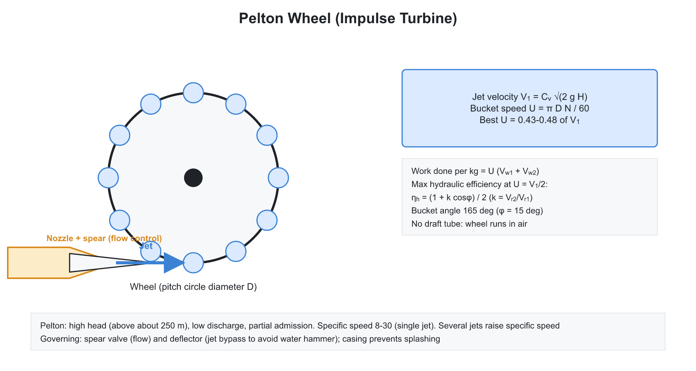
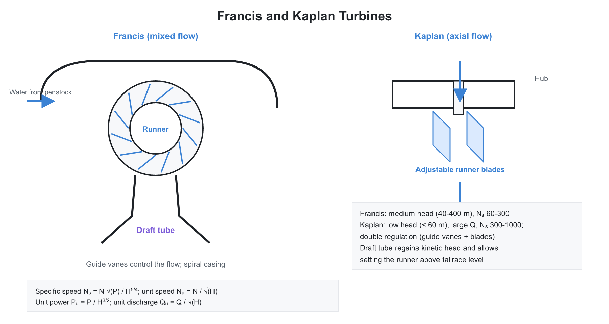
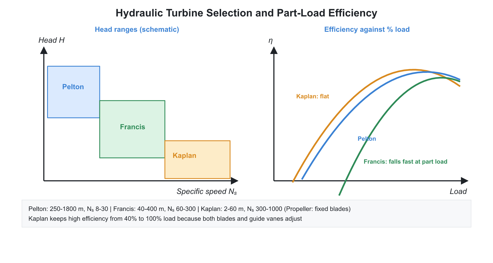

# 🌊 01. Impulse and Reaction Hydraulic Turbines

**Exam relevance:** APPSC AEE: C | SSC JE: C | RRB JE: C | Category: ALL | Yield: VHY

---

## Part A: Detailed Theory (read this first)

A hydraulic turbine is a machine that extracts energy from flowing water and delivers it as shaft work, usually to turn an alternator. Everything in this chapter follows from one principle: the angular momentum of the water changes as it passes through the runner, and the torque on the runner equals that change per second. The three main turbines (Pelton, Francis, Kaplan) differ in how the available head is converted: all of it to velocity in a nozzle (Pelton), or partly to velocity and partly kept as pressure inside the runner (Francis, Kaplan).

### A1. Energy available and head terms
```text
reservoir -> nozzle === water jet ===> (runner) -> tailrace
                                      turbine
```


**Source of energy.** Water stored at height has potential energy. Flowing down the penstock it gains speed and loses some energy to friction.

- **Gross head $H_g$:** difference of reservoir (head race) and tail race levels.
- **Net (effective) head $H$:** the head actually available to the turbine, $H = H_g - h_f$, where $h_f$ is the penstock friction loss (and minor losses). Power calculations always use $H$.
- Water power available: $P_w = \rho g Q H$.

**Classification.**

| Basis | Types |
|---|---|
| Action of water | Impulse (Pelton): only kinetic energy at the runner, at atmospheric pressure. Reaction (Francis, Kaplan, propeller): pressure and velocity both change in the runner |
| Head | High above 300 m (Pelton); medium 30 to 300 m (Francis); low below 30 m (Kaplan, propeller) |
| Flow direction | Tangential (Pelton), radial (old Francis), mixed (modern Francis), axial (Kaplan, propeller) |
| Specific speed | Low (Pelton), medium (Francis), high (Kaplan) |

**Why head decides the machine.** A high head with small discharge needs a small wheel running slowly relative to the jet speed, which suits an open jet on buckets. A low head with large discharge needs a large flow area and a high rotational speed, which suits an axial propeller. Medium conditions are best served by the mixed-flow Francis runner.

### A2. Euler's turbine equation

**Derivation idea.** Angular momentum per second entering the runner at radius $r_1$ is $\dot{m} V_{w1} r_1$; leaving at radius $r_2$ it is $\dot{m} V_{w2} r_2$. Torque equals the rate of change of angular momentum:

$$T = \dot{m}\left(V_{w1}r_1 - V_{w2}r_2\right)$$

Multiplying by angular velocity $\omega$ and using $U = \omega r$ gives the power:

$$P = \rho Q\left(V_{w1}U_1 - V_{w2}U_2\right)$$

Work per unit weight (head extracted by the runner):

$$H_E = \frac{1}{g}\left(V_{w1}U_1 - V_{w2}U_2\right)$$

**Terms.** $V_w$ is the whirl component of the absolute velocity (its component along the blade speed direction), $V_f$ is the flow component (perpendicular to blade speed), $U$ is the peripheral blade speed $= \pi D N/60$, and subscripts 1 and 2 denote inlet and outlet.

**Velocity triangles.** At each point, the absolute velocity $\vec{V}$ equals the vector sum of blade velocity $\vec{U}$ and relative velocity $\vec{V}_r$ (water relative to the blade). The water moves tangent to the blade in the relative frame, which fixes the direction of $V_r$. Drawing the triangles correctly is the key to every numerical problem.

**Best outlet condition.** If the water leaves with no whirl ($V_{w2} = 0$), the exit kinetic energy is the least for a given axial flow, and the work extracted is $V_{w1}U_1/g$ per unit weight. Francis and Kaplan are designed near this condition at full load.

### A3. Efficiencies

| Efficiency | Meaning |
|---|---|
| Hydraulic $\eta_h$ | runner power divided by water power; accounts for losses inside the runner and vanes |
| Mechanical $\eta_m$ | shaft power divided by runner power; bearing and windage friction |
| Volumetric $\eta_v$ | water through runner divided by water supplied; leakage past the runner |
| Overall $\eta_o$ | shaft power divided by $\rho g Q H$ |

$$\eta_o = \eta_h\,\eta_m\,\eta_v$$

### A4. Pelton wheel (impulse turbine)


**How it works.** The whole net head is converted to kinetic energy in a nozzle, forming a high-speed jet at atmospheric pressure. The jet strikes double-cup buckets on the rim of a wheel. A central splitter ridge divides the jet into two halves that are turned back through nearly $180^\circ$. Because the wheel runs in air at atmospheric pressure, no draft tube is needed, and the pressure is the same at inlet and outlet.

**Parts and their purpose.**

- **Penstock:** carries water from the reservoir to the nozzle.
- **Nozzle with spear (needle) valve:** the spear moves axially to regulate the jet diameter and hence discharge, without changing jet velocity.
- **Buckets with splitter:** turn the jet and divide it so that axial thrust balances out.
- **Deflector (jet deflector):** diverts the jet away from the buckets when load drops suddenly, so the nozzle can close slowly and avoid water hammer.
- **Brake nozzle:** a small jet directed at the back of the buckets to stop the wheel quickly.
- **Casing:** stops splashing and guides the water to the tailrace; it does not act as a pressure vessel.

**Jet velocity.** $V_1 = C_v\sqrt{2gH}$ with $C_v$ about 0.97 to 0.99.

**Velocity triangle and force.** Relative velocity at inlet: $V_{r1} = V_1 - U$. At outlet, bucket friction reduces it: $V_{r2} = k V_{r1}$. The bucket turns the jet through angle $\beta$ (typically $165^\circ$), so the outlet relative velocity makes $\phi = 180^\circ - \beta$ (typically $15^\circ$) with the direction opposite to the blade motion. The outlet whirl component is $V_{w2} = V_{r2}\cos\phi - U$ (taking inlet whirl direction as positive and outlet whirl in the opposite direction).

Force on the bucket series:

$$F = \rho a V_1\,(V_1 - U)\,(1 + k\cos\phi)$$

Power $P = FU$. Hydraulic efficiency:

$$\eta_h = \frac{2\,(V_1 - U)(1 + k\cos\phi)\,U}{V_1^2}$$

Differentiating with respect to $U$ gives the optimum at $U = V_1/2$:

$$\eta_{h,max} = \frac{1 + k\cos\phi}{2}$$

If the jet were turned back through $180^\circ$ with no friction ($\phi = 0$, $k = 1$), the efficiency would be 100 percent: all kinetic energy is extracted and the water leaves with zero absolute velocity. In practice $\phi$ is about $15^\circ$ so that the water clears the next bucket, giving about 98 percent.

**Why $U = V_1/2$ is optimal.** If the wheel runs too slowly, the water leaves with high absolute velocity (kinetic energy wasted). If the wheel runs too fast, the relative velocity falls and the jet cannot push the buckets. At exactly half the jet speed, the water leaves with zero absolute velocity.

**Design numbers.**

- Speed ratio $\phi_s = U/\sqrt{2gH}$ is about 0.43 to 0.48 (with friction, slightly below 0.5).
- Jet ratio $m = D/d$ is 6 to 35, typically about 12.
- Number of buckets $z = D/(2d) + 15$; bucket width about $5d$, depth about $1.2d$.
- Specific speed 10 to 35 for a single jet and up to about 60 for multiple jets. More jets mean higher specific speed; with $n$ jets, the specific speed rises as $\sqrt{n}$.

**Part-load behaviour.** Efficiency stays nearly constant over a wide load range, because the spear valve changes the discharge while jet velocity stays fixed.

### A5. Francis turbine (mixed flow reaction turbine)


**How it works.** Water enters a spiral (scroll) casing, which distributes it uniformly around the runner. It passes through fixed stay vanes (structural, resist the casing pressure load) and then through adjustable guide (wicket gate) vanes, which control flow and set the entry angle. It enters the runner radially inward, turns, and leaves axially into the draft tube. The runner is fully submerged and is full of water under pressure, so part of the head is converted in the runner itself.

**Velocity diagram.** At inlet, $V_{w1} = V_1\cos\alpha$ and $V_{f1} = V_1\sin\alpha$, where $\alpha$ is the guide vane angle. At outlet, the design usually has axial discharge with $V_{w2} = 0$.

For $V_{w2} = 0$:

$$\eta_h = \frac{V_{w1}U_1}{gH}$$

**Ratios.**

- Speed ratio $U_1/\sqrt{2gH}$ is about 0.6 to 0.9.
- Flow ratio $V_{f1}/\sqrt{2gH}$ is about 0.15 to 0.30.
- Discharge: $Q = \pi D_1 B_1 V_{f1} = \pi D_2 B_2 V_{f2}$, corrected for blade thickness.

**Degree of reaction.** The fraction of the total energy transfer taken from the pressure drop in the runner:

$$R = \frac{\text{pressure head change in the runner}}{\text{total head change in the runner}} = 1 - \frac{V_1^2 - V_2^2}{2gH_E}$$

$R = 0$ is a pure impulse machine (Pelton). Francis typically has $R$ between 0.4 and 0.6. Higher $R$ means more of the head drop occurs within the rotating blades, a more "reaction-type" machine.

**Draft tube.** A gradually expanding diffuser from the runner outlet to the tail race.

- It lets the runner be installed above tail water level for easy access, without losing that head.
- It converts the outlet kinetic energy into pressure, recovering head, so the runner outlet pressure is below atmospheric (suction), which increases the effective pressure drop across the runner.
- Types: conical, simple elbow, Moody spreading, elbow with varying cross-section. The cone angle is limited to about $8^\circ$ to $10^\circ$ since a wider angle causes flow separation.

Draft tube efficiency:

$$\eta_d = \frac{\dfrac{V_2^2 - V_3^2}{2g} - h_f}{\dfrac{V_2^2}{2g}}$$

A Pelton wheel needs no draft tube, because its runner operates in air.

### A6. Kaplan and propeller turbines (axial flow)

**Features.** Water flows axially through the runner after being guided by vanes. The inlet and outlet flow velocities are equal and the blade speed is the same ($V_{f1} = V_{f2}$, $U_1 = U_2$), because the radius does not change.

- **Propeller turbine:** fixed blades. Efficient only near the design load.
- **Kaplan turbine:** runner blades can rotate about their axis to change pitch with load, and guide vanes are also adjustable (double regulation). Efficiency remains high over a wide load range.
- Used at low heads (below 30 m, up to about 70 m) and large discharges. A large hub (boss) carries 3 to 8 blades.
- Discharge: $Q = \dfrac{\pi}{4}\left(D_o^2 - D_b^2\right)V_f$.
- Specific speed 300 to 1000.

**Related types.** Deriaz is a mixed-flow adjustable-blade turbine. Bulb is a horizontal axis machine with the generator enclosed in a watertight bulb, used at very low heads.

**Why blades twist.** Blade speed rises with radius, so blade angle must change from hub to tip to keep the inlet triangle matched to the flow. This is why axial blades are twisted.

### A7. Specific speed and unit quantities

**Unit quantities.** Values for a turbine of the same geometry working under 1 m head:

$$N_u = \frac{N}{\sqrt{H}}, \qquad Q_u = \frac{Q}{\sqrt{H}}, \qquad P_u = \frac{P}{H^{3/2}}$$

They follow from the dimensionless similarity laws $ND/\sqrt{H}$, $Q/(ND^3)$ and $P/(\rho N^3 D^5)$ being constant. They are used to predict the performance of the same turbine at a different head.

**Specific speed.** Speed of a geometrically similar turbine that produces 1 kW under 1 m head:

$$N_s = \frac{N\sqrt{P}}{H^{5/4}}$$

(N in rpm, P in kW, H in m.) It is a type number, not an actual speed. It depends only on shape, so it identifies the turbine suited to a given head, power and speed.

| Turbine | $N_s$ range |
|---|---|
| Pelton, single jet | 10 to 35 |
| Pelton, multi-jet | up to about 60 |
| Francis | 60 to 300 |
| Kaplan, propeller | 300 to 1000 |

Low $N_s$ means high head and low discharge; high $N_s$ means low head and high discharge.

### A8. Governing and surge protection

**Governing.** The turbine drives an alternator that must run at constant speed to hold frequency. When load falls, the speed rises. A governor senses the speed change and, through an oil-pressure servomotor, changes the discharge: spear valve and deflector in a Pelton wheel; guide vanes (plus runner blades in Kaplan) in reaction turbines.

**Water hammer protection.** Rapid closure of a long penstock produces a pressure surge. A Pelton avoids this by diverting the jet rather than closing the nozzle fast. For reaction turbines, a surge tank placed near the end of a long penstock absorbs the surge and supplies water during a load increase, and relief valves can open when the guide vanes close suddenly.

### A9. Cavitation in turbines

**Mechanism.** When the local absolute pressure falls to the vapour pressure of water at that temperature, vapour bubbles form. They are swept to higher-pressure regions and collapse violently, generating shock pressures that pit the metal surface. Effects: noise, vibration, pitting and loss of efficiency.

**Where it occurs.** In reaction turbines, at the runner outlet or draft tube inlet, where the pressure is lowest. In Pelton wheels, cavitation is not an issue in the runner (atmospheric pressure) but can arise from erosion at buckets and nozzle.

**Thoma's cavitation parameter.**

$$\sigma = \frac{H_{atm} - H_v - H_s}{H}$$

$H_s$ is the height of the runner outlet above tail water (suction head), $H_{atm}$ the atmospheric pressure head, $H_v$ the vapour pressure head and $H$ the net head. The turbine is safe against cavitation if $\sigma > \sigma_c$ (critical value, which rises with specific speed). A higher-specific-speed turbine therefore must be set lower (smaller $H_s$, even negative).

**Remedies.** Lower runner setting, polished surfaces, stainless steel runners, avoiding operation far from design load, and injecting air in the draft tube.

### A10. Comparison and selection


| Feature | Pelton | Francis | Kaplan |
|---|---|---|---|
| Type | impulse | reaction (mixed flow) | reaction (axial flow) |
| Head | high | medium | low |
| Discharge | low | medium | high |
| Specific speed | low | medium | high |
| Runner | open to atmosphere | submerged | submerged |
| Draft tube | no | yes | yes |
| Regulation | spear, deflector | guide vanes | guide vanes and runner blades |
| Part-load efficiency | nearly constant | falls | high (double regulation) |

### A11. What examiners test from this chapter

| Topic | APPSC AEE | SSC JE | RRB JE |
|---|---|---|---|
| Classification: impulse vs reaction | Direct | Very common | Very common |
| Turbine selection by head / specific speed | Direct | Very common | Very common |
| Pelton: $U = V_1/2$, efficiency, jet ratio | Numerical | Very common | Common |
| Francis: draft tube purpose, degree of reaction | Conceptual | Common | Common |
| Kaplan: adjustable blades, double regulation | Direct | Common | Common |
| Specific speed values and formula | Numerical | Very common | Common |
| Unit quantities | Numerical | Common | Occasional |
| Governing, deflector, spear valve | Direct | Common | Common |
| Cavitation and Thoma's number | Conceptual | Common | Occasional |
| Euler's equation numerical | Numerical | Common | Occasional |

---

## Part B: Quick-reference notes, formulas, numericals and PYQs


## 🧭 1. Foundations

- A **hydraulic turbine** converts the energy of flowing water (potential and kinetic) into mechanical energy at the shaft.
- **Gross head $H_g$:** difference between the headwater and tailwater levels. **Net (effective) head $H$:** gross head minus the head loss in the penstock, $H = H_g - h_f$.
- **Classification:**

| Basis | Types |
|---|---|
| Action of water | **Impulse** (Pelton): only kinetic energy at the runner, at atmospheric pressure. **Reaction** (Francis, Kaplan, propeller): both pressure and kinetic energy change in the runner |
| Head | High (above 300 m): Pelton. Medium (30 to 300 m): Francis. Low (below 30 m): Kaplan, propeller |
| Flow direction | Tangential (Pelton), radial (old Francis), mixed (modern Francis), axial (Kaplan, propeller) |
| Specific speed | Low (Pelton), medium (Francis), high (Kaplan) |

## 🧭 2. Euler's turbine equation

For a turbine the work done per unit weight of water (head extracted by the runner):

$$H_E = \frac{1}{g}\left(V_{w1}U_1 - V_{w2}U_2\right)$$

For the power:

$$P = \rho\,Q\left(V_{w1}U_1 - V_{w2}U_2\right)$$

- $V_{w}$ is the whirl component of the absolute velocity and $U$ the blade (peripheral) speed. Subscript 1 is the inlet, 2 the outlet.
- For a Pelton wheel, $U_1 = U_2 = U$; for radial machines, $U = \dfrac{\pi D N}{60}$ and $U_1 \ne U_2$.

## 🧭 3. Efficiencies

| Efficiency | Definition |
|---|---|
| Hydraulic | $\eta_h = \dfrac{\text{power delivered to runner}}{\text{power supplied by water}} = \dfrac{\text{runner power}}{\rho g Q H}$ |
| Mechanical | $\eta_m = \dfrac{\text{shaft power}}{\text{runner power}}$ |
| Volumetric | $\eta_v = \dfrac{\text{water through runner}}{\text{water supplied}}$ (leakage loss) |
| Overall | $\eta_o = \dfrac{\text{shaft power}}{\rho g Q H} = \eta_h\,\eta_m\,\eta_v$ |

## 🧭 4. Pelton wheel (impulse turbine)

- **Components:** penstock, **nozzle** with a spear (needle) valve to regulate the flow, **buckets** (double hemispherical cups with a splitter ridge in the middle), casing, and a **brake nozzle** (stops the wheel quickly).
- A single jet is used in small units; 2 to 6 jets in large ones. The jet strikes the bucket tangentially, and the entire head is converted to kinetic energy in the nozzle.
- **Jet velocity:** $V_1 = C_v\sqrt{2gH}$ with $C_v = 0.97$ to $0.99$.
- **Velocity ratio** $\phi = \dfrac{U}{\sqrt{2gH}} \approx 0.43$ to $0.48$. Peak efficiency theoretically at $U = \dfrac{V_1}{2}$.
- **Velocity diagram:** relative velocity at inlet $V_{r1} = V_1 - U$. At outlet, $V_{r2} = k\,V_{r1}$ ($k$ accounts for bucket friction). The bucket turns the jet through an angle $\beta$ (typically $165^\circ$), so the outgoing relative velocity makes an angle $\phi = 180^\circ - \beta$ (typically $15^\circ$) with the reversed direction of motion. The whirl velocity at outlet, measured opposite to the bucket motion, is $V_{w2} = V_{r2}\cos\phi - U$.
- **Force by the jet on buckets:**

$$F = \rho\,a\,V_1\,(V_1 - U)\,(1 + k\cos\phi)$$

where $\phi = 180^\circ - \beta$ is the angle of the outgoing jet with the direction of motion. 

- **Power of the runner:** $P = F\,U$. 
- **Hydraulic efficiency (with friction):**

$$\eta_h = \frac{2\,(V_1 - U)(1 + k\cos\phi)\,U}{V_1^2}$$

  - It is maximum when $U = \dfrac{V_1}{2}$, giving $\eta_{h,max} = \dfrac{1 + k\cos\phi}{2}$. With $k = 1$ and $\phi = 0$ (jet turned back through $180^\circ$), $\eta_{h,max} = 100\%$; in practice $\phi \approx 15^\circ$, giving about $98\%$.
- **Bucket size:** width $\approx 5d$, depth $\approx 1.2d$ ($d$ is the jet diameter). **Number of buckets** $z = \dfrac{D}{2d} + 15$. **Jet ratio** $m = \dfrac{D}{d}$ is $6$ to $35$ (typically $12$).
- **Specific speed** $N_s = 10$ to $35$ (one jet), up to $60$ for multiple jets.
- **Governing:** spear valve controls the flow; a **deflector** diverts the jet to avoid sudden closure and water hammer (the nozzle closes slowly, and the deflector moves quickly).
- **Pelton efficiency** is almost constant over a wide load range because of the nozzle-spear arrangement.

## 🧭 5. Francis turbine (mixed flow reaction turbine)

- **Components:** spiral (scroll) casing, **stay vanes**, **guide (wicket) vanes** (adjustable, regulate the flow and give the correct entry angle), **runner**, and **draft tube**.
- The runner is completely submerged and works under pressure; the pressure at the inlet is greater than at the outlet.
- Water enters radially (inward flow) and leaves axially.
- **Velocity diagram:** at inlet, $V_{w1} = V_1\cos\alpha$, $V_{f1} = V_1\sin\alpha$; with the blade angle $\theta$ and the exit angle $\phi$. At the outlet, the flow is usually axial, $V_{w2} = 0$ (for best efficiency).
- **Work done per kg** (for $V_{w2} = 0$): $w = V_{w1}\,U_1$.
- **Hydraulic efficiency (for radial discharge):**

$$\eta_h = \frac{V_{w1}U_1}{g\,H}$$

- **Flow ratio** $\psi = \dfrac{V_{f1}}{\sqrt{2gH}}$ = 0.15 to 0.30. **Speed ratio** $\phi = \dfrac{U_1}{\sqrt{2gH}}$ = 0.6 to 0.9.
- **Discharge:** $Q = \pi D_1 B_1 V_{f1}\,(1 - \text{blade thickness factor}) = \pi D_2 B_2 V_{f2}$.
- **Degree of reaction:**

$$R = \frac{\text{pressure (head) change in the runner}}{\text{total head change}} = 1 - \frac{V_1^2 - V_2^2}{2\,g\,H_E}$$

  - $R = 0$ for impulse, and typically $0.4$ to $0.6$ for Francis.
- **Specific speed** $N_s = 60$ to $300$ (medium).
- **Draft tube:** a gradually expanding diffuser connecting the runner outlet to the tailrace. Its purposes are to (i) allow the turbine to be set above the tailwater without losing head, (ii) convert the kinetic energy at the runner outlet into pressure energy (recovering head), and (iii) create suction (negative pressure) at the runner outlet which increases the effective head. **Types:** conical, simple elbow, moody spreading, elbow with varying cross-section. The cone angle is limited to about $8^\circ$ to $10^\circ$ to avoid flow separation. Efficiency of a draft tube:

$$\eta_d = \frac{\dfrac{V_2^2 - V_3^2}{2g} - h_f}{\dfrac{V_2^2}{2g}}$$

  - The draft tube is never required for a Pelton wheel; the wheel runs in air at atmospheric pressure.

## 🧭 6. Kaplan and propeller turbines (axial flow reaction)

- **Propeller turbine:** fixed blades. **Kaplan turbine:** runner blades are adjustable (pitch can change) with the load, and the guide vanes are also adjustable (double regulation); thus high efficiency across a wide load range.
- Used for low heads (below 30 m, up to about 70 m) and large discharges. The runner has 3 to 8 blades on a large-diameter **hub (boss)**.
- Water flows axially through the runner; the flow velocity is the same at inlet and outlet ($V_{f1} = V_{f2}$), and $U_1 = U_2 = U$.
- **Discharge:** $Q = \dfrac{\pi}{4}(D_o^2 - D_b^2)\,V_f$ ($D_o$ is the runner outer diameter and $D_b$ the hub diameter).
- **Specific speed** $N_s = 300$ to $1000$ (high).
- The **Deriaz** turbine is a mixed-flow adjustable-blade variant; the **bulb** turbine is for very low heads with a horizontal axis.

## 🧭 7. Specific speed and unit quantities

- **Unit quantities** (for a turbine working under 1 m head):

$$N_u = \frac{N}{\sqrt{H}},\qquad Q_u = \frac{Q}{\sqrt{H}},\qquad P_u = \frac{P}{H^{3/2}}$$

- **Specific speed** (speed of a geometrically similar turbine which produces 1 kW under 1 m head):

$$N_s = \frac{N\sqrt{P}}{H^{5/4}}$$

(with $P$ in kW, $N$ in rpm, $H$ in m).

| Turbine | $N_s$ range (approx.) |
|---|---|
| Pelton (single jet) | $10$ to $35$ |
| Pelton (multi-jet) | up to $60$ |
| Francis | $60$ to $300$ |
| Kaplan, propeller | $300$ to $1000$ |

- Specific speed identifies the **type** of turbine for given head, flow and speed; low $N_s$ means high head and low discharge. It is the basis for selecting a turbine.
- **Model laws for turbines:** for dynamic similarity, $\dfrac{N D}{\sqrt{H}} = $ const, $\dfrac{Q}{N D^3} = $ const, $\dfrac{P}{\rho N^3 D^5} = $ const; $\dfrac{gH}{N^2D^2} = $ const (head coefficient).

## 🧭 8. Governing of turbines

- Governing maintains a constant speed under a varying load (so that the alternator frequency stays constant). A **governor** senses speed changes and acts on the regulating device: spear valve and deflector for a Pelton wheel; guide vanes (and the runner blades in Kaplan) for reaction turbines. The oil-pressure **servo mechanism** (actuator) supplies the force. A relief valve or a surge tank avoids water hammer.
- **Surge tank:** a reservoir near the end of a long penstock that absorbs pressure surges and supplies water at the load change.

## 🧭 9. Cavitation in turbines

- Occurs when the local absolute pressure falls to the vapour pressure of water; bubbles then collapse on metal surfaces, causing pitting, noise, vibration and a drop in efficiency.
- In reaction turbines, it is most likely at the **runner outlet or the draft tube inlet** (lowest pressure).
- **Thoma's cavitation parameter:**

$$\sigma = \frac{H_{atm} - H_v - H_s}{H}$$

  where $H_s$ is the suction head (height of the runner outlet above the tailwater), $H_{atm}$ the atmospheric head and $H_v$ the vapour pressure head. The turbine is free from cavitation if $\sigma$ exceeds the critical value $\sigma_c$.
- **Preventive measures:** keep the setting of the runner low, polished surfaces, and use cavitation-resistant materials (stainless steel) for the runner; avoid operating at off-design loads.

## 🧭 10. Comparison table

| Feature | Pelton | Francis | Kaplan |
|---|---|---|---|
| Type | Impulse | Reaction (mixed flow) | Reaction (axial flow) |
| Head | High | Medium | Low |
| Discharge | Low | Medium | High |
| Specific speed | Low | Medium | High |
| Runner | Open to atmosphere | Submerged | Submerged |
| Draft tube | No | Yes | Yes |
| Regulation | Spear, deflector | Guide vanes | Guide vanes and runner blades |
| Efficiency at part load | Nearly constant | Falls | High (double regulation) |

## 🧭 11. Worked numericals

1. **Pelton.** $H = 400$ m, $C_v = 0.98$: $V_1 = 0.98\sqrt{2\times 9.81\times400} = 86.8$ m/s. Optimum $U = 43.4$ m/s.
2. **Hydraulic efficiency.** $k = 0.95$, $\phi = 15^\circ$: $\eta_{h,max} = \dfrac{1 + 0.95\times 0.966}{2} = 95.9\%$.
3. **Power.** $Q = 5$ m$^3$/s, $H = 100$ m, $\eta_o = 0.88$: $P = 1000\times 9.81\times 5\times 100\times0.88/1000 = 4316$ kW.
4. **Specific speed.** $N = 300$ rpm, $P = 10000$ kW, $H = 50$ m: $N_s = \dfrac{300\times 100}{50^{1.25}} = \dfrac{30000}{132.9} = 225.7$, a Francis turbine.
5. **Unit speed.** $N = 400$ rpm at $H = 25$ m: $N_u = 80$ rpm. At $H = 100$ m, the speed is $80\times 10 = 800$ rpm.
6. **Francis degree of reaction.** Runner inlet head change $= 36$ m, total $H_E = 60$ m: $R = 0.6$.

## 🧭 12. Common mistakes

- Taking the maximum efficiency condition $U = V_1/2$ as the practical value; it is about $0.45\sqrt{2gH}$ because of the nozzle velocity coefficient.
- Using the Pelton formula for a reaction turbine.
- Forgetting that a Pelton wheel has no draft tube and is not submerged.
- Using $P$ in watts in the specific speed formula (it must be kW).
- Forgetting that the degree of reaction is exactly $0$ for a Pelton wheel and lies between $0$ and $1$ (typically $0.4$ to $0.6$) for reaction turbines.

## 🧭 13. Interconnections

- **Power plants:** the hydroelectric plant uses these turbines.
- **Fluid mechanics:** momentum equation, Bernoulli, dimensional analysis for the unit quantities.
- **Pumps:** a pump is a reversed turbine (Francis type pump-turbines are used in pumped storage).

## 🧭 14. PYQs

| # | Question | Answer | Exam / Year | Verify |
|---|---|---|---|---|
| 1 | Pelton wheel is suited to | High head, low discharge | SSC JE 2017 | [ ] |
| 2 | Kaplan turbine is | Axial flow reaction turbine, adjustable blades | RRB JE 2015 | [ ] |
| 3 | Specific speed of a turbine | $\dfrac{N\sqrt{P}}{H^{5/4}}$ | SSC JE 2018 | [ ] |
| 4 | Draft tube is used in | Reaction turbines | RRB JE 2014 | [ ] |
| 5 | Optimum bucket speed in a Pelton wheel | About half the jet velocity | SSC JE 2016 | [ ] |
| 6 | Francis turbine is | Mixed flow reaction turbine | APPSC AEE 2012 | [ ] |
| 7 | Degree of reaction of a Pelton wheel | Zero | SSC JE 2019 | [ ] |
| 8 | Cavitation is most likely at | Runner outlet / draft tube inlet | RRB JE 2019 | [ ] |
| 9 | Spear valve in a Pelton wheel | Regulates the flow | SSC JE 2015 | [ ] |
| 10 | Highest specific speed turbine | Kaplan (propeller) | RRB JE 2016 | [ ] |
| 11 | Overall efficiency of a turbine | $\eta_h\times\eta_m\times\eta_v$ | SSC JE 2020 | [ ] |
| 12 | Thoma's number relates to | Cavitation | RRB JE 2018 | [ ] |
| 13 | Number of jets in a Pelton wheel of high specific speed | More than one | SSC JE 2021 | [ ] |
| 14 | Surge tank is used to | Absorb pressure surges / water hammer | APPSC AEE 2016 | [ ] |
| 15 | Which turbine has a runner with adjustable blades | Kaplan | RRB JE 2017 | [ ] |
| 16 | Function of the draft tube | Convert exit kinetic energy to pressure and allow setting above tailwater | SSC JE 2022 | [ ] |

## 🧭 15. Revision checklist

- [ ] Euler's turbine equation, efficiencies
- [ ] Pelton: velocity diagram, efficiency, optimum speed
- [ ] Francis: velocity diagram, reaction, draft tube
- [ ] Kaplan: axial flow features
- [ ] Specific speed ranges and unit quantities
- [ ] Cavitation and Thoma's number
