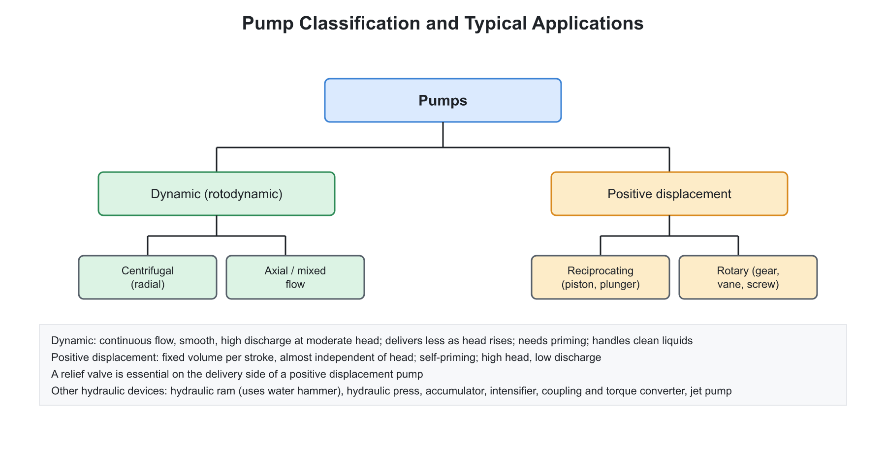
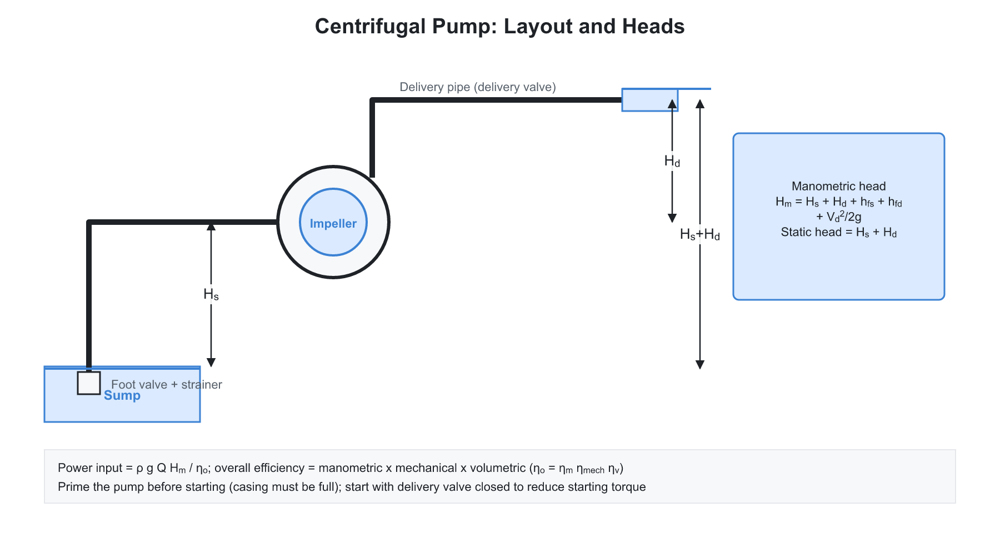
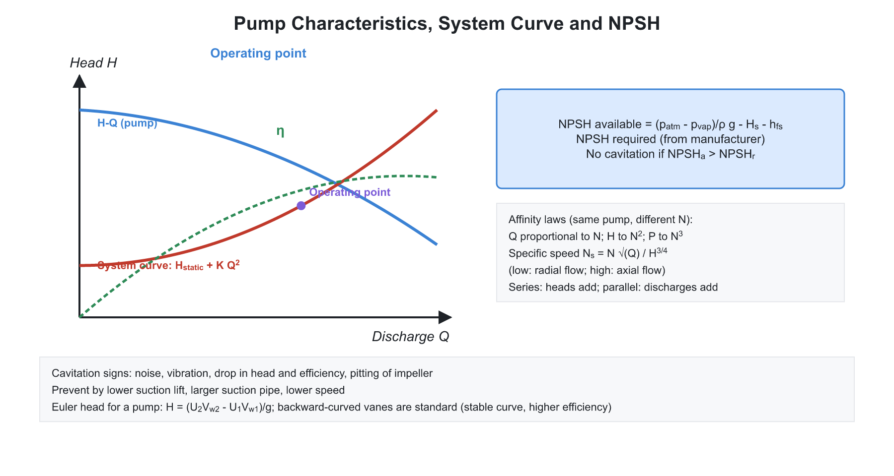
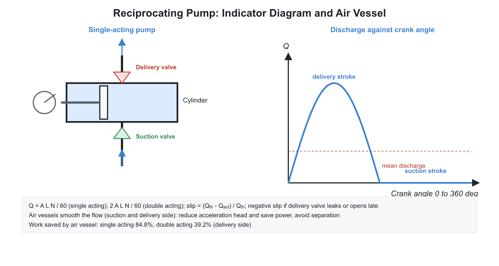

# 🌊 02. Pumps and Hydraulic Devices

**Exam relevance:** APPSC AEE: C | SSC JE: C | RRB JE: C | Category: ALL | Yield: VHY

---

## Part A: Detailed Theory (read this first)

A pump is the reverse of a turbine: it adds energy to a liquid so that the liquid can be lifted, pushed through a pipe network or pressurised. Two completely different principles are used. Rotodynamic pumps (centrifugal, mixed, axial) give the liquid kinetic energy with a spinning impeller and then convert it to pressure. Positive displacement pumps (reciprocating, gear, vane, screw) trap a fixed volume and push it out mechanically. The first is governed by Euler's equation and affinity laws; the second by swept-volume geometry. Both are limited at the suction side by cavitation.

### A1. Classification and when each type is used
```text
sump ---> suction pipe ---> [ PUMP ] ---> delivery pipe ---> tank
```



| Class | Types | Characteristic |
|---|---|---|
| Rotodynamic | Centrifugal (radial), mixed flow, axial flow | Smooth, continuous, large discharge, moderate head |
| Positive displacement | Reciprocating (piston, plunger, diaphragm); rotary (gear, vane, screw, lobe) | Pulsating or constant flow, small discharge, very high head, self-priming |

The choice follows from head and discharge: low head with very large flow suits axial pumps; moderate head and flow suits centrifugal pumps; very high head with small flow, or viscous liquids, suits positive displacement pumps.

### A2. Centrifugal pump: construction and working


**Working principle.** Liquid enters the impeller eye axially, is thrown outward by the rotating vanes and leaves the impeller at high velocity. The casing then converts the kinetic energy to pressure energy by diffusion, because its flow area increases along the path. Low pressure at the eye draws in more liquid from the sump, so the flow is continuous.

**Parts.**

- **Impeller:** rotating vanes. Closed (shrouded) impellers have the best efficiency for clean liquids. Open and semi-open impellers handle liquids with solids. Double-suction impellers balance axial thrust.
- **Casing:** volute (spiral, area increasing), vortex (a circular chamber between impeller and volute, reduces losses) or diffuser (guide vanes, high efficiency, multistage pumps).
- **Suction pipe** with foot valve and strainer; **delivery pipe** with delivery valve; shaft and bearings.

**Priming.** A centrifugal pump cannot lift liquid when the casing is full of air because the low density of air produces too little pressure drop to draw liquid up (air binding). The casing and suction pipe must be filled with liquid before starting. A foot valve prevents the water from draining back.

### A3. Heads in a pumping system

- **Suction head $h_s$:** vertical height of the pump centreline above the sump.
- **Delivery head $h_d$:** vertical height of the delivery outlet above the pump.
- **Static head:** $H_{st} = h_s + h_d$.
- **Manometric head $H_m$:** the total head the pump actually delivers, equal to static head plus all friction losses in suction and delivery pipes plus delivery velocity head:

$$H_m = H_{st} + h_{fs} + h_{fd} + \frac{V_d^2}{2g}$$

Equivalently, $H_m$ is the head imparted by the impeller less the losses inside the pump.

### A4. Euler's pump equation and vane shape

**Derivation.** As in a turbine, torque equals the rate of change of angular momentum. For a pump the liquid gains angular momentum:

$$H_{th} = \frac{1}{g}\left(U_2 V_{w2} - U_1 V_{w1}\right)$$

For radial entry ($V_{w1} = 0$, no pre-whirl):

$$H_{th} = \frac{U_2 V_{w2}}{g}, \qquad V_{w2} = U_2 - \frac{V_{f2}}{\tan\beta_2}$$

where $\beta_2$ is the vane outlet angle measured from the tangent, opposite to the direction of motion.

**Effect of vane outlet angle.**

| Outlet angle $\beta_2$ | Vane type | Behaviour |
|---|---|---|
| Less than $90^\circ$ | Backward-curved | Stable, highest efficiency, head falls with discharge; standard |
| $90^\circ$ | Radial | Moderate efficiency |
| Greater than $90^\circ$ | Forward-curved | Gives high absolute velocity but is unstable and inefficient because most of the energy is kinetic and hard to convert; not used in pumps |

**Slip.** The liquid in the passage between vanes does not follow the vane exactly: a relative eddy opposite to the impeller rotation (circulatory flow) reduces the actual whirl velocity. The slip factor is $\sigma = V_{w2}'/V_{w2}$, always less than 1.

**Minimum starting speed.** Liquid in the impeller acts as a forced vortex, producing a centrifugal head $(U_2^2 - U_1^2)/2g$. The pump begins to deliver when this equals the manometric head.

### A5. Efficiencies and power

| Efficiency | Definition |
|---|---|
| Manometric | $\eta_{man} = H_m/H_{th}$ |
| Mechanical | impeller power divided by shaft power |
| Volumetric | $Q/(Q + q_{leak})$ |
| Overall | $\rho g Q H_m$ divided by shaft power $= \eta_{man}\eta_m\eta_v$ |

Water (hydraulic) power $= \rho g Q H_m$. Shaft (brake) power $= \rho g Q H_m/\eta_o$.

### A6. Affinity laws, specific speed and characteristic curves


**Affinity laws for the same pump at different speeds** (geometry fixed): $Q \propto N$, $H \propto N^2$, $P \propto N^3$. These follow from velocity triangles scaling with $U$.

**For geometrically similar pumps** (diameter changes at fixed speed): $Q \propto D^3$, $H \propto D^2$, $P \propto D^5$. For a trimmed impeller of the same casing, an approximate rule is $Q \propto D$, $H \propto D^2$, $P \propto D^3$.

**Specific speed.** Speed of a geometrically similar pump delivering 1 m$^3$/s against 1 m head:

$$N_s = \frac{N\sqrt{Q}}{H_m^{3/4}}$$

| Pump | Approximate $N_s$ |
|---|---|
| Radial centrifugal | 10 to 70 |
| Mixed flow | 70 to 180 |
| Axial flow | 180 to 500 |

A higher $N_s$ means larger discharge, smaller head and an impeller that is more axial. For multistage pumps, $H$ in the formula is per stage.

**Series and parallel.** Pumps in series (multistage) add heads at the same discharge. Pumps in parallel add discharges at the same head.

**Characteristic curves.** The head-discharge curve of a backward-curved pump falls with discharge. The efficiency curve peaks at the best efficiency point (BEP). The operating point is where the pump curve meets the system curve $H_{st} + K Q^2$. A centrifugal pump has minimum power at zero discharge, so it is started with the delivery valve closed. An axial pump has maximum power at zero discharge, so it is started with the valve open.

### A7. NPSH and cavitation in pumps

**Mechanism.** Pressure is lowest at the impeller inlet. If it falls to the vapour pressure of the liquid, bubbles form and collapse downstream, giving noise, vibration, pitting and loss of head and efficiency.

**Net positive suction head available:**

$$NPSH_A = \frac{p_{atm}}{\rho g} - h_s - h_{fs} - \frac{p_v}{\rho g}$$

(when the pump is above the sump; $h_s$ becomes negative when the sump is above the pump). To avoid cavitation, $NPSH_A \ge NPSH_R$, where $NPSH_R$ is given by the manufacturer. Thoma's parameter for pumps is $\sigma = NPSH/H_m$.

**Practical limit.** Maximum suction lift is about 6 to 7 m of water at sea level, less for hot water (higher $p_v$) and at altitude (lower $p_{atm}$). Remedies: lower the pump, shorten and enlarge the suction pipe, reduce speed, use a double-suction impeller.

### A8. Reciprocating pump


**Working.** A piston moves in a cylinder. On the suction stroke the pressure falls, the suction valve opens and liquid enters. On the delivery stroke the delivery valve opens and liquid is pushed out. Valves are automatic and operate by pressure difference.

**Theoretical discharge.** For a single-acting pump, $Q_{th} = ALN/60$. For double-acting (both sides of the piston), $Q_{th} = 2ALN/60$, ignoring the rod area.

**Slip.** $Slip = Q_{th} - Q_{act}$; percentage slip $= (1 - C_d)\times 100$ with $C_d = Q_{act}/Q_{th}$. Slip is caused by leakage past valves and piston. Negative slip ($Q_{act} > Q_{th}$) can happen when the delivery valve opens late, the suction pipe is long and the speed is high.

**Acceleration head.** The piston motion is nearly simple harmonic. The liquid column in the pipe must be accelerated and decelerated, which needs a pressure head:

$$h_a = \frac{l}{g}\frac{A}{a}\omega^2 r\cos\theta$$

It is maximum at the start of a stroke. A short, wide pipe reduces it. If it is excessive on the suction side, the pressure can fall below vapour pressure and a gap forms in the liquid (separation), which collapses with a shock.

**Friction head** in the pipes varies as the square of velocity, so it is zero at the ends of the stroke and maximum at mid-stroke.

**Air vessels.** An air chamber on the suction and delivery sides absorbs the flow fluctuations. Benefits: smoother flow, lower acceleration head and friction losses, higher permissible speed without separation, and power saving. A delivery air vessel reduces the work against friction by up to about 39 percent for a single-acting and about 85 percent for a double-acting pump.

**Indicator diagram.** A plot of cylinder pressure against stroke length. The ideal diagram is a rectangle; real diagrams show acceleration and friction effects and the area gives the work per cycle.

### A9. Comparison: centrifugal versus reciprocating

| Feature | Centrifugal | Reciprocating |
|---|---|---|
| Flow | continuous, smooth | pulsating |
| Discharge | large | small |
| Head | low to moderate | high |
| Efficiency | falls at low flow | high over a range |
| Priming | required | self-priming |
| Viscous liquids | poor | good |
| Speed | high | low |
| Maintenance | easy | difficult |

Rotary positive-displacement pumps (gear, vane, screw, lobe) give a nearly constant flow at high pressure and are used for lubricating oil and hydraulic power systems.

### A10. Other hydraulic devices

**Hydraulic ram.** Uses the energy of a large quantity of water falling through a small drive head to lift a small quantity to a larger height, without external power. The sudden closure of the waste valve creates a water hammer pressure which forces some water through the delivery valve. Let $H_s$ be supply head, $H_d$ delivery head, $Q$ total flow from source and $q$ delivered flow.

- D'Aubuisson's efficiency: $\eta_A = \dfrac{qH_d}{QH_s}$
- Rankine's efficiency: $\eta_R = \dfrac{q(H_d - H_s)}{(Q - q)H_s}$

**Hydraulic accumulator.** Stores pressurised fluid and returns it at constant pressure during peak demand.

**Hydraulic intensifier.** A differential piston raises pressure; the pressure ratio equals the area ratio.

**Hydraulic press.** By Pascal's law the force multiplication is $A_2/A_1$.

**Fluid coupling and torque converter.** A fluid coupling has a pump impeller and a turbine runner in a common oil-filled casing; the input and output torques are equal, slip is 2 to 5 percent, and it cannot multiply torque. A torque converter adds a stationary stator (reactor) that redirects the fluid, so output torque can exceed input torque.

**Air lift and jet pumps** raise water from wells using compressed air or a driving jet. **Hydraulic circuits** consist of pump, relief valve, directional control valve, actuator and filter; **pneumatic** systems use compressed air with a filter-regulator-lubricator (FRL) unit.

### A11. What examiners test from this chapter

| Topic | APPSC AEE | SSC JE | RRB JE |
|---|---|---|---|
| Classification of pumps | Direct | Very common | Very common |
| Priming, air binding, foot valve | Direct | Very common | Very common |
| Manometric head and efficiencies | Numerical | Very common | Common |
| Vane shape and outlet angle | Conceptual | Common | Common |
| Affinity laws | Numerical | Very common | Common |
| Specific speed values | Direct | Common | Common |
| NPSH and cavitation | Conceptual | Common | Common |
| Reciprocating pump discharge and slip | Numerical | Very common | Common |
| Air vessel purpose and percentage saving | Direct | Common | Common |
| Hydraulic ram, accumulator, coupling | Direct | Common | Common |
| Starting pump with valve closed or open | Direct | Common | Common |

---

## Part B: Quick-reference notes, formulas, numericals and PYQs


## 🧭 1. Foundations

- A **pump** adds energy to a liquid, raising its pressure or head. A pump is the reverse of a turbine.
- **Classification:**

| Class | Types |
|---|---|
| **Rotodynamic (dynamic)** | Centrifugal (radial), mixed flow, axial flow (propeller) |
| **Positive displacement** | Reciprocating (piston, plunger, diaphragm), rotary (gear, vane, screw, lobe) |

- Centrifugal pumps give a smooth, continuous, high discharge at moderate head; reciprocating pumps give a high head at low discharge, with pulsating flow.

## 🧭 2. Centrifugal pump

- **Components:** **impeller** (rotating vanes), **casing** (volute, vortex or diffuser type), **suction pipe** with foot valve and strainer, **delivery pipe** with a delivery valve, and the shaft.
- **Working:** the impeller imparts a high velocity to the liquid, which is then converted into pressure in the casing by the diffuser action of the volute.
- **Priming:** filling the suction pipe and casing with liquid before starting, as a centrifugal pump cannot lift liquid when full of air (air-bound). A foot valve keeps the liquid in the suction line.
- **Casings:** **volute** (spiral, increasing area), **vortex** (a circular chamber between the impeller and volute), **diffuser (turbine)** with guide vanes (high efficiency, used in multistage pumps).
- **Impeller types:** closed (shrouded on both sides, best efficiency, for clean liquids), semi-open, open (for liquids with solids). **Single-suction** and **double-suction** (balances axial thrust).
- **Heads:**
  - **Suction head $h_s$:** vertical height of the pump centreline above the sump level.
  - **Delivery head $h_d$:** height of the delivery outlet above the pump centreline.
  - **Static head** $H_s = h_s + h_d$.
  - **Manometric head** $H_m$: the head against which the pump has to work, $H_m = H_s + h_{fs} + h_{fd} + \dfrac{V_d^2}{2g}$ (static head plus losses plus delivery velocity head). Also $H_m = \dfrac{\text{energy supplied by impeller per kg}}{g} - \text{losses inside the pump}$.
  - **Total head** $= H_m$ in effect.

### Euler's pump equation

$$H_{th} = \frac{1}{g}\left(U_2V_{w2} - U_1V_{w1}\right)$$

- For radial entry ($V_{w1} = 0$), $H_{th} = \dfrac{U_2V_{w2}}{g}$ with $V_{w2} = U_2 - \dfrac{V_{f2}}{\tan\beta_2}$, where $\beta_2$ is the vane angle at the outlet (relative to the tangent, opposite to the direction of motion).
- **Vane shapes:**

| Outlet angle $\beta_2$ | Vane | Remarks |
|---|---|---|
| Less than $90^\circ$ | Backward-curved | Stable, highest efficiency; standard |
| $90^\circ$ | Radial | Moderate |
| Greater than $90^\circ$ | Forward-curved | Unstable, low efficiency; not used in pumps |

### Efficiencies and power

| Efficiency | Definition |
|---|---|
| Manometric | $\eta_{man} = \dfrac{H_m}{H_{th}} = \dfrac{g\,H_m}{U_2V_{w2}}$ |
| Mechanical | $\eta_m = \dfrac{\text{impeller power}}{\text{shaft power}}$ |
| Volumetric | $\eta_v = \dfrac{Q}{Q + q_{leakage}}$ |
| Overall | $\eta_o = \dfrac{\rho g Q H_m}{\text{shaft power}} = \eta_{man}\,\eta_m\,\eta_v$ |

- **Power:** water (hydraulic) power $= \rho\,g\,Q\,H_m$; shaft (brake) power $= \dfrac{\rho g Q H_m}{\eta_o}$.
- **Slip:** the actual whirl velocity is less than the theoretical one because of the circulatory flow in the impeller passages. **Slip factor** $\sigma = \dfrac{V_{w2}'}{V_{w2}}$.
- **Minimum starting speed** of a centrifugal pump: the speed at which the centrifugal head just exceeds the manometric head, $\dfrac{U_2^2 - U_1^2}{2g} = H_m$.

### Pump laws and specific speed

- **Similarity (affinity) laws:** with the same pump (diameter fixed) at different speeds, $Q \propto N$, $H \propto N^2$, $P \propto N^3$. With the same speed and different impeller diameter, $Q \propto D^3$, $H \propto D^2$, $P \propto D^5$ (for geometrically similar pumps), or $Q\propto D$, $H \propto D^2$, $P\propto D^3$ for trimming an impeller.
- **Specific speed:** speed of a geometrically similar pump that delivers $1$ m$^3$/s against a head of $1$ m:

$$N_s = \frac{N\sqrt{Q}}{H_m^{3/4}}$$

| Pump type | $N_s$ (rpm, m$^3$/s, m) approx. |
|---|---|
| Centrifugal (radial) | $10$ to $70$ (low) |
| Mixed flow | $70$ to $180$ |
| Axial flow | $180$ to $500$ |

  - **Higher $N_s$** means a larger discharge and smaller head, and the impeller becomes more axial.
- **Multistage pumps:** pumps in series (impellers on one shaft) raise the head; for $n$ identical stages, head $= nH$ and discharge unchanged. Pumps in parallel increase the discharge; head is unchanged.
- **Characteristic curves:** head-discharge ($H$-$Q$), power-discharge and efficiency-discharge. The head falls with the discharge for a backward-curved vane. The efficiency curve peaks at the **best efficiency point (BEP)**. A centrifugal pump should be **started with the delivery valve closed** (the power is minimum at zero discharge), and a mixed or axial flow pump with the valve open.
- **Operating point:** the intersection of the pump characteristic and the system curve ($H_s + K Q^2$).

### NPSH and cavitation

- **Net Positive Suction Head (NPSH):** the head available at the pump suction above the vapour pressure head.

$$NPSH_{available} = \frac{p_{atm}}{\rho g} - h_s - h_{fs} - \frac{p_v}{\rho g}$$

- To avoid cavitation, $NPSH_A \ge NPSH_R$ (required, specified by the manufacturer).
- Cavitation in pumps occurs at the **inlet of the impeller**. Effects: noise, vibration, pitting, drop in head and efficiency.
- **Thoma's parameter** for pumps: $\sigma = \dfrac{NPSH}{H_m}$.
- **Maximum practical suction lift** is about $6$ to $7$ m of water at sea level.

## 🧭 3. Reciprocating pump

- **Components:** cylinder with piston or plunger, crank and connecting rod, suction and delivery valves, and suction and delivery pipes (with air vessels).
- **Types:** **single-acting** (one delivery per revolution), **double-acting** (two deliveries per revolution), **single-cylinder**, **double-cylinder**, **triple (three-throw)**.
- **Discharge:**
  - Single-acting: $Q_{th} = \dfrac{A\,L\,N}{60}$.
  - Double-acting: $Q_{th} = \dfrac{2\,A\,L\,N}{60}$ (ignoring the piston rod area).
  - **Slip** $= Q_{th} - Q_{act}$; **percentage slip** $= \left(1 - C_d\right)\times100$ where $C_d = \dfrac{Q_{act}}{Q_{th}}$. **Negative slip** occurs when $Q_{act} > Q_{th}$ (delivery valve opens late, suction pipe is long and the speed is high).
- **Power:** $P = \rho\,g\,Q\,(H_s + h_{fs}+h_{fd})/\eta$.
- **Work done against friction in pipes** during the stroke: the friction head is maximum at the middle of the stroke (as the piston velocity varies sinusoidally); the acceleration head is maximum at the beginning and end.
- **Acceleration head** in the suction pipe: $h_{as} = \dfrac{l_s}{g}\cdot\dfrac{A}{a_s}\,\omega^2 r\cos\theta$, maximum at the start of the stroke ($\theta=0$) where it is $\dfrac{l_s}{g}\dfrac{A}{a_s}\omega^2 r$. A short, large-diameter pipe reduces it. 
- **Air vessels:** fitted on the suction and delivery sides, they (i) smooth the flow, (ii) reduce the acceleration head and friction losses, (iii) permit a higher running speed without separation, and (iv) save power. Air vessel on the delivery side reduces work done against friction by up to about $39\%$ (single-acting) and $84.8\%$ (double-acting) in the delivery pipe.
- **Indicator diagram:** plot of pressure in the cylinder against the stroke. The ideal diagram is a rectangle; the actual one shows deviations due to the acceleration effects and friction. Cavitation (separation) can occur when the pressure falls below the vapour pressure at the end of the suction stroke.
- **Centrifugal versus reciprocating pump:**

| Feature | Centrifugal | Reciprocating |
|---|---|---|
| Flow | Continuous, smooth | Pulsating |
| Discharge | Large | Small |
| Head | Low to moderate | High |
| Efficiency | Lower at low flow | Higher |
| Priming | Required | Self-priming |
| Viscous liquids | Poor | Good |
| Maintenance | Easy | Difficult |
| Speed | High | Low |

## 🧭 4. Rotary pumps

- Gear, vane, screw and lobe pumps are positive displacement pumps that give a constant flow with a high pressure and are used for lubricating oils and hydraulic power systems.

## 🧭 5. Other hydraulic devices

- **Hydraulic ram:** it uses the energy of a large quantity of water falling through a small height (the "drive" head) to raise a small quantity of water to a greater height, with no external power; the water hammer effect operates the delivery valve.
  - Let $H_s$ be the supply (drive) head, $H_d$ the delivery head, $Q$ the total water drawn from the source and $q$ the water delivered, so that $Q - q$ is wasted at the waste valve.
  - **D'Aubuisson's efficiency:** $\eta_A = \dfrac{q\,H_d}{Q\,H_s}$.
  - **Rankine's efficiency:** $\eta_R = \dfrac{q\,(H_d - H_s)}{(Q - q)\,H_s}$.
- **Hydraulic accumulator:** stores energy in the form of pressurised fluid and delivers it at a constant pressure during peak demand. Energy stored $= p\,V$ with the load $W = p\,A$.
- **Hydraulic intensifier:** raises the pressure of a liquid using a differential piston; pressure ratio equals the area ratio.
- **Hydraulic press:** based on Pascal's law, the force multiplication $= \dfrac{A_2}{A_1}$.
- **Hydraulic lift and crane**, **hydraulic coupling and torque converter:**
  - **Fluid coupling** has an impeller (pump) and a runner (turbine) in a common casing filled with oil; it transmits torque without a mechanical connection. Input and output torques are equal; the slip is $2\%$ to $5\%$; it cannot multiply torque.
  - **Torque converter** has an additional stationary **stator (reactor)** that redirects the fluid and multiplies torque.
- **Air lift pump**, **jet pump** and **submersible pumps** are used in wells.
- **Hydraulic circuits (oil hydraulics):** pump, relief valve, directional control valve, actuator (cylinder or motor), and filter. **Pneumatic systems** use compressed air with an FRL unit (filter, regulator, lubricator).

## 🧭 6. Worked numericals

1. **Euler head.** $U_2 = 20$ m/s, $V_{f2} = 3$ m/s, $\beta_2 = 30^\circ$: $V_{w2} = 20 - \dfrac{3}{\tan30^\circ} = 14.8$ m/s; $H_{th} = \dfrac{20\times14.8}{9.81} = 30.2$ m.
2. **Power.** $Q = 0.05$ m$^3$/s, $H_m = 30$ m, $\eta_o = 0.7$: $P = \dfrac{1000\times9.81\times0.05\times30}{0.7\times1000} = 21$ kW.
3. **Affinity.** A pump gives $H = 20$ m at $1000$ rpm. At $1500$ rpm, $H = 20\times 2.25 = 45$ m; power rises by $3.375$.
4. **Specific speed.** $N = 1450$ rpm, $Q = 0.05$ m$^3$/s, $H_m = 25$ m: $N_s = \dfrac{1450\times0.2236}{25^{0.75}} = \dfrac{324.2}{11.18} = 29$, a radial centrifugal pump.
5. **NPSH.** $p_{atm} = 10.3$ m, $h_s = 3$ m, $h_{fs} = 0.5$ m, $p_v = 0.3$ m: $NPSH_A = 10.3 - 3 - 0.5 - 0.3 = 6.5$ m.
6. **Reciprocating.** $D = 0.15$ m, $L = 0.3$ m, $N = 60$ rpm, single-acting: $Q_{th} = \dfrac{0.01767\times0.3\times60}{60} = 0.0053$ m$^3$/s. 

## 🧭 7. Common mistakes

- Starting a radial centrifugal pump with the delivery valve open; its power is minimum at zero discharge, so it is started with the valve closed. Axial flow pumps are the exception: their power rises as the discharge drops, so they are started with the valve open.
- Mixing up manometric head and static head.
- Using the turbine specific speed formula (with power) for a pump (which uses discharge).
- Forgetting that percentage slip is based on theoretical discharge, not actual.
- Believing that a fluid coupling multiplies torque; only a torque converter does.

## 🧭 8. Interconnections

- **Turbines:** Euler's equation, cavitation and specific speed are parallel concepts.
- **Fluid mechanics:** Bernoulli's equation, pipe friction and NPSH.
- **Refrigeration and compressors:** pumps handle the liquid refrigerant and water circuits.

## 🧭 9. PYQs

| # | Question | Answer | Exam / Year | Verify |
|---|---|---|---|---|
| 1 | Priming of a centrifugal pump is done to | Remove air from the suction pipe and casing | SSC JE 2017 | [ ] |
| 2 | Specific speed of a pump | $\dfrac{N\sqrt{Q}}{H^{3/4}}$ | RRB JE 2015 | [ ] |
| 3 | A centrifugal pump should be started with the delivery valve | Closed | SSC JE 2018 | [ ] |
| 4 | Vane shape for a centrifugal pump | Backward-curved | RRB JE 2014 | [ ] |
| 5 | NPSH is needed to prevent | Cavitation | SSC JE 2016 | [ ] |
| 6 | Pump laws: power varies with speed as | Cube | APPSC AEE 2012 | [ ] |
| 7 | Function of an air vessel in a reciprocating pump | Smooth the flow and reduce friction and acceleration head | SSC JE 2019 | [ ] |
| 8 | Reciprocating pump is best for | High head and low discharge | RRB JE 2019 | [ ] |
| 9 | Negative slip in a reciprocating pump occurs when | Actual discharge exceeds theoretical discharge | SSC JE 2015 | [ ] |
| 10 | Fluid coupling transmits | Torque without multiplication | RRB JE 2016 | [ ] |
| 11 | Hydraulic ram works on | Water hammer | SSC JE 2020 | [ ] |
| 12 | Hydraulic accumulator stores | Energy under pressure | RRB JE 2018 | [ ] |
| 13 | Pumps in series | Add the heads | SSC JE 2021 | [ ] |
| 14 | Cavitation in a centrifugal pump occurs at | Impeller inlet | APPSC AEE 2016 | [ ] |
| 15 | Hydraulic intensifier | Increases the pressure of a liquid | RRB JE 2017 | [ ] |

## 🧭 10. Revision checklist

- [ ] Heads: static, manometric; Euler's pump equation; vane shapes
- [ ] Efficiencies and power, specific speed
- [ ] Affinity laws and pump characteristics
- [ ] NPSH and cavitation
- [ ] Reciprocating pump: slip, air vessel, acceleration head
- [ ] Hydraulic ram, accumulator, intensifier, coupling, torque converter
