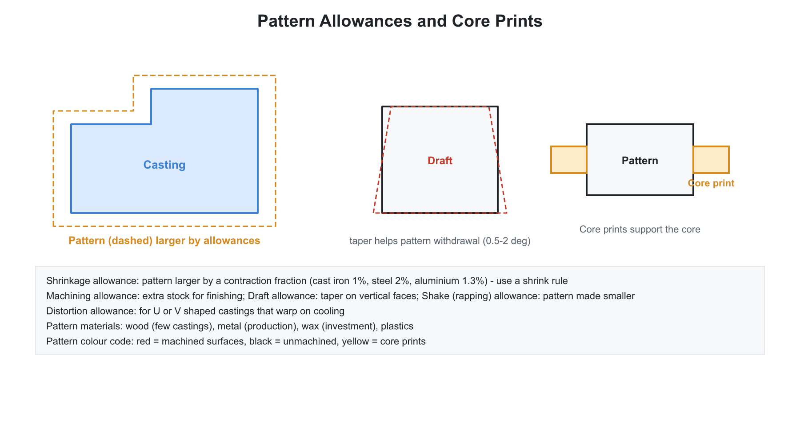
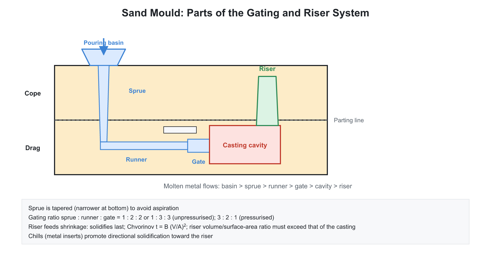

# 01. Casting and Foundry

**Exam relevance:** APPSC AEE: C | SSC JE: C | RRB JE: C | Category: ALL | Yield: VHY

---

## Part A: Detailed Theory (read this first)

Casting is the oldest shaping process: molten metal is poured into a cavity, solidifies and takes the shape of the cavity. Everything in a foundry follows from three physical facts. Metal shrinks as it cools, so extra metal must be supplied. Metal solidifies from the mould wall inward, so the order of freezing can be controlled. Hot metal carries gases and slag, so the mould must let gas escape and the gating must avoid turbulence. Pattern allowances, risers, gating design, sand properties and defects are all consequences of these three facts.

### A1. Where casting fits among manufacturing processes
```text
       pouring basin
            |
          sprue
            |
runner ----+---- gate ---> [ mould cavity ] ---> riser
```


| Group | Examples |
|---|---|
| Primary shaping | casting, powder metallurgy, moulding |
| Secondary (forming) | forging, rolling, extrusion, drawing, sheet-metal work |
| Material removal | turning, milling, drilling, grinding, EDM |
| Joining | welding, brazing, soldering, riveting, adhesives |
| Surface finishing | polishing, honing, lapping, electroplating |
| Heat treatment | annealing, hardening, tempering |

**Advantages of casting.** Complex shapes (internal cavities through cores), very large or very small parts, almost any metal, low tooling cost for a single piece, and near-net-shape production. **Limitations.** Poorer surface finish and dimensional accuracy than machining, porosity and shrinkage defects, and lower strength than a forged part of the same material because of the coarse as-cast grain structure.

### A2. The steps of sand casting

- Make a pattern (a replica of the part with allowances).
- Prepare moulding sand and make the mould in two halves, cope (top) and drag (bottom), around the pattern.
- Remove the pattern, place cores for internal cavities and close the mould.
- Melt the metal and pour it through the gating system.
- Allow solidification and cooling, break the mould (shake-out), cut off gates and risers (fettling), clean and inspect.

### A3. Patterns and allowances


A pattern is not the exact shape of the final part. It is modified by allowances to account for what happens during casting and machining.

| Allowance | Reason | Effect on pattern |
|---|---|---|
| Shrinkage | metal contracts as it cools from solidification to room temperature | pattern made larger; roughly cast iron 10 mm/m, steel 20 mm/m, aluminium 15 mm/m |
| Machining (finish) | extra metal is removed by machining | pattern made larger |
| Draft (taper) | pattern must be withdrawn without damaging the sand | taper of 0.5 to 2 degrees on vertical faces |
| Shake (rapping) | the pattern is rapped to loosen it, enlarging the cavity | pattern made slightly smaller |
| Distortion | U and V shaped castings distort on cooling | pattern is pre-deformed in the opposite direction |

**Memory aid.** Shrinkage and machining increase pattern size; shake decreases it; draft is a taper, not a size change on its own.

**Pattern materials.** Wood (cheap and easy; seasoned teak, mahogany, deodar; short runs), metal such as aluminium, brass or cast iron (durable, long runs), plastic, wax (investment casting) and plaster. **Pattern types.** Single piece, split, loose piece, match plate, gated, sweep, skeleton and cope-and-drag.

**Colour code.** Red for surfaces to be machined, black for unmachined surfaces, yellow for core prints.

### A4. Moulding sand and cores

**Constituents of green sand.** Silica sand (the base, with high refractoriness), a binder such as bentonite or kaolinite clay, 2 to 8 percent moisture to activate the clay, and additives such as coal dust (sea coal), dextrin and wood flour.

**Properties the sand must have.**

- **Permeability:** ability to let gases escape. It rises with coarse, uniform grains and falls with finer grains, high clay and high moisture.
- **Refractoriness:** ability to withstand high temperature without fusing.
- **Cohesiveness:** strength of binding between grains.
- **Flowability:** ability to flow and pack around the pattern.
- **Collapsibility:** ability to yield when the casting shrinks, which prevents hot tears.
- **Green strength and adhesiveness:** ability to hold shape and stick to the moulding box.

**Trade-off.** Fine grains give a better surface finish but lower permeability. Too much moisture lowers permeability and causes steam-related defects.

**Types of sand.** Green sand, dry sand, loam sand, facing sand, parting sand, backing sand and core sand.

**Cores.** A core is a sand body that forms hollow cavities or internal features. Core prints on the pattern create recesses in the mould to hold the core. Chaplets (metal supports) prevent the core from shifting under buoyancy. Cores must be strong, permeable and collapsible. Binders include linseed oil, resins and sodium silicate (CO$_2$ process).

**Tests.** Permeability number, clay content, AFS grain fineness number and moisture content.

### A5. Solidification and Chvorinov's rule

**Physical picture.** Heat flows from the metal through the mould wall. A solid skin forms first and thickens inward. The time to freeze depends on how much heat must be removed (proportional to volume) and how fast it can leave (proportional to surface area). Chvorinov's rule states:

$$t_s = B\left(\frac{V}{A}\right)^2$$

where $V$ is casting volume, $A$ is the surface area through which heat leaves, and $B$ is a mould constant that depends on mould and metal properties. The ratio $V/A$ is called the modulus; the time is proportional to the square of the modulus.

**Consequences.**

- A compact shape (sphere, cube) has the largest $V/A$ and takes longest to freeze; a thin plate or a long thin rod has small $V/A$ and freezes quickly.
- The riser must solidify after the casting, so it must have a larger modulus. A common design rule is $t_{riser} = 1.25\,t_{casting}$.
- For a cube of side $a$, $V/A = a/6$. For a sphere of diameter $d$, $V/A = d/6$. For a cylinder with $H = D$, $V/A = D/6$.

**Shrinkage in three stages.** Liquid shrinkage (cooling to the freezing point) and solidification shrinkage (phase change) must be fed by the riser. Solid shrinkage (cooling from freezing to room temperature) is compensated by the pattern shrinkage allowance.

### A6. Gating system


**Parts.** Pouring basin, sprue (vertical channel), runner (horizontal), ingates (entry to the cavity) and risers.

**Functions.** Fill the cavity completely at a suitable rate, avoid turbulence (which draws air and erodes sand), trap slag, and establish a favourable temperature gradient.

**Velocity at the base of the sprue.** By Bernoulli, $v = C\sqrt{2gh}$, where $C$ is a loss coefficient below 1.

**Why the sprue tapers downward.** Falling metal speeds up, so by continuity ($Av$ constant) the area must decrease to keep the sprue full. An untapered sprue would let the stream detach from the walls, draw air into the metal (aspiration) and create gas defects. The cross-sectional areas satisfy $A_1/A_2 = \sqrt{h_2/h_1}$.

**Gating ratio.** The ratio of sprue : runner : ingate areas.

- **Pressurised system:** total ingate area is smaller than or equal to the sprue area, for example 1 : 0.75 : 0.5. The metal runs full, flow is fast, there is little air entrapment but high velocity can cause turbulence and sand erosion.
- **Non-pressurised system:** areas increase downstream, for example 1 : 2 : 2 or 1 : 3 : 3. Velocity falls and flow is gentle, which reduces erosion, but air can be drawn in so the system may not run full. It is commonly used for aluminium and magnesium alloys that oxidise easily.

**Filling time.** $t = V/(A_g\,C\sqrt{2gh})$, where $V$ is the casting volume and $A_g$ the gate area.

### A7. Risers and directional solidification

A riser is a reservoir of molten metal attached to the casting. It supplies liquid metal to compensate for shrinkage during freezing, so that any shrinkage cavity forms in the riser and not in the casting.

**Requirements.** It must freeze last (larger modulus), have enough volume to supply the shrinkage, and be connected by a neck that does not freeze first.

**Sizing.**

- By Chvorinov's rule: select riser $V/A$ so that $t_{riser} \ge 1.25\,t_{casting}$.
- By Caine's formula: the freezing ratio $x = (A/V)_{casting}/(A/V)_{riser}$ is related to relative volume $y = V_{riser}/V_{casting}$ by $x = a/(y - b) + c$, with constants $a$, $b$, $c$ for the metal. A larger freezing ratio means a smaller riser is enough.

**Types.** Top and side risers; open (reaches the top surface of the mould) and blind (completely inside the mould, may use an atmospheric core to maintain pressure).

**Chills and padding.** Chills are metal inserts that extract heat faster from thick regions (internal and external types). Padding adds a taper to thick sections so the thickness grows toward the riser. Both help directional solidification, so freezing progresses from the far end toward the riser.

### A8. Casting processes

| Process | Principle and features |
|---|---|
| Sand casting | cheap, versatile, large and small parts, ferrous and non-ferrous metals; poor finish |
| Shell moulding | resin-coated sand against a heated metal pattern forms a thin shell; good accuracy and finish |
| Investment (lost wax) | wax pattern coated by ceramic slurry, wax melted out; excellent accuracy; turbine blades, jewellery |
| Plaster mould | gypsum mould; good finish; low-melting alloys |
| Die casting | metal die, pressure injection; high production rate and excellent finish; Zn, Al, Mg, Cu alloys |
| Gravity die (permanent mould) | metal mould, filled by gravity |
| Centrifugal casting | rotation forces metal outward; true centrifugal (pipes), semi-centrifugal and centrifuging; dense outer layer, impurities collect at the bore |
| Continuous casting | steel through a water-cooled copper mould to produce billets and slabs |
| Lost foam | polystyrene pattern vaporised by the metal |
| Slush casting | hollow casting, liquid poured out before complete solidification |

**Die casting chambers.** In a hot chamber machine the injection mechanism is submerged in the molten metal, so it suits low-melting alloys (Zn, Sn, Pb). In a cold chamber machine the metal is ladled into a separate chamber, which suits Al, Mg and Cu alloys that would attack or overheat the injection system.

### A9. Melting furnaces

- **Cupola:** grey cast iron, fuel is coke, flux is limestone; continuous melting. Zones from the bottom: well, combustion (oxidising), reduction, melting, preheating and stack.
- **Electric arc furnace:** steel.
- **Induction furnace:** high-quality, clean melts and alloy additions.
- **Crucible furnace:** non-ferrous metals.
- **Converters (Bessemer, LD/BOF)** and open hearth for steelmaking.

### A10. Casting defects

| Defect | Cause |
|---|---|
| Blow holes and pinholes | gas trapped; low permeability, excess moisture |
| Shrinkage cavity | inadequate feeding; poor riser design |
| Misrun | metal solidifies before filling; low pouring temperature or thin section |
| Cold shut | two streams meet but do not fuse; low temperature |
| Hot tears | cracks from restrained contraction at high temperature |
| Sand wash, scab, rat tail, buckle | sand erosion or expansion defects |
| Core shift, mould shift | misalignment of cores or cope and drag |
| Inclusions, dross, slag | impurities trapped |
| Warping | uneven cooling |

**Inspection.** Visual, dye penetrant, magnetic particle (ferromagnetic surface cracks), radiography and ultrasonic (internal defects).

### A11. What examiners test from this chapter

| Topic | APPSC AEE | SSC JE | RRB JE |
|---|---|---|---|
| Pattern allowances (which increase size) | Direct | Very common | Very common |
| Properties of moulding sand | Direct | Very common | Very common |
| Chvorinov's rule and modulus | Numerical | Very common | Common |
| Gating design, sprue taper | Conceptual | Common | Common |
| Riser purpose and design | Conceptual | Very common | Common |
| Die casting hot and cold chamber | Direct | Common | Common |
| Centrifugal and investment casting | Direct | Common | Very common |
| Cupola zones and flux | Direct | Common | Common |
| Casting defects and causes | Direct | Very common | Very common |

---

## Part B: Quick-reference notes, formulas, numericals and PYQs


## 🧭 1. Foundations

- **Manufacturing processes** change raw material into a finished product. **Classification:**

| Group | Examples |
|---|---|
| Primary shaping | Casting, powder metallurgy, moulding |
| Secondary (forming) | Forging, rolling, extrusion, drawing, sheet-metal work |
| Material removal (machining) | Turning, milling, drilling, grinding, EDM |
| Joining | Welding, brazing, soldering, adhesive bonding, riveting |
| Surface finishing | Polishing, honing, lapping, electroplating |
| Heat treatment | Annealing, hardening, tempering |

- **Casting:** pouring molten metal into a mould cavity of the desired shape and allowing it to solidify. Suitable for complex shapes, large parts, and a wide range of metals. Limitations are poorer surface finish and dimensional accuracy, and defects like porosity.

## 🧭 2. Patterns

- A **pattern** is a replica of the part used to make the mould cavity. Allowances:

| Allowance | Purpose |
|---|---|
| **Shrinkage** | Compensates for solid contraction on cooling; pattern is made larger. Cast iron about $10$ mm/m, steel about $20$ mm/m, aluminium about $15$ mm/m |
| **Machining (finish)** | Extra material for machining |
| **Draft (taper)** | Taper on vertical surfaces ($0.5^\circ$ to $2^\circ$) for easy withdrawal from sand |
| **Shake (rapping)** | Pattern is rapped before removal, enlarging the cavity; pattern is made slightly smaller |
| **Distortion** | For shapes likely to distort (U or V shapes) |

- **Pattern materials:** wood (cheap, easy; for small production), metal (aluminium, brass, cast iron: durable), plastic, wax (investment casting), plaster. Wood patterns are made of seasoned teak, mahogany or deodar.
- **Pattern types:** single piece, split, loose-piece, match plate, gated, sweep, skeleton, cope-and-drag.
- **Colour code:** red on surfaces to be machined, black for unmachined surfaces, yellow for core prints, and so on.

## 🧭 3. Moulding sand and cores

- **Moulding sand constituents:** silica sand (base), clay binder (bentonite, kaolinite), moisture ($2\%$ to $8\%$), and additives (coal dust, sea coal, dextrin, wood flour).
- **Properties:** **permeability** (escape of gases), **refractoriness** (resist high temperature), **cohesiveness** (strength of binding), **flowability**, **collapsibility**, **adhesiveness**, and **green strength**. 
- **Fine grain** gives a good surface finish but low permeability. Too much moisture lowers permeability and causes steam defects.
- **Sand types:** green sand, dry sand, loam sand, facing sand, parting sand, backing sand, core sand.
- **Core:** a sand body that forms hollow cavities or internal shapes. **Core prints** support the cores in the mould. **Chaplets** (metal supports) prevent the core from shifting. Cores must be strong, permeable, and collapsible. **Binders:** oils (linseed), resins, sodium silicate (CO$_2$ process).
- **Mould making:** hand, machine (jolt, squeeze, sand slinger).
- **Tests:** permeability number, clay content, grain fineness number (AFS number), moisture content.

## 🧭 4. Gating system and risers

- **Gating system parts:** pouring basin, sprue, runner, gates (ingates), and riser. 
- **Functions:** fill the cavity at a proper rate with minimum turbulence, avoid slag and air entrapment, and control the temperature gradient.
- **Sprue** tapers downwards to prevent aspiration (air entrapment) and to maintain a full flow: the velocity increases with fall, so the area must reduce. 
- **Velocity of metal** at the bottom of the sprue (Bernoulli): $v = C\sqrt{2gh}$.
- **Gating ratio:** sprue : runner : ingate area, for example $1:2:1$ (pressurised) or $1:3:3$ (non-pressurised: larger area downstream to reduce velocity).
- **Filling time** $t = \dfrac{V}{A_g\,C\sqrt{2gh}}$, where $V$ is the casting volume.
- **Riser:** a reservoir of molten metal that feeds the casting during solidification shrinkage. It must solidify **after** the casting.
- **Chvorinov's rule:** solidification time

$$t_s = B\left(\frac{V}{A}\right)^2$$

  where $V$ is the volume and $A$ the surface area of the casting, and $B$ is a mould constant. A riser should have a higher $\dfrac{V}{A}$ than the casting, typically $t_{riser} = 1.25\,t_{casting}$.
- **Caine's formula** for riser size: $x = \dfrac{a}{y - b} + c$, where the freezing ratio is $x = \dfrac{(A/V)_{casting}}{(A/V)_{riser}}$ and the relative volume is $y = \dfrac{V_{riser}}{V_{casting}}$; $a$, $b$ and $c$ are constants of the metal.
- **Types of risers:** top, side, open, blind. **Chills** (internal and external) promote directional solidification. **Padding** (taper) also encourages it.
- **Shrinkage stages:** liquid shrinkage, solidification shrinkage, solid shrinkage; the first two are compensated by risers, the last by the pattern allowance.

## 🧭 5. Casting processes

| Process | Features |
|---|---|
| **Sand casting** | Cheap, versatile, large and small, ferrous and non-ferrous; poor finish |
| **Shell moulding** | Resin-coated sand heated against a hot metal pattern forms a thin shell; good accuracy and finish |
| **Investment (lost wax)** | Wax pattern coated with ceramic slurry; wax melted out; excellent accuracy and finish; for turbine blades, jewellery |
| **Plaster mould** | Gypsum mould; good finish; low-melting alloys |
| **Die casting (permanent mould, high pressure)** | Metal moulds; high rate; excellent finish; for Zn, Al, Mg, Cu alloys. **Hot chamber** (low melting point: Zn, Sn, Pb; the injection mechanism is submerged) and **cold chamber** (Al, Mg, Cu; molten metal ladled into a chamber) |
| **Gravity die casting (permanent mould)** | Metal mould filled by gravity |
| **Centrifugal casting** | Mould rotation forces metal outward: **true** (pipes, with an axis of rotation along the part), **semi-centrifugal**, **centrifuging**. Dense, impurity-free outer layer; impurities collect at the bore |
| **Continuous casting** | Steel poured through a water-cooled copper mould, producing billets, slabs |
| **Lost foam** | Polystyrene foam pattern vaporised by the molten metal |
| **Slush casting** | Hollow castings; metal poured out before it solidifies |

- **Melting furnaces:** **cupola** (grey cast iron; uses coke as the fuel and limestone as flux; melting zone, charging door; continuous melting), **electric arc furnace** (steel), **induction furnace** (high-quality, clean), **crucible furnace** (non-ferrous), **open hearth**, and **converters** (Bessemer, LD/BOF). 
- **Cupola** zones from the bottom: well, combustion (oxidising), reduction, melting, preheating, and stack.
- **Fettling and cleaning:** removal of gates and risers, sand, and fins; shot blasting.

## 🧭 6. Casting defects

| Defect | Cause |
|---|---|
| **Blow holes, pinholes** | Gas trapped; low permeability, excess moisture |
| **Shrinkage cavities** | Inadequate feeding; poor riser design |
| **Misrun** | Metal solidifies before filling the cavity; low pouring temperature, thin section |
| **Cold shut** | Two streams meet but do not fuse; low temperature |
| **Hot tears** | Cracks from restrained contraction at high temperature |
| **Sand wash, scab, rat tails, buckles** | Sand erosion or expansion defects |
| **Cuts and washes** | Erosion of sand by metal flow |
| **Core shift, mould shift (cope-drag mismatch)** | Misalignment |
| **Inclusions, dross, slag** | Impurities trapped |
| **Warping** | Uneven cooling |

- **Inspection:** visual, dye penetrant, magnetic particle, radiography, ultrasonic.

## 🧭 7. Worked numericals

1. **Chvorinov.** A cube of side $0.1$ m: $\dfrac{V}{A} = \dfrac{a}{6} = 0.0167$ m. Sphere diameter $0.1$ m: $\dfrac{V}{A} = \dfrac{d}{6} = 0.0167$ m. Same solidification time; for a cylinder with $D = H$, $\dfrac{V}{A} = \dfrac{D}{6}$.
2. **Riser time.** Casting $\dfrac{V}{A} = 0.5$ cm; the riser should have $t_{riser} = 1.25\,t_c$, so $\dfrac{V}{A}$ of the riser $= \sqrt{1.25}\times0.5 = 0.56$ cm.
3. **Pouring.** Head $0.3$ m, the velocity at the gate: $\sqrt{2\times9.81\times0.3} = 2.43$ m/s.
4. **Shrinkage allowance.** A casting of $500$ mm in cast iron at $1\%$: pattern length $= 505$ mm.

## 🧭 8. Common mistakes

- Making the riser solidify before the casting (it would not feed).
- Confusing draft with shrinkage allowance.
- Believing that die casting is for ferrous metals; it is for low-melting alloys.
- Inverting Chvorinov's ratio: the solidification time grows with $\dfrac{V}{A}$ (not $\dfrac{A}{V}$), and it is squared.

## 🧭 9. Interconnections

- **Material science:** solidification, grain structure, phase diagrams.
- **Fluid mechanics:** Bernoulli's equation in gating design.
- **Heat transfer:** transient conduction in the mould.

## 🧭 10. PYQs

| # | Question | Answer | Exam / Year | Verify |
|---|---|---|---|---|
| 1 | Allowance given to compensate solid contraction | Shrinkage allowance | SSC JE 2017 | [ ] |
| 2 | Chvorinov's rule relates solidification time to | $\left(\dfrac{V}{A}\right)^2$ | RRB JE 2015 | [ ] |
| 3 | Function of a riser | Feed molten metal to compensate for shrinkage | SSC JE 2018 | [ ] |
| 4 | Core prints are used to | Support the core in the mould | RRB JE 2014 | [ ] |
| 5 | Hot chamber die casting is used for | Low melting point alloys (Zn, Sn, Pb) | SSC JE 2016 | [ ] |
| 6 | Investment casting is also called | Lost wax process | APPSC AEE 2012 | [ ] |
| 7 | Permeability of moulding sand is | Ability to allow gases to escape | SSC JE 2019 | [ ] |
| 8 | Cupola is used for melting | Cast iron | RRB JE 2019 | [ ] |
| 9 | Draft allowance is provided to | Facilitate removal of the pattern | SSC JE 2015 | [ ] |
| 10 | Sprue is tapered to | Avoid aspiration of air | RRB JE 2016 | [ ] |
| 11 | Chaplets are used to | Support cores | SSC JE 2020 | [ ] |
| 12 | Cold shut is caused by | Low pouring temperature / fusion failure | RRB JE 2018 | [ ] |
| 13 | Shell moulding sand binder | Thermosetting resin | SSC JE 2021 | [ ] |
| 14 | Centrifugal casting is used for | Pipes and cylindrical parts | APPSC AEE 2016 | [ ] |

## 🧭 11. Revision checklist

- [ ] Pattern allowances and materials
- [ ] Sand properties, cores, chaplets
- [ ] Gating and riser design, Chvorinov's rule
- [ ] Casting processes and their uses
- [ ] Casting defects and causes
