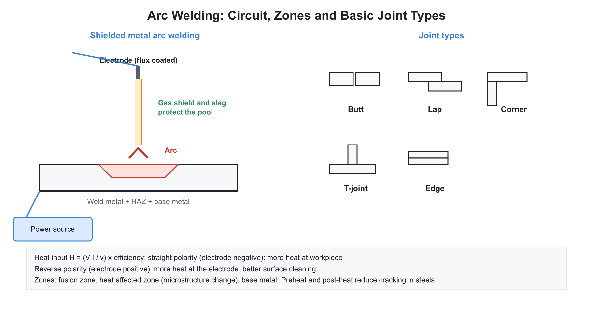
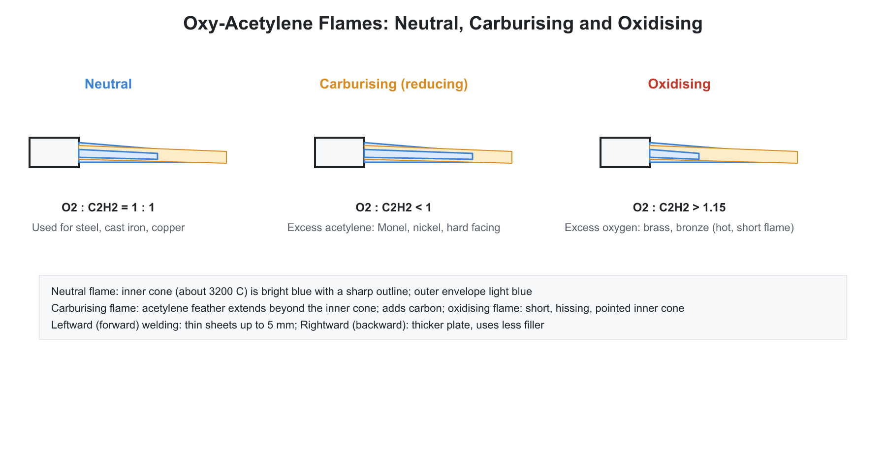

# 02. Welding, Brazing and Soldering

**Exam relevance:** APPSC AEE: C | SSC JE: C | RRB JE: C | Category: ALL | Yield: VHY

---

## Part A: Detailed Theory (read this first)

Welding joins pieces permanently by bringing the joint region to a state where atoms of the two parts bond, by melting (fusion), by plastic deformation under pressure (solid state) or by melting only a filler (brazing and soldering). The chapter can be understood through three questions: where does the heat come from (flame, arc, resistance, friction, beam, chemical reaction), how is the molten metal protected from the air (flux, slag, inert gas, vacuum), and what happens metallurgically in the heat-affected zone as the joint cools. The processes differ in the answers to these three questions.

### A1. Classification and weld anatomy
```text
     electrode
       |
      ( )  arc
       v
--------- weld pool --------- workpiece
```



| Group | Processes |
|---|---|
| Fusion welding (base metal melts) | gas welding, arc welding (SMAW, GTAW, GMAW, SAW, FCAW, plasma), thermit, electroslag, electron beam, laser |
| Pressure (solid state) welding | forge, resistance (spot, seam, projection, butt), friction, ultrasonic, explosive, diffusion, cold |
| Brazing and soldering | only the filler metal melts, base metal stays solid |

**Joint types:** butt, lap, corner, tee and edge. **Weld types:** groove (square, V, U, J, bevel), fillet, plug, slot, spot and seam.

**Zones of a fusion weld.**

- **Weld metal (fusion zone):** melted and resolidified, with a cast structure.
- **Heat-affected zone (HAZ):** base metal that was not melted but heated enough to change its microstructure and properties.
- **Unaffected base metal.**

The HAZ is often the weakest region, because of grain coarsening and, in steels, hard brittle phases.

### A2. Gas welding


**Principle.** A fuel gas burns in oxygen in a torch. The flame melts the edges of the joint, and a filler rod is added. Oxy-acetylene gives the hottest flame, about $3200^\circ$C. Acetylene is stored dissolved in acetone in cylinders packed with porous material, because free acetylene under pressure can explode.

**Three flame types.**

| Flame | Oxygen to acetylene | Use |
|---|---|---|
| Neutral | 1 : 1 | mild steel, cast iron; most welding |
| Carburising (reducing) | excess acetylene | hard surfacing, nickel, Monel, stellite |
| Oxidising | excess oxygen | brass and bronze; oxide film suppresses zinc vaporisation |

The neutral flame has a sharp bright inner cone and an outer envelope. A carburising flame has a feathery white inner cone. An oxidising flame has a short, pointed inner cone and makes a hissing sound.

**Techniques.** Leftward (forehand) welding suits thin plates; rightward (backhand) welding suits thick plates, with better economy and less distortion because the flame is directed at the completed weld, keeping the pool hot and giving slow cooling.

**Safety terms.** Backfire is a pop of the flame at the tip; flashback is flame travel back into the torch and hoses, prevented by flashback arrestors.

**Oxy-fuel cutting.** The steel is preheated to its ignition temperature (about $870^\circ$C), then a jet of pure oxygen burns the iron to iron oxide, which is blown out. It works for plain steel because the oxide melts at a lower temperature than the metal. It does not work for stainless steel, cast iron or non-ferrous metals, because their oxides melt at higher temperatures than the base metal and form a protective layer.

### A3. Arc welding principles

**The arc.** An electric arc is a sustained discharge through ionised gas between an electrode and the work. Typical values: arc voltage 20 to 40 V, current 50 to 500 A, core temperature 6000 to $7000^\circ$C. In a DC arc about two-thirds of the heat is released at the anode, because electrons arriving there give up their kinetic energy and work function.

**Polarity.**

| Polarity | Connection | Heat distribution | Use |
|---|---|---|---|
| DCSP / DCEN (straight) | electrode negative, work positive | about 2/3 at the work | deep penetration, thick plates |
| DCRP / DCEP (reverse) | electrode positive, work negative | more heat at the electrode | thin sheets, aluminium (cathodic cleaning of the oxide film), shallow penetration |
| AC | alternating | about equal | reduces arc blow; used for aluminium in TIG |

**Heat input per unit length of weld:**

$$H = \eta\frac{V I}{v}$$

with arc efficiency $\eta$ of about 0.7 to 0.9, arc voltage $V$, current $I$ and welding speed $v$. A higher heat input gives slower cooling, a wider HAZ and more distortion.

**Power source characteristics.** For manual processes (SMAW, GTAW) the operator cannot hold the arc length constant, so a drooping (constant-current) characteristic keeps current nearly steady as voltage varies. For automatic wire-fed processes (GMAW, SAW) a flat (constant-voltage) characteristic is used. The wire feed speed is constant, and any change in arc length automatically changes the current to melt the wire faster or slower, so the arc length is self-regulating.

**Arc blow.** Magnetic forces deflect the arc in DC welding near the ends of plates or in corners. It is reduced by using AC, changing the earth connection or using shorter arcs.

**Duty cycle.** The percentage of a 10-minute period for which the machine can supply rated current without overheating.

### A4. Arc welding processes

| Process | Key features |
|---|---|
| SMAW (stick, MMAW) | flux-coated consumable electrode; flux makes shielding gas and slag; manual, portable, versatile |
| GTAW (TIG) | non-consumable tungsten electrode, inert gas (argon, helium), separate filler rod; excellent quality for stainless steel, aluminium and thin sections |
| GMAW (MIG/MAG) | continuous consumable wire; inert gas (MIG: Ar, He) or active gas (MAG: CO$_2$); high deposition rate |
| SAW | arc buried under a granular flux blanket (invisible); automatic; high deposition; deep penetration; flat position only; thick plate |
| FCAW | tubular wire with flux core, with or without external gas |
| Plasma arc (PAW) | constricted arc up to about $20000^\circ$C; high precision |
| Electroslag | vertical, thick plates; heat from resistance of molten slag |
| Atomic hydrogen | arc between two tungsten electrodes in an H$_2$ stream |

**Electrode coating (flux) functions.** Produces shielding gas, forms a protective slag, adds alloying elements, stabilises the arc and deoxidises the pool.

**Electrode code (AWS).** E6013: E for arc electrode, 60 for tensile strength in ksi (60 ksi), 1 for all positions, 3 for the coating and current type.

**Hydrogen.** Hydrogen dissolved in the weld causes cold cracking in the HAZ. Low-hydrogen electrodes are baked and stored dry.

### A5. Resistance welding

**Principle.** Joule heating at the interface of the two parts, with pressure applied. No filler or flux is needed:

$$H = I^2 R t$$

The heat depends on the square of the current, on the contact resistance (highest at the faying interface), and on time. Electrodes are copper alloys because of their high conductivity and thermal conductivity, so the heat is generated at the interface rather than in the electrodes.

**Types.**

- **Spot welding:** overlapping sheets, car bodies; discrete nuggets.
- **Seam welding:** roller electrodes make a continuous, leak-proof joint.
- **Projection welding:** embossed projections localise the current.
- **Butt and flash welding:** rods, rails, chains.
- **Percussion welding:** capacitor discharge.

### A6. Other welding processes

- **Thermit welding:** an exothermic reaction of aluminium powder with iron oxide, $\text{Fe}_2\text{O}_3 + 2\text{Al} \rightarrow 2\text{Fe} + \text{Al}_2\text{O}_3$, reaches about $3000^\circ$C. Used for rail joints and repairs.
- **Friction welding:** relative rotation of one part against another under pressure heats the interface to plasticity; for rods and shafts.
- **Friction stir welding (FSW):** a rotating non-consumable tool plasticises and stirs the material along the joint, without melting; excellent for aluminium alloys.
- **Ultrasonic welding:** high-frequency vibration; thin foils and dissimilar materials.
- **Explosive welding:** a controlled detonation drives one plate onto another at high speed; used for cladding.
- **Electron beam welding (EBW):** focused electron beam in vacuum; deep, narrow welds with minimal HAZ.
- **Laser beam welding (LBW):** focused laser, no vacuum, high speed.
- **Forge welding:** heating and hammering; the oldest process.

### A7. Brazing and soldering

| Feature | Soldering | Brazing | Welding |
|---|---|---|---|
| Filler melting point | below $450^\circ$C | above $450^\circ$C but below the base metal | at or near the base metal |
| Filler | lead-tin (now lead-free) | copper-zinc (spelter), silver alloys | similar to base metal |
| Flux | rosin, zinc chloride | borax | depends on process |
| Strength | low | medium to high | highest |
| Mechanism | capillary action | capillary action | fusion |

Soldering is used in electronics and plumbing. The eutectic tin-lead solder is 63 Sn - 37 Pb, melting at $183^\circ$C. Flux removes oxides from the surfaces so that the molten filler wets them and capillary action draws it into the narrow gap.

### A8. Weld metallurgy, defects and inspection

**HAZ in steel.** Near the fusion line, the metal is heated above the critical temperature and cools rapidly. Austenite grains coarsen, and in carbon steel fast cooling forms martensite, which is hard and brittle and prone to cracking, especially with hydrogen present. Remedies: preheating (slows cooling) and post-weld heat treatment (tempers martensite and relieves residual stress).

**Carbon equivalent.**

$$CE = \%C + \frac{\%Mn}{6} + \frac{\%Cr + \%Mo + \%V}{5} + \frac{\%Ni + \%Cu}{15}$$

Weldability worsens as CE rises; steels above about 0.45 normally need preheating.

**Defects.** Porosity (trapped gas), slag inclusion, lack of fusion, incomplete penetration, undercut (groove melted into the base metal along the toe), overlap, hot and cold cracks, spatter, distortion and residual stress.

**Distortion control.** Proper joint design, balanced welding sequences, back-step technique, pre-setting, clamping fixtures and stress relieving.

**Inspection (NDT).** Visual; dye penetrant (surface cracks); magnetic particle (surface and near-surface cracks in ferromagnetic material); radiography (X-ray or gamma, internal defects); ultrasonic (internal defects); eddy current. **Destructive tests:** tensile, bend, hardness, impact.

### A9. What examiners test from this chapter

| Topic | APPSC AEE | SSC JE | RRB JE |
|---|---|---|---|
| Fusion vs pressure welding classification | Direct | Very common | Very common |
| Oxy-acetylene flame types and their uses | Direct | Very common | Very common |
| Polarity and heat distribution | Conceptual | Very common | Common |
| Heat input formula | Numerical | Common | Occasional |
| Drooping vs flat characteristic | Conceptual | Common | Common |
| TIG, MIG, SAW features | Direct | Very common | Very common |
| Resistance welding, $I^2Rt$ | Numerical | Common | Common |
| Thermit, friction stir, EBW | Direct | Common | Common |
| Brazing vs soldering vs welding | Direct | Very common | Very common |
| Carbon equivalent, HAZ | Conceptual | Common | Occasional |
| Weld defects and NDT | Direct | Very common | Very common |

---

## Part B: Quick-reference notes, formulas, numericals and PYQs


## 🧭 1. Foundations

- **Welding:** a permanent joining process that fuses two or more parts by heat, pressure or both, with or without filler metal.

| Group | Processes |
|---|---|
| **Fusion welding** (base metal melts) | Gas welding, arc welding (SMAW, GTAW, GMAW, SAW, FCAW, plasma), thermit, electroslag, electron beam, laser |
| **Pressure (solid state) welding** | Forge, resistance (spot, seam, projection, butt), friction, ultrasonic, explosive, diffusion, cold |
| **Brazing and soldering** | Only the filler metal melts |

- **Joint types:** butt, lap, corner, tee, edge. **Weld types:** groove (V, U, J, bevel, square), fillet, plug, slot, spot, seam.
- **Weld zones:** **weld metal (fusion zone)**, **heat-affected zone (HAZ)** (base metal whose structure is altered by heat but not melted), and the unaffected base metal.

## 🧭 2. Gas welding

- Fuel gas burns with oxygen; the flame melts the edges. **Oxy-acetylene** gives the highest flame temperature, about $3200^\circ$C (acetylene is stored dissolved in acetone, in cylinders with porous filler, to avoid explosion).
- **Three flames:**

| Flame | Oxygen : acetylene | Use |
|---|---|---|
| **Neutral** | $1:1$ | Mild steel, cast iron (most welding) |
| **Carburising (reducing)** | Excess acetylene | Hard surfacing, nickel, Monel; stellite |
| **Oxidising** | Excess oxygen | Brass, bronze (prevents zinc vaporisation) |

- The neutral flame has a bright inner cone (about $3200^\circ$C) and an outer envelope. A carburising flame has a feathery white inner cone.
- **Welding techniques:** **leftward (forehand)** for thin plates; **rightward (backhand)** for thick plates (better economy and less distortion).
- **Gas welding pressures:** **low-pressure** (injector type torch) and **high-pressure** systems. **Flashback arrestor** and **backfire** are safety terms.
- **Oxy-fuel cutting:** the metal is preheated to its ignition temperature (about $870^\circ$C for steel), and a jet of pure oxygen burns it (oxidises); it works for steel but not for stainless steel, cast iron or non-ferrous metals because their oxides have a higher melting point than the metal.

## 🧭 3. Arc welding

- An **electric arc** between the electrode and workpiece provides heat (about $6000^\circ$C to $7000^\circ$C at the core). The arc voltage is $20$ to $40$ V; the current is $50$ to $500$ A. About $\tfrac23$ of the heat is generated at the anode in DC arc (with DCSP, the work is positive, giving deeper penetration).
- **Polarity:**

| Polarity | Connection | Heat | Use |
|---|---|---|---|
| **DCSP / DCEN** (straight) | Electrode $-$, work $+$ | About $\tfrac23$ of heat at the work | Deep penetration, thick plates |
| **DCRP / DCEP** (reverse) | Electrode $+$, work $-$ | Heat at the electrode | Thin sheets, aluminium (cleaning action), shallow penetration |
| **AC** | Alternating | Equal | Magnetic arc blow reduced |

- **Heat input per unit length:** 

$$H = \eta\,\frac{V\,I}{v}\ \text{J/mm}$$

  where $\eta$ is the efficiency (about $0.7$ to $0.9$), $V$ the arc voltage, $I$ the current, and $v$ the welding speed.
- **Power source characteristics:** **drooping (constant current)** for SMAW and GTAW (the current stays steady when arc length changes); **flat (constant voltage)** for GMAW and SAW (self-regulating arc length).
- **Arc blow:** deflection of the arc by magnetic forces in DC welding; reduced with AC or by changing the earth connection.
- **Duty cycle** $= \dfrac{\text{arc time}}{\text{total time (10 min basis)}}$.

### Arc welding processes

| Process | Description |
|---|---|
| **SMAW (stick, MMAW)** | Flux-coated consumable electrode; flux generates a gas shield and slag. Manual, portable, versatile |
| **GTAW (TIG)** | Non-consumable tungsten electrode, inert gas (argon, helium); filler rod added separately; excellent quality, for stainless steel and aluminium, thin sections |
| **GMAW (MIG / MAG)** | Continuous consumable wire; inert gas (MIG: Ar/He) or active gas (MAG: CO$_2$); high deposition rate |
| **SAW** | A granular flux blanket covers the arc, which is therefore invisible; automatic; high deposition, deep penetration; flat position only; for thick plate |
| **FCAW** | Tubular wire with flux core; with or without external gas |
| **Plasma arc welding (PAW)** | Constricted arc; temperature up to about $20000^\circ$C; high precision |
| **Electroslag welding** | Vertical, thick plates; heat from the resistance of molten slag |
| **Atomic hydrogen welding** | Arc between two tungsten electrodes in an H$_2$ atmosphere |

- **Electrode designation (AWS):** E6013: "E" arc electrode; "60" tensile strength $60$ ksi; "1" all positions; "3" coating type. 
- **Functions of the flux coating:** produces shielding gas, forms slag to protect the weld metal, adds alloying elements, stabilises the arc, and deoxidises.
- **Shielded gas:** argon is heavier than air; helium gives a hotter arc. 
- **Hydrogen embrittlement/cracking:** low-hydrogen electrodes are baked.

## 🧭 4. Resistance welding

- Heat is produced by resistance at the interface, $H = I^2\,R\,t$, with pressure applied. No filler or flux.
- **Types:** **spot** (overlapping sheets, car bodies), **seam** (roller electrodes making a continuous leak-proof joint), **projection** (embossed projections localise the current), **butt/flash** (rods, rails), and **percussion**.
- The heat is sensitive to current (squared), time, electrode pressure, and surface contact resistance. Electrodes are copper alloys (high conductivity).

## 🧭 5. Other welding processes

- **Thermit welding:** exothermic reaction of aluminium powder with iron oxide ($\text{Fe}_2\text{O}_3 + 2\text{Al} \rightarrow 2\text{Fe} + \text{Al}_2\text{O}_3$) at about $3000^\circ$C; used for rail joints and repairs.
- **Friction welding:** relative motion heats the interface; rotating part is pressed against the stationary part; used for rods, shafts. **Friction stir welding (FSW):** a rotating non-consumable tool stirs the plasticised material along the joint; produces no melting; excellent for aluminium alloys.
- **Ultrasonic welding:** high-frequency vibration; for thin foils and dissimilar materials.
- **Explosive welding:** controlled detonation drives one plate into another; for cladding.
- **Electron beam welding (EBW):** a focused electron beam in a vacuum, deep narrow welds with little HAZ. **Laser beam welding (LBW):** a focused laser, no vacuum required, high speed.
- **Forge welding:** the oldest process; heating and hammering.

## 🧭 6. Brazing and soldering

| Feature | Soldering | Brazing | Welding |
|---|---|---|---|
| Filler melting point | Below $450^\circ$C | Above $450^\circ$C but below the base metal's melting point | At or near the base metal's melting point |
| Filler | Lead-tin (now lead-free) alloys | Copper-zinc (spelter), silver alloys | Similar to base metal |
| Flux | Rosin, zinc chloride | Borax | Varies |
| Strength | Low | Medium to high | Highest |
| Mechanism | Capillary action | Capillary action | Fusion |

- **Soldering** is used in electronics and plumbing. A 60-40 tin-lead solder melts at about $190^\circ$C. The eutectic composition is 63 Sn - 37 Pb ($183^\circ$C).

## 🧭 7. Weld metallurgy, defects and inspection

- **HAZ** shows grain coarsening near the fusion line; high cooling rates in carbon steels produce **martensite** which is brittle and crack-prone. **Preheating** and **post-weld heat treatment** reduce this.
- **Carbon equivalent** $CE = \%C + \dfrac{\%Mn}{6} + \dfrac{\%Cr + \%Mo + \%V}{5} + \dfrac{\%Ni + \%Cu}{15}$: weldability falls with an increasing CE (above about $0.45$ requires preheat).
- **Defects:** **porosity** (trapped gas), **slag inclusion**, **lack of fusion**, **incomplete penetration**, **undercut** (groove melted into the base metal along the toe), **overlap**, **cracks** (hot and cold), **spatter**, **distortion** and **residual stress**. 
- **Distortion control:** proper joint design, balanced welding, back-step technique, pre-setting, fixtures, stress relieving.
- **Inspection (NDT):** visual, **dye penetrant** (surface cracks), **magnetic particle** (surface and near-surface in ferromagnetic materials), **radiography** (X-ray, gamma; internal defects), **ultrasonic** (internal defects), and **eddy current**. **Destructive tests:** tensile, bend, hardness, impact.
- **Weld symbols:** a reference line with an arrow; the symbol below the line means the weld is on the arrow side.
- **Safety:** protective helmets with shade filters, gloves, ventilation.

## 🧭 8. Worked numericals

1. **Heat input.** $V = 25$ V, $I = 200$ A, $v = 5$ mm/s, $\eta = 0.8$: $H = \dfrac{0.8\times25\times200}{5} = 800$ J/mm.
2. **Resistance spot welding.** $I = 10$ kA, $R = 100\ \mu\Omega$, $t = 0.2$ s: $H = (10^4)^2(10^{-4})(0.2) = 2000$ J.
3. **Carbon equivalent.** $C = 0.2$, $Mn = 1.2$, others negligible: $CE = 0.2 + 0.2 = 0.4$.
4. **Oxy-acetylene cutting.** The preheat reaches the ignition temperature of steel (about $870^\circ$C), then oxygen oxidises the iron.

## 🧭 9. Common mistakes

- Using an oxidising flame for steel; the neutral flame is the standard.
- Saying that the arc welding heat is shared equally between the electrode and work in DC; it is about $\tfrac23$ at the anode.
- Mixing up TIG (non-consumable tungsten) and MIG (consumable wire).
- Believing that brazing melts the base metal; it does not.
- Forgetting that cast iron and stainless steel cannot be cut by the oxy-fuel process.

## 🧭 10. Interconnections

- **Material science:** phase transformations in HAZ, hardenability, carbon equivalent.
- **Machine design:** welded joint strength (throat area).
- **Electrical:** transformer, rectifier power sources.

## 🧭 11. PYQs

| # | Question | Answer | Exam / Year | Verify |
|---|---|---|---|---|
| 1 | Neutral flame is used for welding | Mild steel | SSC JE 2017 | [ ] |
| 2 | Oxidising flame is used for | Brass | RRB JE 2015 | [ ] |
| 3 | TIG welding uses | Non-consumable tungsten electrode | SSC JE 2018 | [ ] |
| 4 | Submerged arc welding | Arc is covered by granular flux | RRB JE 2014 | [ ] |
| 5 | Spot welding is a form of | Resistance welding | SSC JE 2016 | [ ] |
| 6 | Heat generated in resistance welding | $I^2Rt$ | APPSC AEE 2012 | [ ] |
| 7 | Thermit welding uses | Aluminium and iron oxide | SSC JE 2019 | [ ] |
| 8 | Brazing filler melts above | $450^\circ$C | RRB JE 2019 | [ ] |
| 9 | Straight polarity means | Electrode negative, work positive | SSC JE 2015 | [ ] |
| 10 | Undercut is a | Welding defect (groove along the toe) | RRB JE 2016 | [ ] |
| 11 | Flux in SMAW is used to | Protect the weld from oxidation and stabilise the arc | SSC JE 2020 | [ ] |
| 12 | Temperature of oxy-acetylene flame | About $3200^\circ$C | RRB JE 2018 | [ ] |
| 13 | Friction stir welding | A solid-state welding process | SSC JE 2022 | [ ] |
| 14 | Dye penetrant test detects | Surface cracks | APPSC AEE 2016 | [ ] |
| 15 | Solder is an alloy of | Tin and lead | RRB JE 2017 | [ ] |

## 🧭 12. Revision checklist

- [ ] Fusion vs pressure welding classification
- [ ] Gas flames and their uses
- [ ] Arc welding processes and polarity
- [ ] Resistance welding formula
- [ ] Brazing vs soldering vs welding
- [ ] Defects and NDT methods
