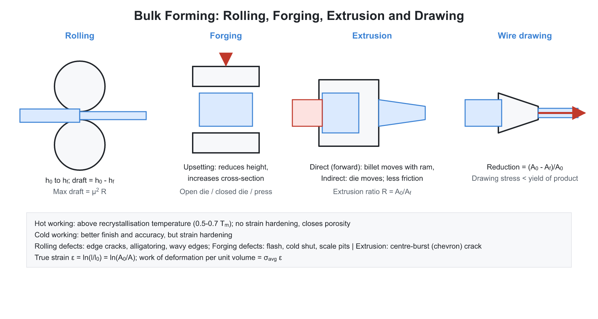
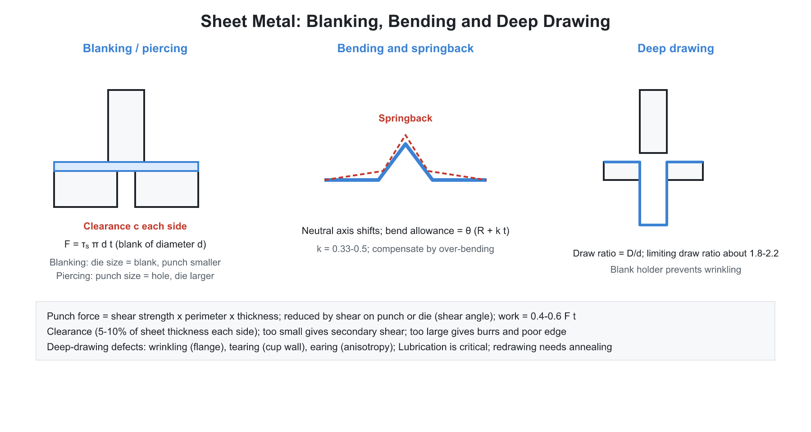

# 03. Metal Forming (Bulk and Sheet)

**Exam relevance:** APPSC AEE: C | SSC JE: C | RRB JE: C | Category: ALL | Yield: HY

---

## Part A: Detailed Theory (read this first)

Metal forming changes the shape of a solid metal by plastic deformation, without removing material. The metal is pushed beyond its yield point so that it flows, and the volume stays constant. Everything in this chapter rests on the physics of plastic flow: slip of dislocations, strain hardening, recrystallisation and the effect of friction at the tool interface. The processes (rolling, forging, extrusion, drawing, sheet-metal work) differ only in how the force is applied and which direction the metal is allowed to flow.

### A1. Plastic deformation and its mechanism

**Elastic versus plastic.** Elastic strain is recovered when the load is removed; plastic strain is permanent and starts at the yield point. At the atomic level, plastic deformation occurs by slip of crystal planes through the movement of dislocations, and in some metals by twinning.

**Strain hardening.** As deformation proceeds, dislocations multiply and tangle, so the metal becomes stronger and harder and less ductile. This is quantified by the flow curve:

$$\sigma = K\varepsilon^n$$

where $K$ is the strength coefficient and $n$ the strain-hardening exponent (a larger $n$ means more hardening).

**True stress and true strain.** Engineering values use the original dimensions; true values use the instantaneous dimensions:

$$\sigma_T = \sigma_e(1 + \varepsilon_e), \qquad \varepsilon_T = \ln(1 + \varepsilon_e)$$

Volume is constant during plastic flow, so the true strains in three directions add to zero: $\varepsilon_1 + \varepsilon_2 + \varepsilon_3 = 0$. True strains are additive for successive operations, while engineering strains are not.

**Yield criteria.** Tresca (maximum shear stress) and von Mises (distortion energy), as in the Strength of Materials failure theories.

### A2. Hot working versus cold working

The dividing line is the recrystallisation temperature, roughly $0.4\,T_m$ (absolute melting temperature) for pure metals.

| Feature | Hot working | Cold working |
|---|---|---|
| Temperature | above recrystallisation | below recrystallisation |
| Strain hardening | removed at once by recrystallisation | accumulates |
| Force needed | low | high |
| Amount of deformation | very large | limited by ductility; intermediate annealing needed |
| Surface finish and accuracy | poor (oxide scale, thermal contraction) | good |
| Grain structure | refined, equiaxed | elongated in the working direction |
| Residual stress | none | present |
| Strength and hardness | unchanged | increased |

**Annealing sequence of a cold worked metal.** Recovery (internal stresses relieved, properties change slightly), then recrystallisation (new strain-free grains form, strength falls and ductility returns) and finally grain growth (grains coarsen at higher temperature or longer time). Recrystallisation temperature falls with greater prior deformation and with finer initial grain.

### A3. Rolling
```text
			 O  top roller
thick stock --->||---> thin strip
			 O  bottom roller
```



**Process.** The metal passes between rotating rolls, which reduce its thickness and increase its length, with a small increase in width called spread.

- **Draft:** $h_0 - h_f$. **Reduction:** $(h_0 - h_f)/h_0$.
- **Bite condition.** The rolls must be able to pull the strip in by friction. The angle of bite $\alpha$ must satisfy $\mu \ge \tan\alpha$. The maximum draft is $h_0 - h_f = \mu^2 R$. If the draft is larger, the rolls slip. Using a rough roll or tapering the entry raises the allowable draft.
- **Contact length:** $L = \sqrt{R(h_0 - h_f)}$.
- **Rolling force:** $F \approx \sigma_{avg}\,w\,L$, where $\sigma_{avg}$ is the average flow stress. Torque per roll is about $F L/2$ and power for two rolls is $2\pi N T$.
- **Neutral point.** On the contact arc, the strip moves slower than the roll surface before the neutral point and faster after it. At the neutral point, strip and roll speed are equal.

**Roll arrangements.** Two-high, three-high, four-high and cluster (Sendzimir) mills. Large rolls deflect under load and give a thicker strip in the middle; small work rolls backed by larger rolls (four-high, cluster) reduce force and deflection and make thin foils.

**Products.** Plates, sheets, bars, rails, structural shapes and seamless tubes (Mannesmann piercing). **Defects.** Edge cracks, alligatoring (split along the centre plane), wavy edges and zipper cracks.

### A4. Forging

**Process.** Metal is shaped by compressive blows (hammer) or squeezing (press). Forging refines the grain and aligns the grain flow with the contour of the part, which gives better strength and toughness than a casting or a machined part.

**Types.**

- **Open die:** flat dies, free lateral flow; large simple shapes.
- **Closed (impression) die:** a cavity gives the shape. Excess metal escapes as flash at the parting line, which also builds back-pressure that forces metal into the corners.
- **Press forging:** slow squeeze, deeper penetration. **Drop forging:** impact; the surface layers are worked most.
- **Upset forging:** increases cross-section at a bar end (bolt heads).
- **Roll forging, swaging, coining (cold, fine detail), cogging (reducing an ingot).**

**Operations.** Fullering (reduce section and lengthen), edging, drawing down, upsetting, bending, punching and flattening.

**Forging force.** Without friction, $F = \sigma_f A$. With friction between the dies and the workpiece, the pressure rises toward the centre (friction hill) and for a cylinder:

$$F = \sigma_f A\left(1 + \frac{2\mu r}{3h}\right)$$

The force rises as the part becomes thinner (smaller $h$) and as friction increases.

**Defects.** Laps, cold shuts, flash, scale pits, incomplete filling, mismatch.

### A5. Extrusion

**Process.** A billet in a container is forced by a ram through a die opening. The product has the shape of the die and is long and uniform in section.

- **Direct (forward):** ram and product move in the same direction; high friction between billet and container wall.
- **Indirect (backward):** the die is carried by a hollow ram and moves against the billet, so there is no relative motion between billet and container wall; less friction and lower force.
- **Hydrostatic:** a fluid surrounds the billet, reducing friction. **Impact extrusion:** cold, for collapsible tubes.

**Extrusion ratio and strain.** $R = A_0/A_f$, true strain $\varepsilon = \ln R$. Ideal pressure $p = \sigma_f \ln R$; with friction and redundant work $p = \sigma_f(a + b\ln R)$.

**Materials.** Aluminium, copper, brass and plastics. **Defects.** Surface cracking, pipe (tail pipe, a central funnel-shaped defect at the end of the billet) and internal cracks (chevron or centre burst).

### A6. Wire and rod drawing

**Process.** A rod or wire is pulled through a die with a reducing cross-section. The pull force is tensile at the exit, so the material must be strong enough to survive it.

- **Reduction in area:** $r = (A_0 - A_f)/A_0$.
- **Ideal drawing stress:** $\sigma_d = \sigma_f \ln(A_0/A_f)$.
- The drawing stress must stay below the yield strength of the emerging wire, otherwise the wire breaks rather than being drawn. For an ideal non-hardening material ($\sigma_d = \sigma_f$), the largest possible reduction occurs at $A_0/A_f = e$, i.e. $r = 63$ percent.
- **Die:** approach, reduction zone (cone semi-angle 6 to 15 degrees), bearing land and back relief. Materials: tungsten carbide and diamond for fine wire.

**Distinction.** Tube drawing (with plug or mandrel) is different from sheet deep drawing. **Defects:** centre-burst (chevron) cracks, seams and die marks.

### A7. Sheet-metal operations


| Operation | Description |
|---|---|
| Shearing | cutting along a straight line |
| Blanking | cutting a piece out of sheet; the piece is the product |
| Punching (piercing) | cutting a hole; the hole is the product and the slug is scrap |
| Notching, slitting, nibbling, trimming, parting | variants of cutting |
| Bending | deformation about a straight axis |
| Deep drawing | cup from a flat blank; blank holder prevents wrinkling |
| Stretch forming | sheet stretched over a die |
| Spinning | rotating sheet formed over a mandrel |
| Embossing, coining | impressions |
| Ironing | thinning of cup walls |

### A8. Shearing and blanking in detail

**How the cut happens.** The punch presses into the sheet, causing plastic deformation, then cracks start at both cutting edges and meet, giving fracture. The cut edge has a burnished zone and a fractured zone.

**Clearance.** The gap between punch and die is 5 to 10 percent of thickness per side. Too little clearance needs more force and wears tools; too much produces burrs and a rounded edge.

**Die and punch size.** For blanking, the die size equals the blank size and the punch is smaller by the clearance (the blank is the required piece, which is bounded by the die). For punching, the punch size equals the hole size and the die is larger.

**Cutting force:**

$$F = \tau_u L t$$

with $L$ the cut perimeter, $t$ the thickness and $\tau_u$ the ultimate shear strength (about $0.7\,\sigma_u$).

**Shear on the punch.** Angling the cutting edge means only part of the perimeter cuts at a time, which lowers the peak force (without changing the energy). If the shear is $s \ge t$, the peak force is approximately $F\,t/s$.

**Tooling terms.** Strip layout (minimise scrap), pilot (locates the strip), stripper (strips the sheet from the punch) and knockout (ejects the part). **Die types:** simple, compound (blank and pierce in one stroke), combination, progressive (multiple stations) and transfer.

### A9. Bending and springback

**Bend allowance** (length of the neutral axis in the bend):

$$B_A = \alpha\,(R + k t)$$

with $\alpha$ in radians, $R$ the inner radius, $t$ the thickness and $k$ the neutral axis factor (about 0.33 for $R < 2t$ and 0.5 for $R > 2t$). The neutral axis shifts toward the inside of the bend as the radius gets smaller.

**Springback.** After the load is removed, the elastic part of the strain is recovered and the bend opens slightly. It increases with yield strength and bend radius and decreases with elastic modulus and with thickness. It is compensated by overbending, bottoming or stretch bending.

**Minimum bend radius.** The outer fibre stretches; a very small radius cracks the outside of the bend. Ductile materials permit smaller radii.

**Bending force:** $F = K\sigma_u L t^2/W$ with $K = 1.33$ for V-bending and $0.33$ for wiping bend, and $W$ the die opening.

### A10. Deep drawing

**Process.** A flat blank is drawn into a cup by a punch pushing it through a die, while a blank holder keeps the flange from wrinkling. The flange is compressed circumferentially and the wall is stretched.

- **Drawing ratio:** $DR = D_{blank}/d_{punch}$. Limit about 2.0 to 2.2 for the first draw. Reduction $(D - d)/D$ is limited to about 50 percent.
- **Blank diameter** from equal area: for a cup of diameter $d$ and height $h$, $D = \sqrt{d^2 + 4dh}$.
- **Drawing force:** $F = \pi d t\,\sigma_u\,(D/d - 0.7)$.

**Defects.** Wrinkling of the flange (too little blank-holder force), tearing at the punch radius (too much blank-holder force or too small die radius), earing (planar anisotropy) and orange peel (coarse grains).

**Formability.** The forming limit diagram (FLD) plots limit strains before necking. The anisotropy ratio $r$ (width strain to thickness strain) measures resistance to thinning, and a high average $r$ means better deep drawability.

### A11. Special forming

Explosive forming, electro-hydraulic forming, electromagnetic forming, hydroforming, superplastic forming and incremental sheet forming. High-energy-rate methods form large or difficult parts with simple tooling.

### A12. What examiners test from this chapter

| Topic | APPSC AEE | SSC JE | RRB JE |
|---|---|---|---|
| Hot working vs cold working | Direct | Very common | Very common |
| Recrystallisation temperature and stages | Conceptual | Common | Common |
| True stress and strain | Numerical | Common | Occasional |
| Rolling: bite condition, maximum draft | Numerical | Common | Common |
| Forging types, flash, defects | Direct | Very common | Very common |
| Extrusion types, extrusion ratio | Direct | Common | Common |
| Wire drawing and maximum reduction | Numerical | Common | Occasional |
| Blanking vs punching, clearance, die size | Direct | Very common | Very common |
| Cutting force | Numerical | Very common | Common |
| Deep drawing ratio, blank diameter | Numerical | Common | Common |
| Springback and bend allowance | Conceptual | Common | Common |

---

## Part B: Quick-reference notes, formulas, numericals and PYQs


## 🧭 1. Foundations of plastic deformation

- **Elastic deformation** is recoverable; **plastic deformation** is permanent and occurs beyond the yield point, by slip (dislocation movement) and twinning.
- **Hot working:** deformation above the **recrystallisation temperature** (about $0.4\,T_m$ in kelvin). Strain hardening is relieved at once by recrystallisation. Large deformation at low force; fine grain, no residual stress; poor surface finish and dimensional accuracy (scale formation).
- **Cold working:** below the recrystallisation temperature. Strain hardening increases strength and hardness and reduces ductility; good surface finish and accuracy; needs higher forces; may need intermediate annealing.
- **True stress and strain:** $\sigma_T = \sigma_e(1 + \varepsilon_e)$ and $\varepsilon_T = \ln(1 + \varepsilon_e)$. **Flow curve:** $\sigma = K\varepsilon^n$ ($K$ is the strength coefficient, $n$ the strain-hardening exponent). Volume is constant during plastic deformation: $\varepsilon_1 + \varepsilon_2 + \varepsilon_3 = 0$ (true strains).
- **Recovery, recrystallisation, grain growth** occur in sequence on annealing a cold-worked metal.
- **Yield criteria:** Tresca (maximum shear stress) and von Mises (distortion energy).

## 🧭 2. Rolling

- Metal passes between rotating rolls, which reduce the thickness.
- **Draft** $= h_0 - h_f$. **Reduction** $= \dfrac{h_0 - h_f}{h_0}$. **Spread** is the increase in width.
- **Maximum draft** (condition for the bite): $\mu \ge \tan\alpha$, where $\alpha$ is the angle of bite; $h_0 - h_f = \mu^2\,R$ (for roll radius $R$). 
- **Roll-strip contact length:** $L = \sqrt{R\,(h_0 - h_f)}$.
- **Rolling force** $F \approx \sigma_{avg}\,w\,L$; **torque** $= F\,\dfrac{L}{2}$ per roll; **power** $= 2\pi N\,T$ (two rolls).
- **Roll arrangements:** two-high, three-high, four-high, cluster (Sendzimir, for thin foils), and continuous (tandem). **Four-high** and **cluster** mills reduce roll deflection by using small work rolls backed by large rolls.
- **Rolled products:** plates, sheets, bars, rails, structural shapes (I-beams, channels), tubes (Mannesmann piercing).
- **Defects:** edge cracks, alligatoring, wavy edges, zipper cracks.

## 🧭 3. Forging

- Metal is deformed by compressive force from hammers or presses. 
- **Types:** **open die** (flat dies, material flows freely; large simple shapes), **closed (impression) die** (cavity gives the shape; **flash** is excess metal squeezed out at the parting line, which also builds back pressure), **press forging** (slow squeezing), **drop forging** (impact), **upset forging** (increases the cross-section of a bar end, bolt heads), **roll forging**, **swaging**, **coining** (cold, fine detail), **cogging** (reducing the thickness of an ingot).
- **Operations:** **fullering** (reduces cross-section and lengthens), **edging**, **drawing down**, **upsetting**, **bending**, **punching**, **flattening**.
- **Forging force (ideal, no friction):** $F = \sigma_f\,A$. With friction, the pressure rises toward the centre (friction hill). The force for a cylinder: $F = \sigma_f\,A\left(1 + \dfrac{2\mu r}{3h}\right)$.
- **Forging defects:** laps, cold shuts, flash, scale pits, incomplete filling, and mismatch.
- **Advantages:** grain flow follows the part's contour; improved strength and toughness.

## 🧭 4. Extrusion

- A billet is forced through a die opening. 
- **Types:** **direct (forward)** (ram and material move in the same direction; high friction), **indirect (backward)** (the die moves against the billet; less friction), **hydrostatic** (billet surrounded by fluid), **impact** (cold, for collapsible tubes), **cold extrusion**.
- **Extrusion ratio** $R = \dfrac{A_0}{A_f}$. **True strain** $\varepsilon = \ln R$. 
- **Extrusion pressure:** $p = \sigma_f\,\ln R$ (ideal); with friction and redundant work, $p = \sigma_f\,(a + b\ln R)$.
- Used for aluminium, copper, brass, plastics; produces long uniform sections.
- **Defects:** surface cracking, pipe (tail pipe, centre burst) and internal cracking (chevron).

## 🧭 5. Wire and rod drawing

- A rod is pulled through a die with a reducing cross-section. 
- **Reduction in area** $r = \dfrac{A_0 - A_f}{A_0}$. **Drawing stress (ideal):** $\sigma_d = \sigma_f\,\ln\dfrac{A_0}{A_f}$, always less than the yield strength of the drawn wire (otherwise, the wire breaks). Maximum reduction per pass, ideally: $\dfrac{A_0}{A_f} = e$, i.e. $r = 63\%$ (for non-strain-hardening material, $\sigma_d = \sigma_f$).
- **Die:** approach, reduction (cone semi-angle $6^\circ$ to $15^\circ$), bearing (land), and back relief. Die materials: tungsten carbide, diamond (for fine wire).
- **Tube drawing** (with a mandrel or plug) and **deep drawing** are different. 
- **Defects:** centre-burst (chevron) cracks, seams, die marks.

## 🧭 6. Sheet-metal operations

| Operation | Description |
|---|---|
| **Shearing** | Cutting along a straight line |
| **Blanking** | Cutting a piece out of sheet; the **piece** is the product |
| **Punching (piercing)** | Cutting a hole; the **hole** is the product, the slug is scrap |
| **Notching, slitting, nibbling, trimming, parting** | Variants of cutting |
| **Bending** | Deformation about a straight axis |
| **Drawing (deep drawing)** | Cup-shaped parts from a flat blank; blank holder prevents wrinkling |
| **Stretch forming** | Sheet stretched over a die |
| **Spinning** | Rotating sheet formed over a mandrel |
| **Embossing, coining** | Impressions |
| **Ironing** | Thinning of cup walls |

### Shearing and blanking

- **Clearance** between punch and die $c = 0.05\,t$ to $0.10\,t$ (about $5\%$ to $10\%$ of the thickness per side); excessive clearance causes burrs, and insufficient clearance requires a large force.
- **Die size:** For **blanking**, the die size equals the blank size and the punch is smaller by the clearance. For **punching**, the punch size equals the hole size and the die is larger.
- **Cutting force:** $F = \tau_u\,L\,t$ (with $L$ the cut perimeter, $t$ the thickness, and $\tau_u$ the ultimate shear strength, about $0.7\,\sigma_u$). 
- **Shear on the punch** (angled cutting edges) reduces the peak force because only part of the perimeter is cut at any instant. If the shear (vertical rise of the cutting edge) is $s \ge t$, the peak force is approximately $F\,\dfrac{t}{s}$, where $F = \tau_u L t$ is the force without shear.
- **Cutting power/energy:** $E = F\,t\times k$ with $k \approx 0.5$ to $0.7$ (fraction of thickness penetrated before fracture).
- **Strip layout** minimises scrap; **pilot** locates the strip; **stripper** removes the strip from the punch; **knockout** ejects the part.
- **Dies:** simple, compound (blank and pierce in one stroke), combination, progressive (multiple stations), transfer.

### Bending

- **Bend allowance:** $B_A = \alpha\,(R + k\,t)$ ($\alpha$ in radians, $R$ inner bend radius, $t$ thickness, $k$ the neutral-axis factor of $0.33$ for $R < 2t$ and $0.5$ for $R > 2t$).
- **Springback:** elastic recovery after the load is released; compensated by **overbending**, bottoming, or stretch-bending. Springback grows with yield strength and bend radius and decreases with modulus.
- **Minimum bend radius** depends on ductility: a smaller radius risks cracking on the outer fibre.
- **Bending force:** $F = \dfrac{K\,\sigma_u\,L\,t^2}{W}$ ($K = 1.33$ for V-bending, $0.33$ for wiping; $W$ is the die opening).

### Deep drawing

- **Drawing ratio** $\text{DR} = \dfrac{D_{blank}}{d_{punch}}$ (limiting value about $2.0$ to $2.2$ for the first draw). **Reduction** $= \dfrac{D - d}{D}$ (limit about $50\%$).
- **Blank diameter** from the equal-area principle (cup of diameter $d$ and height $h$): $D = \sqrt{d^2 + 4dh}$.
- **Drawing force:** $F = \pi d\,t\,\sigma_u\left(\dfrac{D}{d} - 0.7\right)$.
- **Defects:** wrinkling (flange, low blank-holder force), tearing (high blank-holder force or small die radius), earing (planar anisotropy), and orange peel.
- **Forming Limit Diagram (FLD)** shows the limit strains before necking or fracture. **Anisotropy ($r$-value)**: the ratio of width strain to thickness strain; a high $r$ means a better deep-drawing ability.

## 🧭 7. High-energy-rate and special forming

- **Explosive forming**, **electro-hydraulic forming**, **electromagnetic forming**, **hydroforming**, **superplastic forming**, and **incremental sheet forming**.

## 🧭 8. Worked numericals

1. **Rolling.** $h_0 = 20$ mm, $h_f = 15$ mm, $R = 250$ mm: $L = \sqrt{250\times5} = 35.4$ mm. Maximum draft for $\mu = 0.1$: $0.01\times250 = 2.5$ mm.
2. **Blanking force.** $L = 100$ mm, $t = 2$ mm, $\tau_u = 300$ MPa: $F = 300\times100\times2 = 60$ kN.
3. **Blank diameter.** Cup $d = 50$ mm, $h = 40$ mm: $D = \sqrt{2500 + 8000} = 102.5$ mm. Drawing ratio $= 2.05$.
4. **Extrusion.** $A_0 = 2000$ mm$^2$, $A_f = 500$ mm$^2$, $\sigma_f = 100$ MPa: $p = 100\ln4 = 138.6$ MPa.
5. **Wire drawing.** $\sigma_f = 200$ MPa, $r = 30\%$: $\sigma_d = 200\ln\dfrac{1}{0.7} = 71.3$ MPa.

## 🧭 9. Common mistakes

- Reversing punch and die clearance rules between blanking and punching.
- Using engineering strain in the extrusion or drawing equations (true strain $\ln R$ is required).
- Saying that hot working increases strength; it gives a refined grain but no strain hardening.
- Confusing blanking (piece wanted) with piercing (hole wanted).

## 🧭 10. Interconnections

- **Strength of materials:** true stress-strain, yield criteria, shear strength.
- **Material science:** recrystallisation, grain flow, strain hardening.
- **Machine design:** press and flywheel selection.

## 🧭 11. PYQs

| # | Question | Answer | Exam / Year | Verify |
|---|---|---|---|---|
| 1 | Hot working is done above | Recrystallisation temperature | SSC JE 2017 | [ ] |
| 2 | Cold working increases | Hardness and strength | RRB JE 2015 | [ ] |
| 3 | In blanking, the clearance is provided on | The punch | SSC JE 2018 | [ ] |
| 4 | In punching, the clearance is provided on | The die | RRB JE 2014 | [ ] |
| 5 | Extrusion ratio | $\dfrac{A_0}{A_f}$ | SSC JE 2016 | [ ] |
| 6 | Springback in bending is compensated by | Overbending | APPSC AEE 2012 | [ ] |
| 7 | Process used to make seamless pipes | Mannesmann piercing / extrusion | SSC JE 2019 | [ ] |
| 8 | Wrinkling in deep drawing is prevented by | Blank holder | RRB JE 2019 | [ ] |
| 9 | Coining is a | Cold forging process | SSC JE 2015 | [ ] |
| 10 | Flash in closed die forging | Excess metal squeezed at the parting plane | RRB JE 2016 | [ ] |
| 11 | In hot rolling the thickness is reduced by | Rolls | SSC JE 2020 | [ ] |
| 12 | Four-high rolling mill is used to | Reduce roll deflection | RRB JE 2018 | [ ] |
| 13 | Blank diameter in deep drawing | $\sqrt{d^2 + 4dh}$ | SSC JE 2021 | [ ] |
| 14 | Upsetting increases | The cross-section at the expense of length | APPSC AEE 2016 | [ ] |
| 15 | Recrystallisation temperature is about | $0.4\,T_m$ | RRB JE 2017 | [ ] |

## 🧭 12. Revision checklist

- [ ] Hot vs cold working
- [ ] Rolling geometry (bite, draft)
- [ ] Forging types and defects
- [ ] Extrusion and drawing formulas
- [ ] Sheet-metal operations and clearance rules
- [ ] Deep drawing ratio and blank size
