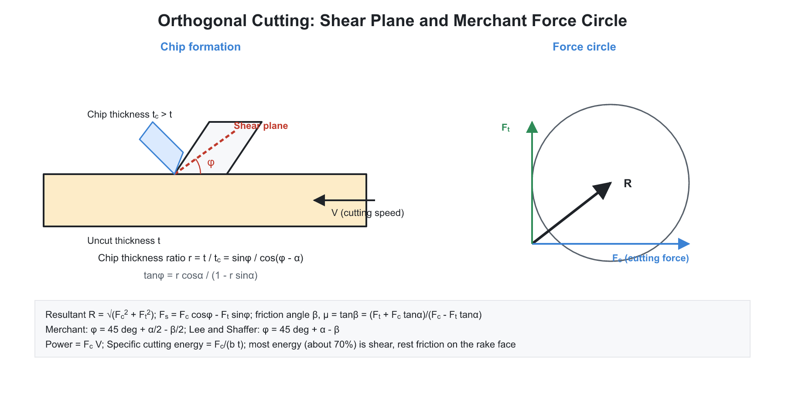
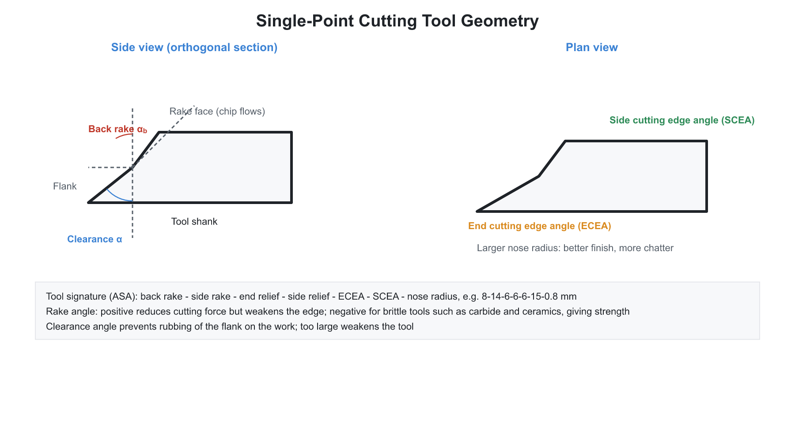
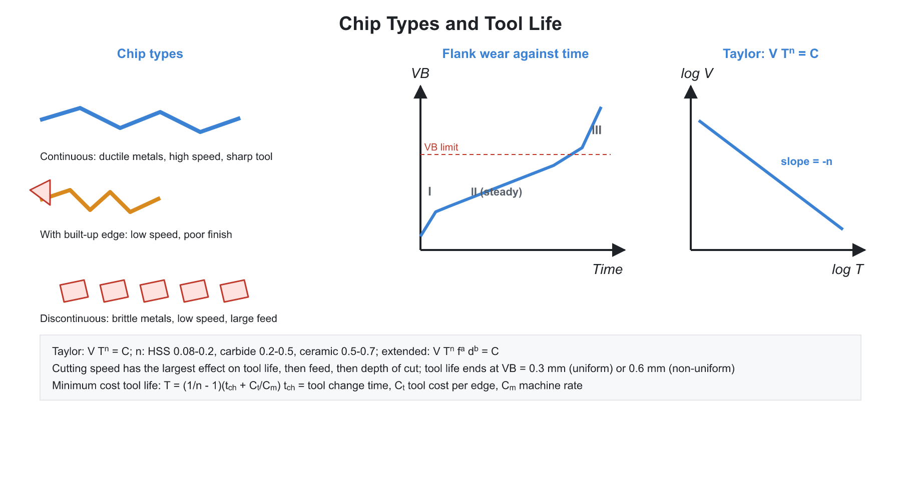
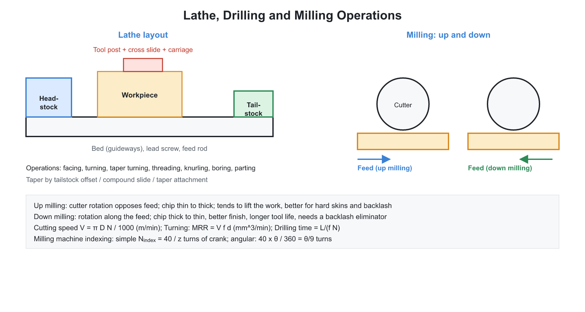

# 🏭 04. Machining, Cutting Tools and Machine Tools

**Exam relevance:** APPSC AEE: C | SSC JE: C | RRB JE: C | Category: ALL | Yield: VHY

---

## 📘 Part A: Detailed Theory (read this first)

Machining removes unwanted material in the form of chips, using a tool that is harder than the work and a relative motion between them. The theory is the physics of one thin layer of metal being sheared off. From that single picture follow the chip types, the forces, the power, the heat, the tool wear and tool life, and finally the economics of choosing a cutting speed. Machine tools (lathe, drill, mill, shaper, grinder) are simply different ways of arranging the tool and work motions.

### 🔹 A1. Mechanics of chip formation

**Cutting motions.** The primary motion (cutting speed) removes material; the feed motion moves the cutting zone to new material; the depth of cut sets the layer thickness.

**Orthogonal and oblique cutting.** In orthogonal cutting the cutting edge is perpendicular to the cutting velocity, so deformation is two-dimensional and the analysis is simple. In oblique cutting the edge is inclined, the chip flows sideways, and the analysis is three-dimensional. Real tools are oblique, but theory is developed for orthogonal cutting.

**Turning parameters.**

- Cutting speed: $V = \pi D N/1000$ m/min for $D$ in mm and $N$ in rpm.
- Feed $f$ in mm/rev; depth of cut $d$ in mm.
- Material removal rate: $MRR = V f d$ (with consistent units, for example mm/min, mm and mm giving mm$^3$/min).

**Primary shear.** The work material ahead of the tool shears along a narrow zone called the shear plane, inclined at the shear angle $\phi$ to the cutting direction. The chip then slides up the tool face against friction (secondary deformation zone).

### 🔹 A2. Tool geometry

**Tool signature (ASA system).** Back rake, side rake, end relief, side relief, end cutting edge angle, side cutting edge angle and nose radius, for example 8-14-6-6-6-15-1.

- **Rake angle:** controls chip flow and cutting force. A positive rake reduces force and power but weakens the edge. A negative rake is used with carbides and ceramics to protect the brittle edge.
- **Relief (clearance) angle:** prevents the flank rubbing on the machined surface.
- **Side cutting edge (lead) angle:** affects chip thickness and tool life.
- **Nose radius:** improves surface finish and edge strength; too large a radius causes chatter.

### 🔹 A3. Chip types

| Chip | Conditions | Remarks |
|---|---|---|
| Continuous | ductile metal, high speed, positive rake, good lubrication | good finish; chip breaker needed for safety |
| Continuous with built-up edge (BUE) | ductile metal, medium speed, high friction | layer of work material welds to the tool and spoils the finish; reduced by higher speed, coolant, positive rake |
| Discontinuous (segmented) | brittle metals (cast iron), low speed, small rake | irregular finish but stable cutting force |
| Serrated | titanium, hard materials, high speed | cyclic shear banding |

A chip breaker (a step or groove) curls and breaks a long chip for safe handling.

### 🔹 A4. Merchant's analysis of orthogonal cutting

Let $t_1$ be the uncut chip thickness, $t_2$ the chip thickness, $\alpha$ the rake angle and $\phi$ the shear angle.

**Chip thickness ratio** (cutting ratio):

$$r = \frac{t_1}{t_2} = \frac{\sin\phi}{\cos(\phi - \alpha)} \quad\Rightarrow\quad \tan\phi = \frac{r\cos\alpha}{1 - r\sin\alpha}$$

Since the chip is thicker than the uncut layer, $r < 1$, and the chip compression ratio is $1/r$.

**Shear strain in the shear plane:**

$$\gamma = \cot\phi + \tan(\phi - \alpha)$$

**Merchant's force circle.** The resultant force $R$ between tool and chip can be resolved in three ways.

- Along and across the cutting velocity: cutting force $F_c$ and thrust force $F_t$ (measured by a dynamometer).
- On the tool face: friction force $F$ and normal force $N$.
- On the shear plane: shear force $F_s$ and normal force $F_n$.

$$F = F_c\sin\alpha + F_t\cos\alpha, \qquad N = F_c\cos\alpha - F_t\sin\alpha$$

$$F_s = F_c\cos\phi - F_t\sin\phi, \qquad F_n = F_c\sin\phi + F_t\cos\phi$$

The coefficient of friction on the tool face is $\mu = \tan\beta = F/N$, where $\beta$ is the friction angle. The shear stress on the shear plane is $\tau_s = F_s/A_s$, with $A_s = b\,t_1/\sin\phi$.

**Shear angle relation.** Merchant assumed the shear angle adjusts to minimise cutting energy (or to maximise shear stress effects), giving:

$$2\phi + \beta - \alpha = 90^\circ \quad\Rightarrow\quad \phi = 45^\circ + \frac{\alpha}{2} - \frac{\beta}{2}$$

Lee and Shaffer's slip-line solution gives $\phi = 45^\circ + \alpha - \beta$.

**Insight.** A larger rake angle or a lower friction angle gives a larger shear angle, which gives a thinner chip, lower shear strain, smaller shear plane area and lower cutting force.

**Power.** Cutting power $P = F_c V$. The thrust force does no work because there is no motion along its direction. Specific cutting energy $= F_c/(b t_1)$ in J/mm$^3$.

**Heat.** Roughly 75 percent of the heat goes with the chip, about 20 percent into the work and about 5 percent into the tool. Temperature rises most with cutting speed, then feed and least with depth of cut.

### 🔹 A5. Tool wear and tool life

**Wear types.**

- **Flank wear** on the clearance face, measured as wear land width $VB$. It results from abrasion and sets the tool life criterion.
- **Crater wear** on the rake face, caused by the sliding chip at high temperature (diffusion); it lowers the strength of the edge.
- **Nose wear, notch wear** at the depth-of-cut line and **edge chipping**.

**Wear mechanisms.** Abrasion, adhesion, diffusion (at high temperature, for example carbide cutting steel), oxidation and fatigue (thermal cycling in interrupted cuts).

**Tool life.** The cutting time between tool sharpenings to a specified wear criterion, for example flank wear of 0.3 mm for HSS or carbide in general turning.

**Taylor's tool life equation:**

$$V T^n = C$$

where $T$ is the tool life in minutes, $V$ the cutting speed in m/min, $n$ an exponent depending mainly on tool material, and $C$ a constant (the speed giving one minute of tool life).

| Tool material | Exponent $n$ |
|---|---|
| HSS | 0.08 to 0.2 |
| Cemented carbide | 0.2 to 0.5 |
| Ceramics | 0.5 to 0.7 |

The extended form is $V T^n f^a d^b = C$. Because $n$ is small, a small increase in speed shortens life greatly: a 1 percent increase in $V$ lowers $T$ by about $1/n$ percent. For two conditions, $V_1 T_1^n = V_2 T_2^n$.

### 🔹 A6. Machining economics and machinability

The cutting speed decides both production rate and cost. A high speed cuts quickly but wears the tool fast, so tool change time and tool cost rise.

- **Speed for minimum cost** (economic tool life):

$$T_{opt} = \left(\frac{1}{n} - 1\right)\left(t_c + \frac{C_t}{C_m}\right)$$

with $t_c$ the tool-change time, $C_t$ the cost per tool edge and $C_m$ the machine and labour cost rate.

- **Speed for maximum production rate:** $T_{opt} = \left(\frac{1}{n} - 1\right)t_c$.
- The speed for maximum profit lies between the two. The maximum-production speed is higher than the minimum-cost speed.

**Machinability.** Ease of machining, judged by tool life, surface finish, power and chip form. Machinability index $= (V_{60}$ of the material$) / (V_{60}$ of free-cutting steel B1112$)\times 100$, where $V_{60}$ is the speed that gives 60 minutes of tool life. Sulphur, lead and phosphorus improve machinability.

### 🔹 A7. Tool materials

| Material | Properties | Typical use |
|---|---|---|
| High carbon steel | cheap; softens above $250^\circ$C | hand tools |
| HSS | 18-4-1 W-Cr-V, M2, M42 with cobalt; red hardness to about $600^\circ$C | drills, taps, general tools |
| Cast alloys (stellite) | Co-Cr-W; to about $800^\circ$C | between HSS and carbide |
| Cemented carbide | WC with Co binder; to about $1000^\circ$C; hard, brittle | high speed; ISO grades P (steel), M (stainless), K (cast iron) |
| Coated carbide | TiN, TiC, Al$_2$O$_3$ coating | higher speed and life |
| Ceramics | Al$_2$O$_3$; to $1200^\circ$C; brittle | high-speed finishing |
| Cermets | TiC/TiN with Ni | finishing |
| CBN | second hardest; does not react with ferrous metals | hardened steels |
| Diamond (PCD) | hardest; reacts with iron at high temperature | non-ferrous metals, composites |

**Required properties:** hot hardness, toughness, wear resistance and chemical stability. **Cutting fluids** cool and lubricate, reduce friction and BUE, and flush chips. Carbides often cut dry or with a continuous heavy flow because intermittent coolant causes thermal shock.

### 🔹 A8. Lathe

**Parts.** Bed, headstock (spindle and gears), tailstock, carriage (saddle, cross slide, compound rest, apron), lead screw and feed rod.

**Operations.** Turning, facing, taper turning, thread cutting, drilling, boring, knurling, parting-off, grooving and forming.

**Taper turning methods.** Compound rest swivelling (short steep tapers), tailstock offset (long gentle tapers), taper attachment and form tools. For a taper from diameter $D$ to $d$ over taper length $l$ in a job of total length $L$:

$$\tan\alpha = \frac{D - d}{2l}, \qquad \text{tailstock offset} = \frac{L(D - d)}{2l}$$

**Machining time.** Turning: $t = L/(fN)$ min. Facing: $t = (D/2)/(fN)$.

**Thread cutting.** The lead screw is geared to the spindle so that the carriage advances one thread pitch per spindle revolution:

$$\frac{N_{lead\,screw}}{N_{spindle}} = \frac{p_{thread}}{p_{lead\,screw}} = \frac{\text{driver teeth}}{\text{driven teeth}}$$

**Types and size.** Engine (centre), bench, tool room, capstan and turret (production), automatic, CNC. Size is the swing over bed and the distance between centres. **Work holding:** 3-jaw self-centring chuck (round work), 4-jaw independent chuck (irregular), collet, face plate, mandrel between centres, steady and follower rests for long slender work.

### 🔹 A9. Drilling, boring, reaming

A twist drill has a standard point angle of $118^\circ$, a helix angle of about $30^\circ$, lip relief and a chisel edge, and consists of web, flutes, margin and land. **Operations:** drilling, reaming (accurate size and finish, allowance about 0.4 mm), boring (enlarge a drilled hole using a single-point tool), counterboring, countersinking, spot facing, tapping.

- Drilling time: $t = (L + 0.3D)/(fN)$ for a $118^\circ$ point (approach allowance).
- Drilling MRR: $\dfrac{\pi D^2}{4} f N$.

### 🔹 A10. Milling

A multi-tooth rotating cutter removes material from a feeding workpiece. **Types:** peripheral (slab), face, end, form, gang, straddle and T-slot milling.

**Up and down milling.**

| Feature | Up (conventional) milling | Down (climb) milling |
|---|---|---|
| Cutter rotation versus feed | opposite | same direction |
| Chip thickness | zero at entry, maximum at exit | maximum at entry, zero at exit |
| Surface finish | poorer | better |
| Tendency | cutter tends to lift the work | cutter presses the work down |
| Machine need | normal | backlash eliminator required |
| Use | castings with hard scale | clean surfaces |

**Formulas.**

- Feed per tooth $f_t$; table feed rate $= f_t\,z\,N$ mm/min.
- Maximum chip thickness in slab milling: $t_{max} = 2 f_t\sqrt{d/D}$.
- Machining time: $t = (L + L_a + L_o)/(f_t z N)$ with approach $L_a = \sqrt{d(D - d)}$ in slab milling and $L_a = D/2$ in face milling.
- $MRR = w\,d\,f_m$.
- Simple indexing: the crank turns $40/N$ times for $N$ divisions.

### 🔹 A11. Shaping, planing, slotting and broaching

**Shaper.** The tool reciprocates and the work feeds. A quick return mechanism (Whitworth, crank and slotted link) makes the idle return stroke faster. The cutting speed is $V = L N (1 + k)/1000$ with $k$ the ratio of return time to cutting time. **Planer:** the work reciprocates, for large work. **Slotter:** a vertical shaper for keyways and internal splines.

**Broaching.** A multi-tooth tool is pushed or pulled through the work, and the rise per tooth removes the material in a single stroke; high productivity for keyways and splines, but the tool is costly.

### 🔹 A12. Grinding and finishing

**Grinding.** A bonded abrasive wheel acts as a multi-point tool for hard materials and fine finish.

- **Abrasives:** aluminium oxide (steels), silicon carbide (cast iron, non-ferrous, carbides), CBN and diamond.
- **Bonds:** vitrified (most common), resinoid, rubber, shellac and metallic.
- **Wheel marking** example A 46 K 5 V: A for aluminium oxide, 46 grit (medium), K grade (medium hardness), 5 structure (medium spacing), V vitrified bond.
- **Grade** means bond strength. Hard materials need a soft wheel so that blunt grains fall off; soft materials need a hard wheel.
- **Loading:** pores clogged with metal (soft, ductile work). **Glazing:** dulled grains not shed. **Dressing:** restores sharpness. **Truing:** restores shape.
- **Centreless grinding:** the work rests on a blade between a grinding wheel and a regulating wheel; high-volume production of round parts.

**Finishing processes.** Honing (abrasive sticks, cylinder bores, cross-hatch), lapping (loose abrasive, flats and optical surfaces), superfinishing, buffing, polishing and burnishing (plastic flow).

### 🔹 A13. What examiners test from this chapter

| Topic | APPSC AEE | SSC JE | RRB JE |
|---|---|---|---|
| Rake and relief angles, tool signature | Direct | Very common | Very common |
| Chip types and BUE | Direct | Very common | Very common |
| Merchant's circle, shear angle relation | Numerical | Common | Occasional |
| Cutting ratio and shear angle | Numerical | Common | Common |
| Taylor's equation, effect of speed on life | Numerical | Very common | Common |
| Tool materials and hot hardness | Direct | Very common | Very common |
| Lathe operations, taper turning, thread cutting | Numerical | Very common | Very common |
| Up vs down milling | Conceptual | Common | Common |
| Indexing | Numerical | Common | Common |
| Quick return mechanism of shaper | Direct | Common | Common |
| Grinding wheel marking, loading, glazing | Direct | Very common | Common |
| Economic cutting speed | Conceptual | Occasional | Rare |

---

## ⚡ Part B: Quick-reference notes, formulas, numericals and PYQs

## 🧭 1. Foundations of metal cutting

- **Machining** removes material as chips using a harder cutting tool. 
- **Orthogonal cutting:** the cutting edge is perpendicular to the cutting velocity (two-dimensional, simple analysis). **Oblique cutting:** the edge is inclined (three-dimensional; the usual practice).
- **Cutting parameters (turning):** cutting speed $V = \dfrac{\pi D N}{1000}$ m/min; **feed** $f$ (mm/rev); **depth of cut** $d$ (mm).
- **Material removal rate (turning):** $\text{MRR} = V\,f\,d$ (with consistent units: $V$ in mm/min, giving mm$^3$/min).
- **Tool signature (ASA):** back rake - side rake - end relief - side relief - end cutting edge angle - side cutting edge angle - nose radius, for example $8\text{-}14\text{-}6\text{-}6\text{-}6\text{-}15\text{-}1$.
  - **Rake angle** controls the chip flow and the cutting force: a positive rake reduces the force and the power but weakens the edge; a negative rake (used with carbides and ceramics) strengthens the edge.
  - **Clearance (relief) angle** prevents rubbing between the flank and the work surface.
  - **Side cutting edge angle (lead angle)** affects the chip thickness and the tool life.
  - **Nose radius** improves the surface finish and tool strength; too large a radius causes chatter.
- **Chip types:** **continuous** (ductile material, high speed, positive rake; good finish), **continuous with built-up edge (BUE)**, **discontinuous (segmented)** (brittle material like cast iron, low speed, small rake), and **serrated**. BUE is a layer of work material welded to the tool; it spoils the finish and is reduced by increasing speed, using coolant, and positive rake.
- **Chip breakers** limit the chip length for safety.

## 🧭 2. Merchant's theory (orthogonal cutting mechanics)

Let $t_1$ be the uncut chip thickness, $t_2$ the chip thickness after cutting, $\alpha$ the rake angle, and $\phi$ the shear angle.

$$r = \frac{t_1}{t_2} = \frac{\sin\phi}{\cos(\phi - \alpha)}\quad\Rightarrow\quad \tan\phi = \frac{r\cos\alpha}{1 - r\sin\alpha}$$

- **Chip thickness ratio (cutting ratio)** $r < 1$; **chip compression ratio** $= \dfrac{1}{r}$.
- **Shear strain:**

$$\gamma = \cot\phi + \tan(\phi - \alpha)$$

- **Force circle (Merchant's circle):** the resultant force $R$ is resolved into
  - cutting force $F_c$ (along the velocity) and thrust force $F_t$ (perpendicular);
  - friction force $F$ and normal force $N$ on the tool face;
  - shear force $F_s$ and normal force $F_n$ on the shear plane.

$$F = F_c\sin\alpha + F_t\cos\alpha,\qquad N = F_c\cos\alpha - F_t\sin\alpha$$

$$F_s = F_c\cos\phi - F_t\sin\phi,\qquad F_n = F_c\sin\phi + F_t\cos\phi$$

- **Coefficient of friction on the tool face:** $\mu = \tan\beta = \dfrac{F}{N}$, with friction angle $\beta$.
- **Shear stress on the shear plane:** $\tau_s = \dfrac{F_s}{A_s}$, with $A_s = \dfrac{b\,t_1}{\sin\phi}$.
- **Merchant's first relation** (minimum energy / maximum shear stress):

$$2\phi + \beta - \alpha = 90^\circ,\qquad \phi = 45^\circ + \frac{\alpha}{2} - \frac{\beta}{2}$$

- **Lee and Shaffer** (slip-line theory): $\phi = 45^\circ + \alpha - \beta$.
- **Power:** cutting power $P = F_c\,V$ (the thrust force does no work as there is no motion along it). **Specific cutting energy** $= \dfrac{F_c}{b\,t_1}$ (J/mm$^3$). 
- **Energy distribution:** roughly $70\%$ to $80\%$ is the shear plane energy; friction accounts for the remainder. About $75\%$ of the heat goes with the chip, $20\%$ into the work, and $5\%$ into the tool.
- **Cutting temperature** rises with the cutting speed (greatest influence), then feed and then depth of cut.

## 🧭 3. Tool wear and tool life

- **Wear types:** **flank wear** (on the clearance face; characterised by the wear land $VB$), **crater wear** (on the rake face from chip friction; at high temperature), **nose wear**, notch wear, and edge chipping.
- **Wear mechanisms:** abrasion, adhesion, diffusion (at high temperature, in carbide tools), oxidation, and fatigue.
- **Tool life:** the time of cutting between sharpenings to a specified wear criterion (flank wear of $0.3$ mm for HSS and carbide in general-purpose work, according to ISO).
- **Taylor's tool life equation:**

$$V\,T^n = C$$

  where $T$ is the tool life (min), $V$ the cutting speed (m/min), $n$ the exponent and $C$ a constant (the speed that gives a $1$-minute tool life).

| Tool material | $n$ |
|---|---|
| HSS | $0.08$ to $0.2$ |
| Cemented carbide | $0.2$ to $0.5$ |
| Ceramics | $0.5$ to $0.7$ |

- **Extended Taylor equation:** $V\,T^n\,f^a\,d^b = C$.
- **Tool life vs speed:** a small increase in cutting speed shortens the tool life sharply (a $1\%$ rise in $V$ reduces $T$ by about $\dfrac{1}{n}\%$).
- **Machining economics:** 
  - **Minimum cost speed** (economic tool life): 

$$T_{opt} = \left(\frac{1}{n} - 1\right)\left(t_c + \frac{C_t}{C_m}\right)$$

  where $t_c$ is the tool-change time, $C_t$ the cost of a tool edge (grinding and depreciation) and $C_m$ the machine and labour cost rate.
  - **Maximum production rate speed:** $T_{opt} = \left(\frac{1}{n} - 1\right)t_c$.
  - **Maximum profit** speed lies between these two. The maximum-production speed is higher than the minimum-cost speed.
- **Machinability:** ease of machining, indicated by tool life, surface finish, power consumption and chip form. **Machinability index** $= \dfrac{V_{60}\ \text{of the material}}{V_{60}\ \text{of the free-cutting steel (B1112)}}\times100$, with $V_{60}$ the speed that gives a tool life of $60$ minutes. Free-machining additives are sulphur, lead and phosphorus.

## 🧭 4. Tool materials

| Material | Properties | Hot hardness / use |
|---|---|---|
| **High carbon steel** | Cheap; loses hardness above $250^\circ$C | Hand tools |
| **HSS (high-speed steel)** | 18-4-1 (W-Cr-V) or M2, M42 with cobalt; red hardness up to about $600^\circ$C | General cutting tools, drills, taps |
| **Cast alloys (stellite)** | Co-Cr-W; up to $\approx 800^\circ$C | Between HSS and carbide |
| **Cemented carbide** | WC with Co binder (sintered); $\approx 1000^\circ$C; high compressive strength, brittle | Higher speeds; ISO P (steel), M (stainless), K (cast iron) grades. TiC and TaC added for steel cutting |
| **Coated carbide** | TiN, TiC, Al$_2$O$_3$ (CVD/PVD) | Higher speed and tool life |
| **Ceramics** | Al$_2$O$_3$; up to $1200^\circ$C; very hard, brittle | High-speed finishing of cast iron and steel |
| **Cermets** | TiC/TiN with Ni | Finishing |
| **CBN (cubic boron nitride)** | Second hardest; stable at high temperature, does not react with ferrous metals | Hardened steels |
| **Diamond (PCD)** | Hardest; reacts with iron at high temperature | Non-ferrous metals, composites |

- **Cutting fluids:** cool (water-based) and lubricate (oils); reduce friction and BUE; flush the chips. Soluble oil, neat oil, synthetic fluids. Carbide tools often cut dry or with a continuous heavy flow, because an interrupted coolant supply causes thermal shock.

## 🧭 5. Machine tools and operations

### 🔹 Lathe

- **Parts:** bed, headstock (spindle, gears), tailstock, carriage (saddle, cross slide, compound rest, apron), lead screw and feed rod.
- **Operations:** turning, facing, taper turning, thread cutting, drilling, boring, knurling, parting-off, grooving, forming.
- **Taper turning methods:** compound rest swivelling (short, steep tapers), tailstock offset (long, gentle tapers; offset $= \dfrac{L\,(D - d)}{2\,l}$ for a total length $L$ and taper length $l$), taper turning attachment, and form tools. **Taper:** $\tan\alpha = \dfrac{D - d}{2l}$ where $\alpha$ is the half angle.
- **Machining time (turning):** $t = \dfrac{L}{f\,N}$ min. For **facing:** $t = \dfrac{D/2}{f\,N}$.
- **Thread cutting:** the lead screw is driven from the spindle through change gears. For each spindle revolution the carriage must advance by the pitch $p$ of the thread to be cut, so

$$\frac{N_{lead\,screw}}{N_{spindle}} = \frac{p_{thread}}{p_{lead\,screw}} = \frac{\text{driver teeth}}{\text{driven teeth}}$$

- **Types of lathes:** engine (centre) lathe, bench, tool room, capstan and turret (production: multiple tool stations), automatic (screw machine), CNC lathe. **Size:** swing over bed (largest diameter) and distance between centres.
- **Work holding:** chuck (3-jaw self-centring for round work, 4-jaw independent for irregular), collet, face plate, between centres with a mandrel, and steady and follower rests (to support long slender work).

### 🔹 Drilling, boring, reaming

- **Drill** (twist drill): point angle $118^\circ$ (standard); helix angle $\approx 30^\circ$ for general-purpose; lip relief; chisel edge. The drill has the **web**, **flutes**, **margin** and **land**.
- **Operations:** drilling, reaming (accurate sizing and finish; the allowance is about $0.4$ mm), boring (enlarging a drilled hole; single-point), counterboring, countersinking, spot facing, tapping.
- **Drilling time:** $t = \dfrac{L + 0.3\,D}{f\,N}$ (the approach allowance is about $0.3\,D$ for a $118^\circ$ point). For a blind hole, add the tip allowance.
- **MRR (drilling)** $= \dfrac{\pi D^2}{4}\,f\,N$.

### 🔹 Milling

- A rotating multi-tooth cutter removes material from a feeding workpiece.
- **Types:** **peripheral (slab) milling**, **face milling**, **end milling**, **form milling**, **gang**, **straddle**, and **T-slot**. Machines: horizontal, vertical, universal, planer type.
- **Up (conventional) milling:** the cutter rotates against the feed; the chip thickness starts at zero and increases; the surface finish is poorer and the cutter tends to lift the workpiece (needs a rigid clamp); used for castings with a hard scale. **Down (climb) milling:** the cutter rotates with the feed; the chip begins at maximum thickness and reduces to zero; better finish and longer tool life; the machine requires a **backlash eliminator**; avoids work lift; not for scaly surfaces.
- **Feed per tooth** $f_t$; **feed rate** $= f_t\,z\,N$ (mm/min), $z$ being the number of teeth.
- **Maximum chip thickness (slab milling):** $t_{max} = 2\,f_t\sqrt{\dfrac{d}{D}}$ (depth of cut $d$ and cutter diameter $D$).
- **Machining time:** $t = \dfrac{L + L_a + L_o}{f_t\,z\,N}$, with approach $L_a = \sqrt{d\,(D - d)}$ for slab milling, and $L_a = \dfrac{D}{2}$ for face milling.
- **MRR** $= w\,d\,f_m$ (width $\times$ depth $\times$ feed rate).
- **Indexing (dividing head):** simple indexing, with the index crank rotating $\dfrac{40}{N}$ turns for $N$ divisions (gear ratio $40:1$). Compound, differential and angular indexing are other methods.

### 🔹 Shaping, planing, slotting

- **Shaper:** the tool reciprocates and the work feeds; **quick return mechanism** (Whitworth, crank-and-slotted-link) gives the idle return stroke a higher speed. **Quick return ratio** $= \dfrac{\text{cutting stroke time}}{\text{return stroke time}}$ (typically $3:2$). **Planer:** the work reciprocates and the tool feeds; for large work. **Slotter:** a vertical shaper (keyways, internal splines).
- **Shaper time:** $t = \dfrac{W}{f\,N}$, where $W$ is the width and the speed in strokes/min; the **cutting speed** $V = \dfrac{L\,N\,(1 + k)}{1000}$, with $k = \dfrac{\text{return time}}{\text{cutting time}}$ (m/min).

### 🔹 Grinding

- A bonded abrasive wheel acts as a multi-point tool for finishing and for hard materials.
- **Abrasives:** aluminium oxide (steel), silicon carbide (cast iron, non-ferrous, carbides), CBN, diamond. **Bond:** vitrified (most common), resinoid, rubber, shellac, metallic.
- **Wheel marking:** e.g. **A 46 K 5 V**: abrasive type (A = Al$_2$O$_3$), grit size (46: medium), grade (K: medium hardness; A soft, Z hard), structure (5: medium; open or dense), bond (V: vitrified).
- **Grade** is the bond strength. **Soft** wheels for hard materials (so that dull grains fall off), **hard** wheels for soft materials.
- **Wheel actions:** **loading** (clogging by metal, in soft ductile materials), **glazing** (dulled grains), **dressing** (restoring the shape and sharpness), **truing**.
- **Types:** cylindrical (external, internal, centreless), surface (reciprocating, rotary), tool and cutter grinders. **Centreless grinding** has no centres; the work is supported on a blade between a regulating wheel and a grinding wheel; for high production of round parts.
- **Finishing processes:** **honing** (abrasive sticks, cylinder bores, crosshatch pattern), **lapping** (loose abrasive in a vehicle; flat/optical), **superfinishing**, **buffing**, **polishing**, **burnishing** (plastic flow).

### 🔹 Other

- **Broaching:** a multi-tooth tool pushed or pulled through; the rise per tooth removes material in a single stroke; used for keyways and splines; high productivity; the tool is expensive.
- **Sawing, gear cutting (forming, generating: hobbing, shaping, shaving), thread cutting/rolling.**

## 🧭 6. Worked numericals

1. **Cutting speed.** $D = 50$ mm at $N = 400$ rpm: $V = \dfrac{\pi\times50\times400}{1000} = 62.8$ m/min.
2. **Turning time.** $L = 200$ mm, $f = 0.2$ mm/rev, $N = 400$: $t = \dfrac{200}{0.2\times400} = 2.5$ min.
3. **Taylor.** $VT^{0.25} = C$; at $V = 60$ m/min the life is $60$ min. At $V = 90$: $T = 60\times\left(\dfrac{60}{90}\right)^{4} = 60\times0.1975 = 11.9$ min.
4. **Shear angle.** $r = 0.4$, $\alpha = 10^\circ$: $\tan\phi = \dfrac{0.4\times0.985}{1 - 0.4\times0.174} = 0.4235$, so $\phi = 22.9^\circ$.
5. **Merchant.** $\alpha = 10^\circ$, $\beta = 30^\circ$: $\phi = 45 + 5 - 15 = 35^\circ$.
6. **Cutting power.** $F_c = 1000$ N, $V = 60$ m/min: $P = \dfrac{1000\times60}{60\times1000} = 1$ kW.
7. **Optimum tool life.** $n = 0.25$, $t_c = 2$ min, $C_t/C_m = 3$ min: $T = (4 - 1)(2 + 3) = 15$ min.
8. **Milling time.** Slab length $200$ mm, $D = 100$ mm, $d = 5$ mm, $z = 8$, $f_t = 0.1$ mm, $N = 100$ rpm: $L_a = \sqrt{5\times95} = 21.8$ mm; $t = \dfrac{200 + 21.8}{0.1\times8\times100} = 2.77$ min.

## 🧭 7. Common mistakes

- Treating the thrust force as doing work; only $F_c$ contributes to power.
- Using the optimum tool life formula without the factor $\left(\frac1n - 1\right)$.
- Mixing up up-milling and down-milling chip profiles.
- Confusing truing with dressing of a grinding wheel: truing restores the wheel geometry (concentricity and profile), dressing restores the sharpness by removing clogged and dulled grains.
- Selecting a hard wheel for a hard workpiece; the correct pick is a soft grade.

## 🧭 8. Interconnections

- **Strength of materials:** shear stress and strain in the shear plane.
- **Material science:** hardness, hot hardness, tool materials.
- **Heat transfer:** cutting temperature, coolant.
- **Industrial engineering:** machining economics, tool-life management.

## 🧭 9. PYQs

| # | Question | Answer | Exam / Year | Verify |
|---|---|---|---|---|
| 1 | Taylor's tool life equation | $VT^n = C$ | SSC JE 2017 | [ ] |
| 2 | Merchant's relation | $2\phi + \beta - \alpha = 90^\circ$ | RRB JE 2015 | [ ] |
| 3 | Chip thickness ratio $r$ is | $\dfrac{t_1}{t_2}$, always less than $1$ | SSC JE 2018 | [ ] |
| 4 | Continuous chips with BUE occur at | Low cutting speed in ductile materials | RRB JE 2014 | [ ] |
| 5 | Discontinuous chips are produced when machining | Brittle materials like cast iron | SSC JE 2016 | [ ] |
| 6 | Crater wear occurs on | Rake face | APPSC AEE 2012 | [ ] |
| 7 | Flank wear occurs on | Clearance (flank) face | SSC JE 2019 | [ ] |
| 8 | Hardest tool material | Diamond | RRB JE 2019 | [ ] |
| 9 | Cemented carbide tools are made of | Tungsten carbide with cobalt binder | SSC JE 2015 | [ ] |
| 10 | Quick return mechanism is used in | Shaper | RRB JE 2016 | [ ] |
| 11 | Drill point angle (standard) | $118^\circ$ | SSC JE 2020 | [ ] |
| 12 | Down milling | Cutter rotation is in the same direction as the feed | RRB JE 2018 | [ ] |
| 13 | Grinding wheel for hard material should be | Soft grade | SSC JE 2021 | [ ] |
| 14 | In grinding, loading means | Clogging of the wheel with metal particles | APPSC AEE 2016 | [ ] |
| 15 | Tool life increases with | Decrease in cutting speed | RRB JE 2017 | [ ] |
| 16 | Power consumed in cutting is equal to | $F_c\times V$ | SSC JE 2022 | [ ] |
| 17 | Index crank turns for 10 divisions | $\dfrac{40}{10} = 4$ turns | RRB JE 2013 | [ ] |

## 🧭 10. Revision checklist

- [ ] Tool signature and angles
- [ ] Merchant's circle and relations
- [ ] Taylor's equation and economic life
- [ ] Tool materials and hot hardness
- [ ] Machine tool operations and time formulas
- [ ] Up vs down milling; grinding wheel marking
