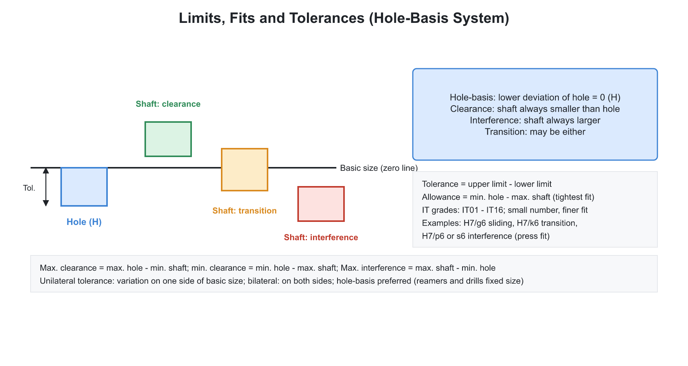
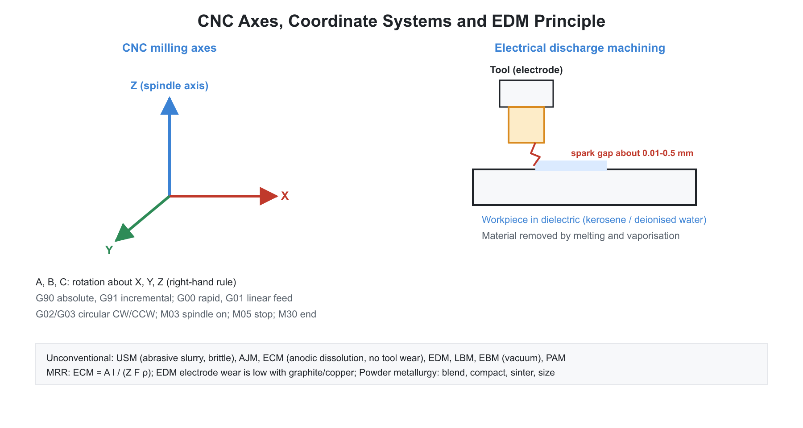

# 🏭 05. Metrology, CNC, Unconventional Machining, Powder Metallurgy and Fixtures

**Exam relevance:** APPSC AEE: C | SSC JE: C | RRB JE: C | Category: ALL | Yield: HY

---

## 📘 Part A: Detailed Theory (read this first)

This chapter groups four themes that are all about control and precision in manufacturing. Metrology and limits-fits answer how we measure a dimension and how much variation a part may have and still assemble correctly. CNC and automation answer how a machine follows a programme with no operator guidance. Unconventional machining answers how to cut materials that conventional tools cannot touch, using electrical, chemical or mechanical energy instead of a cutting edge. Powder metallurgy and jigs and fixtures complete the picture with a net-shape process and the tooling that makes repeatable production possible.

### 🔹 A1. Fundamentals of measurement

**Metrology** is the science of measurement. A measurement is useful only when we know how good it is.

- **Accuracy:** closeness of the reading to the true value.
- **Precision:** closeness of repeated readings to each other. An instrument can be precise but not accurate (a constant offset).
- **Least count:** the smallest value the instrument can read.
- **Sensitivity** (output change per unit input), **range**, **resolution**, **readability**, **hysteresis**, **calibration** (comparison with a higher standard) and **traceability** (chain of calibration to the national standard).

**Errors.** Systematic errors have a fixed pattern and can be corrected (zero error, calibration, temperature). Random errors vary unpredictably and are reduced by averaging. Gross errors are blunders. Parallax error occurs when the scale is read from an angle.

**Standards.** The metre is defined from the speed of light. Line standards (a scale) are read between two lines; end standards (slip gauges) are read between two flat faces.

**Slip (gauge) blocks.** Hardened steel, carbide or ceramic blocks with flat, parallel faces that can be wrung together by molecular attraction. Grades 00, 0, I and II (calibration, inspection, workshop). To build a size with the fewest blocks, eliminate the last decimal place first.

### 🔹 A2. Linear and angular measuring instruments

| Instrument | Typical least count |
|---|---|
| Vernier calliper | 0.02 mm (50 vernier divisions equal 49 main-scale divisions) |
| Micrometer (outside) | 0.01 mm (screw pitch 0.5 mm, 50 thimble divisions) |
| Vernier height and depth gauges | 0.02 mm |
| Dial indicator | 0.01 mm (rack, pinion and gear train) |
| Vernier bevel protractor | 5 minutes of arc |

**Least count formulas.**

$$LC_{vernier} = 1\,MSD - 1\,VSD = \frac{\text{smallest main scale division}}{\text{number of vernier divisions}}, \qquad LC_{micrometer} = \frac{\text{screw pitch}}{\text{thimble divisions}}$$

**Comparators.** They compare a part against a standard and magnify the difference. Types: mechanical (dial indicator, Johansson Mikrokator, reed type), optical (Zeiss ultra-optimeter), electrical (LVDT), pneumatic (Solex) and fluidic.

**Sine bar.** Sets or measures angles: $\sin\theta = h/L$, where $L$ is the centre distance between rollers and $h$ is the gauge block height. It is accurate up to about $45^\circ$; at larger angles a small error in $h$ causes a larger error in $\theta$, so a sine centre or table is used.

**Other angle tools.** Angle gauges, autocollimator, clinometer, spirit level and taper gauges.

**Optical flat.** A precisely flat glass plate placed on a surface under monochromatic light. Interference gives fringes; straight, parallel and equally spaced fringes mean a flat surface. Each fringe corresponds to a height difference of $\lambda/2$.

**Other equipment.** Tool maker's microscope, profile projector, coordinate measuring machine (CMM) and laser interferometer.

**Surface finish.** The arithmetic mean roughness $R_a$ is the most common parameter; others are $R_z$ and $R_{max}$. Measured with a stylus profilometer such as Talysurf. Typical $R_a$: turning 1.6 to 6.3 $\mu$m, grinding 0.2 to 1.6 $\mu$m, lapping 0.025 to 0.4 $\mu$m. Surface texture consists of roughness, waviness and lay.

### 🔹 A3. Limits, fits and tolerances

**Definitions.**

- **Basic (nominal) size:** the reference size. **Actual size:** measured size.
- **Limits of size:** maximum and minimum permitted sizes.
- **Tolerance:** upper limit minus lower limit.
- **Deviation:** difference of a limit from the basic size. **Fundamental deviation:** the deviation nearest to the zero line.

**Systems.**

- **Hole basis:** the hole has zero lower deviation (letter H) and the shaft varies to give the required fit. It is preferred because holes are produced by fixed-size tools (drills, reamers) while shafts are easily turned to any size.
- **Shaft basis:** the shaft has zero upper deviation (letter h) and the hole varies.

**Types of fit.**

| Fit | Condition | Examples |
|---|---|---|
| Clearance | shaft always smaller than the hole | H7/g6 (sliding), H8/f7 (running) |
| Transition | may give clearance or interference | H7/k6, H7/n6 |
| Interference | shaft always larger than the hole | H7/p6, H7/s6 (press or shrink fit) |

**Allowance** is the intentional difference between mating parts: minimum hole size minus maximum shaft size (positive for clearance, negative for interference).

**ISO designation.** In a callout such as 40 H7/g6, the letter gives the position of the tolerance zone relative to the zero line and the number is the IT grade (magnitude of tolerance). There are 18 grades from IT01 to IT16. Fine grades are for gauges and precision parts; coarse grades are for casting and forming.

**Standard tolerance unit.** $i = 0.45\sqrt[3]{D} + 0.001D$ in micrometres, where $D$ is the geometric mean diameter in mm. Then IT7 $= 16i$, IT8 $= 25i$, IT9 $= 40i$, IT10 $= 64i$ and IT11 $= 100i$.

**Limit gauges.** A go gauge checks the maximum material limit (smallest hole, largest shaft), and a no-go gauge checks the minimum material limit.

- **Taylor's principle:** the go gauge should have the full form of the feature so that it checks all dimensions at once, and the no-go gauge should check only one dimension at a time.
- Plug gauges check holes; ring and snap (gap) gauges check shafts.
- Gauge tolerance is about 10 percent of the work tolerance, and wear allowance is added on the go gauge.

**Interchangeability and selective assembly.** If parts are made within limits, any part fits any mate. When tolerances would be too expensive to hold, selective assembly sorts parts into groups and matches them.

**Geometric tolerances (GD&T).** Form (straightness, flatness, circularity, cylindricity), orientation (parallelism, perpendicularity, angularity), location (position, concentricity, symmetry) and run-out.

**Threads and gears.** Screw thread major, minor and pitch diameters; the three-wire method gives the effective diameter. Gear tooth vernier (chordal thickness), base tangent method and rolling gear tester measure gears.

### 🔹 A4. NC, CNC and DNC

- **NC:** control by coded instructions, originally on punched tape.
- **CNC:** a computer in the machine control unit stores and edits programs.
- **DNC:** a central computer sends programs to several machines.

**Axes.** X, Y and Z are linear; A, B and C are rotations about X, Y and Z. The Z axis lies along the spindle.

**Coordinates.** Absolute (G90) measures from the origin; incremental (G91) measures from the previous point.

**Control types.** Point-to-point (positioning only, such as drilling), straight-cut, and continuous path or contouring (milling and turning profiles).

**Loops.** Open loop uses stepper motors with no feedback; closed loop uses servo motors with feedback from encoders, resolvers or linear scales and corrects errors.

**System parts.** Program input, machine control unit, drive system (servo motors and ball screws), feedback devices and the machine tool. Ball screws have very low friction and no backlash. Adaptive control adjusts cutting parameters in real time from sensor signals.

**Merits and demerits.** Accuracy, repeatability, flexibility, shorter setup time and the ability to make complex shapes, against high cost, skilled programming and maintenance.

### 🔹 A5. Part programming

| Code | Function |
|---|---|
| G00 | rapid positioning |
| G01 | linear interpolation at feed rate |
| G02 / G03 | circular interpolation clockwise / counter-clockwise |
| G04 | dwell |
| G17 / G18 / G19 | XY / ZX / YZ plane |
| G20 / G21 | inch / metric input |
| G28 | return to reference point |
| G40 / G41 / G42 | cutter compensation cancel / left / right |
| G43 | tool length compensation |
| G54 to G59 | work coordinate systems |
| G90 / G91 | absolute / incremental |
| G94 / G95 | feed per minute / feed per revolution |
| G96 / G97 | constant surface speed / constant rpm |
| M00 | program stop |
| M01 | optional stop |
| M02 / M30 | end of program / end and rewind |
| M03 / M04 / M05 | spindle clockwise / counter-clockwise / stop |
| M06 | tool change |
| M08 / M09 | coolant on / off |

**Format.** A block contains words with address letters: N (sequence number), G, X Y Z, F (feed), S (speed), T (tool) and M. A modal code stays active until changed; a non-modal code acts only in its block.

### 🔹 A6. Robotics and automation

A robot is a programmable multifunction manipulator. Its degrees of freedom decide its mobility. Common configurations: Cartesian, cylindrical, spherical (polar), SCARA and articulated.

**Related ideas.** Flexible manufacturing system (FMS), computer integrated manufacturing (CIM), CAD/CAM, automated guided vehicles (AGV). **Additive manufacturing** builds parts layer by layer: FDM, SLA, SLS and DMLS. **Group technology** and cellular manufacturing group similar parts; **transfer lines** suit mass production.

### 🔹 A7. Unconventional machining processes

These are used for hard or brittle materials, complex shapes and micro-features, where a cutting edge is impractical.

| Process | Energy and mechanism | Tool or medium | Remarks |
|---|---|---|---|
| USM | mechanical; tool vibrates at about 20 kHz and drives abrasive slurry (SiC, B$_4$C, Al$_2$O$_3$) onto the work | soft tool such as mild steel | brittle hard materials (glass, ceramics, carbide); not for ductile metals |
| AJM | high-velocity gas carrying abrasive | nozzle | cutting and deburring of brittle materials |
| WJM / AWJM | high-pressure water jet (to about 400 MPa), abrasive added for hard material | nozzle | soft materials and composites; no heat-affected zone |
| ECM | anodic dissolution (Faraday's laws) with electrolyte such as NaCl or NaNO$_3$ | tool is the cathode and does not wear | complex shapes in hard conductive material; no residual stress |
| EDM | thermal; spark erosion in dielectric (kerosene, deionised water) | graphite or copper electrode (wears) | conductive hard material, dies and moulds; wire EDM uses a thin brass wire |
| LBM | thermal; focused laser vaporises material | beam | micro-holes, cutting; any material |
| EBM | thermal; focused electron beam in a vacuum | beam | very small holes |
| PAM | thermal; high-temperature plasma | torch | cutting conductive metals |
| CHM | chemical etching | mask and etchant | thin sheets, large areas, printed circuits |

**ECM and Faraday's law.** The mass removed is

$$m = \frac{E\,I\,t}{F} = \frac{A\,I\,t}{z\,F}$$

where $E = A/z$ is the chemical equivalent (atomic mass over valency) and $F = 96500$ C/mol. The volumetric MRR is $A I \eta/(z F \rho)$. The removal rate depends on current and the material's equivalent weight, not on its hardness.

**EDM details.** In a relaxation circuit with resistor $R$, capacitor $C$ and voltage $V$, the energy per spark is $\tfrac{1}{2}CV^2$ and the charging time is governed by $RC$. A servo mechanism maintains the spark gap. The recast layer on the surface is a drawback.

**USM details.** Material is removed by brittle fracture under the impact of abrasive grains. MRR rises with amplitude, frequency and grit size and falls with workpiece hardness and toughness.

**Process choice.** Hard conductive materials: EDM or ECM. Hard non-conductive materials: USM or laser. Thin soft sheets: water jet.

### 🔹 A8. Powder metallurgy

**Process.** Metal powders are blended, compacted in a die (typically 100 to 900 MPa) and sintered below the melting point (about 0.7 to 0.9 $T_m$) in a controlled atmosphere, where particles bond by atomic diffusion.

**Steps.** Powder production (atomisation, reduction, electrolysis, carbonyl process, milling), blending, compacting, sintering and finishing (sizing, coining, infiltration, impregnation).

**Products.** Self-lubricating bearings (oil-impregnated bronze), cemented carbide tools, filters (controlled porosity), gears, magnets and refractory metals such as the tungsten filament (which cannot be cast).

**Advantages and limits.** Near-net-shape with little waste, controlled porosity and the ability to make alloys and composites that cannot be cast, against high powder and die cost, size limits, lower density and strength and difficulty with complex shapes.

**Powder properties.** Particle size and shape, flow rate, apparent density and compressibility.

### 🔹 A9. Jigs and fixtures

- **Jig:** holds the work and guides the tool (drill bushes). Used in drilling, reaming and tapping.
- **Fixture:** holds and positions the work but does not guide the tool; the tool is set relative to the work with set blocks or feeler gauges. Used in milling, turning, grinding and welding.

**3-2-1 principle.** A rigid body has six degrees of freedom. Three points on the primary plane restrain three, two points on the secondary plane restrain two, and one point on the tertiary plane restrains the last.

**Elements.** Locating elements: pins, V-blocks and buttons. Clamping elements: strap, screw, cam, toggle, hydraulic and pneumatic. Clamps must hold firmly without distorting the work. Good design allows easy loading and unloading, chip clearance and error-proofing.

**Benefits.** Interchangeability, accuracy, higher productivity and lower skill requirements.

### 🔹 A10. What examiners test from this chapter

| Topic | APPSC AEE | SSC JE | RRB JE |
|---|---|---|---|
| Accuracy vs precision, least count | Direct | Very common | Very common |
| Vernier and micrometer reading | Numerical | Very common | Very common |
| Sine bar, optical flat, comparators | Direct | Common | Common |
| Limits, fits, tolerance, allowance numerical | Numerical | Very common | Common |
| Hole basis vs shaft basis, types of fits | Direct | Very common | Very common |
| Go and no-go gauges, Taylor's principle | Direct | Common | Common |
| NC, CNC, DNC, open and closed loop | Direct | Common | Very common |
| G and M codes | Direct | Very common | Very common |
| USM, ECM, EDM, laser, water jet | Direct | Very common | Very common |
| Faraday's law in ECM | Numerical | Common | Occasional |
| Powder metallurgy steps and products | Direct | Common | Common |
| Jigs vs fixtures, 3-2-1 principle | Direct | Very common | Common |

---

## ⚡ Part B: Quick-reference notes, formulas, numericals and PYQs

## 🧭 SECTION I: METROLOGY AND LIMITS, FITS

## 🧭 1. Measurement basics

- **Metrology** is the science of measurement. 
- **Accuracy:** closeness to the true value. **Precision:** repeatability of readings. **Least count:** the smallest value that an instrument can read. **Sensitivity**, **range**, **readability**, **resolution**, **hysteresis**, **calibration**, **traceability**.
- **Errors:** systematic (can be corrected: calibration, zero, environment), random, gross. **Parallax error** occurs when reading a scale at an angle.
- **Standards of length:** the metre is defined from the speed of light; line standards (scale) and end standards (gauge blocks, slip gauges).
- **Slip (gauge) blocks:** end standards, wrung together; grades 00, 0, I, II (calibration, inspection, workshop). Made of hardened steel, carbide, or ceramic; flatness within microns. Building a size from the minimum number of blocks starts with the last decimal place.

## 🧭 2. Linear measuring instruments

| Instrument | Least count |
|---|---|
| **Vernier calliper** | $0.02$ mm (50 divisions on the vernier = 49 on the main scale), $0.1$ mm or $0.05$ mm for other types |
| **Micrometer (outside)** | $0.01$ mm (thimble with 50 divisions on a pitch of $0.5$ mm) |
| **Vernier height gauge, depth gauge** | $0.02$ mm |
| **Dial indicator** | $0.01$ mm, a rack and pinion with a gear train |
| **Bevel protractor (vernier)** | $5'$ (minutes of arc) |

- **Least count (vernier):** $\text{LC} = 1\ \text{MSD} - 1\ \text{VSD} = \dfrac{\text{smallest main-scale division}}{\text{number of vernier divisions}}$.
- **Micrometer least count** $= \dfrac{\text{pitch of the screw}}{\text{number of thimble divisions}}$.
- **Comparators** (compare a part with a standard, with an amplification): **mechanical** (dial indicator, Johansson Mikrokator, reed type), **optical** (Zeiss ultra-optimeter), **electrical** (LVDT), **pneumatic** (Solex), and **fluidic**. 
- **Sine bar:** measures or sets angles. $\sin\theta = \dfrac{h}{L}$, where $L$ is the distance between roller centres and $h$ the height of the slip gauge pile. It is accurate up to about $45^\circ$; for larger angles the error grows because the sine function flattens in sensitivity near $90^\circ$ (use a sine centre or a sine table). 
- **Angle gauges, autocollimator, clinometer, spirit level, taper gauges.**
- **Optical flat:** checks the flatness by interference fringes (monochromatic light); a flat surface gives straight, parallel fringes, and each fringe represents a height of $\dfrac{\lambda}{2}$.
- **Tool makers' microscope**, **profile projector**, **coordinate measuring machine (CMM)**, **laser interferometer**.
- **Surface finish:** roughness parameter $R_a$ (arithmetic mean deviation), $R_z$, $R_{max}$. **Profilometer** (stylus), **Talysurf**. Typical $R_a$: turning $1.6$ to $6.3\ \mu$m, grinding $0.2$ to $1.6\ \mu$m, lapping $0.025$ to $0.4\ \mu$m. Lay, waviness and roughness are components of a surface texture.

## 🧭 3. Limits, fits and tolerances

- **Basic size** (nominal), **actual size**, **limits of size** (maximum and minimum), **tolerance** = upper limit $-$ lower limit, **deviation** (upper and lower) from the basic size, **fundamental deviation** (the one nearest the zero line).
- **Hole basis system:** the hole is the constant member (lower deviation zero, letter H); the shaft varies to give the fit. **Shaft basis system:** the shaft is constant (upper deviation zero, letter h). The hole basis system is preferred because holes are made with standard-size tools (reamers, drills) while shafts are easily turned to different sizes.
- **Fits:**

| Fit | Condition | Examples |
|---|---|---|
| **Clearance** | Shaft always smaller than the hole | H7/g6 (sliding), H8/f7 (running) |
| **Transition** | May give clearance or interference | H7/k6, H7/n6 |
| **Interference** | Shaft always larger than the hole | H7/p6, H7/s6 (press fit, shrink fit) |

- **Allowance** $=$ minimum hole size $-$ maximum shaft size (the intentional difference; positive for clearance, negative for interference).
- **Designation (ISO):** e.g. $\phi 40\,H7/g6$: the letter gives the position of the tolerance zone relative to the zero line; the number is the **IT grade** (tolerance magnitude). 18 IT grades (IT01, IT0, IT1 to IT16). Finer grades are for gauges; coarser for casting and forming.
- **Standard tolerance unit** $i = 0.45\sqrt[3]{D} + 0.001\,D$ ($\mu$m, with $D$ the geometric mean of the diameter step in mm). IT7 $= 16i$, IT8 $= 25i$, IT9 $= 40i$, IT10 $= 64i$, IT11 $= 100i$.
- **Gauges:** **go and no-go** limit gauges. The **go** gauge checks the maximum material limit; the **no-go** checks the minimum material limit. **Taylor's principle:** the go gauge has the full form of the feature (checking all dimensions at once), while the no-go gauge checks only one dimension at a time. **Plug gauge** (holes), **ring and snap (gap) gauges** (shafts). A **gauge tolerance** is about $10\%$ of the work tolerance (wear allowance is added on the go gauge).
- **Interchangeability:** parts that are made to limits can be assembled randomly. **Selective assembly** matches parts in groups when tolerances are too tight to produce economically.
- **Geometric tolerances (GD&T):** form (straightness, flatness, circularity, cylindricity), orientation (parallelism, perpendicularity, angularity), location (position, concentricity, symmetry), run-out.
- **Screw thread measurement:** major, minor and pitch diameters; **three-wire method** for the effective (pitch) diameter; profile projector; screw thread micrometer. **Gear measurement:** gear tooth vernier (chordal thickness), base tangent method, rolling gear tester.

## 🧭 SECTION II: CNC AND AUTOMATION

## 🧭 4. NC / CNC / DNC

- **Numerical Control (NC):** machine control by coded instructions (punched tape). **CNC:** a computer on the machine does the control (editable programs). **DNC:** a central computer supplies programs to many machines. 
- **Axes:** X, Y, Z (linear), A, B, C (rotary about X, Y, Z). The Z axis is along the spindle axis.
- **Coordinate systems:** **absolute** (G90) and **incremental** (G91). **Control types:** **point-to-point** (positioning only: drilling), **straight-cut**, and **continuous path / contouring** (milling, turning contours).
- **Open-loop** (stepper motors, no feedback) and **closed-loop** (servo motors with encoders/resolvers/linear scales for position feedback). 
- **Parts of a CNC system:** program input, machine control unit (MCU), drive system (servo motors and ball screws), feedback devices, and the machine tool.
- **Ball screws** have low friction and no backlash. **Linear scales** give direct position feedback.
- **Adaptive control** adjusts the parameters in real time.
- **Advantages:** accuracy, repeatability, flexibility, lower setup time, complex shapes. **Disadvantages:** high cost, skilled programming, maintenance.

## 🧭 5. Part programming (G and M codes)

| Code | Function |
|---|---|
| **G00** | Rapid positioning |
| **G01** | Linear interpolation (cutting feed) |
| **G02 / G03** | Circular interpolation clockwise / counter-clockwise |
| **G04** | Dwell |
| **G17 / G18 / G19** | XY / ZX / YZ plane selection |
| **G20 / G21** | Inch / metric input |
| **G28** | Return to the reference (home) point |
| **G40 / G41 / G42** | Cutter compensation cancel / left / right |
| **G43** | Tool length compensation |
| **G54 to G59** | Work coordinate systems |
| **G90 / G91** | Absolute / incremental |
| **G94 / G95** | Feed per minute / feed per revolution |
| **G96 / G97** | Constant surface speed / constant rpm (lathe) |
| **M00** | Program stop |
| **M01** | Optional stop |
| **M02 / M30** | End of program / end and rewind |
| **M03 / M04 / M05** | Spindle clockwise / counter-clockwise / stop |
| **M06** | Tool change |
| **M08 / M09** | Coolant on / off |

- **Word address format:** N (sequence number), G, X Y Z, F (feed), S (speed), T (tool), M. G-codes are **modal** (remain active until changed) or non-modal (one block only).

## 🧭 6. Robotics and automation

- **Robot:** a programmable multifunction manipulator. **Degrees of freedom (DOF).** **Configurations:** Cartesian, cylindrical, spherical (polar), SCARA, articulated.
- **Flexible Manufacturing System (FMS)**, **CIM**, **CAD/CAM**, **AGV**, **additive manufacturing (3D printing)**: FDM, SLA, SLS, DMLS.
- **Group technology** and **cellular manufacturing** use similarity of parts to improve efficiency. **Transfer lines** (Detroit-type automation) for mass production.

## 🧭 SECTION III: UNCONVENTIONAL MACHINING

## 🧭 7. Non-traditional processes

Used for hard/tough materials, complex shapes and micro-features, where the conventional tool is impractical.

| Process | Energy and mechanism | Tool / medium | Remarks |
|---|---|---|---|
| **USM** (ultrasonic machining) | Mechanical: high-frequency vibration ($\approx 20$ kHz) of the tool drives abrasive slurry (SiC, B$_4$C, Al$_2$O$_3$) against the workpiece | Soft tool (mild steel, copper) | For brittle, hard materials (glass, ceramics, carbide); not for ductile ones |
| **AJM** (abrasive jet machining) | High-velocity air carrying abrasive | Nozzle | Cutting, deburring of brittle materials |
| **WJM / AWJM** (water jet) | High-pressure water jet (up to about $400$ MPa), with abrasive for hard materials | Nozzle | Soft materials, composites; no heat-affected zone |
| **ECM** (electrochemical machining) | Anodic dissolution (Faraday's laws); electrolyte (NaCl, NaNO$_3$) flows between tool (cathode) and workpiece (anode) | Tool does not wear | Complex shapes in hard conductive materials; no tool wear, no residual stress |
| **EDM** (electrical discharge machining) | Thermal: spark erosion in a dielectric (kerosene, deionised water) | Graphite or copper electrode (wears) | For conductive hard materials; moulds and dies; recast layer. **Wire EDM** uses a thin brass wire |
| **LBM** (laser beam machining) | Thermal: focused laser vaporises material | Beam | Micro-holes, cutting; any material |
| **EBM** (electron beam machining) | Thermal: focused electrons in a vacuum | Beam | Very small holes |
| **PAM** (plasma arc machining) | Thermal: high-temperature plasma | Torch | Cutting of conductive metals |
| **CHM** (chemical machining) | Chemical etching | Mask and etchant | Thin sheets, large areas (printed circuits) |

- **ECM (Faraday's law):** mass removed $m = \dfrac{E\,I\,t}{F} = \dfrac{A\,I\,t}{z\,F}$, where $E = \dfrac{A}{z}$ is the chemical equivalent (atomic mass over valency), $F = 96500$ C is Faraday's constant. **MRR** $= \dfrac{A\,I\,\eta}{z\,F\,\rho}$ volume per unit time.
- **EDM:** relaxation circuit with capacitor $C$, resistor $R$ and voltage $V$. **Energy per spark** $= \tfrac12 C V^2$. **Charging time** $\approx$ governed by $RC$. The spark gap controlled by a servo. Wear ratio (tool wear / work removal).
- **USM:** material is removed by brittle fracture under the impact of abrasive grains. MRR rises with vibration amplitude, frequency and grit size, and falls as the workpiece hardness and toughness increase.
- **Choice:** hard ferrous alloys and conductive: EDM/ECM; non-conductive hard: USM/LBM; thin soft: water jet.

## 🧭 SECTION IV: POWDER METALLURGY AND TOOLING

## 🧭 8. Powder metallurgy (PM)

- Metal powders are blended, **compacted** in a die (at $100$ to $900$ MPa), and **sintered** (heated below the melting point, about $0.7$ to $0.9\,T_m$, in a controlled atmosphere) to bond the particles.
- **Steps:** powder production (atomisation, reduction, electrolysis, carbonyl, milling), blending, compacting, sintering, and finishing (sizing, coining, infiltration, impregnation).
- **Products:** self-lubricating bearings (oil-impregnated bronze), cemented carbide tools, filters, porous parts, gears, magnets, refractory metals (tungsten filament).
- **Advantages:** near-net shape, little waste, controlled porosity, materials that cannot be cast. **Limitations:** high die and powder cost, size limits, lower density (strength) and difficulty in complex shapes.
- **Powder properties:** particle size and shape, flow rate, apparent density, compressibility.

## 🧭 9. Jigs and fixtures

- **Jig:** a work-holding and tool-guiding device (drill bushes guide the tool); used in drilling, reaming, tapping. **Fixture:** a work-holding device that positions and clamps the work, and sets the tool relative to the work with set blocks or feeler gauges (no tool guiding); used in milling, turning, grinding, welding.
- **Principles of location:** the **3-2-1 principle** (six degrees of freedom of a rigid body are restrained using three points on the primary plane, two on the secondary and one on the tertiary plane). 
- **Locating elements:** pins, V-blocks, buttons. **Clamping elements:** strap, screw, cam, toggle, hydraulic, pneumatic; they should not distort the work. **Features:** easy loading and unloading, chip clearance, error-proofing, low cost.
- **Benefits:** interchangeability, accuracy, higher productivity, lower skill needs.

## 🧭 10. Worked numericals

1. **Vernier.** $49$ main scale divisions of $1$ mm = $50$ vernier divisions: $\text{LC} = 1 - \dfrac{49}{50} = 0.02$ mm.
2. **Micrometer.** Pitch $0.5$ mm with $50$ divisions: LC $= 0.01$ mm. Reading: main scale $12.5$ mm + $23\times0.01$ = $12.73$ mm.
3. **Sine bar.** $L = 200$ mm, angle $30^\circ$: $h = 200\sin30^\circ = 100$ mm.
4. **Fit.** Hole $\phi 25^{+0.021}_{0}$, shaft $\phi 25^{-0.020}_{-0.033}$: maximum clearance $= 25.021 - 24.967 = 0.054$ mm, minimum clearance $= 25.000 - 24.980 = 0.020$ mm; a clearance fit. Tolerances: hole $0.021$, shaft $0.013$.
5. **ECM.** Iron ($A = 56$, $z = 2$, $\rho = 7860$ kg/m$^3$), $I = 1000$ A: mass rate $= \dfrac{56\times1000}{2\times96500}\ \text{g/s} = 0.29$ g/s; volume rate $= \dfrac{0.29}{7.86} = 0.037$ cm$^3$/s.
6. **EDM energy.** $C = 10\ \mu$F, $V = 100$ V: $E = 0.5\times10\times10^{-6}\times10^4 = 0.05$ J per spark.

## 🧭 11. Common mistakes

- Reversing the roles of the go and no-go gauges.
- Giving the hole in a hole-basis system a zero upper deviation; it is the lower deviation of the hole that is zero (letter H). In a shaft-basis system (letter h) it is the upper deviation of the shaft that is zero.
- Treating EDM as suitable for non-conductors.
- Saying that USM is good for ductile materials.
- Confusing the jig (guides the tool) with the fixture (positions and holds only).

## 🧭 12. Interconnections

- **Machine design:** fits and tolerances on shafts and bearings.
- **Manufacturing:** every machining operation is controlled by these standards.
- **Industrial engineering:** quality control, inspection.

## 🧭 13. PYQs

| # | Question | Answer | Exam / Year | Verify |
|---|---|---|---|---|
| 1 | Least count of a standard vernier calliper | $0.02$ mm | SSC JE 2017 | [ ] |
| 2 | Hole basis system, hole has | Zero lower deviation (H) | RRB JE 2015 | [ ] |
| 3 | Go gauge checks | Maximum material limit | SSC JE 2018 | [ ] |
| 4 | Sine bar is used for | Measuring angles | RRB JE 2014 | [ ] |
| 5 | Transition fit | May give clearance or interference | SSC JE 2016 | [ ] |
| 6 | G01 code | Linear interpolation | APPSC AEE 2012 | [ ] |
| 7 | M03 code | Spindle on, clockwise | SSC JE 2019 | [ ] |
| 8 | G90 | Absolute programming | RRB JE 2019 | [ ] |
| 9 | USM is suitable for | Brittle, hard materials | SSC JE 2015 | [ ] |
| 10 | EDM dielectric | Kerosene | RRB JE 2016 | [ ] |
| 11 | ECM is based on | Faraday's laws of electrolysis | SSC JE 2020 | [ ] |
| 12 | Tool wear is negligible in | ECM | RRB JE 2018 | [ ] |
| 13 | Powder metallurgy sintering is done | Below the melting point of the main constituent | SSC JE 2021 | [ ] |
| 14 | Jig differs from fixture because it | Guides the tool | APPSC AEE 2016 | [ ] |
| 15 | The 3-2-1 principle relates to | Location of work in jigs and fixtures | RRB JE 2017 | [ ] |
| 16 | Optical flat is used to check | Flatness | SSC JE 2022 | [ ] |

## 🧭 14. Revision checklist

- [ ] Instruments and least counts
- [ ] Limits, fits, tolerances, gauges (Taylor's principle)
- [ ] CNC axes, G and M codes
- [ ] Unconventional machining table (energy, medium, use)
- [ ] Powder metallurgy steps
- [ ] Jig and fixture principles
